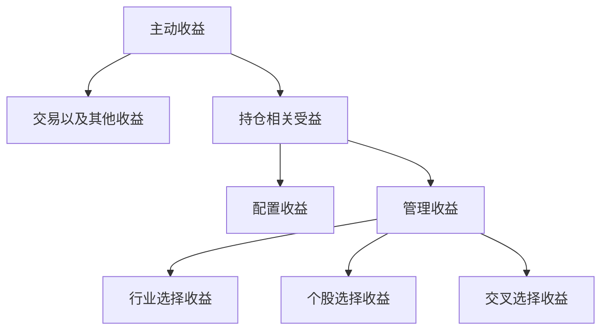
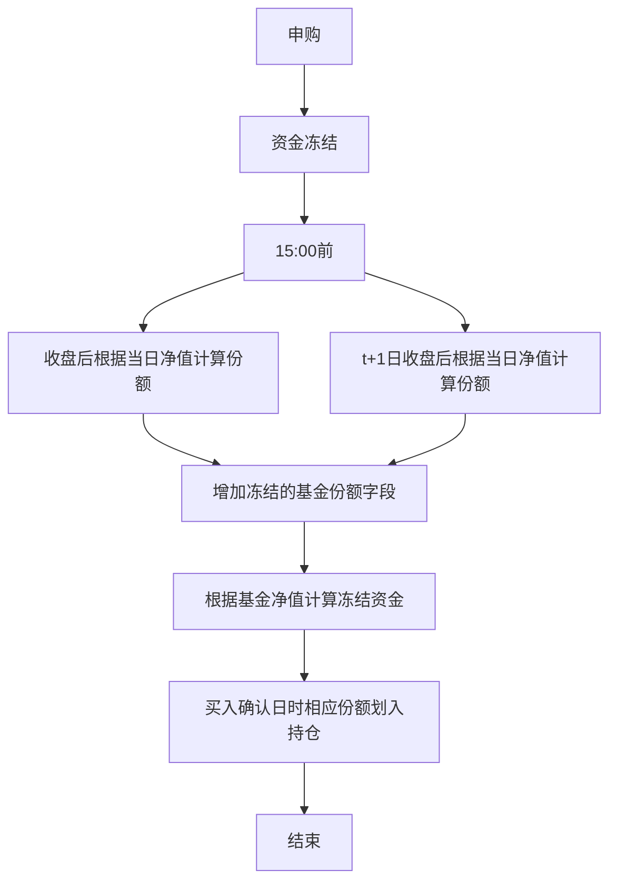
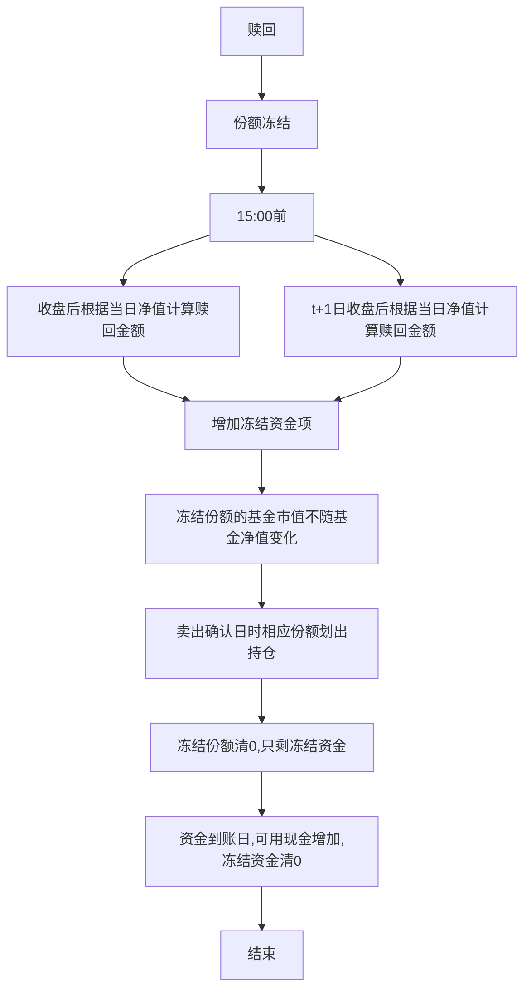
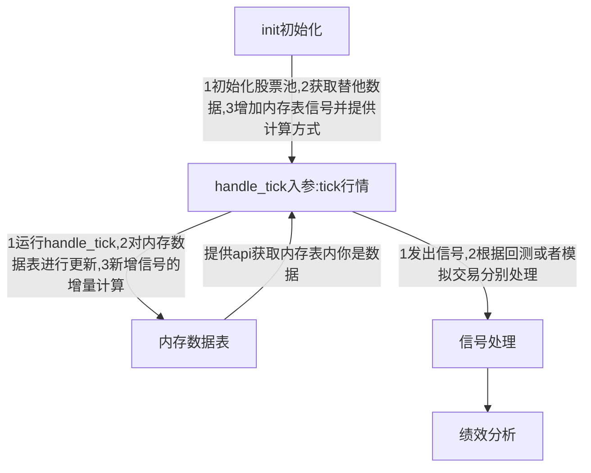

# SuperMind回测引擎


## 股票回测引擎
### 编写股票交易策略

1.导航栏中，依次点击"我的策略"—"策略研究"
2.新建股票策略,点击进入策略编辑页面，如下图

<div align="center">
 
 </div>

3.左侧编译环境内使用python语言实现策略逻辑

- 交易股票：600519.SH(贵州茅台)
- 买入条件：5日均线上穿20日均线
- 卖出条件：5日均线下穿20日均线

<div align="center">
 
 </div>

4.右侧选择回测时间区间，并进行回测

<div align="center">
 
 </div>

+ 策略源码：

```python
#初始化账户
def init(context):
    g.index='600519.SH'

def handle_bar(context,bar_dict):
    close = history(g.index, ['close'], 20, '1d', False, fq = 'pre', is\_panel=0)
    MA5 = close['close'].values[-5:].mean()
    #计算二十日均线价格
    MA20 = close['close'].values.mean()
    #如果五日均线大于二十日均线
    if MA5 > MA20:
        #使用所有现金买入证券
        order_target_percent(g.index,1)
        #记录本次买入
        log.info("全仓买入{0}".format(g.index))
    #如果五日均线小于二十日均线
    if MA5 < MA20 :
        #卖出所有证券
        order_target_percent(g.index,0)
        #记录本次卖出
        log.info("全仓卖出{0}".format(g.index))
```

---

### 回测环境

* 回测引擎运行在Python3.8之上, 请您使用Python3.8来实现策略逻辑
* 我们支持所有的Python标准库和部分常用第三方库, 具体请看: [Python库](http://quant.10jqka.com.cn/platform/html/help-api.html?t=-9#691/702 "Python库 ")
* 同时，我们也支持自定义Python库，只需将您的.py文件存放于“我的研究”根目录, 即可在回测中直接调用, 具体说明请参见常见问题-[如何调用自定义Python库？](http://quant.10jqka.com.cn/platform/html/help-api.html?t=0#1/203 "如何调用自定义Python库？")
* 支持代码调试功能，具体请看：[代码调试](http://quant.10jqka.com.cn/platform/html/help-api.html?t=-9#691/745 "代码调试")

---

### 编译运行

1.您的策略必须在init()和handle_bar()函数框架下实现:

* init为初始化函数，用于初始一些全局变量，在整个回测过程最开始执行一次。
* handle_bar为时间驱动函数，用于设置买卖条件等，每个回测时间频率（每日/分钟）调用一次。

2.完成策略编写后，选定回测开始日期和结束日期，选择初始资金、运行频率(每日或每分钟)等参数，点击"编译运行"；

<div align="center">
 
 </div>

3.回测引擎根据您选择的运行频率调用handle\\\_bar函数，也就是执行该函数下的代码。回测引擎会实时显示策略当前时间的数据，如收益、风险指标、持仓等信息


4.回测引擎会根据您所使用的下单方式进行下单，并根据后续实际成交情况进行订单处理；

5.您可以在任何时候调用log.info函数来打印需要输出的日志；通过record函数输出自定义图形。


* 添加log.info函数与record函数后的代码如下：
* 添加log.info函数与record函数后的代码如下：

```python
#初始化账户
def init(context):
    g.index='600519.SH'

def handle_bar(context,bar_dict):
    close = history(g.index, ['close'], 20, '1d', False, fq = 'pre', is_panel=0)
    MA5 = close['close'].values[-5:].mean()
    #计算二十日均线价格
    MA20 = close['close'].values.mean()
    #设置交易信号
    trade_signal=0
    #如果五日均线大于二十日均线
    if MA5 > MA20:
        #使用所有现金买入证券
        order_target_percent(g.index,1)
        #记录本次买入
        log.info("全仓买入{0}".format(g.index))
        #记录买入信号
        trade_signal=1
    #如果五日均线小于二十日均线
    if MA5 < MA20 :
        #卖出所有证券
        order_target_percent(g.index,0)
        #记录本次卖出
        log.info("全仓卖出{0}".format(g.index))
        #记录卖出信号
        trade_signal=-1

    log.info(trade_signal)
    record(trade_signal=trade_signal)
```

### 策略回测

* 如果策略能成功完成编译运行，则说明策略代码在指定历史区间是可运行的。
* 一般而言，策略回测是将可运行的策略代码进行历史区间回测，并获取策略回测详情报告：交易明细、历史持仓、收益&风险指标分析、组合归因等。
  * 步骤1.将可运行的策略代码，点击"开始回测"
    
  * 步骤2.在策略详情页面，查看收益概况、交易明细、历史持仓及相关分析结果，如下图：
    

### 模拟交易

* 顺利完成回测的策略，在回测详情页面，点击"开启模拟交易"，即绑定模拟交易\\\~ 

### 数据

SuperMind提供海量优质的金融数据，以便您能实现策略逻辑

* 股票数据、指数数据、基金数据、行情数据、财务数据、因子数据、行业数据、概念数据、商品期货数据、股指期货数据、外汇数据等等
* 数据提取——[详见股票API文档](http://quant.10jqka.com.cn/platform/html/help-api.html?t=-2#541/0 "详见股票API文档")
* 数据详情查看——[详见数据文档](http://quant.10jqka.com.cn/platform/html/help-api.html?t=-1#3/0 "详见数据文档")

### 运行频率

* 在"开始回测"左侧选择运行频率参数，参数分"每日"和"分钟"两种。
* 选择"每日"，则系统按"日回测"进行回测，即每个交易日09:30运行一次
* 选择"分钟"，则系统按"分钟回测"进行回测，即每个交易日内每分钟都会运行一次

### 运行时间

---

1.开盘前(9:00)运行：
　　before_trading函数
2.盘中运行：
　　handle_bar函数
　　　>日回测9:31:00运行一次，配置enable_open_bar后于9:30:00运行
　　　>分钟回测9:31:00-11:30,13:01:00-15:00:00，每分钟运行一次，配置enable_open_bar后于9:30:00增加一次运行
　　　>tick回测9:30:03-11:30,13:00:03-15:00:00，每3秒钟运行一次
3.收盘后(15:30)运行：
　　after_trading函数

### 佣金与印花税

---

* 券商佣金默认值为万分之二点五，即0.025%，最少5元，双边收费；
* 印花税默认值为千分之一，即0.1%，卖出时收费；
* 您还可以通过[set_commission](http://quant.10jqka.com.cn/platform/html/help-api.html?t=-2#541/557 "set_commission")来设置具体的手续费参数。

### 滑点

---

**在实战交易中，往往最终成交价和预期价格有一定偏差，因此我们提供两种滑点模式来帮助您更好地模拟真实市场的表现：**

* 设置固定滑点，即最终成交价和委托价之差为固定值。
* 设置可变滑点，即最终成交价和预期价格之比为固定百分比。默认为可变滑点0.2%，即买入成交价为委托价上浮0.1%，卖出成交价为委托价下调0.1%。
* 默认无滑点，不过您可通过[set_slippage](http://quant.10jqka.com.cn/platform/html/help-api.html?t=-2#541/557 "set\_slippage")函数来设置回测具体的滑点参数。

### 拆分合并与分红

---5

当股票发生拆分，合并或者分红时，股价会出现跳空缺口，为了消除这种价格变化对回测结果的影响，我们会根据个股除权除息信息对账户中的现金或持股数量进行相应的调整修正，并自动更新到您的context信息中。
**为了使回测结果更加准确，更加贴近实盘场景，我们做了如下处理：**

* 回测所用价格数据与下单所用价格数据是独立的。即在回测过程中，您可采用前复权/不复权或后复权价格来计算交易下单信号，回测引擎均采用真实价格（即不复权价格）下单；
* 回测引擎会在除权除息当日，调用before_trading_start函数之前，自动处理并更新您的账户信息。
* 前复权数据采用动态复权模式，即在回测过程中，轮循至某个股除权除息日，则按除权后价格对之前的价格数据进行调整。

### 订单处理

---

对于您在某个单位时间下的单，我们会做如下处理：

**1.按天回测**

　A.**交易价格：**
　>市价单：开盘价+滑点。
　>限价单：委托价。
　B.**最大成交量:**
　>默认为下单当日总成交量的25%，该比例可通过市场参与度函数[set_volume_limit](http://quant.10jqka.com.cn/platform/html/help-api.html?t=-2#541/557 "set_volume_limit")进行调整。
　>若下单量低于最大成交量，则按下单量成交；若下单量大于最大成交量，则按最大成交量成交。
　**C.撮合方式：**
　>市价单：开盘下单，一次性撮合，不成交或未成交部分不再撮合。
　>限价单：开盘下单，一次性撮合，不成交或未成交部分不再撮合。

**2.分钟回测**

　A.**交易价格：**
　>市价单：当前分钟起始价+滑点
　>限价单：委托价
　B.**最大成交量：**
　>默认为下单当前分钟总成交量的25%，该比例可通过市场参与度函数[set_volume_limit](http://quant.10jqka.com.cn/platform/html/help-api.html?t=-2#541/557 "set_volume_limit")进行调整。
　>若下单量低于最大成交量，则按下单量成交；若下单量大于最大成交量，则按最大成交量成交。
　C.**撮合方式：**
　>市价单：分钟起始点下单，一次性撮合，不成交或未成交部分即刻取消委托。
　>限价单：分钟起始点下单，之后每分钟均按分钟价量撮合一次，未成交部分顺延至下一分钟进行撮合，直到完全成交或者当天收盘为止。

**3.注意：**

```tips
1.一天结束后, 所有未完成的订单会被取消。 
2.每次订单完成(完全成交)或者取消后,我们会根据成交量计算交易费(参见set_commission), 减少您的现金。
```

### TICK级别回测

当前tick级别的回测仅能在研究环境中进行，[http://quant.10jqka.com.cn/view/study-research.html](http://quant.10jqka.com.cn/view/study-research.html)

示例代码：

```python
source_code="""
# 股票策略模版
def init(context):
    subscribe('000001.SZ')
  
## 开盘时运行函数
def handle_tick(context, tick):
    print(tick.b1, tick.b1_v)
"""

research_strategy(source_code, start_date='20210601', end_date='20210815', capital_base=float(10000000), frequency='TICK', stock_market='STOCK', benchmark=None)

```

### 股票期货混合策略

* 如果您的策略不仅有股票交易，而且还有商品期货和股指期货的交易，有关期货部分的回测引擎介绍，请查看[期货回测引擎](http://quant.10jqka.com.cn/platform/html/help-api.html?t=-9#686/0)

### 风险模型

* 风险模型主要提供证券的风险预测与业绩归因的作用。在此过程中，风险模型需要对股票收益建立因子模型，对组合过去历史的收益来源进行归因，依据统计方法和经验对股票未来风险形成推断与预测。对风险的度量要满足灵活性，准确性等要求。风险模型使用标准差来度量风险，且统计特征清晰，随时间变化稳定。对风险的预测有很多种方式，SuperMind风险模型建立在多因子模型的基础上,认为股票收益率与多个因子之间存在线性的关系，即：

```
r=α+βf+μ 
其中：
- r为股票收益率向量，
- β为因子暴露，
- μ为特质收益，
- f为因子收益率 
当股票特质收益率与公共因子不相关时，组合预期风险可以分解为公共因子解释的风险及特质风险： wΣw′=wβΩβ′w′+wΔw′ 
其中：
- w为组合成份股权重
- Ω为因子收益率的协方差矩阵
- Δ为股票的特质风险矩阵
我们假设股票的特质风险之间也互不相关，所以Δ是一个对角矩阵
```

- 风险模型当中的因子主要包括两个部分，风格因子与行业因子：

> 行业因子：中信一级行业分类
> 风格因子：市值，Beta，动量，估值，盈利，成长，杠杆，波动，非线性市值，流动性
>
> 风险模型数据提取函数详见：[get_stylefactor](http://quant.10jqka.com.cn/platform/html/help-api.html?t=-2#541/743 "get_stylefactor")

### 组合优化器

**组合优化器函数查询**:[OptimizePort，opt.add_constraint](http://quant.10jqka.com.cn/platform/html/help-api.html?t=-2#541/751 "OptimizePort，opt.add\_constraint")

**优化方式**
组合优化器优化方式暂定为三种：最大化夏普比（MVO）、最大化信息比率、效用最大化（剔除成本影响）优化方式后期持续增加，例如L-B模型、风险平价模型等常用的资产配置模型。

* MVO算法
  公式：

$$
target=\frac{R * W}{W^{\prime} \sum W}
$$

使用最优化算法求解，使target最大。R为一系列个股预期收益值[r1,r2,...rn]，n为股票数量，为函数输入参数项，可以选择使用历史平均收益作为预期收益，需输入股票代码。W为各个股票的权重，为优化器所要计算的未知量[w1,w2,...wn]，n为股票数量。∑为个股协方差矩阵（nXn），使用个股历史涨跌幅计算，取数范围为前120个周期，例如日频数据，则选取前120个交易日的涨跌幅，如为周频，则使用日频数据进行转换。

* 最大化信息比率
  公式：

$$
target=\frac{R * W}{(\mathrm{~W}-\mathrm{Wb})^{\prime} \sum(\mathrm{W}-\mathrm{Wb})}
$$

使用最优化算法求解，使target最大。R,W,∑定义同1.1.1中描述。Wb为个股在所选基准中所占的权重，为[wb1,wb2,...wbn]，n为股票数量，当个股没有在基准中时，wb为0。基准可自由选择，作为函数输入项，默认为中证500。

* 效用最大化
  公式：

$$
\text { target }={\sum_{i=1}^n r_i * w_i}-{\gamma * W^{\prime} \sum W}-{\lambda \sum_{i=1}^n\left|w_{i, t}-w_{i, t-1}\right|}
$$

使用最优化算法求解，使target最大。R,W,∑定义同1.1中描述。γ 为风险厌恶系数，函数输入参数项，默认为0.5。λ为交易成本，函数输入参数项，默认为0。Wi，t-1 为股票初始权重，可自定义输入，也可选择初始权重都为0。

**约束条件**
目前暂定七个约束条件：换手率、跟踪误差、组合风险、个股权重、风格因子主动暴露、行业因子主动暴露、行业中性。

* 换手率约束
  约束条件：

$$
\text { downlimit } \leq \mathrm{W^{\prime}} \sum \mathrm{W} \leq \text { uplimit }
$$

Wi，t 为函数求解值，个股优化后的权重；Wi，t-1 为股票初始权重，可自定义输入，也可选择初始权重都为0。Uplimit为输入的换手率限制值，不可小于0，最大值为100（默认单位%）。

* 跟踪误差
  约束条件：

$$
\text { downlimit } \leq(\mathrm{W}-\mathrm{Wb}){ }^{\prime} \sum(\mathrm{W}-\mathrm{Wb}) \leq \text { uplimit }
$$

W和Wb为组合中的股票和基准中的股票做并集后的权重向量。

例如组合中有股票A,B,C，基准包含的股票为A,B,D，则W和Wb两个向量都有四个元素[WA,WB,WC,WD]和[WbA,WbB,WbC,WbD]，且WD和WbC 为0。[WA,WB,WC]为组合中股票的权重，为优化器所要求解的未知量[w1,w2,...wn]，n为股票数量。∑为个股协方差矩阵（nXn），n为组合和基准股票的并集，算法同1.1.1中描述。基准可自由选择，作为函数输入项，默认为中证500。Downlimt和uplimit作为输入的跟踪误差上下限，downlimt不可小于0。

* 组合风险
  约束条件：

$$
\text { downlimit } \leq \mathrm{W^{\prime}} \sum \mathrm{W} \leq \text { uplimit }
$$

W为各个股票的权重，为优化器所要求解的未知量[w1,w2,...wn]，n为股票数量。∑为个股协方差矩阵（nXn），计算同1.1中描述。Downlimt和uplimit作为输入的组合风险上下限，downlimt不可小于0。

* 个股权重
  约束条件：

$$
\text { downlimit } \leq w_{i, t} \leq \text { uplimit } \quad \text { and } \sum_{i=1}^n \mid w_{i, t}=1
$$

可针对每个股票做单独的权重约束，downlimt和uplimt为所对应股票的权重上下限，可自由输入。函数输入项包含个股代码及所要约束的上下限值，输入的股票数量0<=w<=n（优化目标中所输入的股票总数）。每个股票需在优化目标中输入的股票列表中，否则报错。为内置权重约束，所有股票的权重值加起来等于1。

* 风格因子主动暴露度
  约束条件：

$$
\text { downlimit } \leq X_{\text {style }} \bullet W \leq \text { uplimit }
$$

Downlimt和uplimit为自定义输入的某个因子的暴露度约束上下限，输入方式为因子名称、下限值、上限值。当前共有十个风格因子，如需针对全部因子做限制，则需要输入十个相对应的风格因子暴露度上下限值。Xstyle 为个股对该风格因子的暴露度，为[x1 style1，x2style1,...xnstyle1]该数据由风险模型模块计算得出（目前易源博每日会更新该数据）。W为各个股票的权重，为优化器所要求解的未知量[w1,w2,...wn]。

* 行业因子主动暴露度
  约束条件：

$$
\text { downlimit } \leq X_{\text {industry }} \bullet {(W-Wb)} \leq \text { uplimit }
$$

Downlimt和uplimit为自定义输入的某个行业因子的暴露度约束上下限，输入方式为行业因子名称、下限值、上限值。当前共有29个行业因子（中信一级），如需针对全部因子做限制，则需要输入29个相对应的行业因子暴露度上下限值。Xindustry 为个股对该行业的暴露度（即该个股是否属于该行业，属于为1，不属于为0）。W为各个股票的权重，为优化器所要求解的未知量[w1,w2,...wn]。 Windustry为该行业在基准中所占的权重，不是矩阵，为数值。

* 行业中性
  约束条件：

$$
X_{\text {industry }} \bullet W = W_{\text{industry}}
$$

X_industry 为个股对该行业的暴露度（即该个股是否属于该行业，属于为1，不属于为0）。W为各个股票的权重，为优化器所要求解的未知量[w1,w2,...wn]。
W_industry为该行业在基准中所占的权重，不是矩阵，为数值。

### 绩效分析

- 什么是绩效分析？

绩效分析是对资产组合进行分析，将其回报和风险归到提前设定的可能的原因上。目前该功能可实现对股票型策略进行收益及风险拆分，主要分为Brinson分析和风格分析。
我们首先会对每一期的持仓表进行单期归因，然后将多期的结果使用进行累计。下面我们会介绍单期归因的算法和累计归因所得到的结果。

- 如何使用绩效分析

策略成功回测后，在回测详情页面点击绩效分析功能，如下图：


### 组合归因详解

#### Brinson组合归因

Brinson 是目前最为人知的归因方案。除了需要组合持仓内容之外，还设定一个基准。最初的brinson模型是把收益拆解为行业选择收益、个股选择收益和交叉收益，我们在传统模型基础上做了进一步的扩展，拆分出配置收益和交易收益。

- 多期brinson收益分解




该策略主动收益为**105.53%**，交易及其他收益为 **-5.01%**，反映了管理人盘中买卖点选择以及其他资产带来的收益的;持仓相关收益为 **110.54%**，反映的是在股票持合中，用股票收盘价计算得到的持仓收益，配置收益为 **-14.19%**，主要是由产品的股票仓位和基准的股票仓位差异带来的，反映的是投资经理的仓位管理能力。管理收益为**12472%**，它反映的是不考虑合位的情况下，投资经理在股票内部的营理能力，其中，行业洗择收益为**78.77%**、个股选择收益为**4.94%**、交又收益为**41.01%**.

> 对于各个拆分收益的计算如下：


| 指标名称     |                                                                 指标计算                                                                 | 指标和计算解释                                                                                                       |
| ------------ | :--------------------------------------------------------------------------------------------------------------------------------------: | -------------------------------------------------------------------------------------------------------------------- |
| 主动收益     |                                        $R^p-R^b\\其中，R^p来源于净值计算，R^b来源于基准持仓计算$                                        | $R^p为组合的真实收益；R^b为基准的真实收益,\\这里我们假设基准的持仓是完全已知的，因此可以用个股的加权收益代替$        |
| 持仓收益     | $W^{p^T}*r^p-R^b\\其中，W_p同上，r^p=\begin{bmatrix}r_{1}^{p}\\...\\r_{n}^{p}\end{bmatrix},为组合持仓个股的收益。注意：权重比收益早一期$ | $表示由持仓信息计算得到的主动收益$                                                                                   |
| 交易收益     |                                                            $R^p-W^{p^T}*r^p$                                                            | $由真实收益与持仓收益相减得到，是不可观察到的$                                                                       |
| 仓位配置收益 |                                         $(w^p-w^b)R^b/w^b=(\sum w_i^p-\sum w_i^b)R^b/\sum w_i^b$                                         | $其中，wp表示组合仓位，由个股仓位加总得到；w^b表示基准仓位，由成分股仓位加总得到。\\如果基准是某一个股票指数，w^b=1$ |
| 行业选择收益 |                                           $w^p\sum(\frac{w_j^p}{w^p}-\frac{w_j^b}{w^b})r_j^b$                                           |                                                                                                                      |
| 个股选择收益 |                                                 $w^p\sum(r_j^p-r_j^b)\frac{w_j^b}{w^b}$                                                 |                                                                                                                      |
| 交叉收益     |                                       $w^p\sum(r_j^p-r_j^b)(\frac{w_j^p}{w^p}-\frac{w_j^b}{w^b})$                                       |                                                                                                                      |
| 管理收益     |                                                   $行业配置收益+个股选择收益+交叉收益$                                                   |                                                                                                                      |

上述指标的计算只针对单期的brinson拆解，为了分析策略在一个周期里的收益归类，我们使用Carino简化因子调整。

> Carino简化因子的计算方式如下：

$$
k_t=\left\{\begin{matrix}{\frac{ln(1+r_t)-ln(1+b_t)}{r_t-b_t}},&r_t-b_t
\\
\frac{1}{1+r_t},&r_t\neq b_t\end{matrix}\right.
$$

$$
k=\left\{\begin{matrix}{\frac{ln(1+r)-ln(1+b)}{r-b}},&r-b
 \\
\frac{1}{1+r},&r\neq b\end{matrix}\right.
$$

Rt，bt为t期策略和基准的收益率；r，b为区间内策略和基准收益率。

> 使用简化因子对多期收益分解进行加和：

$$
k *(r-b)=\sum_{t=1}^{m}k_t*(r_t-b_t)
$$

$$
r-b=\sum_{t}^{m}\frac{k_t}{k}*A_t+\sum_{t}^{m}\frac{k_t}{k}*S_t+\sum_{t}^{m}\frac{k_t}{k}*I_t
$$

At，St，It为t期收益的分解项。

- 行业绩效归因拆解

把收益按行业拆分，查看每个策略在每个行业是否带来了主动收益。图中主动收益展示的也是多期的收益率，通过Carino因子进行调整。主动风险计算的是多期主动风险的方差，衡量多期主动收益的稳定性。主动权重是统计整个回测区间内各行业主动权重的均值。


#### 风格分析

- 基于风格因子的归因是一种更为精细的归因方式。我们使用同花顺内部准备好的一系列风格因子及因子收益率，将组合的回报和风险分别划分到这些因子上，从而得到组合的投资风格。当前包含的风格因子有：


| 风格因子代码          | 因子名称   | 含义                                   | 备注                                                                                     |
| --------------------- | ---------- | -------------------------------------- | ---------------------------------------------------------------------------------------- |
| beta                  | beta       | 上市公司与指数之间的协同性             | 个股的Beta值，指数收益使用HS300                                                          |
| bp                    | 估值       | 记账价值和市值的比值                   | 市净率=总市值/归属于母公司所有者权益合计                                                 |
| earnings\\\_yield     | 盈利       | 分析师预测与过去财年收益统计           |                                                                                          |
| growth                | 成长       | 由销售额及盈利统计。                   |                                                                                          |
| leverage              | 杠杆       | 上市公司的使用杠杆的情况。             |                                                                                          |
| liquidity             | 流动性     | 由交易量和频率不同而带来的收益         |                                                                                          |
| momentum              | 动量       | 能量性指标，表示相对强度               | 从过去某一天开始，向过去再推504天，计算其每天的超额收益对数值，再针对这504天进行加权平均 |
| non\\\_linear\\\_size | 非线性市值 | 上市公司的规模处于中等的程度           |                                                                                          |
| size                  | 市值       | 上市公司的规模，即该公司是大盘股的程度 | 对数市值                                                                                 |
| volatility            | 波动率     | 对大盘偏离的不确定性                   |                                                                                          |

- 风格归因效果图：
  
  其中主动收益是多期的收益率，通过Carino因子进行调整。主动风险计算的是多期主动风险的方差，衡量多期主动收益的稳定性。
- 策略和基准风格对比图：
  衡量回测期内策略整体风格和基准的差异，点击特定的风格因子柱状图可查看策略及基准的历史风格变化，如下图：
   组合风格稳定性：
  

> 选取策略组合在回测期间的四个界面查看其当期的主动收益、主动风险及主动暴露度。相关的计算公式如下：


| 指标名称 |                                                                                                                                                                       指标计算                                                                                                                                                                       | 指标和计算解释                                                                                                                                                                                                |
| -------- | :--------------------------------------------------------------------------------------------------------------------------------------------------------------------------------------------------------------------------------------------------------------------------------------------------------------------------------------------------: | ------------------------------------------------------------------------------------------------------------------------------------------------------------------------------------------------------------- |
| 风格权重 |                                                                         $factorweight=X*W^p，\\其中, X=\begin{bmatrix}x_{1,1} & ... & x_{n,1}\\... & ... & ... \\x_{1,10} & ... & x_{n,10} \\\end{bmatrix},W^p=\begin{bmatrix}W_1^p \\... \\W_n^p\end{bmatrix}，n为个股数量$                                                                         | $x_i,j：第i个股票在第j个风格上的暴露，j=1,2,...10; \\wi:第i个股票在组合中的权重“*”为向量乘法$                                                                                                               |
| 风格收益 |                                                                                                                         $factor \ return=factor \ weight \bullet F\\其中，F=\begin{bmatrix}f_1 \\... \\f_{10}\end{bmatrix} $                                                                                                                         | $f_j:第j个风格的收益率，j=1,2,...10, “\bullet"表示点乘$                                                                                                                                                      |
| 风格收益 |                                            $specific \ return=\begin{bmatrix}w_1^p & ... & w_n^p\\\end{bmatrix}*\begin{bmatrix}\varepsilon _1^p \\... \\\varepsilon _n^p\end{bmatrix}={w^p}^T*\varepsilon ^p\\其中，\varepsilon^p=\begin{bmatrix}\varepsilon _1^p \\... \\\varepsilon _n^p\end{bmatrix}$                                            | ${W^p}^T为W^P的转置向量；\varepsilon_i^p为组合第i个股票的特质收益率$                                                                                                                                          |
| 风格风险 |                                                                           $factor \ risk=\frac{factor \  weight \bullet (\Lambda_f*factor \ weight)}{\sqrt{{W^p}^T*\Lambda_s*W^p}}\\specific \ risk=\frac{{W^p}^T*\Lambda_\varepsilon*W^p}{\sqrt{{W^p}^T*\Lambda_s*W^p}}$                                                                           | $\Lambda_f:因子收益率的协方差矩阵，取过去120个交易日计算；\\\Lambda_\varepsilon:组合持仓个股特质收益率的协方差矩阵，取过去120个交易日计算；\\\Lambda_s:组合持仓个股收益率的协方差矩阵，取过去120个交易日计算$ |
| 主动权重 |                                                                                                                        $active \ weight=X*(W^p-W^b),\\其中，W^b=\begin{bmatrix}W_1^b \\... \\W_n^b\end{bmatrix}，n为个股数量$                                                                                                                        | $仅计算风格因子$                                                                                                                                                                                              |
| 主动收益 |                                                                                                                                                 $active \ factor \ return=active \ weight \bullet F$                                                                                                                                                 | $风格因子的主动权重*风格因子收益率$                                                                                                                                                                           |
| 主动收益 |                $active \ specific\ return= \begin{bmatrix}W_1^p & ... & W_n^p\\\end{bmatrix}*\begin{bmatrix}\varepsilon _1^p\\...\\\varepsilon _n^p\end{bmatrix}-\begin{bmatrix}W_1^b & ... & W_n^b\\\end{bmatrix}*\begin{bmatrix}\varepsilon _1^b\\...\\\varepsilon _n^b\end{bmatrix}={w^p}^T*\varepsilon ^p-{w^b}^T*\varepsilon ^b$                | $组合的特质收益-基准的特质收益$                                                                                                                                                                               |
| 主动风险 | $active factor risk =\frac{\text { active weight } \cdot\left(\Lambda_f * \text { active weight }\right)}{\sqrt{\left(W^p-W^b\right)^T * \Lambda_{a s} *\left(W^p-W^b\right)}}\\active specificrisk=\frac{\left(W^p-W^b\right)^T * \Lambda_{a \epsilon} *\left(W^p-W^b\right)}{\sqrt{\left(W^p-W^b\right)^T * \Lambda_{a s} *\left(W^p-W^b\right)}}$ | $\Lambda_{a s}:组合持仓个股与基准持仓个股取并集后的协方差矩阵，取过去120个交易日计算\\\Lambda_{a \epsilon}:组合持仓个股与基准持仓个股取并集后的特质收益率协方差矩阵，取过去120个交易日计算$                   |

### 收益&风险指标

##### 策略收益率—Returns

- **释义:** 策略在回测区间内的收益率
- **算法:**

$$
Returns=(\frac{P_{end}-P_{start}}{P_{start}})*100%
$$

- **说明:**

$$
P_{start}为回测开始时策略账户总资产\\
P_{end}为回测结束时策略账户总资产
$$

##### 策略年化收益率—Annualized Returns

- **释义:** 策略在回测区间内的复合年化收益率
- **算法:**

$$
Annualized \ Returns=[(1+R)^{\frac{250}{n}}-1]*100\%
$$

- **说明:**

$$
R为策略收益率\\
n为回测区间交易日数量
$$

##### 基准收益率—Benchmark Returns

* **释义:** 基准在回测区间的收益率，默认基准为沪深300指数，可通过set\\\_benchmark函数进行自定义修改。

- **算法:**

$$
Benchmark \ Returns=(\frac{M_{end}-M_{start}}{M_{start}})*100\%
$$

- **说明:**

$$
M_{start}为回测开始时基准价值\\
M_{end}为回测结束时基准价值\\
(基准默认为沪深300指数，可通过set_benchmark函数进行自定义修改）
$$

##### 基准年化收益率—Annualized Benchmark Returns

* **释义:** 基准在回测区间内的复合年化收益率
* **算法:**

$$
Annualized \ Benchmark \ Returns=[(1+R_b)^\frac{250}{n}-1]*100\%
$$

* **说明:**R_b为基准收益率\\n为回测区间交易日数量

Rb为基准收益率n为回测区间交易日数量##### 超额收益率—Excess Return

* **释义:** 策略相对基准的超额收益率
* **算法:**

$$
超额收益=\frac{1+策略收益}{1+基准收益}-1
$$

##### 非系统性风险—Alpha

- **释义:** 表示策略收益中和市场无关的部分，用于衡量投资中面临的非系统性风险

Alpha > 0 表示策略表现优于基准表现 Alpha = 0 表示策略表现与基准表现相当 Alpha < 0 表示策略表现差于基准表现

* **算法:**

$$
Alpha=R_a-[R_f+\beta*(R_{ba}-R_f)]
$$

* **说明**

$$
R_a策略年化收益率\\
R_{ba}基准年化收益率\\
R_f无风险利率（当日十年期国债利率均值）
$$

##### 系统风险—Beta

* **释义:** 表示策略收益对市场收益波动的敏感程度，用于衡量投资中面临的系统性风险。
* **算法:**

$$
Beta=\frac{Cov(R_p ,R_m)}{Var(R_m)}
$$

- **说明:**

$$
R_p为策略每日收益率\\R_m为基准每日收益率\\Cov()表示协方差\\Var()表示方差
$$

##### 夏普比率—Sharpe

* **释义:** 夏普比率用于度量承受单位风险所获得的超额报酬（相对无风险资产）。 举例而言，假如国债的回报是4%，而您的投资组合预期回报是16%，您的投资组合的标准偏差是6%。那么用16%－4%可以得出12%（代表您超出无风险投资的回报），再用12%÷6%＝2，代表投资者风险每增长1%，换来的是2%的多余收益。
* **算法:**

$$
Sharpe \ Ratio=\frac{R_a-R_f}{\delta_p}
$$

- **说明:**

$$
R_a为策略年化收益率\\R_f无风险利率（当日十年期国债利率均值）\\ \delta_p策略收益波动率
$$

##### 收益波动率—Volatility

* **释义:** 收益波动率，用来测量资产的风险性
* **算法:**

$$
Algorithm \ Volatility=\sigma_p=\sqrt{\frac{250}{n}\sum_{i=1}^{n}(r_p-\bar{r_p})^2}\\r_p=策略每日收益率\\ \bar{r_p}=策略每日收益率的平均值=\frac{1}{n}\sum_{i=1}^{n}r_p\\n=策略执行天数
$$

##### 信息比率—Information Ratio

* **释义:** 信息比率，衡量单位超额风险带来的超额收益（相对基准收益率）。
* **算法:**

$$
Information \ Ratio = \frac{R_p-R_m}{\sigma_{t}}\\R_p=策略年化收益率\\R_m=基准年化收益率\\\sigma_t=策略与基准每日收益率值的年化标准差
$$

##### 最大回撤—Max Drawdown

* **释义:** 最大回撤，描述策略可能出现的最糟糕的情况
* **算法:**

$$
Max \ Drawdown = Max(P_x-P_y)/P_x\\P_x,P_y=策略某日股票和现金的总价值，y>x
$$

##### 索提诺比率—Sortino

* **释义:** 索提诺比率用于度量承担一个单位下行风险获得的超额收益。
* **算法:**

$$
Sortino Ratio=\frac{R_a-R_f}{\delta_{pd}}\\R_a为策略年化收益率\\R_f无风险利率（当日十年期国债利率均值）\\\delta_{pd}策略下行波动率
$$

##### 跟踪误差—Tracking error

* **释义:** 年化跟踪误差:用于衡量策略收益和市场基准收益之间的差异。跟踪误差越大，表明策略所持有投资组合偏离基准组合的程度越大。 【注】该指标适宜评估纯多头策略，不适于评估多空结合的对冲策略。
* **算法:**

$$
Tracking \ Error= \sqrt{\frac{250}{n-1}\sum_{i=1}^{n}(R_a(i)-\bar{R_a})^2}\\R_a(i)=R_p(i)-R_m(i)
$$

* **说明:**

$$
\\n为回测区间内交易日数量\\\bar{R_a}为n日区间内策略日主动收益率均值\\R_a(i)为第i个交易日策略的主动收益率\\R_p(i)为第i个交易日策略的收益率\\R_m(i)为第i个交易日基准的收益率（默认为沪深300指数）
$$

---

##### 下行波动率—Downside Risk

* **释义**年化下行波动率:相比于普通波动率，下行波动率对收益率的波动方向进行了区分，只有当收益率向下波动时才视为风险。 我们以每日基准收益率作为参照标准，若策略日收益率大于基准日收益率，则视为向上波动；反之，则视为向下波动。
* **算法**

$$
Downside \ Risk=\sqrt{\frac{250}{n}\sum_{i=1}^{n}[R_p(i)-R_m(i)^2]*f(i)}\\若R_p(i)<R_m(i),则f(i)=1\\若R_p(i)\geqslant R_m(i),则f(i)=0
$$

* **说明:**

$$
n为回测区间内交易日数量\\R_p(i)为第i个交易日策略的收益率\\R_m(i)为第i个交易日基准的收益率（默认为沪深300指数）
$$

### 调试功能

* 程序能一次写完并正常运行的概率很小，基本不超过1%。总会有各种各样的bug需要修正。有的bug很简单，看看错误信息就知道，有的bug很复杂，我们需要知道出错时，哪些变量的值是正确的，哪些变量的值是错误的，因此，需要一整套调试程序的手段来修复bug。

> 1.简单直接粗暴有效的方式是用print把可能有问题的变量打印出来看看，逐个检查，用print最大的坏处是将来还得删掉它，想想程序里到处都是print，运行结果也会包含很多垃圾信息。
>
> 2.在策略编辑页面，SuperMind提供代码调试功能，你可以采用这套完整的调试程序来修复程序bug

* 如何启动调试程序？

　　在策略编辑器左侧,点击"行号",设置断点后,点击"编译运行"启动调试程序。


* 调试程序简介

> 1.启动调试程序后，代码会自动运行到第一个断点处，如上图，第一个断点是行7，代码当前已运行完行7（行8还未运行）
> 2.调试程序右上角显示的时间是回测系统的运行时间
> 3.调试程序上方菜单栏，从左到右共6个按钮，分别为：恢复执行代码(跳至下一个断点),执行下一步(不运行函数),执行下一步(运行函数),跳出此函数,清空console,结束调试继续编译
> 4.调试程序左侧即为console面板,右侧为监控属性面板
> 5.1分钟内不使用调试程序，则自动关闭调试程序
> 6.调试时，程序无视注释内容

* 菜单栏按钮介绍

> 1.恢复执行代码(跳至下一个断点)：直接运行至下一个断点处
> 2.执行下一步(不运行函数)：运行下一行代码，如果下一行代码调用函数，则直接运行完该函数，接着准备下一行代码
> 3.执行下一步(运行函数)：运行下一行代码，如果下一行代码调用函数，则会进入函数内，执行函数内第一行代码
> 4.跳出此函数:如果当前行处于函数中，则直接运行完该函数
> 5.清空console:清空左侧console面板的所有内容
> 6.结束调试继续编译:关闭调试程序，策略继续编译

* 如何使用console面板？

> 输入变量，“Enter”输出变量值(无法修改参数)
> 变量之间运算，“Enter”输出结果
> 判断变量是否满足条件，“Enter”输出结果 

* 如何监控变量？

> 调试程序右侧监控属性，点击"+添加"，输入变量名，点击“完成”，即可进行监控 
> 监控面板显示当前监控的变量及变量值，继续运行代码 
> 运行代码的过程中，监控面板实时显示监控变量及变量值，便于您进行观察，不需要print打印函数来逐一输出。 

### 对比功能

一般而言，量化策略会存在一个或多个参数，在验证策略逻辑的过程中，宽客们往往会尝试用不同的参数进行回测，比如在2018年，对平安银行采用双均线策略，采用不同周期的两条均线会使策略收益截然不同哦

##### **如何启动回测对比？**

策略回测列表中，选取相应的回测，点击左上角的对比按钮，即可启动


##### **如何使用回测对比？**

* 对比功能，包括：概况、累积收益、回撤、源码。
* 其中概况页面，详细展示了所选回测的回测指标，我们以平安银行双均线策略为例，创建3组参数，分别为（5,20）,(10,55),(20,60)。
  
  * 累积收益页面，详细展示了所选回测的收益走势，可以发现（20,60）参数组的累积收益较高，参数周期越短，交易次数越多，收益反而越差，可能与18年的暴跌行情相关。
    
  * 回撤页面，详细展示了所选回测的回撤情况，可以发现（20,60）参数组的回撤较低，参数周期越短，交易次数越多，回撤反而越大，可能与18年的暴跌行情相关。
    
  * 源码页面，详细展示了所选回测的源码，同时只能选取两个回测进行对比
    

### python库

SuperMind平台支持所有Python的基础库([https://docs.python.org/3.8/library/index.html](https://docs.python.org/3.8/library/index.html "https://docs.python.org/3.8/library/index.html"))，并支持目前流行的第三方库，例如NumPy，pandas，Ta-Lib，scikit-learn等。

为了保障SuperMind平台的安全，以下的python包和功能已被禁用，如有不便敬请见谅:


| 包         | 属性和方法       |
| ---------- | ---------------- |
| os         | \_\_builtins\_\_ |
| sys        | \_\_import\_\_   |
| six        | get_ipython      |
| subprocess | exec             |
| pickle     | eval             |
| socket     |                  |
| ast        |                  |
| IPython    |                  |
| ipykernel  |                  |
| shutil     |                  |
| pathlib    |                  |
| requests   |                  |

## 场外基金回测引擎

### 费率

**申购（认购）费用——前后端收费**
申购（认购）就是在基金成立后的存续期间（认购则是在基金发行时的募集期间），投资者向基金公司购买基金份额的交易行为。在交易过程中，投资者都需要向基金公司支付一定的手续费。这种手续费，称为申购（认购）费用。
申购（认购）费用分为**前端收费**和**后端收费**两种模式。前端收费指的是你在购买开放式基金时就支付申购费的付费方式。后端收费指的则是你在购买开放式基金时并不支付申购费，等到卖出时才支付的付费方式。后端收费的设计目的是为了鼓励你能够长期持有基金，因此，后端收费的费率一般会随着你持有基金时间的增长而递减。某些基金甚至规定如果你能在持有基金超过一定期限后才卖出，后端收费可以完全免除。

- 前端申购费用计算公式：

$$
申购费用=净申购金额 \times 申购费率\times折扣率\\净申购金额=申购金额-申购费用\\根据公式1和2得到：净申购金额=申购金额\div \left ( 1+申购费率\times折扣率 \right)\\申购费用=申购金额\times申购费率\times折扣率\div\left( 1+申购费率\times折扣率 \right )
$$

- 后端申购费用计算公式：

$$
后端申购\div 认购费用=赎回份额\times基金净值\times对应份额后端申购(认购)费率
$$

### 平台折扣

通过不同平台购买基金，折扣率会不同，回测中默认值为0.1，也可以通过函数set\_discount\_rate()函数来自定义设置申购折扣率。

- 各平台费率参考：


| 平台名称   | 折扣率   |
| ---------- | -------- |
| 爱基金     | 0.1      |
| 天天基金网 | 0.1      |
| 好买基金网 | 0.1\~1.0 |

- **注意**：当前所有平台只对前端申购费用进行打折，其他费用不应用折扣率这一参数。

### 赎回费用

赎回就是投资者将持有的基金份额卖给基金公司的交易行为。在交易过程中，投资者需要向基金公司支付一定的手续费，这种手续费，称为赎回费用。

- **赎回费用公式**：赎回费用=赎回份额X基金净值X赎回费率

由于赎回费用会根据持有期的长短进行调整，所以赎回的不同持有期的基金份额使用不同赎回费率，从申购/认购确认日开始计算到当前日（获取净值的日期）的自然日天数。遵循先进先出原则。

例如：3月1日申购了100份，4月1日申购了500份，5月1日赎回200份，则其中100份的持有期从3月1日算为61天，另外100份从4月1日起算为30天。同样，后端申购费率也采用这种机制。

### 管理费用、托管费用、销售服务费用

基金管理费是基金公司，也就是基金管理人的管理报酬，是基金公司的主要收入方式。 基金管理费是按日计提，月底由基金托管人（在我国是托管银行）从基金总资产中一次性支付给基金管理人，不另外向投资人收取。

- **每日应付的基金管理费**＝前一日的基金资产净值X年管理费率/当年天数

比如基金管理费，年费率为1.5%，这一年有365天，某只基金前一日基金资产净值为100亿元，则该日基金管理费计提额=10000000000X1.5%/365=41万。
也就是一只管理资产总额在100亿的基金，年管理费率为1.5%的情况下，一天的管理费在41万。每天计提管理费，月底支付一次。同样，基金托管费，销售服务费也是这样收取的。直接从基金总资产中扣除，每日公布的基金净值是已经扣除了管理费、托管费和销售服务费的。因此，在回测中不在额外对这三项费用进行扣除。

### 认购期

基金首次发售基金份额称为基金募集，在基金募集期内购买基金份额的行为称为基金的认购，一般认购期最长为一个月。而投资者在募集期结束后，申请购买基金份额的行为通常叫做基金的申购。在基金募集期内认购，一般会享受一定的费率优惠。

### 封闭期

开放式基金的封闭期是指基金成功募集足够资金宣告基金合同生效后，会有一段不接受投资人申购及赎回基金份额申请的时间段。设定封闭期一方面是为了方便基金的后台(登记注册中心)为日后申购、赎回做好最充分的准备；另一方面基金管理人可将募集来的资金根据证券市场状况完成初步的投资安排。根据《证券投资基金运作管理办法》规定，基金封闭期不得超过3个月。

### 申购期

基金募集期结束并成立后，再经过一段时间的封闭期，投资者就可以根据基金销售网点规定的手续购买/赎回基金份额，这一交易状态开放时间称为申购期。此时由于基金净值已经反映了其投资组合的价值，因此每单位基金份额净值不一定为1元，可能高于也可能低于1元，故同一笔资产认购和申购同一基金所得到的基金份额数将有可能不同。同时，多数基金销售网点对基金申购费用都有一定的折扣（前端申购费）。

### 申购份额/赎回金额计算

- **申购份额计算**：

$$
净申购金额=申购金额\div\left(1+申购费率\times折扣率\right)\\申购份额=净申购金额\div基金净值
$$

- **赎回金额计算**：

赎回金额=赎回份额X基金净值-后端申购/认购费用-赎回费用
后端申购/认购费用=赎回份额X基金净值X对应份额后端申购（认购）费率
赎回费用=赎回份额X基金净值X赎回费率
其中基金净值对应的值按一下规则获取：
15：00前申购/赎回的，获取当日净值
15：00后申购/赎回的，获取下一交易日净值

### 申购份额/赎回金额确认机制

基金的购买时间是指基金申购交易当天；基金的确认时间：是指基金申购之后基金公司系统受理，一般是T+1天确认，不过具体时间还要根据基金公司公布的确认制度来确定。
基金规定交易日当天15点前交易，属于当天申购，按当天的基金净值确认份额，超过15点算下一个交易日。
比如你星期五晚上申购一只基金，晚上可以理解为15点以后了，当天收盘价是1元，过了周末，到周一是1.1元，周二是1.2元。那么你的申购的价格是1.1元。但是确认申购成功日是基金规定的T+X的那个X日，比如周五晚上买，按照下周一的净值计算份额，确认日期比如是T+1日，那确认申购成功日期就是下周二，从申购日到确认日资金会被冻结。基金赎回确认机制也和申购机制相同，15点前提交赎回的按当日净值进行计算金额，确认日采用T+N制度，从赎回至确认日赎回的基金份额会冻结。

### 在途份额/资金

申购或赎回基金后，需要N个交易日进行确认，N根据每个基金规定的确认日T+N制度进行确定。用户申购基金后，相应的资金需要进入冻结状态。未到买入确认日，持仓中不显示相应的基金份额，相应的资金金额冻结，可用现金减少。到确认日后，申购的基金份额进入持仓记录中，冻结的资金金额清0。同理，在用户赎回基金份额时，赎回发起时开始冻结相应的份额（可用份额减少），冻结的份额市值将不再随基金的净值进行变动（15:00后赎回的市值按T+1日净值进行确认），同时可用现金部分不增加。回测中可通过Get\_frozen\_asset()函数进行查询当前冻结的资产（基金份额或资产）。

- 申购流程



- 赎回流程



### 基金分红

- **除息日**

除息日又称为“除权日”。在除息日当天，将进行分配的资产收益部分（即分红的资金）从基金资产中扣除，因此当天的净值一般会降低（假设分红当天股市没有涨跌的情况下）。

- **权益登记日**

权益登记日是指登记享有分红权益的基金份额的日期，基金份额持有人在权益登记日持有的基金份额享有利润分配的权利。

- **红利发放日**

基金会在这天从基金托管帐户划出分红资金，将红利派发给在权益登记日前买入基金的投资者。投资者会在当日收到现金分红，相应的投资账户中的可用现金会增多。

- **分红模式**

基金公司进行分红时，通常提供两种分红模式：现金分红及红利再投资。可通过set\_dividend\_mode()函数进行设置。
现金分红方式就是基金公司将基金收益的一部分，以现金派发给基金投资者的一种分红方式。相应的现金部分会在红利发放日到账。
红利再投资方式就是基金投资者将分红所得现金红利再投资该基金，以获得基金份额的一种方式。再投资的基金份额根据除息日的基金净值进行计算：再投资份额=分红总额/除息日基金净值。

### 基金清算

基金清算是指基金遇有合同规定或法定事由终止时对基金财产进行清理处理的善后行为。基金合同终止时，应当按法律法规和本基金契约的有关规定对基金进行清算，基金管理人应当组织清算组对基金财产进行清算。清算组由基金管理人、基金托管人以及相关的中介服务机构组成。清算组作出的清算报告经会计师事务所审计，律师事务所出具法律意见书后，报国务院证券监督管理机构备案并公告。清算后的剩余基金财产，应当按照基金份额持有人所持份额比例进行分配。
回测时按基金到期日的净值作为最后的净资产（和实际情况存在偏差）。

### 【场外基金案例】

```python
def init(context):
    # 设置3个子账户，股票，期货，场外基金初始资金都为100000
    set_subportfolios([{'cash': 100000, 'type': 'fund'}, {'cash': 100000, 'type': 'future'}, {'cash': 100000, 'type': 'stock'}])

    # 设置申购折扣率
    set_discount_rate(0.2)

    # 设置分红模式
    set_dividend_mode('cash')

    # 000717发行日为20141218，封闭期20150114-20150226,申购起始日期20150227，买入赎回确认日为T+1，资金到账确认日T+7
    context.ins = '000717.OF'
    context.day = 1

def handle_bar(context, bar_dict):
    if context.day == 1:
        # 获取当前可交易的所有基金列表
        fund_list = get_available_fund()
        log.info(fund_list, len(fund_list))

        # 第一天下单10000元
        order_id = order_fund(context.ins, 50000)
        log.info('买入', order_id)
    elif context.day == 2:
        # 第二天买入确认
        pass
    elif context.day == 3:
        # 第三天赎回1000份
        order_id = redeem_fund(context.ins, 10000)
        log.info('赎回', order_id)
    elif context.day == 4:
        # 第四天赎回确认
        pass

def after_trading(context):
    context.day += 1
```

### 【月定投案例】

```
#场外基金定投策略
def init(context):
    # 设置3个子账户，股票，期货，场外基金初始资金都为100000
    set_subportfolios([{'cash': 120000, 'type': 'fund'}])
    # 设置申购折扣率
    set_discount_rate(0.2)
    # 设置分红模式
    set_dividend_mode('invest')
    #确定定投标的景顺长城沪深300增强(000311)
    context.ins = '000311.OF'
    #每月月末买入
    run_monthly(trade,date_rule=-1)
def trade(context, bar_dict):
    order_id = order_fund(context.ins, 10000)
    log.info('申购', order_id)
```


## 期货回测引擎

### 编写期货交易策略

* 导航栏中，依次点击"我的策略"—"策略创作"—"策略研究"
* 新建"股票期货"策略,点击进入"策略编辑"页面，如下图
* 左侧编译环境内使用python 3.5 实现策略逻辑

  ```
  交易股票：螺纹钢
  多头开仓：5日线上穿20日线
  多头平仓：价格跌破20日均线
  空头开仓：5日均线下穿20日均线
  空头平仓：价格突破20日均线
  ```
* 右侧选择回测时间区间，并进行回测
* 策略源码：

```python
'''
螺纹钢均线策略
'''
def init(context):
    #设立商品期货账户
    set_subportfolios([{"cash": 0, "type": 'stock'},{"cash": 200000, "type": "future"}])
    #设置需要交易的标的，螺纹钢
    context.ins = 'RB9999'
    #订阅需要交易的期货品种
    subscribe('RB9999')
def handle_bar(context, bar_dict):
    #获取螺纹钢的合约代码
    g.con = get_futures_dominate('RB')
    #获取合约行情数据
    date = get_datetime().strftime('%Y%m%d %H%M')
    if date[-1] == '0' or date[-1] == '5':
        hist1 = get_price_future(g.con,None,date,'1d',['close'],bar_count = 20)
        #计算5日，20日均线
        ma20 = hist1.mean().values
        ma5 = hist1.iloc[-5:].mean().values
        p = hist1.iloc[-1].values
        #获取当前账户的多空单数量
        short_amount = context.portfolio.future_account.positions[context.ins].short_amount
        long_amount = context.portfolio.future_account.positions[context.ins].long_amount

        #判断条件，如果价格突破20日线，且账户存在空单，则平空
        if p > ma20 and short_amount > 0:
           order_future(context.ins, short_amount, 'close', 'short', None)
        #判断条件，如果5日均线突破20日线，且账户没有多单，则开多
        elif ma5 > ma20 and long_amount == 0:
           order_future(context.ins, 15, 'open', 'long', None)
        #判断条件，如果价格突破跌破20日线，且账户存在多单，则平多
        elif p <= ma20 and long_amount > 0:
           order_future(context.ins, long_amount, 'close', 'long', None)
        #判断条件，如果5日均线跌破20日线，且账户没有空单，则开空
        elif ma5 <= ma20 and short_amount == 0:
           order_future(context.ins, 15, 'open', 'short', None)
def after_trading(context):
    #收盘查看账户基本合约持仓情况
    log.info('收盘查看账户基本合约持仓情况')
    log.info(context)
```

### 期货账户

* 期货回测引擎和股票回测引擎都通过创建“股票期货”的策略类型实现
* 如果你想要交易期货品种，你必须要在init初始化函数中，创建期货账户，并设置期货账户初始资金，详见[set\_subportfolios](http://quant.10jqka.com.cn/platform/html/help-api.html?t=-3#587/0 "set_subportfolios")函数

  ```
  def init(context):
    #设置子账户,股票账户0万，期货账户50万.
    set_subportfolios([{'cash':0,'type':'stock'},{'cash':500000,'type':'future'}])
  ```
* 如果你想要同时交易股票和期货品种，你同样必须要在init初始化函数中，创建股票和期货账户，并设置账户初始资金，详见[set\_subportfolios](http://quant.10jqka.com.cn/platform/html/help-api.html?t=-3#587/0 "set_subportfolios")函数

  ```
  def init(context):
    #设置子账户,股票账户50万，期货账户50万.
    set_subportfolios([{'cash':500000,'type':'stock'},{'cash':500000,'type':'future'}])
  ```

  **注意事项**
* **股票和期货账户的资金无法公用**，当股票账户资金为0时，无法使用期货账户的资金买入股票，当期货账户的资金为0或者保证金不足时，无法使用股票账户的资金来充当。
* **股票和期货账户分别储存持仓信息**，您需要针对账户进行查看。
* 不设置期货账户，则无法进行期货品种交易。

### 订阅期货品种

* 商品期货和股指期货策略中您必须订阅相应的期货品种，才能确保回测中获取品种的行情数据，详见[subscribe](http://quant.10jqka.com.cn/platform/html/help-api.html?t=-3#587/0 "subscribe")订阅函数

  **举例**：如果我要写一个螺纹品种交易策略，除了创建期货账户外，还需要订阅螺纹品种

  ```
  def init(context):
    #设立商品期货账户
    set_subportfolios([{"cash": 0, "type": 'stock'},{"cash": 200000, "type": "future"}])
    #订阅需要交易的期货品种
    context.ins = 'RB9999'
    subscribe(context.ins)
  ```
* 订阅函数可以写在init初始函数或handle\_bar函数里.

### 数据

SuperMind提供海量优质的金融数据，以便您能实现策略逻辑

* 股票数据、指数数据、基金数据、行情数据、财务数据、因子数据、行业数据、概念数据、商品期货数据、股指期货数据、外汇数据等等
* 数据提取——[API文档](https://quant.10jqka.com.cn/view/help/4 "API文档")
* 数据详情查看——[数据平台](http://quant.10jqka.com.cn/view/dataplatform "数据平台")

### 运行频率

* 在"开始回测"左侧选择运行频率参数，参数分"每日"和"分钟"两种。
* 选择"每日"，则系统按"日回测"进行回测，即每个交易日开盘时运行一次
* 选择"分钟"，则系统按"分钟回测"进行回测，即每个交易日内每分钟都会运行一次
  ps:商品期货和股指期货的开盘时间并非一致，且各个期货品种的运行时间也不一致，具体详见运行时间

### 运行时间

#### 大连、上海、郑州交易所

* 集合竞价申报时间：08：55—08：59
* 集合竞价撮合时间：08：59—09：00
* 正常开盘交易时间：09：00－11：30 ,13：30－15：00
* 小节休息：10：15－10：30
  **提示：客户下单时间为集合竞价时间和正常交易时间。在8：59—9：00竞价结束时间和交易所小节休息时间（上午10:15-10:30）下单，交易系统将不接受指令，并视之为废单。**

#### 上期所夜盘

* 集合竞价申报时间：20：55—20：59
* 集合竞价撮合时间：20：59—21：00
* 正常开盘交易时间：21：00－02：30 （黄金、白银）
  　　　　　　　　　21：00－01：00 （铜、铝、铅、锌、镍、锡）
  　　　　　　　　　21：00－23：00 （螺纹钢、热轧卷板、石油沥青、天然橡胶）
  **提示：法定节假日的前一日没有夜盘交易**

#### 大商所夜盘

* 集合竞价申报时间：20：55—20：59
* 集合竞价撮合时间：20：59—21：00
* 正常开盘交易时间：21：00—23：30 （豆一、豆二、豆油、豆粕、焦煤、焦炭、棕榈油、铁矿石）
  **提示：法定节假日的前一日没有夜盘交易**

#### 郑商所夜盘

* 集合竞价申报时间：20：55—20：59
* 集合竞价撮合时间：20：59—21：00
* 正常开盘交易时间：21：00－23：30 （白糖、棉花、菜粕、甲醇、PTA、菜籽油、玻璃、动力煤）
  **提示：法定节假日的前一日没有夜盘交易**

#### 中金所

* 股指期货集合竞价时间：9：25—9：30
* 正常开盘交易时间：9：30-11：30；13：00-15：00

#### 注意事项

* **由于各个品种的交易时间不统一，对于多个品种同时回测，取各个品种的交易时间并集进行回测处理**
* **对于行情数据而言，有夜盘的商品期货的夜盘开始时间为下一日行情数据的起始时间， 其中，非交易时间下单无效**
* **部分期货品种没有夜盘**

### 手续费

* 不同品种手续费、计算方式都不同
* 手续费还需要分平仓和平今仓，需分别考虑。
* 对于中金所而言，股指期货当日有开仓，那么当日的平仓则为先平今仓后平历史仓
* 对于商品期货而言，由于只有上期所有平今选项，其他三个商品交易所都遵从先开先平的原则。
* 手续费类型分：按成交量和按成交额两种，同一交易所不同品种的手续费类型也可能不同
* 佣金类型为按成交量，则手续费按元/手收取，如果佣金类型为成交额，则手续费按成交额的百分比收取。回测环境下，你可以通过[set\_commission](http://quant.10jqka.com.cn/platform/html/help-api.html?t=-3#587/596 "set_commission")函数来设置手续费。
* 具体手续费见下表


| 品种(简称)     | 交易所               | 佣金类型 | 回测手续费 | 回测平今仓手续费 |
| -------------- | -------------------- | -------- | ---------- | ---------------- |
| 铝AL           | 上期所               | 按成交量 | 3          | 0                |
| 锡SN           | 上期所               | 按成交量 | 3          | 0                |
| 橡胶RU         | 上期所               | 按成交额 | 0.00045    | 0.00045          |
| 线材WR         | 上期所               | 按成交额 | 0.00004    | 0.00004          |
| 螺纹钢RB       | 上期所               | 按成交额 | 0.000045   | 0                |
| 燃油FU         | 上期所               | 按成交额 | 0.00002    | 0.00002          |
| 金AU           | 上期所               | 按成交量 | 10         | 0                |
| 铜CU           | 上期所               | 按成交额 | 0.000025   | 0                |
| 银AG           | 上期所               | 按成交额 | 0.00005    | 0                |
| 铅PB           | 上期所               | 按成交额 | 0.00004    | 0                |
| 镍NI           | 上期所               | 按成交量 | 6          | 0                |
| 热轧卷板HC     | 上期所               | 按成交额 | 0.00004    | 0                |
| 锌ZN           | 上期所               | 按成交量 | 3          | 0                |
| 沥青BU         | 上期所               | 按成交额 | 0.00005    | 0                |
| 原油SC         | 上海国际能源交易中心 | 按成交量 | 20         | 0                |
| 棕榈油P        | 大商所               | 按成交量 | 2.5        | 0                |
| 细木工板BB     | 大商所               | 按成交额 | 0.0001     | 0.00005          |
| 鸡蛋JD         | 大商所               | 按成交额 | 0.00015    | 0.00015          |
| 焦炭J          | 大商所               | 按成交额 | 0.00006    | 0.00003          |
| 聚乙烯L        | 大商所               | 按成交量 | 2          | 0                |
| 聚丙烯PP       | 大商所               | 按成交额 | 0.00005    | 0.00025          |
| 铁矿石I        | 大商所               | 按成交额 | 0.00006    | 0.00003          |
| 豆粕M          | 大商所               | 按成交量 | 1.5        | 0                |
| 玉米C          | 大商所               | 按成交量 | 1.2        | 0                |
| 焦煤JM         | 大商所               | 按成交额 | 0.00006    | 0.00003          |
| 中密度纤维板FB | 大商所               | 按成交额 | 0.0001     | 0.00005          |
| 玉米淀粉CS     | 大商所               | 按成交量 | 1.5        | 0                |
| 豆一A          | 大商所               | 按成交量 | 2          | 0                |
| 豆二B          | 大商所               | 按成交量 | 2          | 2                |
| 聚氯乙烯V      | 大商所               | 按成交量 | 2          | 0                |
| 豆油Y          | 大商所               | 按成交量 | 2.5        | 0                |
| 锰硅SM         | 郑商所               | 按成交量 | 3          | 0                |
| 白糖SR         | 郑商所               | 按成交量 | 3          | 0                |
| 菜籽粕RM       | 郑商所               | 按成交量 | 1.5        | 0                |
| 油菜籽RS       | 郑商所               | 按成交量 | 2          | 0                |
| 早籼稻RI(ER)   | 郑商所               | 按成交量 | 2.5        | 2.5              |
| TA             | 郑商所               | 按成交量 | 3          | 3                |
| 动力煤ZC(TC)   | 郑商所               | 按成交量 | 4          | 0                |
| 晚籼稻LR       | 郑商所               | 按成交量 | 3          | 0                |
| 甲醇MA(ME)     | 郑商所               | 按成交量 | 1.4        | 0                |
| 粳稻谷JR       | 郑商所               | 按成交量 | 3          | 3                |
| 硅铁SF         | 郑商所               | 按成交量 | 3          | 0                |
| 菜籽油OI(RO)   | 郑商所               | 按成交量 | 2.5        | 0                |
| 棉花CF         | 郑商所               | 按成交量 | 4.3        | 0                |
| 玻璃FG         | 郑商所               | 按成交量 | 3          | 0                |
| 普麦PM         | 郑商所               | 按成交量 | 5          | 5                |
| 强麦WH(WS)     | 郑商所               | 按成交量 | 2.5        | 0                |
| 面纱CY         | 郑商所               | 按成交量 | 4          | 0                |
| 苹果AP         | 郑商所               | 按成交量 | 1.5        | 0                |
| 沪深300IF      | 中金所               | 按成交额 | 0.000023   | 0.0023           |
| 中证500IC      | 中金所               | 按成交额 | 0.000023   | 0.0023           |
| 上证50IH       | 中金所               | 按成交额 | 0.000023   | 0.0023           |

### 保证金

* 不同品种保证金比例不同，且保证金比例会不断进行变动，您可以通过[get\_future\_info](http://quant.10jqka.com.cn/platform/html/help-api.html?t=-3#587/0 "get_future_info")函数，来查询期货品种的保证金比例
* 保证金分交易所保证金和期货公司保证金，一般而言交易所保证金小于等于期货公司保证金
* 回测环境使用交易所保证金，你可以通过[set\_margin\_rate](http://quant.10jqka.com.cn/platform/html/help-api.html?t=-3#587/596 "set_margin_rate")函数来设置手续费。
* 具体交易所保证金见下表(2018-12)


| 交易所 | 品种 | 名称             | 标准% |
| ------ | ---- | ---------------- | ----- |
| CFFEX  | IC   | 中证500指数      | 15.00 |
| CFFEX  | IF   | 沪深300指数      | 10.00 |
| CFFEX  | IH   | 上证50指数       | 10.00 |
| CZCE   | AP   | 鲜苹果           | 11.00 |
| CZCE   | CF   | 一号棉花         | 7.00  |
| CZCE   | CY   | 棉纱             | 5.00  |
| CZCE   | FG   | 玻璃             | 7.00  |
| CZCE   | JR   | 粳稻谷           | 5.00  |
| CZCE   | LR   | 晚籼稻           | 5.00  |
| CZCE   | MA   | 甲醇             | 7.00  |
| CZCE   | OI   | 菜籽油           | 7.00  |
| CZCE   | PM   | 普通小麦         | 5.00  |
| CZCE   | RI   | 早籼稻           | 5.00  |
| CZCE   | RM   | 菜籽粕           | 6.00  |
| CZCE   | RS   | 油菜籽           | 20.00 |
| CZCE   | SF   | 硅铁             | 7.00  |
| CZCE   | SM   | 锰硅             | 7.00  |
| CZCE   | SR   | 白砂糖           | 5.00  |
| CZCE   | TA   | 精对苯二甲酸     | 6.00  |
| CZCE   | WH   | 优质强筋小麦     | 20.00 |
| CZCE   | ZC   | 动力煤           | 8.00  |
| DCE    | a    | 黄大豆1号        | 7.00  |
| DCE    | b    | 豆二             | 7.00  |
| DCE    | b    | 黄大豆2号        | 7.00  |
| DCE    | bb   | 细木工板         | 20.00 |
| DCE    | c    | 黄玉米           | 5.00  |
| DCE    | cs   | 玉米淀粉         | 5.00  |
| DCE    | fb   | 中密度纤维板     | 20.00 |
| DCE    | i    | 铁矿石           | 8.00  |
| DCE    | j    | 冶金焦炭         | 9.00  |
| DCE    | jd   | 鲜鸡蛋           | 8.00  |
| DCE    | jm   | 焦煤             | 9.00  |
| DCE    | l    | 线型低密度聚乙烯 | 7.00  |
| DCE    | m    | 豆粕             | 7.00  |
| DCE    | p    | 棕榈油           | 6.00  |
| DCE    | pp   | 聚丙烯           | 7.00  |
| DCE    | v    | 聚氯乙烯         | 7.00  |
| DCE    | y    | 豆油             | 6.00  |
| INE    | sc   | 原油             | 10.00 |
| SHFE   | ag   | 白银             | 6.00  |
| SHFE   | al   | 铝               | 7.00  |
| SHFE   | au   | 黄金             | 5.00  |
| SHFE   | bu   | 石油沥青         | 8.00  |
| SHFE   | cu   | 铜               | 7.00  |
| SHFE   | fu   | 燃料油           | 10.00 |
| SHFE   | hc   | 热轧卷板         | 8.00  |
| SHFE   | ni   | 镍               | 8.00  |
| SHFE   | pb   | 铅               | 8.00  |
| SHFE   | rb   | 螺纹钢           | 9.00  |
| SHFE   | ru   | 天然橡胶         | 9.00  |
| SHFE   | sn   | 锡               | 7.00  |
| SHFE   | sp   | 漂针浆           | 7.00  |
| SHFE   | wr   | 线材             | 8.00  |
| SHFE   | zn   | 锌               | 8.00  |

### 滑点

**在实战交易中，往往最终成交价和预期价格有一定偏差，因此我们提供两种滑点模式来帮助您更好地模拟真实市场的表现：**

* 设置固定滑点，即最终成交价和委托价之差为固定值。
* 设置可变滑点，即最终成交价和预期价格之比为固定百分比。默认为可变滑点0.2%，即买入成交价为委托价上浮0.1%，卖出成交价为委托价下调0.1%。
* 默认无滑点，不过您可通过set_slippage函数来设置回测具体的滑点参数。

### 订单委托

* 期货委托跟股票一致，支持限价单和市价单下单
* 系统会根据订单冻结可用资金
* 计算公式：冻结资金=委托数量x委托价格x交易单x保证金比例.
* 与股票一致，期货交易实施涨跌停板制度，涨停无法买入，跌停无法卖出。 ps:市价单按涨停价计算

### 订单处理

对于您在某个单位时间下的单，我们会做如下处理：

- **按天回测**

　A.**交易价格：**
　>市价单：开盘价+滑点。
　>限价单：委托价。
　B.**最大成交量:**
　>默认为下单当日总成交量的25%，该比例可通过市场参与度函数set_volume_limit进行调整。
　>若下单量低于最大成交量，则按下单量成交；若下单量大于最大成交量，则按最大成交量成交。
　**C.撮合方式：**
　>市价单：开盘下单，一次性撮合，不成交或未成交部分不再撮合。
　>限价单：开盘下单，一次性撮合，不成交或未成交部分不再撮合。

- **分钟回测**

　A.**交易价格：**
　>市价单：当前分钟起始价+滑点
　>限价单：委托价
　B.**最大成交量：**
　>默认为下单当前分钟总成交量的25%，该比例可通过市场参与度函数set_volume_limit进行调整。
　>若下单量低于最大成交量，则按下单量成交；若下单量大于最大成交量，则按最大成交量成交。
　C.**撮合方式：**
　>市价单：分钟起始点下单，一次性撮合，不成交或未成交部分即刻取消委托。
　>限价单：分钟起始点下单，之后每分钟均按分钟价量撮合一次，未成交部分顺延至下一分钟进行撮合，直到完全成交或者当天收盘为止。

### 期货结算

* 期货交易实行每日无负债制度，因此每个交易日结束后需进行清算，以结算价将账户持仓盈亏结算为保证金账户可用资金，同时更新占用保证金.
  **ps:日内（盘中）可用资金和占用保证金保持不变。**

### 期货强平

* 当期货合约持仓需要的维持保证金超过当前保证金账户的总资金时，会进行合约强平
* 强平操作先从亏损最多的开始平仓，直至满足维持保证金要求
* 强平单会以第二天的开盘价成交，并产生对应的交易记录

### 期货交割

* 期货持仓到交割日，没有手动交割，系统会以当天结算价进行强平

### 调试功能

* 程序能一次写完并正常运行的概率很小，基本不超过1%。总会有各种各样的bug需要修正。有的bug很简单，看看错误信息就知道，有的bug很复杂，我们需要知道出错时，哪些变量的值是正确的，哪些变量的值是错误的，因此，需要一整套调试程序的手段来修复bug。

  > 1.简单直接粗暴有效的方式是用print把可能有问题的变量打印出来看看，逐个检查，用print最大的坏处是将来还得删掉它，想想程序里到处都是print，运行结果也会包含很多垃圾信息。
  >
  > 2.在策略编辑页面，SuperMind提供代码调试功能，你可以采用这套完整的调试程序来修复程序bug
  >
* 如何启动调试程序？

　　在策略编辑器左侧,点击"行号",设置断点后,点击"编译运行"启动调试程序。


* 调试程序简介
  > 1.启动调试程序后，代码会自动运行到第一个断点处，如上图，第一个断点是行7，代码当前已运行完行7（行8还未运行）
  > 2.调试程序右上角显示的时间是回测系统的运行时间
  > 3.调试程序上方菜单栏，从左到右共6个按钮，分别为：恢复执行代码(跳至下一个断点),执行下一步(不运行函数),执行下一步(运行函数),跳出此函数,清空console,结束调试继续编译
  > 4.调试程序左侧即为console面板,右侧为监控属性面板
  > 5.1分钟内不使用调试程序，则自动关闭调试程序
  > 6.调试时，程序无视注释内容
  >
* 菜单栏按钮介绍
  > 1.恢复执行代码(跳至下一个断点)：直接运行至下一个断点处
  > 2.执行下一步(不运行函数)：运行下一行代码，如果下一行代码调用函数，则直接运行完该函数，接着准备下一行代码
  > 3.执行下一步(运行函数)：运行下一行代码，如果下一行代码调用函数，则会进入函数内，执行函数内第一行代码
  > 4.跳出此函数:如果当前行处于函数中，则直接运行完该函数
  > 5.清空console:清空左侧console面板的所有内容
  > 6.结束调试继续编译:关闭调试程序，策略继续编译
  >
* 如何使用console面板？
  > 输入变量，“Enter”输出变量值(无法修改参数)
  > 变量之间运算，“Enter”输出结果
  > 判断变量是否满足条件，“Enter”输出结果
  >
* 如何监控变量？
  > 调试程序右侧监控属性，点击"+添加"，输入变量名，点击“完成”，即可进行监控
  >
* 监控面板显示当前监控的变量及变量值，继续运行代码 
  运行代码的过程中，监控面板实时显示监控变量及变量值，便于您进行观察，不需要print打印函数来逐一输出。

### 【案例】螺纹均线策略

```python
def init(context):
    #设立商品期货账户
    set_subportfolios([{"cash": 0, "type": 'stock'},{"cash": 200000, "type": "future"}])
    #设置需要交易的标的，螺纹钢
    context.ins = 'RB9999'
    #订阅需要交易的期货品种
    subscribe('RB9999')
def handle_bar(context, bar_dict):
    #获取螺纹钢的合约代码
    g.con = get_futures_dominate('RB')
    #获取合约行情数据
    date = get_datetime().strftime('%Y%m%d %H%M')
    if date[-1] == '0' or date[-1] == '5':
        hist1 = get_price_future(g.con,None,date,'1d',['close'],bar_count = 20)
        #计算5日，20日均线
        ma20 = hist1.mean().values
        ma5 = hist1.iloc[-5:].mean().values
        p = hist1.iloc[-1].values
        #获取当前账户的多空单数量
        short_amount = context.portfolio.future_account.positions[context.ins].short_amount
        long_amount = context.portfolio.future_account.positions[context.ins].long_amount

        #判断条件，如果价格突破20日线，且账户存在空单，则平空
        if p > ma20 and short_amount > 0:
           order_future(context.ins, short_amount, 'close', 'short', None)
        #判断条件，如果5日均线突破20日线，且账户没有多单，则开多
        elif ma5 > ma20 and long_amount == 0:
           order_future(context.ins, 15, 'open', 'long', None)
        #判断条件，如果价格突破跌破20日线，且账户存在多单，则平多
        elif p <= ma20 and long_amount > 0:
           order_future(context.ins, long_amount, 'close', 'long', None)
        #判断条件，如果5日均线跌破20日线，且账户没有空单，则开空
        elif ma5 <= ma20 and short_amount == 0:
           order_future(context.ins, 15, 'open', 'short', None)
def after_trading(context):
    #收盘查看账户基本合约持仓情况
    log.info('收盘查看账户基本合约持仓情况')
    log.info(context)
```

### 【案例】股票期货混合策略

```python
def init(context):
    #设立商品期货子账户,其中stock为30000，future为700000
    set_subportfolios([{"cash": 300000, "type": 'stock'},{"cash": 700000, "type": "future"}])
    set_volume_limit(0.25,0.5)
    set_slippage(PriceSlippage(0.1),'stock')
    set_slippage(FixedSlippage(0),'future')

    #设置需要交易的标的，螺纹钢
    context.ins='RB9999'
    set_margin_rate('RB',0.09,0.09) 


def handle_bar(context, bar_dict):
    stock(context, bar_dict)
    future(context, bar_dict)
def after_trading(context):
    #收盘查看账户基本合约持仓情况
    log.info(context)
    pass

def stock(context, bar_dict):
    price = history(['000001.SZ'], ['close'] , 20, '1d', False, 'pre', is_panel=1)['close']
    ma20 = price.mean().values
    ma5 = price.iloc[-5:].mean().values
    if ma20<ma5 and '000001.SZ' not in context.portfolio.stock_account.positions:
       log.info('买入平安银行')
       order_target_percent('000001.SZ',1)
    elif ma20>ma5 and context.portfolio.stock_account.positions['000001.SZ'].available_amount>0:
       log.info('卖出平安银行')
       order_target('000001.SZ',0)

def future(context, bar_dict):
    #获取螺纹钢的合约代码
    g.con = get_futures_dominate('RB')
    #获取合约行情数据
    hist1 = history_future(g.con,['close'], 250,'1m',False,'pre', is_panel=1)['close']
    #计算250日，20日均线
    ma250 = hist1.mean().values
    ma20 = hist1.iloc[-20:].mean().values
    p = hist1.iloc[-1].values
    #获取当前账户的多空单数量
    short_amount = context.portfolio.future_account.positions[context.ins].short_amount
    long_amount = context.portfolio.future_account.positions[context.ins].long_amount
    #判断条件，如果价格突破250日线，且账户存在空单，则平空
    if p > ma250 and short_amount > 0:
       order_future(context.ins, 15, 'close', 'short', None)
    #判断条件，如果20日均线突破250日线，且账户没有多单，则开多
    elif ma20 > ma250 and long_amount == 0:
       order_future(context.ins, 15, 'open', 'long', None)
    #判断条件，如果价格突破跌破250日线，且账户存在多单，则平多
    elif p <= ma250 and long_amount > 0:
       order_future(context.ins, 15, 'open', 'short', None)
    #判断条件，如果20日均线跌破250日线，且账户没有空单，则开空15手，即平多头的15手
    elif ma20 <= ma250 and short_amount == 0:
       order_future(context.ins, 15, 'close', 'long', None)
```

### 【案例】Alpha对冲策略

```python
import pandas as pd
import numpy as np
import datetime
def init(context):
    #设立期货账户
    set_subportfolios([{"cash": 7000000, "type": 'stock'},{"cash": 3000000, "type": "future"}])
    # 设置最大持股数
    context.max_stocks = 10 
    #记录天数，隔20个交易日调仓
    g.day = 0
def handle_bar(context, bar_dict):
    #期货对冲市值小于股票多头市值，且期货账户有可用资金，则开空单对冲
    if abs(context.portfolio.future_account.market_value) <= context.portfolio.stock_account.total_value and context.portfolio.future_account.available_cash > 0:
        code = get_futures_dominate('IF')
        subscribe(code)
        num = int(context.portfolio.stock_account.total_value/1000000)
        order_future(code,num,"open","short",limit_price=None)
    #股票调仓
    if g.day%20 !=0:
        return None
    g.day =  g.day +1
    # 每个调仓日先清仓持有的股票
    for security in list(context.portfolio.positions.keys()):
        order_target(security, 0)
    # 首先获得当前日期
    time = get_datetime()
    date = time.strftime('%Y%m%d')
    # 获得股票池列表
    sample = get_index_stocks('000300.SH',date)
    # 创建字典用于存储因子值
    df = {'security':[], 1:[], 2:[], 3:[], 'score':[]}
    # 因子选择
    for security in sample:
        q=query(
            profit.roic,# 投资回报率
            valuation.pb,# 市净率
            valuation.ps_ttm,# 市销率
        ).filter(
            profit.symbol==security
        )

        # 缺失值填充为0
        fdmt = get_fundamentals(q, date=date).fillna(0)

        # 判断是否有数据
        if (not (fdmt['profit_roic'].empty or
                fdmt['valuation_pb'].empty or
                fdmt['valuation_ps_ttm'].empty)):
            # 计算并填充因子值
            df['security'].append(security)
            df[1].append(fdmt['profit_roic'][0])# 因子1：投资回报率
            df[2].append(fdmt['valuation_pb'][0])# 因子2：市净率
            df[3].append(fdmt['valuation_ps_ttm'][0])#因子3：市销率

    for i in range(1, 4):
        # 因子极值处理，中位数去极值法
        m = np.mean(df[i])
        s = np.std(df[i])
        for j in range(len(df[i])):
            if df[i][j] <= m-3*s:
                df[i][j] = m-3*s
            if df[i][j] >= m+3*s:
                df[i][j] = m+3*s
        m = np.mean(df[i])
        s = np.std(df[i])

        # 因子无量纲处理，标准化法
        for j in range(len(df[i])):
            df[i][j] = (df[i][j]-m)/s

    # 计算综合因子得分
    for i in range(len(df['security'])):
        # 等权重计算(注意因子方向)
        s = (df[1][i]-df[2][i]-df[3][i])
        df['score'].append(s)

    # 按综合因子得分由大到小排序
    df = pd.DataFrame(df).sort_values(by ='score', ascending=False)

    # 等权重分配资金
    cash = context.portfolio.available_cash/context.max_stocks

    # 买入新调仓股票
    for security in df[:context.max_stocks]['security']:
        order_target_value(security, cash)
```


## T+0回测引擎

### T+0 交易简介

在中国证券市场中，实行的是T+1制度，即股票当天买进之后第二天才能卖出。

而日内回转交易即是：因为股票的价格每日都会产生波动，当天单只最大振幅甚至能达到20%【在涨停和跌停之间来回波动】，基于这个基础我们可以进行如下操作： 在账户里有股票也有一定可操作资金情况下，先当天以高价卖出之前买进的股票，再以当天低价买入；或当天以低价买入持有的股票，再以当天高价卖出。

假设，你手中已经持有“建设银行”1000股，成本10元/股。当天振幅较大，先翻绿下跌，在9.5元/股处你买进1000股，目前你已经有2000股“建设银行”股票【本来持有的1000股和今天刚买进的1000股】。

随后该股飘红上涨，在10.5元/股你卖出1000股【最多只能卖1000股，可以少于1000股，这个1000股是你以前持有的，而非今天买入的】，当天买进的1000股是不能卖出的【受T+1规定限制——中国证券市场当天买入的股票不能当天卖出】

此时，你完成了一个标准的T+0操作。你当天获利1000元【未扣除交易费】

**总结就是：在已经有一定底仓的情况下，通过T+0交易，使得持仓不变，现金增加。**

### T+0 交易流程



### 下单及撮合

下单函数以及订单处理函数与之前SuperMind一致，只是对于撮合规则的设计稍有不同。

- **市价单**
  市价单根据set\_volume\_limit函数的设置，按照盘口的状态进行撮合，如果未能全部成交，剩余撤单。买入指令按照卖1至卖10进行撮合，卖出指令按照买1至买10进行撮合。
- **限价单**
  限价单同样采用盘口进行撮合，买入时，使用小于等于买入价的盘口进行撮合，卖出时使用大于等于卖出价的盘口进行撮合。
  比如买入价格为10.11，盘口价格为10.09、10.10、10.11、10.12、10.13，则使用10.09/10.10/10.11的盘口挂单量进行撮合。
  当卖盘价格均大于买入价格时或者盘口挂单量不足导致无法成交时，订单持续保留，直到最终成交或被取消。
- **撮合时间规定**

（1） 设开盘价出现的第一个tick为x，通常为9:25:03，如下图所示：300033在20180522出现的第一个开盘价是48.6，时间为9:25:03。


（2） (x, 9:30)之间的下单均为废单，不进行撮合。日志提示：“下单无效”。
（3） [9:15, x]之间下的市价单，均按照x点的信息进行撮合。若下了多单，则按顺序撮合。
（4） [9:15，x]之间下的限价单，也按照x点的信息进行撮合，如果撮合不成功，则保留单子到开盘后进行撮合。

- **撮合机制**
  将目前的单一市价单扩充为5种市价单：

  - ①对手方最优价格申报
  - ②本方最优价格申报
  - ③即时成交剩余撤销申报
  - ④最优5档即时成交剩余撤销申报
  - ⑤全额成交或撤销申报
  - 其中①②市价单本质为限价单，需要连续Tick撮合，即该tick未完全成交则下一tick继续撮合，直至成交完全、收盘或撤单；而③④⑤仅为撮合当前tick一次，不再下一tick继续撮合。

### 持仓设定

---

由于T+0的特殊性，需要有底仓的存在，而且保持股数不变。

- ** 持仓的限制**
  T+0的目标是保持股数不变，现金增加。所以需要在交易中进行一些限制，以保证每天的股数不发生变化，即每日买入卖出量都不超过持仓量。
- **收盘前必须强行平仓**
  14:56，强行将未成交的委托撤单，未平仓的仓位平仓，将持仓数量恢复至昨日持仓量。（即时停牌或者涨跌停，也按照当前tick的价格进行强行平仓）。
- **收盘前不得下单**
  14:55之后，不得进行下单操作（包括开仓和平仓）。

### 滑点

---

暂无法设置滑点

### 手续费

---

默认为交易额的0.025%，最少5元
可以通过[set\_commission](http://quant.10jqka.com.cn/platform/html/help-api.html?t=-4#535/656 "set_commission")来设置具体的手续费参数。

### 绩效分析定义

---

- **“每日T+0收益”定义：**

$$
因为T+0策略有默认持仓，因此今日T+0收益 = 今日总收益 - 今日持仓收益。
$$

$$
具体计算方法①：今日T+0收益 = （今日总资产 - 昨日总资产） - （今日持仓总市值 - 昨日持仓总市值）\\
具体计算方法②：今日T+0收益 = 今日每笔T+0交易的盈亏之和，若无T+0交易则今日T+0收益为0
$$

- **“一笔T+0交易”的定义为：**
  - 当某只股票的持仓量从小于等于初始持仓量变为大于初始持仓量，表示做多开始；当某只股票的持仓量从大于初始持仓量变为小于等于初始持仓量，表示做多结束；当做多开始与做多结束在同一天内即为一笔完整的T+0做多交易。
  - 当某只股票的持仓量从大于等于初始持仓量变为小于初始持仓量，表示做空开始；当某只股票的持仓量从小于初始持仓量变为大于等于初始持仓量，表示做空结束；当做空开始与做空结束在同一天内即为一笔完整的T+0做空交易。

**示例：**
例1：000001.SZ初始持仓1000股，在同一天内，先买入100股，再买入200股，最后卖出300股，则为一笔300股的做多交易；
例2：在同一天内，先买入100股，再买入200股，再卖出500股，最后买入200股，则为一笔300股的做多交易和一笔200股的做空交易；
例3：在同一天内，先买入100股，再买入200股，再卖出500股，再买入100股，最后买入100股，则为一笔300股的做多交易和一笔200股的做空交易；

**综上，今日T+0收益 = 今日T+0做多交易的盈亏之和 + 今日T+0做空交易的盈亏之和。**

### 绩效分析示例

---

- **绩效分析示例：**
  单笔T+0交易的盈亏计算，以例2为例：
  假如买入平安银行100股 at 15.00元
  买入平安银行200股 at 14.00元
  卖出平安银行500股 at 17.00元
  买入平安银行200股 at 16.00元

$$
则第一笔做多的盈亏 = \\(300×17 - 100×15 - 200×14 ) - max( 5, 100×15×2.5\%\% )\\ - max( 5, 200×14×2.5\%\% ) - max(5, 500×17×2.5\%\%) × 3/5 - (300×17×0.1\%)\\
= 800 - 5 - 5 - 3 - 5.1\\
=781.9
$$

$$
第二笔做空的盈亏 = \\(200×17 - 200×16) - max(5, 500×17×2.5\%\%) × 2/5\\ - (200×17×0.1\%) - max(5, 200×16×2.5\%\%)\\
= 200 - 2 - 3.4 - 5\\
=189.6
$$

总交易笔数 = 做多的交易笔数 + 做空的交易笔数
总交易笔数 = 盈利的交易笔数 + 亏损的交易笔数

总交易笔数 = 做多盈利的交易笔数 + 做多亏损的交易笔数 + 做空盈利的交易笔数 + 做空亏损的交易笔数

### 策略案例

```python
def init(context):
    #不设置滑点、手续费和成交比例，均为默认值
    #订阅同花顺的数据
    subscribe('300033.SZ')
    #建立初始持仓 1000股同花顺
    set_holding_stocks({'300033.SZ':1000})
    #定义买入信号'big'
    reg_signal('big',get_big)
    #定义卖出信号'sell'
    reg_signal('small',get_small)
    #设置全局变量，控制交易次数
    g.today=0


#生成买入信号
def get_big(data):
    #股价大于48.1时买入
    return data['current']>48.1

#生成卖出信号
def get_small(data):
    #股价低于48时卖出
    return data['current']<48.

#执行过程
def handle_tick(context,tick):
    #获取买入信号
    now=tick.datetime
    big=get_signal('300033.SZ',name='big')
    #当时间为9:31:12信号为True且今天未发生过交易时，市价买入100股，对手盘最优价格申报
    if now.hour==9 and now.minute==31 and now.second==12 and big==True and g.today==0:
        #开仓函数
        order_shares('300033.SZ',100)
        #记录交易次数
        g.today=1
    #获取卖出信号
    small=get_signal('300033.SZ',name='small')
    #当时间为9:31:15信号为True且今天发生过交易时，平买仓
    if now.hour==9 and now.minute==31 and now.second==15 and small==True and g.today==1:
        #平仓函数
        order_shares('300033.SZ',-100)
```


## 外汇回测引擎

### 运行时间

- 盘中运行：

　　handle\_bar函数
　　　>日回测: 北京时间每周一早上07:00 和 每周二/三/四/五/六凌晨00:00 各运行一次；
　　　>分钟回测: 北京时间每周一早上07:00 至 周六早上05:59 每分钟运行一次；

### 订单处理

对于您在某个单位时间下的单，我们会做如下处理：

- **按天回测**

　A.**交易价格：**
　$>市单价：买入价 = 开盘价\times\left(1 + 价差比例/2\right),卖出价 = 开盘价\times \left(1-价差比例/2\right), \\默认价差比例=0.4%$
　>限价单：委托价
　B.**最大成交量:**
　>因为外汇交易为银行做市机制，因此默认不存在最大成交量限制。
　C.**撮合方式：**
　>市价单：开盘下单，一次性撮合，不成交或未成交部分不再撮合。
　>限价单：开盘下单，一次性撮合，不成交或未成交部分不再撮合。

- **分钟回测**

　A.**交易价格：**

$>市价单：买入价 = 当前分钟起始价 \times (1 + 价差比例/2), 卖出价 = 当前分钟起始价 \times (1 - 价差比例/2), \\默认价差比例=0.4%$
　>限价单：委托价
　B.**最大成交量：**
　>因为外汇交易为银行做市机制，因此默认不存在最大成交量限制。
　C.**撮合方式：**
　>市价单：分钟起始点下单，一次性撮合，不成交或未成交部分即刻取消委托。
　>限价单：分钟起始点下单，之后每分钟均按分钟价量撮合一次，未成交部分顺延至下一分钟进行撮合，直到完全成交或者当天收盘为止。

- **注意：**

```
1.一天结束后, 所有未完成的订单会被取消。
　　2.持仓过夜将产生隔夜息差费用。
```

### 滑点

**默认无滑点**

### 交易费

　　1. 外汇交易并没有交易费用，其交易成本主要体现在汇买价与汇卖价的价差。


## T+D回测引擎
### 前言

---

欢迎使用SuperMind量化交易平台，本文档详细介绍了SuperMind平台的API使用方法，内容较多，您可通过**Ctrl+F**进行关键字搜索。

如果您在使用过程中遇到帮助中无法解答的问题，您可以：

* 将问题发布到社区
* 给我们发送邮件： supermind@myhexin.com

### 回测环境

---

1.回测引擎运行在Python3.5之上, 请您的策略也兼容Python3.5

2.我们支持所有的Python标准库和部分常用第三方库, 具体请看: Python库

3.同时，我们也支持自定义Python库，只需将您的.py文件存放于“我的研究”根目录, 即可在回测中直接调用, 具体说明请参见常见问题中“如何调用自定义Python库”

### 回测过程

---

1.您的策略必须在init()和handle\_bar()函数框架下实现:

　A.init为初始化函数，用于初始一些全局变量，在整个回测过程最开始执行一次。

　B.handle_bar为时间驱动函数，用于设置买卖条件等，每个回测时间频率（每日/分钟）调用一次。

```
#初始化账户   
def init(context):   
    #设置要交易的合约(AuT+D合约)   
    g.contract = 'AUTD'   
    subscribe('AUTD')

#设置买卖条件，每个交易频率（日/分钟/tick）调用一次   
def handle_bar(context, bar_dict):   
    #获取合约过去20日的收盘价数据   
    close = history_td(g.contract, fields=['close'], bar_count=20, fre_step='1d', is_panel=0)   
    #计算五日均线价格   
    MA5 = close[g.contract].values[-5:].mean()   
    #计算二十日均线价格   
    MA20 = close[g.contract].values.mean()   
    #如果五日均线大于二十日均线   
    if MA5 > MA20:   
        #计算所有可用资金可开仓手数(1000为合约乘数, 8.4%为保证金比例)   
        num=int(context.portfolio.accounts['METAL'].available_cash /(close[g.contract].values[-1]*1000*0.084))   
        if num > 0:   
            #使用所有可用资金开多进场   
            order_td(g.contract, num, 'buy', 'open')   
            #记录这次开仓   
            log.info("买入 {0}手 {1}".format(num, g.contract))   
    #如果五日均线小于二十日均线，并且目前有头寸   
    if (MA5 < MA20) and (context.portfolio.accounts['METAL'].positions[g.contract].buy_quantity > 0):
        #获取可平持仓   
        num = context.portfolio.accounts['METAL'].positions[g.contract].buy_quantity   
        #平多离场   
        order_td(g.contract, num, 'sell', 'close', close_today=True)   
        #记录这次平仓   
        log.info("卖出 {0}手 {1}".format(num, g.contract))
```

2.完成策略编写后，选定回测开始日期和结束日期，选择初始资金、调仓频率(每日或每分钟)等参数，点击"进行回测"，即开始回测；


3.回测引擎根据您选择的调仓频率调用handle\_data函数，也就是执行该函数下的代码。回测引擎会实时显示策略当前时间的数据，如收益、风险指标、持仓等信息；


4.回测引擎会根据您所使用的下单方式进行下单，并根据后续实际成交情况进行订单处理；


5.您可以在任何时候调用log.info函数来打印需要输出的日志；通过record函数输出自定义图形。

　　添加log.info函数与record函数后的代码如下：

```
#初始化账户   
def init(context):   
    #设置要交易的合约(AuT+D合约)   
    g.contract = 'AUTD'   
    subscribe('AUTD')

#设置买卖条件，每个交易频率（日/分钟/tick）调用一次   
def handle_bar(context, bar_dict):   
    #获取合约过去20日的收盘价数据   
    close = history_td(g.contract, fields=['close'], bar_count=20, fre_step='1d', is_panel=0)   
    #计算五日均线价格   
    MA5 = close[g.contract].values[-5:].mean()   
    #计算二十日均线价格   
    MA20 = close[g.contract].values.mean()   
    #如果五日均线大于二十日均线   
    if MA5 > MA20:   
        #计算所有可用资金可开仓手数(1000为合约乘数, 9.8%为保证金比例)   
        num=int(context.portfolio.accounts['METAL'].available_cash /(close[g.contract].values[-1]*1000*0.098))   
        if num > 0:   
            #使用所有可用资金开多进场   
            order_td(g.contract, num, 'buy', 'open')   
            #记录这次开仓   
            log.info("买入 {0}手 {1}".format(num, g.contract))   
    #如果五日均线小于二十日均线，并且目前有头寸   
    if (MA5 < MA20) and (context.portfolio.accounts['METAL'].positions[g.contract].buy_quantity > 0):
        #获取可平持仓   
        num = context.portfolio.accounts['METAL'].positions[g.contract].buy_quantity   
        #平多离场   
        order_td(g.contract, num, 'sell', 'close', close_today=True)   
        #记录这次平仓   
        log.info("卖出 {0}手 {1}".format(num, g.contract))


    margin=context.portfolio.accounts['METAL'].margin
    log.info(margin)
    record(margin=margin)
```


### 运行时间

---

1.开盘前(前一天19:00)运行：

　　before\_trading函数

2.盘中运行：

　　handle\_bar函数
　　　>若前一天为非国定节假日，日回测(前一天20:00)运行一次；若前一天为国定节假日，日回测(当天09:00)运行一次；
　　　>若前一天为非国定节假日，分钟回测(前一天20:00-02:29, 当天09:00-11:29, 当天13:30-15:29)，每分钟运行一次；若前一天为国定节假日，分钟回测(当天09:00-11:29, 当天13:30-15:29)，每分钟运行一次；

3.收盘后(当天16:00)运行：

　　after\_trading函数

### 订单处理

---

对于您在某个单位时间下的单，我们会做如下处理：

1.**按天回测**

　A.**交易价格：**
　>市价单：开盘价+滑点。
　>限价单：委托价。
　B.**最大成交量:**
　>默认为下单当日总成交量的25%，该比例可通过市场参与度函数set_volume_limit_td进行调整。
　>若下单量低于最大成交量，则按下单量成交；若下单量大于最大成交量，则按最大成交量成交。
　**C.撮合方式：**
　>市价单：开盘下单，一次性撮合，不成交或未成交部分不再撮合。
　>限价单：开盘下单，一次性撮合，不成交或未成交部分不再撮合。

2.**分钟回测**

　A.**交易价格：**
　>市价单：当前分钟起始价+滑点
　>限价单：委托价
　B.**最大成交量：**
　>默认为下单当前分钟总成交量的25%，该比例可通过市场参与度函数set_volume_limit_td进行调整。
　>若下单量低于最大成交量，则按下单量成交；若下单量大于最大成交量，则按最大成交量成交。
　C.**撮合方式：**
　>市价单：分钟起始点下单，一次性撮合，不成交或未成交部分即刻取消委托。
　>限价单：分钟起始点下单，之后每分钟均按分钟价量撮合一次，未成交部分顺延至下一分钟进行撮合，直到完全成交或者当天收盘为止。

**3.注意：**

```
1.一天结束后, 所有未完成的订单会被取消。
　　2.每次订单完成(完全成交)或者取消后,我们会根据成交量计算交易费(参见set_commission_td), 减少您的现金。
```

### 滑点

---

　　**在实战交易中，往往最终成交价和预期价格有一定偏差，因此我们提供两种滑点模式来帮助您更好地模拟真实市场的表现：**

　　1.设置固定滑点，即最终成交价和委托价之差为固定值。

　　2.设置可变滑点，即最终成交价和预期价格之比为固定百分比。默认为可变滑点0.2%，即买入成交价为委托价上浮0.1%，卖出成交价为委托价下调0.1%。

　　默认无滑点，不过您可通过set_slippage_td函数来设置回测具体的滑点参数。

### 交易费

---

　　1.交易费默认为交易金额的万分之二，即0.02%，双边收费；您可以通过set_commission_td来设置具体的手续费参数。

　　2.默认保证金为：AUTD合约保证金比例=9.8%，MAUTD合约保证金比例=9.8%，AGTD合约保证金比例=12.6%；您可以通过set_margin_rate_td函数进行修改。

### 外汇回测引擎

---

欢迎使用SuperMind量化交易平台，本文档详细介绍了SuperMind平台的外汇回测引擎，内容较多，您可通过**Ctrl+F**进行关键字搜索。

如果您在使用过程中遇到帮助中无法解答的问题，您可以:

* 将问题发布到[社区](http://quant.10jqka.com.cn/platform/html/community.html "社区")；
* 给我们发送邮件： supermind@myhexin.com;

### 运行时间

---

1.盘中运行：

　　handle\_bar函数
　　　>日回测: 北京时间每周一早上07:00 和 每周二/三/四/五/六凌晨00:00 各运行一次；
　　　>分钟回测: 北京时间每周一早上07:00 至 周六早上05:59 每分钟运行一次；

### 订单处理

---

对于您在某个单位时间下的单，我们会做如下处理：

1.**按天回测**

　A.**交易价格：**

$>市单价：买入价 = 开盘价\times\left(1 + 价差比例/2\right),卖出价 = 开盘价\times \left(1-价差比例/2\right), \\默认价差比例=0.4%$
　>限价单：委托价
　B.**最大成交量:**
　>因为外汇交易为银行做市机制，因此默认不存在最大成交量限制。
　C.**撮合方式：**
　>市价单：开盘下单，一次性撮合，不成交或未成交部分不再撮合。
　>限价单：开盘下单，一次性撮合，不成交或未成交部分不再撮合。

2.**分钟回测**

　A.**交易价格：**
　$>市价单：买入价 = 当前分钟起始价 \times (1 + 价差比例/2), 卖出价 = 当前分钟起始价 \times (1 - 价差比例/2), \\默认价差比例=0.4%$
　>限价单：委托价
　B.**最大成交量：**
　>因为外汇交易为银行做市机制，因此默认不存在最大成交量限制。
　C.**撮合方式：**
　>市价单：分钟起始点下单，一次性撮合，不成交或未成交部分即刻取消委托。
　>限价单：分钟起始点下单，之后每分钟均按分钟价量撮合一次，未成交部分顺延至下一分钟进行撮合，直到完全成交或者当天收盘为止。

**3.注意：**

```
1.一天结束后, 所有未完成的订单会被取消。
　　2.持仓过夜将产生隔夜息差费用。
```

### 滑点

---

**默认无滑点**

### 交易费

---

　　1. 外汇交易并没有交易费用，其交易成本主要体现在汇买价与汇卖价的价差。


## 期货指标策略回测引擎
### 编写策略代码

1. 导航栏中，依次点击"我的策略" - "指标策略" - "期货回测"


2. 新建策略,点击进入策略编辑页面，如下图


3. 右侧进行策略设置


* 标的：回测合约，当选择标的为主连合约时，需要选择“主连回测方式”
* 回测区间：回测计算的起止时间
* 周期：指标计算基于的K线周期，支持日线、60分钟、30分钟、15分钟、5分钟或自定义
* 初始资金：回测开始时持有的资金
* 手续费
* 滑点：默认为1，表示成交价=撮合价格±当前标的最小变动价位\*1，撮合价格默认为当前周期收盘价
* 保证金比例
* 默认开仓数量：交易函数中不写入下单数量时，开仓以默认开仓数量下单，平仓以全部持仓下单
* 主连回测方式：【前/后复权】将主连合约价格进行前/后复权后再进行回测，确保价格连续；【主连链回测】采用回测区间内指定品种当时的主力合约来计算交易信号并进行交易，可选择主力合约换月后立即开仓或等待下一个信号

4. 下方编写策略代码，用户可点击“参考手册”，查询指标函数的相关说明

   

* 策略源码：

```
MA5:=MA(C,P1);  //计算5日线
MA10:=MA(C,P2);     //计算10日线

MA5>MA10 AND BKVOL=0 AND SKVOL=0,BK;    //当5日线大于10日线且当前持仓为0时，买入开仓
MA5<MA10 AND BKVOL=0 AND SKVOL=0,SK;    //当5日线小于10日线且当前持仓为0时，卖出开仓

MA5<MA10 AND BKVOL>0,SP;    //当5日线小于10日线且当前持有多头仓位时，卖出平仓
MA5>MA10 AND SKVOL>0,BP;    //当5日线大于10日线且当前持有空头仓位时，买入平仓
```

### 策略回测

1. 完成策略设置和代码编写后，点击右上角“开始回测”，进行回测计算
2. 回测完成后，在“回测报告”页查看回测报告，包括收益分析、交易明细、历史持仓情况等
   
3. 用户可点击“查看深度报告”，查看更加详细的回测报告
   

### 参数优化

参数优化功能，用于调整策略内部可变参数，以寻找策略表现最佳的参数值。以双均线策略为例，使用参数优化功能来寻找两条均线的最优周期数：

1. 设置参数名称、最小值、最大值、步长、默认值等，回测工具会在参数的最大最小值之间，以设定步长遍历待选值，并代入策略执行回测


2. 设置参数之间的约束关系，如P1<P2。合理设定参数约束关系，可以减少参数搜索空间，提高寻参效率


3. 完成参数设置之后，执行“参数优化”功能，计算完成后会显示参数优化结果
   

### 模拟交易

* 顺利完成回测的策略，在回测报告页面，点击"创建模拟交易"，即可绑定模拟交易
  


## 股票指标策略回测引擎

### 编写策略代码

1. 导航栏中，依次点击"我的策略" - "指标策略" - "股票回测"


2. 新建策略,点击进入策略编辑页面，如下图


3. 右侧进行策略设置


* 标的：回测的股票
* 回测区间：回测计算的起止时间
* 复权方式：支持前复权、后复权、不复权
* 周期：指标计算基于的K线周期，支持日线、60分钟、30分钟、15分钟、5分钟或自定义
* 初始资金：回测开始时持有的资金
* 手续费
* 涨跌停成交限制：启用之后在触及涨跌停时不会撮合成交
* 滑点：单位为0.01元，默认为1，表示成交价=下一周期开盘价±1\*0.01
* 初始持仓：回测开始时持有的股票数量

4. 下方编写策略代码，用户可点击“参考手册”，查询指标函数的相关说明

   

* 策略源码：

```
/*
以下为双均线策略
当短周期均线上穿长周期均线时, 买入当前现金的80%;
当短周期均线下穿长周期均线时, 卖出所有
*/
N:=ROUND(CASH*0.8/CLOSE/100,0)*100; //计算交易数量

MA1:MA(CLOSE,10); //计算短周期均线，并在图中绘制
MA2:MA(CLOSE,240); //计算长周期均线，并在图中绘制

BUYSIG:=CROSS(MA1,MA2); //短周期均线上穿长周期均线时, 出买入信号
SELLSIG:=CROSS(MA2,MA1); //短周期均线下穿长周期均线时, 出卖出信号

BUY(BUYSIG AND HOLDING=0,N);//当出现买入信号, 且持仓为0时, 执行买入
SELL(SELLSIG AND AVHOLDING>0,AVHOLDING);//当出现卖出信号, 且持仓不为0时, 执行卖出
```

### 策略回测

1. 完成策略设置和代码编写后，点击右上角“开始回测”，进行回测计算
2. 回测完成后，在“回测报告”页查看回测报告，包括收益分析、交易明细、历史持仓情况等

   

### 参数优化

参数优化功能，用于调整策略内部可变参数，以寻找策略表现最佳的参数值。以双均线策略为例，使用参数优化功能来寻找两条均线的最优周期数：

1. 设置参数名称、最小值、最大值、步长、默认值等，回测工具会在参数的最大最小值之间，以设定步长遍历待选值，并代入策略执行回测

   
2. 设置参数之间的约束关系，如P1<P2。合理设定参数约束关系，可以减少参数搜索空间，提高寻参效率

   
3. 完成参数设置之后，执行“参数优化”功能，计算完成后会显示参数优化结果
   

### 模拟交易

* 顺利完成回测的策略，在回测报告页面，点击"创建模拟交易"，即可绑定模拟交易

  
