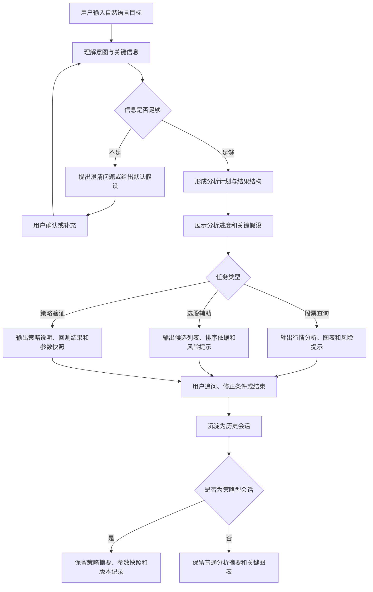

# 产品需求文档（PRD）

## 1. 文档信息

| 项目 | 内容 |
|---|---|
| 产品/项目 | 基于自然语言对话的股票分析与策略验证产品 |
| 需求名称 | 股票查询、选股辅助与策略验证对话式智能体产品 |
| 文档编号 | PRD-STOCK-001 |
| 版本/状态 | V0.4 / 草稿 |
| 产品负责人 | 待定 |
| 创建/更新日期 | 2026-07-24 |
| 关联资料 | 竞品调研、用户访谈、股票分析场景研究 |

### 1.1 修订记录

| 版本 | 日期 | 修订人 | 变更内容 |
|---|---|---|---|
| V0.1 | 2026-07-24 | 产品/设计/研发共识 | 初稿 |
| V0.2 | 2026-07-24 | 产品/设计/研发共识 | 增加历史会话与策略管理功能判断和需求说明 |
| V0.3 | 2026-07-24 | 产品/设计/研发共识 | 调整策略管理为历史会话内的策略沉淀与复用能力，不单独设置策略列表页 |
| V0.4 | 2026-07-24 | 产品/设计/研发共识 | 强化智能体产品设计逻辑，去除独立策略验证页 |

## 2. 背景与问题

### 2.1 业务背景

许多股票用户在做日常分析时，需要同时查看行情、技术指标、财务数据和策略表现，但目前常见方式仍是分散使用多个页面或工具。对普通用户来说，股票分析门槛较高；对策略学习者来说，想验证一个策略想法往往需要先写代码再回测。

本产品聚焦于“让用户用自然语言完成股票查询、选股辅助和策略验证”，将信息获取、分析结论、图表展示和结果解释整合到一个对话式工作流中，提高效率并降低使用门槛。

### 2.2 核心问题

| 编号 | 问题 | 受影响用户 | 场景/频率 | 影响 | 证据 |
|---|---|---|---|---|---|
| P-001 | 用户需要在多个工具之间切换才能查询股票行情和指标 | 散户投资者、股票爱好者 | 日常看盘、盯盘 | 查询效率低、信息碎片化 | 用户访谈与现状调研 |
| P-002 | 用户想验证策略想法，但缺少低门槛入口 | 策略初学者、量化爱好者 | 试验策略思路 | 学习成本高、试错成本高 | 典型用户反馈 |
| P-003 | 现有 AI 产品对股票问题的回答常常缺少过程透明度 | 所有用户 | 分析与决策 | 用户难以判断结论是否可信 | 竞品体验观察 |
| P-004 | 用户完成一次分析或回测后，难以保存、复用和继续迭代结果 | 散户投资者、策略初学者、研究型用户 | 复盘、二次回测、策略优化 | 用户需要重复输入条件，难以形成个人策略资产 | 用户使用路径推演 |

### 2.3 产品机会

通过将“自然语言对话 + 股票分析能力 + 结果解释能力 + 策略验证能力”融合在一起，能够显著缩短股票分析和策略验证的路径，让用户在一个界面内完成从问题提出到结论输出的全过程。

## 3. 目标与非目标

| 目标编号 | 目标描述 | 当前基线 | 目标值 | 验证方式 |
|---|---|---|---|---|
| OBJ-001 | 支持用户用自然语言查询股票行情、走势和基础指标 | 主要依赖手工查询和分散工具 | 80% 的常见股票查询可在 30 秒内完成 | 用户测试与任务完成率 |
| OBJ-002 | 支持用户用自然语言创建并验证基础投资策略 | 需手写代码或使用复杂工具 | 70% 的基础策略可完成生成与验证 | 回测任务完成率 |
| OBJ-003 | 让系统以可解释、可追问的方式输出分析结论，增强结论可信度 | 现有工具多为黑盒回答 | 用户可理解分析依据并持续追问 | 用户满意度与可解释性问卷 |
| OBJ-004 | 支持用户保存历史会话和策略结果，便于复盘、复用和持续优化 | 结果多停留在单次会话中 | 60% 的策略回测结果可被保存或再次打开 | 保存率、复用率、历史访问率 |

### 3.1 非目标

| 编号 | 本期不做 | 原因 |
|---|---|---|
| NOBJ-001 | 不提供真实交易下单能力 | 本期聚焦查询、分析与验证，不做资金管理与实盘执行 |
| NOBJ-002 | 不做全市场、全资产类型覆盖 | 本期先聚焦股票场景，保证体验质量 |
| NOBJ-003 | 不做复杂量化平台的完整功能 | 本期以“自然语言入口 + 基础验证”为核心 |
| NOBJ-004 | 不做独立策略库、策略列表页、权限协作和策略市场 | 本期以对话历史承载策略沉淀与复用，避免偏离智能体产品形态 |

### 3.2 成功定义

当用户能够在一个会话中完成股票查询、理解分析过程、查看图表并完成基础策略验证，并能在后续重新打开历史结果或复用策略继续迭代时，说明产品初版方向是成功的。关键成功指标包括：查询成功率、策略验证成功率、历史访问率、策略复用率、用户复访率以及平均会话时长。

### 3.3 历史会话与策略沉淀取舍结论

| 能力 | 是否需要 | 优先级 | 产品判断 |
|---|---|---|---|
| 历史会话 | 需要 | P1 | 散户和策略初学者会反复查看同一只股票、同一组条件和同一次回测结果。历史会话不是核心计算能力，但直接影响复盘、续聊和留存，应作为基础账户能力纳入本期。 |
| 策略沉淀与复用 | 需要 | P1 | 策略创建和回测如果不能找回、命名、复用和再次执行，会停留在一次性问答。但首期不需要独立策略列表页，应把策略作为一种“策略型历史会话”沉淀在对话历史中。 |
| 独立策略库/协作/市场 | 暂不需要 | 范围外 | 这类能力会把产品拉向传统量化平台，增加权限、版本、审核和运营复杂度，与“智能体对话 + 低门槛验证”的首期目标不一致。 |

## 4. 用户与场景

### 4.1 目标用户

| 用户编号 | 用户/角色 | 核心诉求 | 使用环境 | 关键限制 |
|---|---|---|---|---|
| U-001 | 散户投资者/普通用户 | 想用自然语言快速了解股票走势、技术指标和基本面信息 | PC/移动端网页 | 不熟悉专业术语和代码 |
| U-002 | 策略初学者/量化爱好者 | 想快速表达策略想法并验证其表现 | PC 网页 | 对策略参数和回测流程了解有限 |
| U-003 | 研究型用户/进阶分析者 | 想快速获得股票对比分析和策略结果解释 | PC 网页 | 对复杂操作有较高效率要求 |

### 4.2 使用场景

| 场景编号 | 场景 | 触发条件 | 用户目标 | 当前痛点 | 期望结果 |
|---|---|---|---|---|---|
| SC-001 | 股票走势查询 | 用户输入“某某股票今日走势” | 快速获得行情概览与图表 | 需切换多个页面 | 一条对话中得到结论与图表 |
| SC-002 | 股票对比分析 | 用户输入“比较 AAPL 和 MSFT 最近三个月表现” | 获得对比结论与变化原因 | 需要手动整理数据 | 统一展示对比图和摘要 |
| SC-003 | 策略创建与验证 | 用户输入“创建一个均线突破策略，并回测” | 生成策略并查看回测结果 | 需要手写代码或使用工具 | 自动生成策略、展示收益/回撤与风险指标 |
| SC-004 | 策略优化追问 | 用户输入“把这个策略改成更稳一点” | 对策略进行优化和再次验证 | 现有流程无法自然迭代 | 支持继续追问并更新结果 |
| SC-005 | 选股辅助 | 用户输入“帮我选出近期强势且估值合理的股票” | 从多个股票中筛选出候选名单 | 需要手动查找和整理 | 一次对话内得到筛选结果与解释 |
| SC-006 | 历史复盘与续聊 | 用户打开过去的股票分析或回测会话 | 回看结论、图表和当时参数，并继续追问 | 结果散落在临时对话中 | 可按时间、股票、策略类型找回历史内容并续聊 |
| SC-007 | 策略型历史会话复用 | 用户对某次回测结果满意或想后续优化 | 在历史会话中找回策略、调整参数、再次回测 | 每次都要重新描述策略 | 可在历史记录中按策略类型找回会话，基于原策略再次运行 |

### 4.3 用户故事

| 编号 | 用户故事 | 优先级 | 关联需求 |
|---|---|---|---|
| US-001 | 作为散户投资者，我希望通过自然语言查询某只股票的走势和关键指标，以便快速判断是否值得关注。 | P0 | FR-001、FR-003 |
| US-002 | 作为股票爱好者，我希望比较两只股票在过去一段时间内的表现，以便做出更直观的选择判断。 | P0 | FR-001、FR-003 |
| US-003 | 作为策略初学者，我希望输入一个简单策略描述并得到回测结果，以便快速验证自己的想法。 | P0 | FR-004、FR-005 |
| US-004 | 作为研究型用户，我希望看到系统使用了哪些数据、假设和分析依据，以便判断结果是否可信。 | P0 | FR-002 |
| US-005 | 作为用户，我希望在策略结果出来后继续追问“为什么表现不好”或“如何优化”，以便更好地理解和迭代。 | P1 | FR-004、FR-002 |
| US-006 | 作为普通投资者，我希望通过自然语言进行选股辅助，以便快速得到一批满足条件的股票候选。 | P0 | FR-001、FR-003、FR-006 |
| US-007 | 作为散户投资者，我希望能找回过去的股票分析会话，以便复盘历史判断并继续追问。 | P1 | FR-007、FR-008 |
| US-008 | 作为策略初学者，我希望在历史会话中找回某次策略回测并再次运行，以便逐步优化策略表现。 | P1 | FR-004、FR-005、FR-009 |

### 4.4 业务流程

### 4.5 对话式智能体能力原则

| 原则编号 | 产品原则 | 说明 |
|---|---|---|
| CAP-001 | 以用户意图为中心 | 系统优先理解用户真正想解决的问题，而非仅回答表层问题。 |
| CAP-002 | 结果需可解释 | 每次回答都应包含结论、依据和关键风险说明。 |
| CAP-003 | 支持连续追问 | 用户可以在同一话题上继续追问、补充条件或要求优化。 |
| CAP-004 | 结果需可视化 | 对于趋势、对比和回测结果，应以图表辅助呈现。 |
| CAP-005 | 明确边界 | 系统应在股票相关任务范围内工作，并对不确定内容给出说明。 |
| CAP-006 | 关键结果可沉淀 | 有复盘价值的会话、图表、策略和回测参数应能被保存、检索和复用。 |
| CAP-007 | 先澄清再行动 | 当用户目标、市场、时间范围或回测参数不明确时，系统应优先澄清或明确默认假设。 |
| CAP-008 | 一个对话承载任务 | 股票查询、选股和策略验证都应优先在对话工作台内完成，不拆成多个传统功能页。 |

## 5. 范围与优先级

| 范围编号 | 模块/能力 | 内容说明 | 优先级 | 本期结论 |
|---|---|---|---|---|
| SCOPE-000 | 意图理解与澄清确认 | 识别用户目标、缺失信息和默认假设，并在必要时向用户确认 | P0 | 做 |
| SCOPE-001 | 自然语言股票查询 | 支持股票行情、涨跌幅、技术指标和基础信息查询 | P0 | 做 |
| SCOPE-002 | 结果解释与推理展示 | 展示分析思路、关键依据和结论说明 | P0 | 做 |
| SCOPE-003 | 图表可视化 | 支持走势图、对比图、收益曲线和回撤图 | P0 | 做 |
| SCOPE-004 | 策略创建与验证 | 支持自然语言生成基础策略并完成回测验证 | P0 | 做 |
| SCOPE-005 | 连续对话与追问能力 | 支持用户在同一任务上继续提问、补充条件和优化结果 | P0 | 做 |
| SCOPE-006 | 历史会话 | 支持自动保存会话摘要、查询对象、图表结果和回测结果，便于复盘和续聊 | P1 | 做 |
| SCOPE-007 | 策略型历史会话复用 | 在历史会话中支持策略命名、标签、参数快照、复制、再次回测和基础版本记录 | P1 | 做 |

### 5.1 范围外

| 编号 | 范围外事项 | 原因 |
|---|---|---|
| OUT-001 | 不提供真实交易下单 | 交易执行不属于本期范围 |
| OUT-002 | 不提供复杂量化平台与多策略组合 | 本期聚焦基础策略验证体验 |
| OUT-003 | 不提供独立策略列表页、策略市场、多人协作和公开分享 | 本期聚焦智能体对话历史中的个人使用闭环，降低产品与合规复杂度 |

## 6. 功能需求

### 6.1 需求清单

| 需求编号 | 名称 | 用户价值 | 描述 | 优先级 | 状态 |
|---|---|---|---|---|---|
| FR-000 | 意图理解、澄清与任务确认 | 降低用户表达成本并减少误解 | 系统识别用户目标、任务类型、对象和缺失参数；必要时追问或给出默认假设供用户确认 | P0 | 待设计 |
| FR-001 | 自然语言股票数据查询 | 快速获取股票信息和分析结论 | 用户输入自然语言问题，系统识别股票、时间范围和指标需求 | P0 | 待设计 |
| FR-002 | 结果解释与依据展示 | 提升透明度与可信度 | 系统在给出结论时，说明关键依据、分析路径和风险点 | P0 | 待设计 |
| FR-003 | 股票图表可视化 | 让结果更直观 | 支持趋势图、对比图、K 线图、收益曲线和回撤图 | P0 | 待设计 |
| FR-004 | 自然语言策略创建 | 降低策略验证门槛 | 用户输入策略描述后，系统生成策略逻辑说明 | P0 | 待设计 |
| FR-005 | 策略回测验证 | 让用户快速验证策略表现 | 系统根据策略描述输出回测结果与风险指标 | P0 | 待设计 |
| FR-006 | 自然语言选股辅助 | 帮助用户筛选候选股票 | 用户输入选股条件后，系统根据多维指标输出股票池和排序结果 | P0 | 待设计 |
| FR-007 | 连续追问与上下文理解 | 提升对话体验连续性 | 用户可以在同一任务中继续追问、补充条件或优化结果 | P0 | 待设计 |
| FR-008 | 历史会话与复盘 | 帮助用户找回过去分析内容 | 系统保存会话摘要、任务类型、股票对象、图表和关键结果，并支持搜索、筛选、续聊 | P1 | 待设计 |
| FR-009 | 策略型历史会话复用 | 帮助用户从对话历史中复用策略 | 用户可在历史会话中找到策略回测记录，查看参数快照、复制调整并再次执行 | P1 | 待设计 |

### 6.2 单项需求：FR-000 意图理解、澄清与任务确认

| 项目 | 内容 |
|---|---|
| 目标/价值 | 让用户用自然语言表达模糊目标时，也能被引导成可完成的股票分析、选股或策略验证任务。 |
| 适用用户 | 所有用户 |
| 触发条件 | 用户发起任何股票查询、选股辅助、策略创建或回测请求 |
| 前置条件 | 用户已进入对话工作台 |
| 输入信息 | 用户原始问题、当前会话上下文、已知股票/策略对象、时间范围和目标偏好 |
| 输出结果 | 任务理解摘要、缺失信息问题、默认假设、用户确认后的任务目标 |
| 权限/可见性 | 登录用户可见 |

主流程：

1. 用户输入自然语言目标。
2. 系统识别任务类型、分析对象、时间范围和用户意图。
3. 当信息不足时，系统提出少量澄清问题；当信息基本足够时，系统明确默认假设。
4. 用户确认、补充或修改后，系统进入分析或回测流程。

### 6.3 单项需求：FR-001 自然语言股票数据查询

| 项目 | 内容 |
|---|---|
| 目标/价值 | 让用户通过自然语言快速查询股票走势、波动和基础指标。 |
| 适用用户 | 散户投资者、股票爱好者、研究型用户 |
| 触发条件 | 用户输入类似“某某股票今日走势”“AAPL 近一个月表现” |
| 前置条件 | 用户已登录，所查询市场在产品支持范围内 |
| 输入信息 | 股票代码/名称、时间范围、指标类型、查询目的 |
| 输出结果 | 文本摘要、结构化数据、相关图表、后续建议 |
| 权限/可见性 | 登录用户可见 |

主流程：

1. 用户输入自然语言问句。
2. 系统识别股票、时间范围和分析目标，必要时先确认缺失信息。
3. 返回结论、相关指标、图表、依据说明和风险提示。

### 6.4 单项需求：FR-002 结果解释与依据展示

| 项目 | 内容 |
|---|---|
| 目标/价值 | 让用户理解系统如何得出结论，并判断结论是否可信。 |
| 适用用户 | 所有用户 |
| 触发条件 | 用户发起股票查询、选股辅助或策略验证任务 |
| 前置条件 | 任务已被识别为有效分析需求 |
| 输入信息 | 用户问题、上下文信息、当前任务类型 |
| 输出结果 | 任务理解、关键假设、数据口径、分析路径、风险提示、最终结论 |
| 权限/可见性 | 登录用户可见 |

主流程：

1. 系统识别用户意图并整理任务目标。
2. 输出任务理解、默认假设、关键依据和风险提示。
3. 在最终结果区域汇总结论与图表。

### 6.5 单项需求：FR-003 股票图表可视化

| 项目 | 内容 |
|---|---|
| 目标/价值 | 用图表帮助用户更直观地理解股票走势和策略表现。 |
| 适用用户 | 所有需要分析趋势的用户 |
| 触发条件 | 查询结果存在时间序列或回测结果 |
| 前置条件 | 查询或回测任务已完成 |
| 输入信息 | 数据集、时间范围、指标类型 |
| 输出结果 | 走势图、对比图、K 线图、收益曲线、回撤图 |
| 权限/可见性 | 登录用户可见 |

主流程：

1. 系统根据任务类型选择合适图表。
2. 渲染图表并支持缩放、切换、下载。
3. 图表与文本结论联动显示。

### 6.6 单项需求：FR-004 与 FR-005 策略创建与验证

| 项目 | 内容 |
|---|---|
| 目标/价值 | 让用户用自然语言表达一个简单策略想法，并快速拿到验证结果。 |
| 适用用户 | 策略初学者、量化爱好者、研究型用户 |
| 触发条件 | 用户输入类似“创建一个均线突破策略，并回测” |
| 前置条件 | 策略目标、股票池、时间范围和关键回测参数已确认 |
| 输入信息 | 策略描述、股票池、时间范围、初始资金、手续费 |
| 输出结果 | 策略逻辑说明、关键假设、收益曲线、回撤图、胜率、年化收益、最大回撤等风险指标 |
| 权限/可见性 | 登录用户可见 |

主流程：

1. 用户输入策略需求与回测条件。
2. 系统确认策略目标、适用股票池、时间范围和关键参数。
3. 系统生成策略逻辑说明和回测假设。
4. 输出策略说明、结果摘要、可视化图表和风险提示。

### 6.7 单项需求：FR-006 自然语言选股辅助

| 项目 | 内容 |
|---|---|
| 目标/价值 | 让用户通过自然语言快速筛选出符合条件的股票候选。 |
| 适用用户 | 普通投资者、选股爱好者、研究型用户 |
| 触发条件 | 用户输入类似“帮我选出近期强势且估值合理的股票” |
| 前置条件 | 筛选目标、市场范围和关键维度已确认 |
| 输入信息 | 选股条件、行业范围、市场范围、筛选指标 |
| 输出结果 | 股票候选列表、评分排序、关键指标摘要、可视化图表 |
| 权限/可见性 | 登录用户可见 |

主流程：

1. 用户输入选股条件。
2. 系统识别筛选维度，必要时先确认市场、行业和排序偏好。
3. 输出候选股票列表、排序说明、分析摘要和风险提示。

### 6.8 单项需求：FR-007 连续追问与上下文理解

| 项目 | 内容 |
|---|---|
| 目标/价值 | 让用户能够在同一个分析任务中持续追问、补充条件并优化结果。 |
| 适用用户 | 所有用户 |
| 触发条件 | 用户在已有对话中继续提问 |
| 前置条件 | 当前会话已建立上下文 |
| 输入信息 | 用户新的追问、补充条件、优化目标 |
| 输出结果 | 基于上下文的更新结果、继续解释、下一步建议 |
| 权限/可见性 | 登录用户可见 |

主流程：

1. 用户继续提问或补充条件。
2. 系统在上下文中判断新目标与原目标关系。
3. 输出更新后的结论、解释和建议。

### 6.9 单项需求：FR-008 历史会话与复盘

| 项目 | 内容 |
|---|---|
| 目标/价值 | 让用户能够找回过去的股票分析、选股和策略回测内容，减少重复输入并支持复盘。 |
| 适用用户 | 散户投资者、策略初学者、研究型用户 |
| 触发条件 | 用户完成一次查询、选股或策略回测，或从历史记录入口打开历史内容 |
| 前置条件 | 用户已登录，系统已保存会话元数据和关键结果 |
| 输入信息 | 会话标题、任务类型、股票/策略对象、时间范围、用户问题、系统结果 |
| 输出结果 | 历史会话列表、会话详情、关键图表、结果摘要、续聊入口 |
| 权限/可见性 | 仅当前登录用户可见 |

主流程：

1. 系统在会话完成后自动保存标题、摘要、任务类型、关联股票、图表和关键结果。
2. 用户从历史记录入口按时间、股票、任务类型或关键词检索历史会话。
3. 用户打开历史会话，查看原始问题、系统回答、图表和回测结果。
4. 用户选择继续追问时，系统加载该会话上下文并生成新结果。

边界说明：

1. 首期不提供多人共享、公开链接和评论协作。
2. 历史记录允许用户删除；涉及金融数据授权限制的内容需按数据源规则处理过期展示。

### 6.10 单项需求：FR-009 策略型历史会话复用

| 项目 | 内容 |
|---|---|
| 目标/价值 | 让用户在对话历史中找回自然语言生成的策略，并能持续调整和再次回测。 |
| 适用用户 | 策略初学者、量化爱好者、研究型用户 |
| 触发条件 | 用户完成策略创建或回测，或从历史记录入口打开策略型会话 |
| 前置条件 | 用户已登录，策略逻辑和回测参数已结构化 |
| 输入信息 | 会话标题、策略描述、股票池、时间范围、参数、回测假设、标签 |
| 输出结果 | 策略型历史会话详情、参数快照、历史回测记录、再次回测入口 |
| 权限/可见性 | 仅当前登录用户可见 |

主流程：

1. 用户完成策略回测后，系统自动将该会话标记为策略型历史会话。
2. 系统生成默认会话标题、策略摘要和参数快照，用户可编辑标题与标签。
3. 用户在历史记录中按策略类型、股票、时间或关键词找到该会话。
4. 用户打开策略型历史会话，修改参数或描述后再次发起回测。
5. 系统在同一会话中保留基础版本记录，支持对比最近若干次回测结果。

边界说明：

1. 首期不提供独立策略列表页，策略通过历史会话筛选和搜索找回。
2. 不支持复杂多策略组合、策略市场、实盘自动执行和多人协作。

## 7. 页面与交互

### 7.1 页面清单

| 页面编号 | 页面 | 入口 | 核心任务 | 关键状态 | 原型 |
|---|---|---|---|---|---|
| UI-001 | 对话工作台 | 首页入口 | 输入目标、确认假设、查看分析过程、查看结果与图表 | 空/澄清/分析中/完成/错误 | 待补充 |
| UI-002 | 历史记录页 | 侧边栏入口 | 查看过去问答、策略型会话和回测结果 | 空/正常/加载中 | 待补充 |

### 7.2 页面内容与交互说明

| 页面编号 | 区域/组件 | 展示内容 | 用户操作 | 交互反馈 | 备注 |
|---|---|---|---|---|---|
| UI-001 | 输入框 | 用户输入自然语言问题 | 发送、重新编辑、快捷示例 | 显示输入中状态 | 支持示例问句 |
| UI-001 | 对话流 | 任务理解、澄清问题、依据说明、最终结论 | 回答澄清、展开/收起依据、查看详情 | 高亮关键依据 | 适合展示对话式分析过程 |
| UI-001 | 假设确认区 | 市场、时间范围、指标口径、回测参数等关键假设 | 确认、修改、继续分析 | 更新任务摘要 | 信息不足或存在多种理解时出现 |
| UI-001 | 图表区域 | 行情走势、对比图、收益/回撤图 | 缩放、切换指标、下载 | 图表加载反馈 | 支持多图联动 |
| UI-001 | 策略结果区 | 策略摘要、回测指标、参数快照 | 编辑标题、添加标签、复制策略、再次回测 | 自动保存提示 | 结果沉淀到历史会话 |
| UI-002 | 历史列表 | 会话标题、任务类型、关联股票/策略、更新时间 | 搜索、筛选、打开、删除 | 空状态与加载状态 | 支持按策略型会话筛选 |
| UI-002 | 策略型会话详情 | 策略描述、参数快照、历史回测记录、版本摘要 | 编辑标题/标签、复制策略、再次回测、继续追问 | 展示分析进度和结果更新 | 不单独设置策略列表页 |

### 7.3 文案与提示

| 场景 | 文案类型 | 文案内容 | 触发条件 |
|---|---|---|---|
| 新用户 | 标题 | “用自然语言看股票、验证策略” | 首次进入 |
| 查询失败 | 提示 | “请提供更清晰的股票名称或时间范围” | 识别失败 |
| 需要澄清 | 提示 | “我需要先确认几个条件，以免分析方向偏掉” | 关键信息不足 |
| 策略分析中 | 提示 | “正在为你生成分析与验证结果，请稍候” | 策略任务确认后 |
| 策略会话已保存 | 提示 | “已保存到历史记录，可继续回测和优化” | 策略回测完成后 |
| 历史会话空状态 | 提示 | “完成一次股票分析或回测后，历史记录会出现在这里” | 历史记录为空 |

## 8. 数据与内容

| 数据/内容项 | 用途 | 来源 | 是否必填 | 展示规则 | 备注 |
|---|---|---|---|---|---|
| 股票行情与涨跌幅 | 查询与分析 | 授权金融数据 | 是 | 时间序列图 + 文本摘要 | 初期重点支持主流股票 |
| 技术指标 | 辅助判断趋势 | 产品计算/金融数据 | 是 | 图表与指标卡片 | 包括均线、RSI、MACD 等 |
| 基本面信息 | 进行基础分析 | 数据源/公开信息 | 否 | 结构化字段展示 | 仅作为辅助信息 |
| 策略回测结果 | 验证策略有效性 | 产品计算结果 | 是 | 收益曲线、回撤图、风险指标 | 需说明回测假设与局限 |
| 任务理解与假设 | 支持澄清和确认 | 用户输入/产品生成 | 是 | 对话内展示 | 包含任务类型、对象、时间范围、指标口径和默认假设 |
| 会话历史 | 续聊与回看 | 用户生成数据 | 否 | 时间线展示 | 支持普通会话和策略型会话筛选 |
| 策略型会话元数据 | 保存与复用策略 | 用户生成数据 | 否 | 历史会话详情内展示 | 包含标题、策略描述、参数快照、标签、版本和回测记录 |

## 9. 指标与埋点

### 9.1 业务指标

| 指标编号 | 名称/公式 | 当前值 | 目标值 | 数据源 |
|---|---|---|---|---|
| KPI-001 | 日活跃用户数 | 待统计 | 200+ | 产品埋点 |
| KPI-002 | 查询任务完成率 | 待统计 | 85% | 产品行为数据 |
| KPI-003 | 策略回测任务完成率 | 待统计 | 70% | 产品行为数据 |
| KPI-004 | 用户留存率（7日） | 待统计 | 20% | 用户行为分析 |
| KPI-005 | 历史会话访问率 | 待统计 | 30% | 产品行为数据 |
| KPI-006 | 策略型会话复用率 | 待统计 | 20% | 产品行为数据 |
| KPI-007 | 澄清后任务完成率 | 待统计 | 75% | 产品行为数据 |
| KPI-008 | 连续追问率 | 待统计 | 35% | 产品行为数据 |

### 9.2 行为事件

| 事件编号 | 事件 | 触发时机 | 关键属性 | 关联指标 |
|---|---|---|---|---|
| EVT-001 | 发送查询问题 | 用户输入问题后 | 问题类型、资产类型、时间范围 | KPI-001、KPI-002 |
| EVT-002 | 查看分析过程与依据 | 用户展开依据说明 | 内容类型、停留时长 | KPI-003 |
| EVT-003 | 确认策略回测 | 用户确认策略目标和参数后 | 策略类型、参数 | KPI-003 |
| EVT-004 | 打开历史会话 | 用户从历史记录进入详情 | 任务类型、关联股票、距上次更新时间 | KPI-005、KPI-004 |
| EVT-005 | 编辑策略型会话信息 | 用户编辑会话标题或标签时 | 策略类型、股票池、参数数量 | KPI-006、KPI-004 |
| EVT-006 | 再次运行策略 | 用户从策略型历史会话发起回测 | 会话 ID、版本号、参数变化 | KPI-006、KPI-003 |
| EVT-007 | 回答澄清问题 | 用户确认或补充关键信息时 | 澄清类型、任务类型、是否采用默认假设 | KPI-007 |
| EVT-008 | 连续追问 | 用户基于结果继续提问时 | 原任务类型、追问类型 | KPI-008 |

## 10. 约束、风险与待决事项

### 10.1 产品约束

| 编号 | 约束 | 对产品设计的影响 | 处理方式 |
|---|---|---|---|
| CON-001 | 金融数据授权与稳定性 | 影响查询和回测结果质量 | 选择稳定数据来源并设置兜底方案 |
| CON-002 | 合规与投资建议边界 | 需避免提供不合规的投资承诺 | 通过提示语和信息边界控制 |
| CON-003 | 数据更新频率限制 | 实时性与历史数据覆盖存在差异 | 明确“实时/延迟/历史”标注 |

### 10.2 风险

| 风险编号 | 风险 | 影响 | 应对 |
|---|---|---|---|
| RISK-001 | 智能体误解用户意图 | 结果不准确 | 提供澄清问答和示例输入 |
| RISK-002 | 回测结果被误解为实际收益 | 用户可能错误决策 | 在界面中明确“回测结果非实盘表现” |
| RISK-003 | 数据源波动导致分析偏差 | 用户信任下降 | 加入数据来源说明和更新提示 |
| RISK-004 | 历史会话和策略内容增加隐私与数据存储压力 | 用户数据泄露或存储成本上升 | 默认仅本人可见，支持删除，并设置合理的保存字段与存储周期 |
| RISK-005 | 策略型历史会话被用户理解为投资建议或实盘推荐 | 合规风险上升 | 明确标注策略为用户自建假设和历史回测，不构成投资建议 |

### 10.3 待决事项

| 编号 | 待决事项 | 影响 | 决策人 | 截止日期 | 状态 |
|---|---|---|---|---|---|
| TBD-001 | 初期支持的资产类型范围 | 影响产品范围和用户预期 | 产品负责人 | 2026-08-01 | 待确认 |
| TBD-002 | 是否提供实时行情能力 | 影响体验和数据标注方式 | 产品负责人 | 2026-08-01 | 待确认 |
| TBD-003 | 历史会话与策略结果保存周期 | 影响成本、用户体验和合规要求 | 产品负责人 | 2026-08-01 | 待确认 |

## 11. 验收标准

| 验收编号 | 关联需求 | 前置条件 | 用户操作 | 期望结果 |
|---|---|---|---|---|
| AC-000 | FR-000 | 用户进入对话工作台 | 用户输入缺少时间范围或股票池的问题 | 系统提出澄清问题或明确默认假设，并在用户确认后继续任务 |
| AC-001 | FR-001 | 所查询市场在产品支持范围内 | 用户输入“某某股票今日走势” | 系统返回文本摘要、对应图表、依据说明和风险提示 |
| AC-002 | FR-002 | 用户发起查询或策略任务 | 用户展开依据说明 | 可查看任务理解、关键假设、数据口径和风险提示 |
| AC-003 | FR-004 | 用户确认策略目标和关键参数 | 用户输入“创建策略 xxx，并回测” | 系统生成策略说明、回测假设并返回回测结果与图表 |
| AC-004 | FR-003 | 查询或回测任务完成 | 用户查看结果页 | 可切换图表、查看收益/回撤状态 |
| AC-005 | FR-008 | 用户已完成至少一次查询或回测 | 用户打开历史记录页并选择一条记录 | 可查看原问题、系统回答、关键图表和继续追问入口 |
| AC-006 | FR-009 | 用户已完成一次策略回测 | 用户从历史记录中打开策略型会话 | 可查看策略描述、参数快照、历史回测记录，并可再次发起回测 |

## 12. PRD 检查清单

- [x] 问题、目标和非目标清楚。
- [x] 目标用户、使用场景和核心痛点明确。
- [x] 范围、优先级和范围外事项明确。
- [x] 每项功能需求都有主流程与输出说明。
- [x] 页面、交互状态和关键文案有说明。
- [x] 指标能验证产品目标是否达成。
- [x] 风险、约束和待决事项有处理方式。
- [x] 验收标准可观察、可判定。
