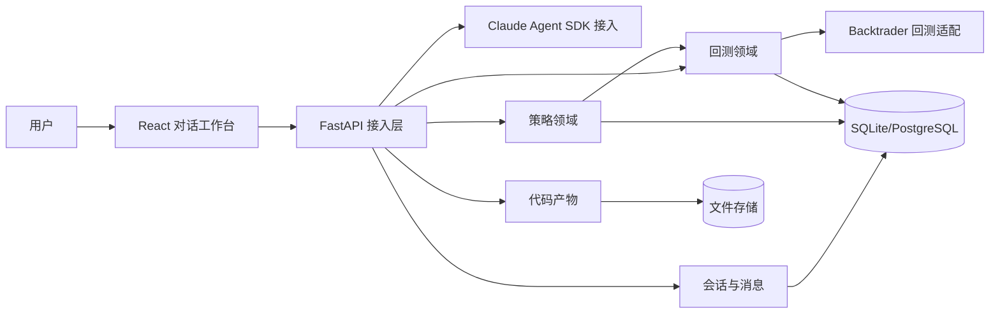
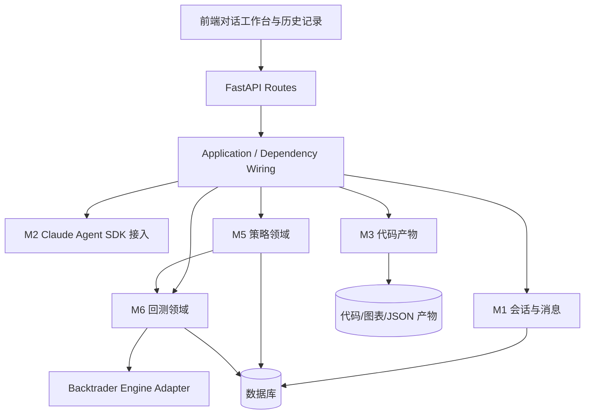
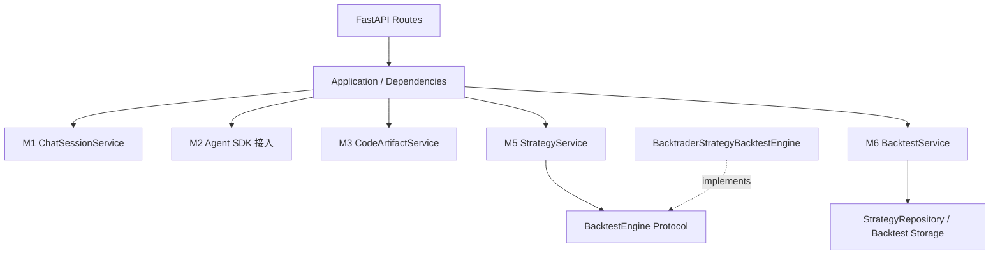
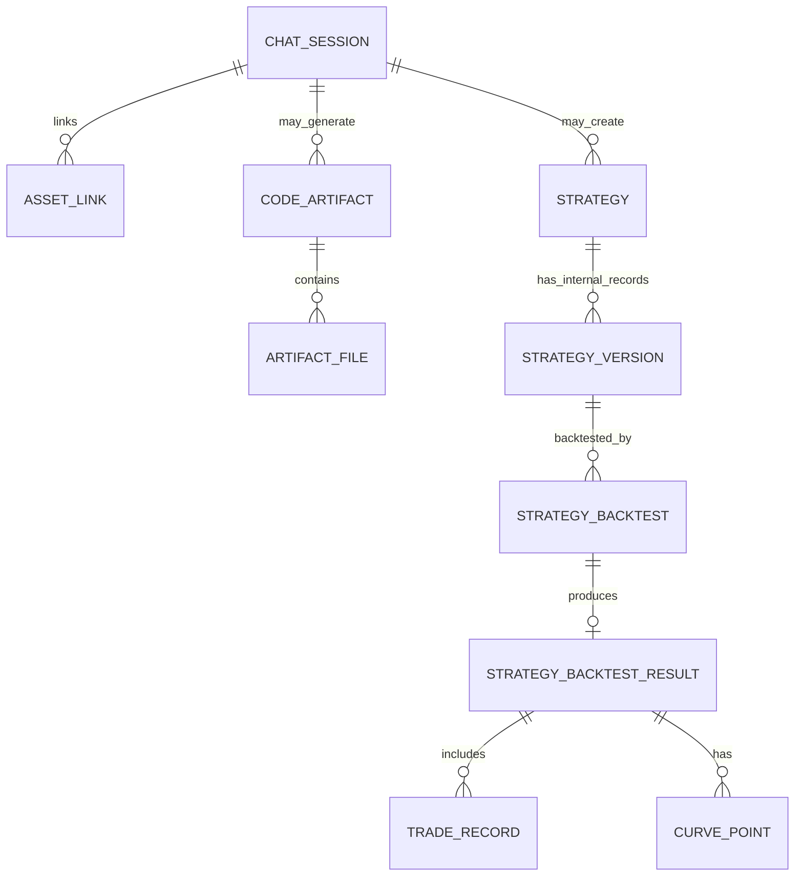

# 概要设计说明书（HLD）

## 1. 文档信息

| 项目 | 内容 |
|---|---|
| 项目/系统 | Chat-Quant 股票分析与策略验证对话式智能体系统 |
| 文档编号 | HLD-STOCK-001 |
| 版本/状态 | V0.3 / 草稿 |
| PRD 基线 | PRD-STOCK-001 V0.4 |
| 编制/评审/批准人 | Codex / 待评审 / 待批准 |
| 日期 | 2026-07-26 |

### 1.1 修订记录

| 版本 | 日期 | 修订内容 | 修订人 | 结论 |
|---|---|---|---|---|
| V0.1 | 2026-07-24 | 基于 PRD、README 与现有目录结构形成概要设计初稿 | 子智能体 A | 待评审 |
| V0.2 | 2026-07-24 | 按“Claude Agent 生成代码 + 系统资产化管理”重构模块边界 | Codex | 待评审 |
| V0.3 | 2026-07-26 | 移除独立 Python 执行模块和 CLI 设计；收敛为策略、回测、代码产物、会话和 Claude Agent SDK 接入 | Codex | 待评审 |

## 2. 设计目的与范围

本文定义 Chat-Quant 首期系统的总体架构、模块划分、核心 API、领域边界和关键数据模型。当前阶段优先实现策略定义和策略回测，不实现实盘策略运行，不抽象独立的 Python 执行模块，也不暴露 CLI。

首期核心思路：

- 用户从会话进入，表达股票分析、策略创建和策略回测目标。
- Claude Agent SDK 负责对话生成、工具调用建议和流式消息承接。
- 系统负责把策略和回测结果沉淀为可追溯资产。
- 策略服务提供策略定义和策略回测入口。
- 回测服务提供回测记录和回测详情查询。
- Backtrader 只作为回测基础设施适配，不上升为业务领域。

### 2.1 范围

| 类型 | 内容 |
|---|---|
| 范围内 | 对话工作台、历史会话、代码产物保存、策略创建、策略更新、策略列表、策略详情、策略删除、策略回测、回测记录、回测详情 |
| 范围外 | 实盘交易、策略运行、独立 CLI、独立 Python 执行平台、策略版本管理 API、策略市场、多策略组合、投顾合规闭环 |
| 技术约束 | 后端 FastAPI；前端 React/Vite/Tailwind 目标形态；Agent 基于 `claude-agent-sdk`；策略回测基于 backtrader、pandas；首期 SQLite，可迁移 PostgreSQL |
| 设计取舍 | 不把“任务”设计为复杂工作流对象；不保留通用 Python 执行概念；回测执行直接由回测引擎适配完成 |

## 3. 设计原则

| 编号 | 原则 | 说明 |
|---|---|---|
| DP-001 | 会话是入口 | 用户所有分析、策略创建、策略回测和追问都从会话进入 |
| DP-002 | 领域概念从业务来 | 只保留会话、代码产物、策略、回测这些业务概念 |
| DP-003 | 策略最小化 | 策略服务只提供创建、更新、列表、详情、删除、策略回测 |
| DP-004 | 回测独立成域 | 回测记录、状态、结果、指标、交易和曲线归回测领域 |
| DP-005 | 技术适配在基础设施 | Backtrader、数据库、文件存储都在 infrastructure 中实现 |
| DP-006 | 不暴露版本管理 | 策略内部可保存当前代码包或内部版本记录，但首期 API 不提供版本创建、查询、校验、复制 |
| DP-007 | 不保留通用执行模块 | 系统不提供通用 Python 代码执行 API，不定义执行结果契约 |
| DP-008 | 回测不等于实盘运行 | 当前目标只实现策略回测，策略运行和交易执行后置 |

## 4. 系统上下文

Chat-Quant 是面向股票分析和策略学习场景的对话式智能体系统。用户通过自然语言创建策略，并对策略进行回测。后端通过 FastAPI 提供平台能力 API，Claude Agent SDK 接入模块负责对话过程和 SDK 消息流，策略和回测领域负责业务资产。



| 外部/基础对象 | 用途 | 责任边界 |
|---|---|---|
| Claude 模型与 `claude-agent-sdk` | 智能体对话、会话恢复、工具权限和流式输出 | 由 Agent SDK 接入模块封装，业务领域不直接依赖 SDK 类型 |
| 用户自建技能 | 指导 Agent 生成分析说明或策略代码 | 技能内容不在 HLD 中设计，系统只负责加载和约束 |
| backtrader | 执行策略回测 | 作为 `infrastructure/backtests` 下的回测引擎适配 |
| pandas | 构造或承接回测数据 | 作为回测引擎适配的技术依赖 |
| 数据库/文件系统 | 保存会话索引、代码产物、策略、回测记录和结果 | 基础设施实现，领域层不依赖具体存储 |

## 5. 总体架构

### 5.1 架构风格

首期采用“模块化单体 + 轻量 DDD 分层 + Agent SDK 接入 + 资产化管理”。FastAPI 后端承载平台能力 API、会话、代码产物、策略、回测和数据库访问。系统不提供独立 CLI，不提供通用 Python 执行 API。



### 5.2 核心运行方式

| 场景 | 主要行为 | 系统能力 | 系统资产 |
|---|---|---|---|
| 查询分析 | Agent 根据会话生成解释、表格或图表 | 会话、代码产物、图表产物 | ChatSession、CodeArtifact、ArtifactFile |
| 策略创建 | 用户或 Agent 提交 `StrategyPackage` | 创建策略 | Strategy、内部当前代码包记录 |
| 策略维护 | 修改名称、描述、标签或状态 | 更新策略、删除策略、列表、详情 | Strategy |
| 策略回测 | 对某个策略发起回测 | 策略回测 | StrategyBacktestRecord、StrategyBacktestResultRecord |
| 回测复盘 | 查询历史回测 | 回测记录、回测详情 | 指标、交易、收益曲线、回撤曲线 |

### 5.3 协议边界

系统只固定需要复用和稳定渲染的协议：

| 协议类型 | 是否固定 | 说明 |
|---|---|---|
| Agent 普通文本回答 | 不固定 | 由 Agent 自由组织解释、依据、风险提示和后续建议 |
| 普通分析结果 | 不固定 | 默认作为文本、表格或文件产物沉淀 |
| 代码产物 | 固定 | 代码必须可追溯、可保存、可关联会话 |
| 策略资产 | 固定 | 通过 `StrategyPackage` 创建策略 |
| 策略回测 | 固定 | 通过策略 API 发起回测，返回回测详情 |
| 回测记录 | 固定 | 通过回测 API 查询记录和详情 |

## 6. 模块划分

### 6.1 模块总览

| 模块编号 | 模块 | 核心职责 | 数据所有权 | 主要依赖 |
|---|---|---|---|---|
| M1 | 会话与消息模块 | 管理产品历史入口、SDK session 索引、历史检索元数据和资产关联 | ChatSession、AssetLink | FastAPI、数据库、M2/M3/M5/M6 的资产引用 |
| M2 | Claude Agent SDK 接入模块 | 封装 `claude-agent-sdk`，配置 system prompt、skills、hooks、allowed tools、SDK session 和 stream relay | SDK session、SDK message stream 引用 | `claude-agent-sdk`、M1 |
| M3 | 代码产物模块 | 保存 Agent 生成代码、入口文件、来源 SDK message/tool_use 和文件产物引用 | CodeArtifact、ArtifactFile | 文件存储、数据库 |
| M5 | 策略领域 | 管理策略定义和策略回测入口 | Strategy、StrategyPackage、内部当前代码包记录 | M6、策略仓储 |
| M6 | 回测领域 | 管理回测记录、状态、结果、指标、交易、收益曲线、回撤曲线和失败原因 | StrategyBacktestRecord、StrategyBacktestResultRecord | M5、Backtrader 适配、回测仓储 |

### 6.2 M1 会话与消息模块

| 项目 | 内容 |
|---|---|
| 职责 | 保存产品历史入口、SDK session id、关联股票、关联策略、关联回测、历史筛选和续聊上下文 |
| 不负责 | 不理解策略代码，不计算回测指标 |
| 核心能力 | `create_chat_session`、`list_chat_sessions`、`get_session_detail`、`link_asset` |

### 6.3 M2 Claude Agent SDK 接入模块

| 项目 | 内容 |
|---|---|
| 职责 | 统一封装 Claude SDK 对话、选项构造、skills 加载、hooks、allowed tools、SDK session 和 stream relay |
| 不负责 | 不设计策略业务，不直接写策略或回测数据库，不直接解析回测指标 |
| 核心能力 | `run_turn`、`build_agent_options`、`get_session_messages`、`cancel_session_turn` |

### 6.4 M3 代码产物模块

| 项目 | 内容 |
|---|---|
| 职责 | 保存和版本化 Agent 生成代码、入口文件、来源 SDK message、来源 SDK tool_use 和文件产物 |
| 不负责 | 不判断策略收益，不执行回测 |
| 核心能力 | `save_code_artifact`、`save_generated_files`、`get_artifact`、`list_artifacts`、`get_entrypoint` |

### 6.5 M5 策略领域

| 项目 | 内容 |
|---|---|
| 职责 | 管理策略名称、描述、类型、标签、参数 schema、默认参数、策略代码文件和当前可回测入口 |
| 不负责 | 不提供版本管理 API，不提供策略校验 API，不执行实盘策略 |
| 核心能力 | `create_strategy`、`update_strategy_metadata`、`list_strategies`、`get_strategy`、`delete_strategy`、`backtest_strategy` |
| 状态 | `active`、`archived`、`deleted` |

策略对外最小 API 只围绕策略本体。内部可以为了保存代码包而维护当前版本记录，但该记录不是首期对外能力。

### 6.6 M6 回测领域

| 项目 | 内容 |
|---|---|
| 职责 | 管理策略回测记录、状态流转、回测配置、指标、交易明细、收益曲线、回撤曲线和失败原因 |
| 不负责 | 不生成策略代码，不保存用户聊天文本，不提供“创建回测”式对外命令 |
| 核心能力 | `list_records`、`get_detail`；策略回测由策略服务发起 |
| 状态 | `pending`、`running`、`succeeded`、`failed`、`canceled` |

Backtrader 执行作为基础设施适配实现，领域层只定义 `StrategyBacktestEngine` 协议和标准结果模型。

### 6.7 模块依赖关系



| 模块 | 允许依赖 | 禁止依赖 |
|---|---|---|
| M1 会话与消息 | 资产引用 DTO、SDK session 映射 | 不执行 Python，不计算回测 |
| M2 Agent SDK 接入 | SDK、core 配置、会话上下文 | 不直接写 Strategy/Backtest 表 |
| M3 代码产物 | 文件存储、ArtifactRepository | 不依赖策略和回测业务 |
| M5 策略领域 | 回测引擎协议、策略仓储 | 不调用 Claude SDK，不实现 Backtrader 细节 |
| M6 回测领域 | 回测模型、回测仓储 | 不生成策略代码，不调用 Claude SDK |
| infrastructure/backtests | backtrader、pandas、临时代码加载 | 不拥有策略/回测业务状态定义 |

### 6.8 后端代码架构

```text
apps/api/app/
  api/
    routes/
      artifacts.py
      backtests.py
      chat.py
      conversations.py
      health.py
      strategies.py

  application/
    artifact_service.py
    chat_service.py
    dependencies.py

  agent_sdk/
    claude_agent.py
    hooks.py
    prompts.py
    sdk_skills.py
    bash_command_policy.py
    sdk_stream_relay.py
    sdk_session_store.py
    sdk_transcript_store.py
    tool_call_logger.py

  domain/
    artifacts/
    backtests/
      execution.py
      models.py
      service.py
    chat_sessions/
    strategies/
      models.py
      repository.py
      service.py

  infrastructure/
    backtests/
      backtrader_engine.py
    db/
    storage/

  schemas/
    contracts/
      agent_sdk.py
      json_types.py
```

分层规则：

| 层 | 职责 | 依赖方向 |
|---|---|---|
| `api/routes` | HTTP 参数接收、鉴权、响应转换 | 调用应用装配后的服务 |
| `application` | 装配用例依赖和跨模块入口 | 可依赖 domain、agent SDK 接入和 infrastructure |
| `agent_sdk` | 封装 Claude SDK 会话能力 | 不被业务领域反向依赖 |
| `domain` | 定义实体、DTO、业务状态、校验规则和服务接口 | 不依赖 FastAPI、SQLAlchemy、Claude SDK、backtrader |
| `infrastructure` | 实现数据库、文件存储、Backtrader 引擎等技术适配 | 可依赖 domain 契约 |
| `schemas/contracts` | 跨模块稳定契约 | 只放仍在使用的共享契约 |

## 7. 服务契约概要

### 7.1 策略服务

```python
class StrategyService:
    def create_strategy(self, command: CreateStrategyCommand) -> StrategyCreateResult:
        ...

    def update_strategy_metadata(self, strategy_id: str, command: UpdateStrategyCommand) -> StrategyRecord:
        ...

    def list_strategies(self, user_id: str, project_id: str) -> list[StrategySummary]:
        ...

    def get_strategy(self, strategy_id: str) -> StrategyDetail:
        ...

    def delete_strategy(self, strategy_id: str) -> StrategyRecord:
        ...

    def backtest_strategy(
        self,
        strategy_id: str,
        config: StrategyBacktestConfig,
        engine: StrategyBacktestEngine,
    ) -> StrategyBacktestDetail:
        ...
```

### 7.2 回测服务

```python
class BacktestService:
    def list_records(
        self,
        strategy_version_id: str | None,
        limit: int,
    ) -> list[StrategyBacktestRecord]:
        ...

    def get_detail(self, backtest_id: str) -> StrategyBacktestDetail:
        ...
```

### 7.3 回测引擎协议

```python
class StrategyBacktestEngine(Protocol):
    name: str
    protocol_name: str

    def execute(
        self,
        backtest: StrategyBacktestRecord,
        version: StrategyVersionRecord,
    ) -> StrategyBacktestResultRecord:
        ...
```

## 8. 核心 DTO 与参数契约

### 8.1 StrategyPackage

```python
class StrategyPackage(BaseModel):
    name: str
    description: str | None = None
    strategy_type: str
    entrypoint: str
    code_artifact_id: str
    code_files: list[StrategyCodeFile]
    params_schema: dict[str, StrategyParameterSchema]
    default_params: dict[str, StrategyParamValue]
    logic_summary: str | None = None
    risk_notes: list[str] = []
```

约束：

- `entrypoint` 使用 `<relative_python_file.py>:<StrategyClassName>`。
- `entrypoint` 指向的文件必须存在于 `code_files`。
- 参数 schema 和默认参数 key 必须完全一致。
- 策略类必须满足回测协议，即继承 `backtrader.Strategy`。

### 8.2 StrategyBacktestConfig

```python
class StrategyBacktestConfig(BaseModel):
    symbols: list[str]
    market: Literal["CN", "US"] = "CN"
    benchmark_symbol: str | None = None
    start_date: date
    end_date: date
    timeframe: Literal["1d"] = "1d"
    initial_cash: Decimal
    commission: Decimal
    slippage: Decimal = Decimal("0")
    data_adjust: str = "qfq"
    params: dict[str, JsonValue] = {}
    currency: str = "CNY"
```

约束：

- `symbols` 至少包含一个有效标的。
- `start_date` 必须早于 `end_date`。
- `end_date` 不允许晚于当前日期。
- `params` 会与策略默认参数合并，并按策略参数 schema 校验。

### 8.3 StrategyBacktestResultRecord

```python
class StrategyBacktestResultRecord(BaseModel):
    id: str
    strategy_backtest_id: str
    summary: str
    metrics: StrategyBacktestMetrics
    trades: list[StrategyTradeRecord]
    curves: list[StrategyCurve]
    warnings: list[str]
    engine: str
    protocol: str
    data_source: dict[str, JsonValue]
```

标准结果必须包含：

- 初始权益、期末权益、总收益率、最大回撤、交易次数。
- 可选年化收益、夏普比率、胜率、最大回撤区间。
- 收益曲线和回撤曲线。
- 失败时记录错误码、错误消息和必要诊断信息。

## 9. 核心对象关系



说明：

- `StrategyVersion` 是策略内部保存当前代码包的实现细节，首期不提供版本管理 API。
- `StrategyBacktest` 是用户可查询的回测记录。
- `StrategyBacktestResult` 是成功回测的标准化结果。

## 10. API 概要

| 接口 | 方法 | 说明 | 主要模块 |
|---|---|---|---|
| `/api/chat/messages` | POST | 发送用户消息，触发 Agent SDK 对话 | M1、M2 |
| `/api/chat/{chat_session_id}/stream` | WS/SSE | 透传 SDK message stream | M1、M2 |
| `/api/conversations` | GET | 查询历史入口列表 | M1 |
| `/api/conversations/{id}` | GET | 查询会话详情、SDK session messages 和关联资产 | M1 |
| `/api/conversations/{id}/assets` | POST | 关联产物、策略或回测 | M1 |
| `/api/artifacts/code` | POST | 保存 Agent 生成代码 | M3 |
| `/api/artifacts/{id}` | GET | 获取代码或文件产物 | M3 |
| `/api/strategies` | POST | 创建策略 | M5 |
| `/api/strategies` | GET | 策略列表 | M5 |
| `/api/strategies/{strategy_id}` | GET | 策略详情 | M5 |
| `/api/strategies/{strategy_id}` | PATCH | 更新策略 | M5 |
| `/api/strategies/{strategy_id}` | DELETE | 删除策略 | M5 |
| `/api/strategy-backtest/protocol` | GET | 获取可回测策略协议 | M5/M6 |
| `/api/strategies/{strategy_id}/backtest` | POST | 策略回测 | M5/M6 |
| `/api/backtests` | GET | 回测记录列表 | M6 |
| `/api/backtests/{backtest_id}` | GET | 回测记录详情 | M6 |

## 11. 异常与边界处理

| 场景 | 触发条件 | 系统行为 | 用户反馈 |
|---|---|---|---|
| 策略包非法 | 参数 schema 不一致、入口格式非法、代码文件缺失 | 拒绝创建策略 | 展示字段级校验错误 |
| 策略不存在 | 查询、更新、删除或回测时找不到策略 | 返回 404 | “策略不存在” |
| 策略已删除 | 对删除策略发起更新或回测 | 返回冲突或不可用状态 | “策略已删除” |
| 回测参数非法 | 日期区间、资金、手续费或参数 schema 不满足要求 | 拒绝策略回测 | 展示参数错误 |
| 策略协议不满足 | 回测入口类不是 `backtrader.Strategy` | 回测记录标记 failed | 展示失败原因 |
| 回测执行失败 | Backtrader 执行抛错、数据为空或指标无法计算 | 回测记录标记 failed | 展示错误码和错误消息 |
| 历史保存失败 | 数据库异常 | 当前请求失败或记录错误状态 | 展示可重试提示 |

## 12. 安全、合规与限制

| 类别 | 设计要求 |
|---|---|
| Agent 工具权限 | 默认只允许必要工具和工作目录；禁止真实交易、越权文件访问和不明外部写操作 |
| 策略代码 | 入口文件、类名、参数和代码文件路径必须校验 |
| 回测执行 | 首期只做本地同步回测；后续如引入隔离执行，应作为具体回测引擎适配能力，而不是独立业务模块 |
| 代码产物 | 保存 checksum、来源 SDK message 和来源 SDK tool_use |
| 数据隔离 | 会话、策略、回测按 user/project 隔离 |
| 投资建议边界 | 分析和回测结果必须提示数据口径、假设和“回测不代表未来收益” |
| 敏感配置 | API Key 和服务 Token 不写入代码产物，不在消息中明文展示 |

## 13. 非功能设计

| 编号 | 类别 | 目标 | 设计机制 |
|---|---|---|---|
| NFR-001 | 可追溯性 | 策略和回测能追溯到会话、SDK message、代码和参数 | ChatSession + AssetLink + CodeArtifact + StrategyBacktestRecord |
| NFR-002 | 可复用性 | 策略可从历史会话继续回测 | Strategy + StrategyBacktestConfig |
| NFR-003 | 可维护性 | 模块边界清晰，业务概念不被技术执行概念污染 | 策略/回测领域 + Backtrader infrastructure adapter |
| NFR-004 | 可验证性 | 策略包和回测结果可自动校验 | StrategyPackage、StrategyBacktestConfig、StrategyBacktestResultRecord |
| NFR-005 | 性能 | 常见查询首包 P95 <= 3s，回测记录分页查询 | 流式响应、分页、结果持久化 |
| NFR-006 | 可扩展性 | 后续可接入真实行情、异步队列或更多回测引擎 | `StrategyBacktestEngine` 协议 + infrastructure 适配 |

## 14. 需求追踪

| PRD 需求 | 主要模块 | 关键产物 |
|---|---|---|
| FR-000 意图理解、澄清与任务确认 | M1、M2 | SDK session messages、澄清消息、默认假设 |
| FR-001 自然语言股票数据查询 | M1、M2、M3 | 分析摘要、代码产物、文件产物 |
| FR-002 结果解释与依据展示 | M1、M2、M3 | SDK assistant message、代码引用、风险提示 |
| FR-003 股票图表可视化 | M2、M3、M6 | 图表产物、收益曲线、回撤曲线 |
| FR-004 自然语言策略创建 | M2、M3、M5 | StrategyPackage、Strategy |
| FR-005 策略回测验证 | M5、M6 | StrategyBacktestRecord、StrategyBacktestResultRecord |
| FR-006 自然语言选股辅助 | M1、M2、M3 | 分析代码、候选列表、指标摘要 |
| FR-007 连续追问与上下文理解 | M1、M2 | ChatSession、SDK session messages |
| FR-008 历史会话与复盘 | M1、M3、M5、M6 | 历史会话详情、代码引用、策略引用、回测引用 |
| FR-009 策略型历史会话复用 | M1、M5、M6 | Strategy、StrategyBacktestRecord |

## 15. 待决事项

| 编号 | 待决事项 | 影响 | 建议 |
|---|---|---|---|
| TBD-001 | 真实行情数据适配 | 影响回测可信度和数据口径 | 首期用可替换数据适配，后续接 akshare 或供应商数据 |
| TBD-002 | StrategyPackage schema 细节 | 影响 Agent 输出和策略校验 | 先固定 P0 字段，保留向后兼容 |
| TBD-003 | 回测曲线存储方式 | 影响历史回放性能 | 小数据入库，大曲线文件化并保存引用 |
| TBD-004 | Agent skills 加载策略 | 影响 Agent SDK 配置 | 技能由用户创建，系统只定义加载路径和权限 |
| TBD-005 | 回测异步化 | 影响长周期回测体验 | 当前同步执行，后续通过任务队列扩展 |

## 16. 下游详细设计输入

详细设计需优先稳定以下契约：

- `ChatSession`、SDK session 读取路径和 `AssetLink`。
- `CodeArtifact` 文件目录、版本号、checksum 和 entrypoint 规则。
- `StrategyPackage`、`StrategyCodeFile`、`StrategyParameterSchema`。
- `StrategyBacktestConfig`、`StrategyBacktestRecord`、`StrategyBacktestResultRecord`。
- `StrategyBacktestEngine` 协议和 Backtrader 适配边界。
- 回测记录列表和回测详情查询分页策略。
- 策略回测 API 的错误码和状态流转。

验收前必须证明：

- 用户能创建策略，并对策略发起回测。
- 策略列表和详情只暴露最小策略信息，不暴露版本管理能力。
- 回测记录列表和详情可查询到状态、指标、交易和曲线。
- 系统文档、API、代码结构中不再存在独立 Python 执行模块。
