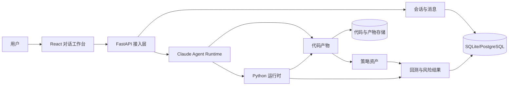
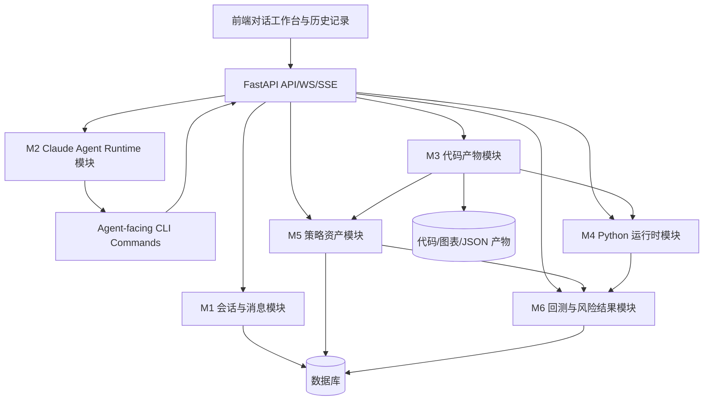
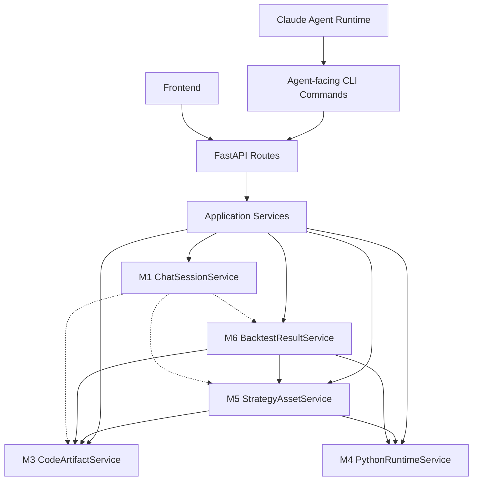
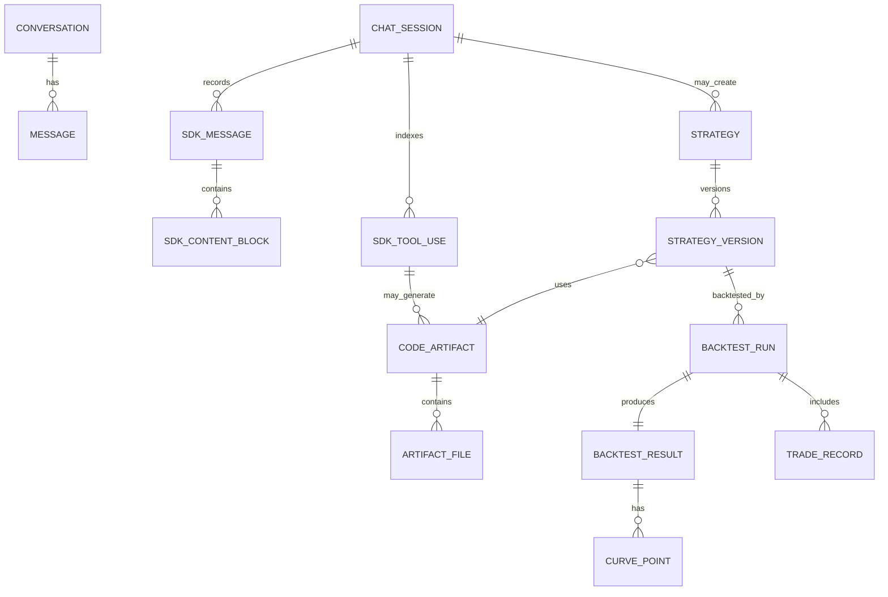

# 概要设计说明书（HLD）

## 1. 文档信息

| 项目 | 内容 |
|---|---|
| 项目/系统 | Chat-Quant 股票分析与策略验证对话式智能体系统 |
| 文档编号 | HLD-STOCK-001 |
| 版本/状态 | V0.2 / 草稿 |
| PRD 基线 | PRD-STOCK-001 V0.4 |
| 编制/评审/批准人 | Codex / 待评审 / 待批准 |
| 日期 | 2026-07-24 |

### 1.1 修订记录

| 版本 | 日期 | 修订内容 | 修订人 | 结论 |
|---|---|---|---|---|
| V0.1 | 2026-07-24 | 基于 PRD、README 与现有目录结构形成概要设计初稿 | 子智能体 A | 待评审 |
| V0.2 | 2026-07-24 | 按“Claude Agent 生成代码 + 系统资产化管理”重构模块边界，收敛为 6 大核心模块 | Codex | 待评审 |

## 2. 设计目的与范围

### 2.1 设计目的

本文定义 Chat-Quant 首期系统的总体架构、模块划分、关键流程、核心契约和数据模型。新版设计以 PRD 中“一个对话承载股票查询、选股辅助、策略创建、策略回测、历史复盘和策略复用”为目标，但不设计沉重的任务中心或传统量化平台。

首期核心思路是：

- 用户通过会话表达目标。
- `claude-agent-sdk` 负责驱动智能体，在系统提示、技能、Hook、工具权限和输出规范内生成 Python 代码、调用平台命令、执行分析、总结结果。
- 系统不内置复杂股票分析业务逻辑，而是负责会话、消息、代码产物、策略资产、回测结果和风险指标的持久化、校验、版本化和复用。
- 策略与回测作为平台能力提供给 Agent 调用；Agent 决定是否调用、何时调用和如何组合调用，平台负责命令协议、资产协议和权限边界。

### 2.2 范围

| 类型 | 内容 |
|---|---|
| 范围内 | 对话工作台、历史会话、自然语言查询分析、自然语言选股辅助、策略创建、策略回测、策略型历史会话复用、代码产物管理、策略版本管理、回测和风险结果管理 |
| 范围外 | 真实交易下单、资金账户、独立策略库页面、策略市场、多人协作、公开分享、复杂多策略组合、投顾合规闭环 |
| 技术约束 | 后端 FastAPI；前端 React/Vite/Tailwind 目标形态；Agent 基于 `claude-agent-sdk`；策略与回测基于 Python、akshare、pandas、backtrader；数据库基于 SQLAlchemy，首期 SQLite，可迁移 PostgreSQL |
| 设计取舍 | 不把“任务”设计成一等复杂工作流对象；SDK transcript 由 `claude-agent-sdk` session/session store 管理，系统只保存 ChatSession 索引和业务资产关联 |

## 3. 设计原则

| 编号 | 原则 | 说明 |
|---|---|---|---|
| DP-001 | 会话是入口 | 用户所有查询、策略创建、回测和追问都从会话进入，历史也以会话复盘为入口 |
| DP-002 | Agent 负责生成 | 智能体负责理解用户意图，生成查询、分析、策略、回测 Python 代码，并解释结果 |
| DP-003 | 系统负责定型 | 系统负责保存、校验、版本化和关联代码、策略、回测、风险结果 |
| DP-004 | 契约优先 | 策略资产化命令必须提交 `StrategyPackage`；回测运行命令必须基于 `BacktestRunSpec`；运行时必须返回 `ExecutionResult`；回测结果必须符合 `BacktestResult` |
| DP-005 | 代码可追溯 | 每段 Agent 生成代码必须有来源 SDK message、SDK Bash tool_use、版本、入口和执行结果 |
| DP-006 | 策略不覆盖 | 策略修改生成新 StrategyVersion，历史版本不可原地覆盖 |
| DP-007 | 回测不可变 | 一次 BacktestRun 的配置开始后不可变，再次运行生成新记录 |
| DP-008 | 平台提供能力，Agent 决定调用 | 策略创建、策略校验、回测、绘图、代码保存都是 Agent 可调用的平台命令，不是 Runtime 写死的流程 |
| DP-009 | 不越过边界 | Agent 行为通过 system prompt、skills、hooks、allowed tools、cwd、命令白名单和资产协议限制在产品范围内 |

## 4. 系统上下文

Chat-Quant 是面向股票分析和策略学习场景的对话式智能体系统。系统提供一个对话工作台，用户用自然语言完成查询分析、选股辅助、策略创建和策略回测。后端通过 Claude Agent Runtime 驱动智能体生成并执行 Python 代码，系统将关键产物资产化。



| 外部/基础对象 | 用途 | 责任边界 |
|---|---|---|
| Claude 模型与 `claude-agent-sdk` | 智能体运行、会话恢复、工具权限、Hook、技能调用、流式输出 | 由 Claude Agent Runtime 统一封装，业务模块不直接依赖 SDK 类型 |
| 用户自建技能 | 指导 Agent 生成 akshare/pandas/backtrader 代码 | 技能内容不在本 HLD 中设计，系统只负责加载、约束和记录 |
| akshare | 获取股票行情、基础数据、选股相关数据 | 主要在 Agent 生成的 Python 代码中使用，输出需标准化 |
| backtrader | 执行策略回测 | 通过标准回测入口和 `BacktestRunSpec` 调用，结果需符合 schema |
| Python 运行环境 | 执行 Agent 生成代码 | 受控目录、超时、日志捕获、结果文件校验 |

## 5. 总体架构

### 5.1 架构风格

首期采用“模块化单体 + Agent Runtime + Agent-facing CLI + 受控 Python 执行 + 资产化管理”的架构风格。FastAPI 后端承载平台能力 API、会话、代码产物、策略、回测和数据库访问；Claude Agent Runtime 负责启动智能体并提供命令界面。智能体能力通过 `claude-agent-sdk`、system prompt、skills、hooks、allowed tools、命令白名单和工作目录约束实现，不额外设计复杂任务编排引擎。



### 5.2 核心运行方式

系统通过三类轻量场景约束 Agent 行为，但不把场景升级成复杂任务系统。

| 场景 | Agent 主要行为 | 可调用平台能力 | 系统接收的资产 |
|---|---|---|
| 查询分析 | 生成 akshare/pandas 查询分析代码，运行后以文本、表格或图表总结行情、指标、选股结果 | 保存代码、执行 Python、生成 K 线/表格/文件产物 | CodeArtifact、ExecutionResult、ArtifactFile、ChartSpec、SDK assistant message |
| 策略创建 | 生成标准 backtrader 策略代码、参数 schema、策略说明；按需要调用策略保存和校验命令 | 保存代码、创建策略版本、校验策略版本 | CodeArtifact、Strategy、StrategyVersion、StrategyPackage |
| 策略回测 | 基于 StrategyVersion 和回测参数决定是否创建并运行回测，解析并总结结果 | 创建回测、运行回测、查询回测结果、生成收益/回撤图 | BacktestRun、BacktestResult、TradeRecord、收益曲线、回撤曲线 |

Agent Runtime 不写死以上场景的调用顺序。它只把系统提示、技能、命令清单和权限交给 Agent；Agent 像操作传统功能页面的人一样，通过命令调用平台能力完成业务。

### 5.3 协议边界

本系统是智能体应用，不把普通查询、基本面分析、选股分析强制约束为固定业务结果 schema。Agent 可以在运行过程中编写查询代码、调用工具、阅读执行结果，并用自然语言、Markdown 表格或图表回答用户。

系统只固定两类协议：

| 协议类型 | 是否固定 | 说明 |
|---|---|---|
| Agent 普通文本回答 | 不固定 | 由 Claude Agent 自由组织解释、依据、风险提示和后续建议 |
| 股价查询、基本面、选股等普通分析结果 | 不固定 | 默认作为 Agent 文本、表格或文件产物沉淀，不设计 `QueryAnalysisResult` 这类统一业务 schema |
| 系统工具输入输出 | 固定 | 例如 K 线绘图工具、回测图表工具、代码保存工具，便于前端渲染和历史回放 |
| 代码产物 | 固定 | 代码必须可追溯、可执行、可复用 |
| 策略资产 | 固定 | 策略必须能校验、版本化和再次回测 |
| 回测与风险结果 | 固定 | 回测结果必须能比较、复盘和再次展示 |

因此，协议设计原则是：少定义业务答案 schema，多定义工具协议和资产协议。没有系统工具覆盖的结果，Agent 直接文本输出；需要稳定渲染或复用的结果，必须进入工具协议或资产协议。

### 5.4 Agent 可调用命令

平台能力通过 Agent-facing CLI 命令暴露给智能体。命令行是 Agent 的工具界面；命令内部通过 RESTful API 调用 FastAPI，FastAPI 再调用应用服务和领域模块。模块之间仍然是 Python 内部调用，不通过 HTTP；HTTP 只用于 Agent 命令或前端访问平台能力。

典型命令清单：

| 命令 | 用途 | 后端入口 | 主要模块 |
|---|---|---|---|
| `chatq artifact save-code` | 保存 Agent 生成的 Python 代码 | `POST /api/artifacts/code` | M3 |
| `chatq runtime execute` | 执行普通 Python 代码产物 | `POST /api/runtime/execute` | M4 |
| `chatq chart kline` | 根据 K 线协议生成图表产物 | `POST /api/charts/kline` | M3/M4 |
| `chatq strategy create` | 根据 `StrategyPackage` 创建策略版本 | `POST /api/strategies` | M5 |
| `chatq strategy get` | 查询策略版本、入口和参数 schema | `GET /api/strategy-versions/{id}` | M5 |
| `chatq strategy validate` | 对策略版本做 import/smoke test | `POST /api/strategy-versions/{id}/validate` | M5/M4 |
| `chatq backtest create` | 创建回测运行记录 | `POST /api/backtests` | M6 |
| `chatq backtest run` | 执行指定回测运行 | `POST /api/backtests/{id}/run` | M6/M4 |
| `chatq backtest get` | 查询回测结果 | `GET /api/backtests/{id}` | M6 |
| `chatq conversation link-asset` | 将产物、策略或回测关联到 ChatSession 或 SDK tool_use | `POST /api/conversations/{id}/assets` | M1 |

命令是否调用、调用几个、调用顺序如何，由 Agent 根据用户目标和当前上下文决定。平台只负责命令幂等、权限校验、参数校验、状态记录和结果持久化。

## 6. 模块划分

### 6.1 模块总览

| 模块编号 | 模块 | 核心职责 | 数据所有权 | 主要依赖 |
|---|---|---|---|---|
| M1 | 会话与消息模块 | 管理产品历史入口、SDK session 索引、历史检索元数据和资产关联；历史消息通过 SDK session 读取 | ChatSession、AssetLink | FastAPI、数据库、M2-M6 |
| M2 | Claude Agent Runtime 模块 | 封装 `claude-agent-sdk`，配置 system prompt、skills、hooks、Bash 命令白名单、工具权限、cwd、session resume、SessionStore 和 SDK message stream 透传 | SDK session、SDK SessionStore 配置、Bash tool_use/tool_result 引用 | `claude-agent-sdk`、M1、Agent-facing CLI |
| M3 | 代码产物模块 | 保存 Agent 生成的查询、分析、策略、回测 Python 代码及 JSON/图表产物引用 | CodeArtifact、ArtifactFile | 文件存储、数据库 |
| M4 | Python 运行时模块 | 受控执行代码产物，捕获 stdout/stderr/异常/可选 JSON 和工具图表产物，返回 ExecutionResult | ExecutionResult、运行日志 | Python、akshare、pandas、backtrader、M3 |
| M5 | 策略资产模块 | 管理 Strategy、StrategyVersion、参数 schema、策略代码引用、验证状态、历史复用 | Strategy、StrategyVersion、StrategyPackage | M1、M3、M4、M6 |
| M6 | 回测与风险结果模块 | 管理 BacktestRun、BacktestConfig、BacktestResult、交易明细、收益曲线、回撤曲线和失败原因 | BacktestRun、BacktestResult、TradeRecord、CurveArtifact | M3、M4、M5 |

### 6.2 M1 会话与消息模块

| 项目 | 内容 |
|---|---|
| 职责 | 保存产品历史入口、SDK session id、关联股票、关联策略、关联回测、历史筛选和续聊上下文；消息详情从 SDK session 读取 |
| 不负责 | 不理解策略代码，不执行 Python，不计算回测指标 |
| 核心能力 | `create_chat_session`、`append_user_prompt`、`list_chat_sessions`、`get_session_detail`、`get_session_messages`、`link_asset` |
| 关键关系 | ChatSession 绑定 SDK session id；SDK messages 由 SDK session/session store 提供；AssetLink 关联 CodeArtifact、StrategyVersion、BacktestRun |
| PRD 覆盖 | FR-007、FR-008、FR-009 |

产品里的“会话/历史会话”只是 SDK session 的产品化索引和历史展示入口，不是自研任务系统，也不定义独立 Agent 状态机。消息、工具调用和最终结果优先从 `claude-agent-sdk` 的 session messages 读取；首期不再把 SDK message/content block/result 复制到 M1 表。

### 6.3 M2 Claude Agent Runtime 模块

| 项目 | 内容 |
|---|---|
| 职责 | 统一封装 `ClaudeSDKClient` 和 `ClaudeAgentOptions`，管理 system prompt、skills、hooks、allowed tools、Bash 命令白名单、工作目录、session resume、SDK message stream 透传与持久化 |
| 不负责 | 不设计技能内容，不内置具体策略逻辑，不直接写策略或回测数据库 |
| 核心能力 | `run_agent_turn`、`build_agent_options`、`load_skill_context`、`load_command_manifest`、`configure_session_store`、`get_session_messages`、`resume_sdk_session` |
| 约束机制 | 通过 system prompt 定义产品边界；通过 skills 提供领域能力；通过 hooks 做运行前后检查；通过 allowed tools 和命令白名单限制可执行动作 |
| PRD 覆盖 | FR-000、FR-001、FR-002、FR-004、FR-005、FR-006、FR-007 |

Runtime 的设计重点是“薄封装”。业务层不再自造 Agent 工作流，也不把 SDK message 转换成另一套平台事件协议；只把 Claude Agent SDK 配置成受控运行环境。Runtime 不主动调用策略、回测、绘图或代码保存服务；它只把这些能力以 CLI 命令形式交给 Agent，并按 SDK 原生消息、Bash tool_use、tool_result 和 ResultMessage 语义留痕。

### 6.4 M3 代码产物模块

| 项目 | 内容 |
|---|---|
| 职责 | 保存和版本化 Agent 生成代码、入口文件、依赖说明、来源 SDK message、来源 SDK Bash tool_use、执行结果引用 |
| 不负责 | 不判断策略收益，不直接执行代码 |
| 核心能力 | `save_code_artifact`、`create_artifact_version`、`get_artifact_entrypoint`、`link_artifact_to_message`、`save_generated_files` |
| 产物类型 | `query_script`、`analysis_script`、`strategy_script`、`backtest_script`、`json_result`、`chart_file` |
| PRD 覆盖 | FR-001、FR-003、FR-004、FR-005、FR-008、FR-009 |

CodeArtifact 是系统可追溯性的基础。任何能影响分析结果或回测结果的代码都必须入库登记，并保存到受控目录。

### 6.5 M4 Python 运行时模块

| 项目 | 内容 |
|---|---|
| 职责 | 执行指定 CodeArtifact 或标准运行入口，限制工作目录和超时，捕获 stdout、stderr、异常、可选 JSON 输出和文件产物 |
| 不负责 | 不生成业务解释，不保存策略版本，不直接决定会话标题 |
| 核心能力 | `execute_python_artifact`、`execute_backtest_spec`、`validate_result_schema`、`collect_runtime_artifacts`、`terminate_timeout_run` |
| 运行输入 | CodeArtifact、entrypoint、env、args、stdin_json、timeout、output_dir |
| 运行输出 | ExecutionResult |
| PRD 覆盖 | FR-001、FR-003、FR-005、FR-006 |

运行时必须稳定承接策略和回测：

- 策略创建后，用运行时做 import/smoke test。
- 策略回测时，运行时根据 `BacktestRunSpec` 执行标准 backtrader 入口。
- 运行时只返回执行事实，不负责业务解释。

### 6.6 M5 策略资产模块

| 项目 | 内容 |
|---|---|
| 职责 | 管理策略名称、描述、参数 schema、策略代码引用、版本、验证状态、来源会话、历史复用 |
| 不负责 | 不执行正式回测，不计算最大回撤 |
| 核心能力 | `create_strategy_from_package`、`create_strategy_version`、`validate_strategy_version`、`copy_strategy_version`、`update_strategy_metadata` |
| 状态 | `draft`、`validating`、`validated`、`invalid`、`archived` |
| PRD 覆盖 | FR-004、FR-008、FR-009 |

策略必须以版本为单位管理。用户修改策略逻辑时生成新 StrategyVersion；用户只调整回测参数时不生成策略版本，只生成新的 BacktestRun。

### 6.7 M6 回测与风险结果模块

| 项目 | 内容 |
|---|---|
| 职责 | 管理每次回测运行、回测配置、执行状态、收益指标、风险指标、交易明细、收益曲线、回撤曲线和失败原因 |
| 不负责 | 不生成策略代码，不保存用户聊天文本 |
| 核心能力 | `create_backtest_run`、`build_backtest_run_spec`、`complete_backtest_run`、`fail_backtest_run`、`list_backtests_by_strategy`、`compare_backtest_runs` |
| 状态 | `pending`、`running`、`succeeded`、`failed`、`canceled` |
| PRD 覆盖 | FR-005、FR-003、FR-008、FR-009 |

回撤与风险指标不单独拆模块，作为 BacktestResult 的一部分管理。这样历史会话里可以按策略版本查看最近若干次回测，并比较收益、最大回撤、胜率和交易次数。

### 6.8 模块依赖关系

模块之间通过 Python 类、函数和数据契约调用，不通过 HTTP 接口互相访问。FastAPI 同时服务两个入口：前端页面和 Agent-facing CLI 命令。CLI 命令作为 Agent 的操作界面，通过 RESTful API 调用平台能力；REST 进入后端后，再由应用服务调用各模块。



| 模块 | 允许依赖 | 禁止依赖 |
|---|---|---|
| M1 会话与消息 | M2-M6 的资产引用 DTO、平台能力调用结果 | 不直接 import `akshare`、`backtrader`，不执行 Python |
| M2 Claude Agent Runtime | M1 提供上下文、Agent-facing CLI 命令清单、SDK session 映射 | 不直接调用 M3/M4/M5/M6，不直接写 Strategy/Backtest 表，不直接解析回测指标 |
| M3 代码产物 | 文件存储、ArtifactRepository | 不依赖策略和回测业务，不调用 Agent |
| M4 Python 运行时 | M3 读取代码、运行环境配置 | 不写会话消息，不写策略/回测业务表 |
| M5 策略资产 | M3 读取策略代码，M4 做策略校验，StrategyRepository | 不调用 Agent，不执行正式回测 |
| M6 回测与风险结果 | M5 读取策略版本，M3 读取代码，M4 执行回测，BacktestRepository | 不生成策略代码，不调用 Agent |

跨模块调用由应用服务承接，但应用服务只实现“平台能力”，不替 Agent 预设完整业务链路。例如 `StrategyApplicationService` 提供“创建策略版本”“校验策略版本”等独立能力，是否调用这些能力由 Agent 根据用户目标通过命令自行决定；`BacktestApplicationService` 提供“创建回测”“运行回测”“查询结果”等独立能力，是否调用以及何时调用也由 Agent 决定。

### 6.9 后端代码架构

后端采用“模块化单体 + 轻量 DDD 分层”组织代码，不采用 MVC。原因是本系统的复杂度主要来自领域资产和状态流转，而不是页面 CRUD。FastAPI route 只负责 HTTP 输入输出，应用服务负责实现平台能力用例，领域层定义实体和契约，基础设施层封装数据库、文件、Claude SDK 和 Python 运行时。

建议目录：

```text
apps/api/app/
  api/
    routes/
      chat.py
      conversations.py
      strategies.py
      backtests.py
      artifacts.py

  application/
    chat_application_service.py
    strategy_application_service.py
    backtest_application_service.py

  cli/
    chatq.py
    commands/
      artifact_commands.py
      runtime_commands.py
      chart_commands.py
      strategy_commands.py
      backtest_commands.py
      conversation_commands.py

    domain/
    chat_sessions/
      entities.py
      services.py
      dto.py
    sdk_transcript/
      entities.py
      dto.py
    artifacts/
      entities.py
      services.py
      dto.py
    strategies/
      entities.py
      services.py
      validators.py
      dto.py
    backtests/
      entities.py
      services.py
      metrics.py
      dto.py

  infrastructure/
    db/
      models/
      repositories/
    agent/
      claude_runtime.py
      hooks.py
      prompts.py
      skill_loader.py
      command_manifest.py
    runtime/
      python_runtime.py
      sandbox.py
    storage/
      filesystem_artifact_store.py

  schemas/
    api/
    contracts/
      strategy_package.py
      backtest_run_spec.py
      execution_result.py
      backtest_result.py
```

分层规则：

| 层 | 职责 | 依赖方向 |
|---|---|---|
| `api/routes` | HTTP 参数接收、鉴权、响应转换 | 只调用 application |
| `application` | 实现平台能力用例，如发消息、创建策略版本、执行回测运行 | 调用 domain service 和 infrastructure 实现 |
| `domain` | 定义实体、DTO、业务状态、校验规则和服务接口 | 不依赖 FastAPI、SQLAlchemy、Claude SDK |
| `infrastructure` | 实现数据库、文件存储、Claude SDK、Python 执行 | 可依赖 domain 契约 |
| `schemas/contracts` | 跨模块稳定契约 | 被 application、domain、infrastructure 共同使用 |

### 6.10 应用服务与模块服务契约

本节先稳定类名、函数名和参数结构。实现时可以用普通类，也可以在详细设计阶段补充 `Protocol` 或抽象基类；HLD 不强制技术形式，但要求签名语义稳定。

应用服务是 REST API 和 Agent-facing CLI 命令背后的平台能力入口，不表示系统会替 Agent 固定编排完整操作顺序。端到端能力调用顺序由 Agent 通过命令调用来决定。

应用能力服务：

```python
class ChatApplicationService:
    async def handle_user_message(
        self,
        command: SendUserMessageCommand,
    ) -> ChatTurnResult:
        ...


class StrategyApplicationService:
    async def create_strategy_from_agent_run(
        self,
        command: CreateStrategyCommand,
    ) -> StrategyVersionDTO:
        ...

    async def reuse_strategy_version(
        self,
        command: ReuseStrategyCommand,
    ) -> StrategyVersionDTO:
        ...


class BacktestApplicationService:
    async def run_backtest(
        self,
        command: CreateBacktestCommand,
    ) -> BacktestResultDTO:
        ...
```

M1 会话与消息：

```python
class ChatSessionService:
    async def create_chat_session(
        self,
        command: CreateChatSessionCommand,
    ) -> ChatSessionDTO:
        ...

    async def get_context(
        self,
        chat_session_id: str,
        limit: int = 30,
    ) -> ChatSessionContext:
        ...

    async def link_asset(
        self,
        command: LinkAssetCommand,
    ) -> AssetLinkDTO:
        ...

class SDKSessionReader:
    async def get_session_messages(
        self,
        sdk_session_id: str,
        limit: int | None = None,
    ) -> list[SDKMessage]:
        ...

    async def get_session_tool_uses(
        self,
        sdk_session_id: str,
    ) -> list[SDKToolUseRef]:
        ...
```

M2 Claude Agent Runtime：

```python
class ClaudeAgentRuntime:
    async def run_turn(
        self,
        command: AgentTurnCommand,
    ) -> AgentTurnResult:
        ...

    async def resume_session(
        self,
        chat_session_id: str,
        sdk_session_id: str | None,
    ) -> AgentSession:
        ...
```

M3 代码产物：

```python
class CodeArtifactService:
    async def save_code(
        self,
        command: SaveCodeArtifactCommand,
    ) -> CodeArtifactDTO:
        ...

    async def save_file_artifact(
        self,
        command: SaveFileArtifactCommand,
    ) -> ArtifactFileDTO:
        ...

    async def get_artifact(
        self,
        artifact_id: str,
    ) -> CodeArtifactDTO:
        ...

    async def get_entrypoint(
        self,
        artifact_id: str,
    ) -> CodeEntrypoint:
        ...

    async def list_by_sdk_tool_use(
        self,
        sdk_tool_use_id: str,
    ) -> list[CodeArtifactDTO]:
        ...
```

M4 Python 运行时：

```python
class PythonRuntimeService:
    async def execute_artifact(
        self,
        spec: PythonExecutionSpec,
    ) -> ExecutionResult:
        ...

    async def smoke_test_strategy(
        self,
        spec: StrategySmokeTestSpec,
    ) -> ExecutionResult:
        ...

    async def execute_backtest(
        self,
        spec: BacktestRunSpec,
    ) -> ExecutionResult:
        ...
```

M5 策略资产：

```python
class StrategyAssetService:
    async def create_from_package(
        self,
        command: CreateStrategyFromPackageCommand,
    ) -> StrategyVersionDTO:
        ...

    async def validate_version(
        self,
        strategy_version_id: str,
    ) -> StrategyValidationResult:
        ...

    async def get_version(
        self,
        strategy_version_id: str,
    ) -> StrategyVersionDTO:
        ...

    async def create_new_version(
        self,
        command: CreateStrategyVersionCommand,
    ) -> StrategyVersionDTO:
        ...

    async def update_metadata(
        self,
        command: UpdateStrategyMetadataCommand,
    ) -> StrategyDTO:
        ...
```

M6 回测与风险结果：

```python
class BacktestResultService:
    async def create_run(
        self,
        command: CreateBacktestRunCommand,
    ) -> BacktestRunDTO:
        ...

    async def build_run_spec(
        self,
        backtest_run_id: str,
    ) -> BacktestRunSpec:
        ...

    async def complete_run(
        self,
        command: CompleteBacktestRunCommand,
    ) -> BacktestResultDTO:
        ...

    async def fail_run(
        self,
        command: FailBacktestRunCommand,
    ) -> BacktestRunDTO:
        ...

    async def get_result(
        self,
        backtest_run_id: str,
    ) -> BacktestResultDTO:
        ...

    async def list_by_strategy_version(
        self,
        strategy_version_id: str,
    ) -> list[BacktestRunDTO]:
        ...
```

### 6.11 核心 DTO 与参数契约

```python
class SendUserMessageCommand(BaseModel):
    user_id: str
    project_id: str
    chat_session_id: str | None = None
    content: str
    attachments: list[str] = []


class AgentTurnCommand(BaseModel):
    chat_session_id: str
    sdk_session_id: str | None = None
    user_message_id: str
    scenario: str
    context: "ChatSessionContext"
    system_prompt_key: str
    skill_names: list[str]
    allowed_tools: list[str]
    allowed_commands: list[str]
    command_manifest_path: str
    working_dir: str


class AgentTurnResult(BaseModel):
    chat_session_id: str
    sdk_session_id: str | None = None
    sdk_result_message_id: str | None = None
    sdk_result_subtype: str | None = None
    sdk_message_refs: list["SDKMessageRef"] = []
    sdk_tool_uses: list["SDKToolUseRef"] = []
    assistant_message: str
    generated_artifacts: list["GeneratedArtifact"]
    strategy_package: "StrategyPackage | None" = None
    error: str | None = None
```

```python
class SDKToolUseRef(BaseModel):
    sdk_tool_use_id: str
    sdk_message_id: str
    sdk_session_id: str
    tool_name: str
    command_name: str | None = None
    input_json: dict[str, Any]
    tool_result_content: Any | None = None
    is_error: bool = False
    error: str | None = None


class ArtifactRef(BaseModel):
    artifact_id: str
    artifact_type: Literal["code", "chart", "json", "image", "table", "log", "file"]
    path: str | None = None
    payload_json: dict[str, Any] | None = None
    metadata: dict[str, Any] = {}


class AgentCommandDefinition(BaseModel):
    name: str
    description: str
    cli: str
    method: Literal["GET", "POST", "PUT", "DELETE"]
    endpoint: str
    input_schema_ref: str
    output_schema_ref: str | None = None
    required_permissions: list[str] = []
```

图表工具协议由系统固定，供 Agent 调用工具生成可渲染产物。普通分析结果不需要固定 schema；只有进入图表工具的内容需要满足图表协议。

```python
class KLinePoint(BaseModel):
    date: date
    open: float
    high: float
    low: float
    close: float
    volume: float | None = None


class ChartOverlay(BaseModel):
    name: str
    type: Literal["line", "band", "marker"]
    data: list[dict[str, Any]]


class ChartAnnotation(BaseModel):
    date: date | None = None
    x: str | float | None = None
    y: float | None = None
    text: str


class KLineChartSpec(BaseModel):
    chart_type: Literal["kline"] = "kline"
    title: str
    symbol: str
    name: str | None = None
    timeframe: str = "1d"
    data: list[KLinePoint]
    overlays: list[ChartOverlay] = []
    volume: bool = True
    annotations: list[ChartAnnotation] = []


class BacktestChartSpec(BaseModel):
    chart_type: Literal["equity_curve", "drawdown_curve"]
    backtest_run_id: str
    title: str
    data: list[dict[str, Any]]
```

```python
class StrategyPackage(BaseModel):
    name: str
    description: str | None = None
    strategy_type: str
    entrypoint: str
    code_artifact_id: str
    params_schema: dict[str, Any]
    default_params: dict[str, Any]


class CreateStrategyFromPackageCommand(BaseModel):
    chat_session_id: str
    source_sdk_session_id: str | None = None
    source_sdk_message_uuid: str | None = None
    source_sdk_tool_use_id: str | None = None
    package: StrategyPackage


class StrategySmokeTestSpec(BaseModel):
    strategy_version_id: str
    code_artifact_id: str
    entrypoint: str
    params: dict[str, Any]
    timeout_seconds: int = 30
```

```python
class CreateBacktestRunCommand(BaseModel):
    chat_session_id: str
    source_sdk_session_id: str | None = None
    source_sdk_message_uuid: str | None = None
    source_sdk_tool_use_id: str | None = None
    strategy_version_id: str
    symbols: list[str]
    market: str
    start_date: date
    end_date: date
    initial_cash: float
    commission: float
    slippage: float = 0
    data_adjust: str = "qfq"
    timeframe: str = "1d"
    params: dict[str, Any]


class BacktestRunSpec(BaseModel):
    backtest_run_id: str
    strategy_version_id: str
    code_artifact_id: str
    entrypoint: str
    symbols: list[str]
    market: str
    start_date: date
    end_date: date
    initial_cash: float
    commission: float
    slippage: float = 0
    data_adjust: str = "qfq"
    timeframe: str = "1d"
    params: dict[str, Any]
    output_path: str
```

```python
class RuntimeArtifact(BaseModel):
    type: Literal["json_result", "chart", "curve", "log", "file"]
    path: str
    name: str | None = None
    metadata: dict[str, Any] = {}


class ExecutionResult(BaseModel):
    status: Literal["succeeded", "failed", "timeout"]
    exit_code: int | None
    stdout: str
    stderr: str
    artifacts: list[RuntimeArtifact]
    error: str | None
    duration_ms: int


class CompleteBacktestRunCommand(BaseModel):
    backtest_run_id: str
    execution_result: ExecutionResult
```

```python
class BacktestResultPayload(BaseModel):
    status: Literal["succeeded", "failed"]
    metrics: dict[str, Any]
    trades: list[dict[str, Any]]
    equity_curve: list[dict[str, Any]]
    drawdown_curve: list[dict[str, Any]]
    warnings: list[str]
```

## 7. 核心对象关系



核心关系：

```text
ChatSession
  -> SDK session messages
  -> SDK content block / SDK tool_use
  -> CodeArtifact

Strategy
  -> StrategyVersion
      -> BacktestRun
          -> BacktestResult
          -> TradeRecord
          -> EquityCurve
          -> DrawdownCurve
```

## 8. 策略与回测能力契约

本节只定义平台能力的输入、输出、校验和资产边界，不定义 Agent 的业务决策。Agent 可以生成代码并自由决定是否调用平台命令；一旦调用策略或回测相关命令，平台必须通过标准契约接住代码和运行结果，才能保证策略可复用、回测可追溯、风险结果可比较。

### 8.1 策略资产契约

`chatq strategy create` 的输入必须包含 `StrategyPackage`：

```json
{
  "name": "均线突破策略",
  "description": "短期均线上穿长期均线买入，下穿卖出",
  "strategy_type": "ma_cross",
  "entrypoint": "strategy.py:GeneratedStrategy",
  "params_schema": {
    "fast_period": {"type": "int", "default": 10, "min": 2},
    "slow_period": {"type": "int", "default": 30, "min": 5},
    "stake": {"type": "int", "default": 100, "min": 1}
  },
  "default_params": {
    "fast_period": 10,
    "slow_period": 30,
    "stake": 100
  },
  "code_artifact_id": "code_xxx"
}
```

策略代码最低规范：

```python
import backtrader as bt


class GeneratedStrategy(bt.Strategy):
    params = (
        ("fast_period", 10),
        ("slow_period", 30),
        ("stake", 100),
    )

    def __init__(self):
        pass

    def next(self):
        pass
```

策略验证规则：

| 校验项 | 要求 |
|---|---|
| 语法校验 | Python 文件可解析 |
| 入口校验 | `entrypoint` 指向的类可 import |
| 基类校验 | 策略类继承 `backtrader.Strategy` 或项目约定的 `BaseStrategy` |
| 参数校验 | `params_schema` 和代码 params 能对应 |
| 副作用校验 | 策略代码不得包含真实交易下单、任意网络写操作、越权文件访问 |
| smoke test | 可在样例 OHLCV 数据上完成一次最小 backtrader run |

### 8.2 回测运行契约

`chatq backtest run` 会将 `BacktestRunSpec` 提交给 Python 运行时：

```json
{
  "backtest_run_id": "bt_xxx",
  "strategy_version_id": "stv_xxx",
  "entrypoint": "strategy.py:GeneratedStrategy",
  "symbols": ["300031"],
  "market": "CN",
  "start_date": "2024-01-01",
  "end_date": "2024-12-31",
  "initial_cash": 100000,
  "commission": 0.001,
  "slippage": 0,
  "data_adjust": "qfq",
  "timeframe": "1d",
  "params": {
    "fast_period": 10,
    "slow_period": 30,
    "stake": 100
  },
  "output_path": "result.json"
}
```

运行时返回 `ExecutionResult`：

```json
{
  "status": "succeeded",
  "exit_code": 0,
  "stdout": "Starting Portfolio Value: 100000.00",
  "stderr": "",
  "artifacts": [
    {"type": "json_result", "path": "result.json"},
    {"type": "curve", "path": "equity_curve.json"},
    {"type": "curve", "path": "drawdown_curve.json"}
  ],
  "error": null,
  "duration_ms": 12000
}
```

标准 `BacktestResult`：

```json
{
  "status": "succeeded",
  "metrics": {
    "initial_value": 100000,
    "final_value": 118500,
    "total_return_pct": 18.5,
    "annual_return_pct": 12.3,
    "max_drawdown_pct": 8.7,
    "max_drawdown_start": "2024-04-10",
    "max_drawdown_end": "2024-05-22",
    "max_drawdown_duration_days": 42,
    "sharpe_ratio": 1.21,
    "win_rate_pct": 53.2,
    "total_trades": 47
  },
  "trades": [],
  "equity_curve": [],
  "drawdown_curve": [],
  "warnings": []
}
```

### 8.3 单个回测运行命令的内部责任

下表只描述 `chatq backtest run` 这个单个平台命令被调用后的内部责任分配，不描述 Agent 的决策内容，也不对 Agent 是否使用该命令作要求。

| 内部责任项 | 责任模块 | 输入 | 输出 |
|---|---|---|---|
| 读取回测记录 | M6 回测与风险结果 | backtest_run_id | BacktestRun |
| 读取策略版本 | M5 策略资产 | strategy_version_id | StrategyVersion、entrypoint、params_schema |
| 生成运行规格 | M6 回测与风险结果 | BacktestRun、StrategyVersion | BacktestRunSpec |
| 执行 Python | M4 Python 运行时 | BacktestRunSpec、CodeArtifact | ExecutionResult |
| 保存文件产物 | M3 代码产物 | ExecutionResult artifacts | ArtifactFile |
| 解析回测结果 | M6 回测与风险结果 | result.json、曲线文件 | BacktestResult、TradeRecord、CurvePoint |
| 更新运行状态 | M6 回测与风险结果 | ExecutionResult、BacktestResult 或错误 | BacktestRun succeeded/failed |

## 9. 核心数据模型概要

| 实体 | 关键字段 | 所属模块 | 说明 |
|---|---|---|---|
| ChatSession | `id`、`user_id`、`project_id`、`sdk_session_id`、`sdk_project_key`、`title`、`summary`、`symbols`、`tags`、`created_at`、`updated_at` | M1 | 产品历史入口和 SDK session 索引；不是 Agent 状态机 |
| SDK SessionStore Entry | SDK opaque transcript entry、`sdk_session_id`、sequence、timestamp | M2/Infra | 由 `claude-agent-sdk` SessionStore 读写；不是 M1 业务消息表 |
| SDKMessage | SDK 返回的 message 对象 | SDK | 通过 `get_session_messages()` 读取，不在 M1 另存一份 |
| SDKToolUseRef | `sdk_session_id`、`sdk_message_uuid`、`sdk_tool_use_id`、`tool_name`、`command_preview` | M1/M2 派生引用 | 从 SDK messages 解析出的轻量引用，可用于 AssetLink，不保存完整 tool_result |
| AssetLink | `id`、`chat_session_id`、`sdk_session_id`、`sdk_message_uuid`、`sdk_tool_use_id`、`asset_type`、`asset_id`、`display_snapshot`、`created_at` | M1 | 将 SDK session transcript 中的位置与 CodeArtifact、StrategyVersion、BacktestRun 关联 |
| CodeArtifact | `id`、`source_sdk_session_id`、`source_sdk_message_uuid`、`source_sdk_tool_use_id`、`artifact_type`、`entrypoint`、`version`、`path`、`checksum`、`created_at` | M3 | 保存 Agent 生成代码和文件产物 |
| Strategy | `id`、`chat_session_id`、`name`、`description`、`tags`、`created_at`、`updated_at` | M5 | 策略资产本体，不单独提供策略列表页 |
| StrategyVersion | `id`、`strategy_id`、`version`、`code_artifact_id`、`entrypoint`、`params_schema`、`default_params`、`status`、`created_at` | M5 | 策略版本，不覆盖历史 |
| BacktestRun | `id`、`strategy_version_id`、`chat_session_id`、`status`、`config_json`、`execution_result_id`、`created_at`、`completed_at` | M6 | 一次不可变回测运行 |
| BacktestResult | `id`、`backtest_run_id`、`metrics_json`、`warnings_json`、`summary` | M6 | 标准化回测结果 |
| TradeRecord | `id`、`backtest_run_id`、`symbol`、`side`、`datetime`、`price`、`size`、`pnl` | M6 | 交易明细 |
| CurvePoint | `id`、`backtest_run_id`、`curve_type`、`date`、`value` | M6 | `equity` 或 `drawdown` 曲线点 |

## 10. API 与事件概要

### 10.1 API

| 接口 | 方法 | 说明 | 主要模块 |
|---|---|---|---|
| `/api/chat/messages` | POST | 发送用户消息，触发 Agent 运行 | M1、M2 |
| `/api/chat/{chat_session_id}/stream` | WS/SSE | 透传 SDK message stream；前端按 SDK message/content block 语义渲染 | M1、M2 |
| `/api/conversations` | GET | 查询历史入口列表；名称保留为产品 API，数据本体为 ChatSession | M1 |
| `/api/conversations/{id}` | GET | 查询 ChatSession 详情、SDK session messages 和关联资产 | M1 |
| `/api/conversations/{id}/assets` | POST | 将产物、策略或回测关联到 ChatSession 或 SDK message/tool_use | M1 |
| `/api/strategies/{id}` | GET | 查询策略详情和版本 | M5 |
| `/api/strategies` | POST | 根据 `StrategyPackage` 创建策略资产和版本 | M5 |
| `/api/strategy-versions/{id}` | GET | 查询策略版本、入口和参数 schema | M5 |
| `/api/strategy-versions/{id}/validate` | POST | 校验策略版本 | M5、M4 |
| `/api/backtests` | POST | 创建 BacktestRun | M6 |
| `/api/backtests/{id}/run` | POST | 执行 BacktestRun | M6、M4 |
| `/api/backtests/{id}` | GET | 查询回测结果、交易、收益曲线、回撤曲线 | M6 |
| `/api/artifacts/{id}` | GET | 获取代码、JSON 或图表产物 | M3 |
| `/api/artifacts/code` | POST | 保存 Agent 生成的代码 | M3 |
| `/api/runtime/execute` | POST | 执行普通 Python 代码产物 | M4 |
| `/api/charts/kline` | POST | 生成 K 线图表产物 | M3/M4 |

### 10.2 SDK 流式消息

M2 读取 `claude-agent-sdk` 产生的 message stream 后做两件事：

1. 当前请求内透传 SDK message stream；SDK 自身把 transcript 写入本地 session 或配置的 SessionStore。
2. 对前端透传 SDK message，并只追加传输层 envelope，例如 `sequence`、`chat_session_id`、`received_at`，不改变 SDK message 语义。

历史会话详情不读 M1 消息表，而是用 SDK `get_session_messages()` 读取 `sdk_session_id` 对应的 message。多机部署时，M2 必须配置 SDK SessionStore，让 transcript 存在可共享的外部存储中。

前端进度展示直接由 SDK 内容驱动：

| SDK 语义 | 前端表现 | 数据来源 |
|---|---|---|
| assistant text block / partial text | AI 气泡文本流式追加 | 当前 SDK stream；历史从 `get_session_messages()` 读取 |
| Bash tool_use，且命令为 `chatq ...` | 工具调用进度行 | SDK message content block |
| tool_result | 工具输出摘要、错误或产物引用 | SDK message content block |
| ResultMessage | 本轮完成、用量、耗时、最终文本 | SDK result message |

代码、策略、回测等业务资产的创建结果由对应 CLI 的 JSON 输出、M3-M6 数据表和 AssetLink 关联共同表达。

## 11. 异常与边界处理

| 场景 | 触发条件 | 系统行为 | 用户反馈 |
|---|---|---|---|
| 用户输入缺少关键参数 | 缺股票池、时间范围、回测资金等 | Agent 按 system prompt 先澄清或声明默认假设 | 展示澄清问题或默认假设 |
| 策略代码不可 import | 语法错误、入口错误、依赖缺失 | StrategyVersion 标记 invalid，保存错误信息 | “策略已生成但校验未通过” |
| smoke test 失败 | 样例数据上无法运行 | StrategyVersion 标记 invalid，不允许正式回测 | 展示失败原因和可重试入口 |
| 回测执行超时 | Python 运行超过阈值 | 终止进程，BacktestRun 标记 failed | “回测超时，可缩短区间或调整策略” |
| result.json 不符合 schema | Agent 代码输出不标准 | BacktestRun 标记 failed，保存 ExecutionResult | “回测执行完成但结果格式无法解析” |
| akshare 数据不可用 | 接口失败、数据为空、股票代码不支持 | ExecutionResult failed 或 warnings；Agent 解释数据口径 | “当前数据源不可用或数据为空” |
| 历史保存失败 | 数据库异常 | 当前结果继续展示，记录 pending persist | “结果已展示，历史保存稍后重试” |

## 12. 安全、合规与运行限制

| 类别 | 设计要求 |
|---|---|
| Agent 工具权限 | 默认只允许必要读写、Python 执行、限定工作目录；禁止真实交易、越权文件访问和不明外部写操作 |
| Python 执行 | 设置工作目录、超时、输出目录、环境变量白名单；运行日志必须可追踪 |
| 代码产物 | 保存 checksum、来源 SDK message、来源 SDK Bash tool_use；策略代码和回测代码可回溯 |
| 数据隔离 | 会话、策略、回测按 user/project 隔离 |
| 投资建议边界 | 所有分析和回测结果必须提示数据口径、假设和“回测不代表未来收益” |
| 敏感配置 | API Key 和服务 Token 不写入代码产物，不在消息中明文展示 |

## 13. 非功能设计

| 编号 | 类别 | 目标 | 设计机制 |
|---|---|---|---|
| NFR-001 | 可追溯性 | 每个结论都能追溯到 SDK message、SDK Bash tool_use、代码、运行结果 | SDK session transcript + AssetLink + CodeArtifact + ExecutionResult |
| NFR-002 | 可复用性 | 策略可从历史会话复制、改参数、再次回测 | StrategyVersion + BacktestRun |
| NFR-003 | 可维护性 | 模块边界清晰，Agent 能力不扩散到业务模块 | SDK 封装在 M2，代码执行封装在 M4 |
| NFR-004 | 可验证性 | 策略和回测结果可自动校验 | StrategyPackage、BacktestRunSpec、BacktestResult schema |
| NFR-005 | 性能 | 常见查询首包 P95 <= 3s，回测异步执行 | 流式响应、后台执行、历史分页 |
| NFR-006 | 可扩展性 | 后续支持更多技能、数据源和策略模板 | 技能外置、代码产物类型可扩展、策略版本化 |

## 14. 需求追踪

| PRD 需求 | 主要模块 | 关键产物 |
|---|---|---|
| FR-000 意图理解、澄清与任务确认 | M1、M2 | SDK session messages、ResultMessage、澄清消息、默认假设 |
| FR-001 自然语言股票数据查询 | M2、M3、M4 | 查询代码、ExecutionResult、分析摘要 |
| FR-002 结果解释与依据展示 | M2、M1 | SDK assistant message、Bash 工具引用、代码引用、风险提示 |
| FR-003 股票图表可视化 | M2、M3、M4、M6 | ChartSpec、ArtifactFile、收益曲线、回撤曲线 |
| FR-004 自然语言策略创建 | M2、M3、M5 | StrategyPackage、Strategy、StrategyVersion |
| FR-005 策略回测验证 | M4、M5、M6 | BacktestRunSpec、BacktestRun、BacktestResult |
| FR-006 自然语言选股辅助 | M2、M3、M4 | 选股分析代码、候选列表、指标摘要 |
| FR-007 连续追问与上下文理解 | M1、M2 | ChatSession、SDK session messages、ResultMessage |
| FR-008 历史会话与复盘 | M1、M3、M5、M6 | 历史会话详情、代码引用、策略引用、回测引用 |
| FR-009 策略型历史会话复用 | M1、M5、M6 | StrategyVersion、BacktestRun、版本对比 |

## 15. 待决事项

| 编号 | 待决事项 | 影响 | 建议 |
|---|---|---|---|
| TBD-001 | Python 运行时是否需要容器隔离 | 影响安全和部署复杂度 | 本地开发先进程隔离，生产建议容器或沙箱 |
| TBD-002 | StrategyPackage schema 细节 | 影响 Agent 输出和策略校验 | 详细设计阶段先固定 P0 字段 |
| TBD-003 | BacktestResult 曲线存储方式 | 影响历史回放性能 | 小数据入库，大曲线文件化并保存引用 |
| TBD-004 | 技能目录和加载策略 | 影响 Agent Runtime 配置 | 技能由用户创建，系统只定义加载路径和权限 |
| TBD-005 | akshare 数据缓存策略 | 影响查询速度和数据口径 | 首期先记录数据来源和时间，缓存策略后置 |

## 16. 下游详细设计输入

详细设计需优先稳定以下契约：

- SDK session 存储策略，包括 `ChatSession`、SDK `SessionStore`、`get_session_messages()` 读取路径和 `AssetLink`。
- `CodeArtifact` 文件目录、版本号、checksum 和 entrypoint 规则。
- `StrategyPackage` schema。
- `StrategyVersion` 校验流程。
- `BacktestRunSpec` schema。
- `ExecutionResult` schema。
- SDK Bash tool_use/tool_result 与 `chatq ...` CLI 输出的关联规则。
- `KLineChartSpec`、`BacktestChartSpec` schema。
- `BacktestResult`、`TradeRecord`、`EquityCurve`、`DrawdownCurve` schema。
- Python 运行时的超时、工作目录、环境变量和结果收集规则。

验收前必须证明：

- 用户能在一次会话里创建策略并完成回测。
- 策略型历史会话能看到策略描述、参数快照、历史回测记录，并能再次发起回测。
- 一次回测能保存收益、最大回撤、回撤区间、交易明细、收益曲线和回撤曲线。
- Agent 生成代码、运行结果、策略版本和回测结果之间可追溯。
