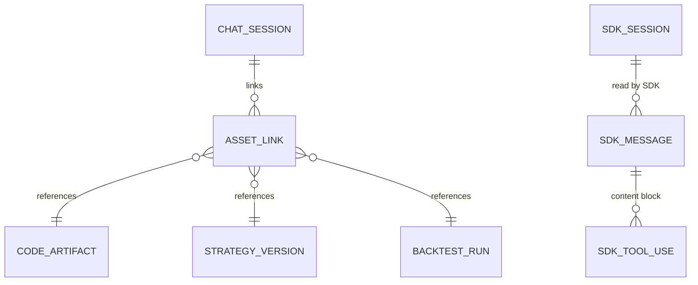

# 详细设计-M1-会话与消息模块

## 1. 文档信息

| 项目 | 内容 |
|---|---|
| 模块 | M1 会话与消息模块 |
| 系统 | Chat-Quant 股票分析与策略验证对话式智能体系统 |
| 版本 | V0.3 |
| 日期 | 2026-07-25 |
| 输入依据 | `docs/概要设计说明书.md`、`docs/prd.md`、`docs/stock-agent-prototype.html`、`docs/Claude-Agent-SDK框架介绍.md` |
| 设计范围 | ChatSession、AssetLink、SDK session message 读取、SDK SessionStore 接入边界 |

## 2. 设计结论

官方 Agent SDK 已提供 session message 读取能力：Python 侧可用 `get_session_messages()`，TypeScript 侧可用 `getSessionMessages()`；SDK 还提供 SessionStore 机制，把 transcript 镜像到 S3、Redis、Postgres 或自定义存储。因此 M1 不再建立 `sdk_messages`、`sdk_content_blocks`、`sdk_results` 这些表，也不把 SDK message 转成一套平台消息模型。

M1 只负责：

1. 保存 ChatSession：产品历史入口、标题、摘要、标签、股票、当前焦点资产、`sdk_session_id`。
2. 通过 M2/SDK 读取 session messages：会话详情和历史回放从 SDK session transcript 获取。
3. 保存 AssetLink：把 CodeArtifact、StrategyVersion、BacktestRun、ArtifactFile 等业务资产关联到 `chat_session_id`、`sdk_session_id`、SDK message uuid 或 SDK tool_use id。
4. 提供历史列表、上下文摘要、资产聚合和权限隔离。

不做的事：

| 不做 | 原因 |
|---|---|
| 自建 Agent message 表 | SDK 已能按 session 获取 messages |
| 自建 content block/result 表 | 会导致 SDK 语义复制和版本兼容负担 |
| 自建 Agent 状态机 | SDK ResultMessage 和当前连接状态足够表达 turn 结果 |
| 自建事件流协议 | 前端直接渲染 SDK message/content block |

## 3. PRD/UI 映射

| PRD | M1 设计响应 |
|---|---|
| FR-000 意图理解、澄清与任务确认 | 用户输入、助手澄清和最终结果均来自 SDK session messages；ChatSession 保存标题、摘要、标签和假设快照 |
| FR-001 股票数据查询 | ChatSession 保存 symbols、markets、time_range；查询代码、表格和图表通过 AssetLink 沉淀 |
| FR-002 结果解释与依据展示 | SDK assistant text block 用于对话气泡；依据和风险提示由 SDK 文本及资产快照展示 |
| FR-003 图表可视化 | 图表文件归 M3/M4/M6；M1 用 AssetLink 挂接到 SDK message 或 SDK tool_use |
| FR-004 自然语言策略创建 | StrategyVersion 由 M5 生成；M1 记录当前焦点策略和策略资产链接 |
| FR-005 策略回测验证 | BacktestRun 由 M6 生成；M1 记录结果链接、摘要快照和最近回测焦点 |
| FR-006 自然语言选股辅助 | 候选池表格或 JSON 作为业务资产链接到 ChatSession |
| FR-007 连续追问与上下文理解 | `get_context` 返回 SDK session id、摘要、焦点资产和最近资产引用 |
| FR-008 历史会话与复盘 | `list_chat_sessions` 支持搜索、筛选、排序；详情聚合 SDK messages 和资产摘要 |
| FR-009 策略型历史会话复用 | 会话详情返回 StrategyVersion、参数快照、历史 BacktestRun 列表和再次回测上下文 |

| 原型元素 | M1 对象/来源 | 说明 |
|---|---|---|
| 左侧最近会话列表 | ChatSession.title、snippet、updated_at、symbols、tags | 列表不需要拉全量 SDK messages |
| 顶部标题与副标题 | ChatSession.title、kind、last_saved_at、data_scope_label | 展示“策略型历史会话”“自动保存于”“数据口径” |
| 对话气泡 | SDK session messages | 用户、助手、tool_result 均按 SDK 原生 message/content block 渲染 |
| 工具调用进度 | SDK Bash tool_use/tool_result | “调用平台命令”来自 SDK content block |
| 图表和结果对象 | AssetLink.display_snapshot + M3/M5/M6 详情 | M1 保存轻量快照，权威数据在资产模块 |
| 再次回测/更稳一点 | ChatSession.current_strategy_version_id/current_backtest_run_id | 新用户消息带入当前焦点资产 |

## 4. 数据模型

### 4.1 ChatSession

ChatSession 是产品层历史入口，兼容 API 路径中的 `/api/conversations` 命名，但不表达独立 Agent 生命周期。

| 字段 | 类型 | 必填 | 说明 |
|---|---|---|---|
| id | string/uuid | 是 | 产品历史入口 ID，建议前缀 `conv_` |
| user_id | string | 是 | 所属用户 |
| project_id | string | 是 | 项目或工作区 ID |
| sdk_session_id | string | 否 | Claude SDK session id |
| sdk_project_key | string | 否 | SDK 本地项目路径或 SessionStore 分区键 |
| title | string | 是 | 历史列表标题 |
| snippet | string | 否 | 历史列表摘要 |
| summary | text | 否 | 长上下文压缩摘要，作为 SDK session 失效时的兜底上下文 |
| kind | string | 是 | `normal`、`strategy`、`screening` 等产品分类 |
| task_type | string | 否 | 查询、选股、策略、回测等产品筛选字段 |
| symbols | json | 否 | 关联股票代码数组 |
| markets | json | 否 | 市场数组 |
| tags | json | 否 | 用户标签和系统标签 |
| current_strategy_version_id | string | 否 | 当前焦点策略版本 |
| current_backtest_run_id | string | 否 | 当前焦点回测 |
| data_scope_label | string | 否 | UI 展示的数据口径 |
| archived_at | datetime | 否 | 归档时间 |
| deleted_at | datetime | 否 | 软删除时间 |
| created_at | datetime | 是 | 创建时间 |
| updated_at | datetime | 是 | 更新时间 |

### 4.2 SDK Session Messages

M1 不拥有 SDK message 表。会话详情读取流程：

1. M1 根据 `chat_session_id` 查询 ChatSession。
2. M1 调用 M2 的 `SDKSessionReader.get_session_messages(sdk_session_id)`。
3. M2 通过 SDK `get_session_messages()` 或配置的 SessionStore 读取 messages。
4. M1 将 SDK messages 与 AssetLink 按 `sdk_session_id`、`sdk_message_uuid`、`sdk_tool_use_id` 合并返回给前端。

消息读取规则：

| 规则 | 说明 |
|---|---|
| 事实源 | SDK session transcript |
| 本地复制 | 不复制为 `sdk_messages`、`sdk_content_blocks`、`sdk_results` |
| 稳定引用 | 资产关联优先使用 SDK message uuid 和 SDK tool_use id |
| 摘要 | ChatSession.summary/snippet 可存产品摘要，但不替代 transcript |
| 断线续传 | 当前连接用传输层 sequence；历史补拉用 SDK session messages |

### 4.3 AssetLink

AssetLink 将 SDK transcript 中的位置与业务资产关联。代码产物本体归 M3，策略版本归 M5，正式回测结果归 M6。

| 字段 | 类型 | 必填 | 说明 |
|---|---|---|---|
| id | string/uuid | 是 | 关联 ID |
| chat_session_id | string | 是 | 所属 ChatSession |
| sdk_session_id | string | 否 | SDK session id |
| sdk_message_uuid | string | 否 | SDK message uuid 或可回放定位字段 |
| sdk_tool_use_id | string | 否 | SDK Bash tool_use id |
| asset_type | string | 是 | `code_artifact`、`strategy_version`、`backtest_run`、`artifact_file` 等 |
| asset_id | string | 是 | 外部资产 ID |
| relation_type | string | 是 | `created`、`used`、`displayed`、`result` |
| display_snapshot | json | 否 | UI 展示快照 |
| created_at | datetime | 是 | 创建时间 |
| updated_at | datetime | 是 | 更新时间 |

### 4.4 SDK SessionStore Infrastructure

生产和多实例环境必须由 M2 配置 SDK SessionStore。若选 Postgres，建议使用独立基础设施表保存 SDK opaque transcript entry，例如：

| 字段 | 类型 | 说明 |
|---|---|---|
| sdk_session_id | string | SDK session id |
| sequence_no | bigint | session 内顺序 |
| entry_json | json/text | SDK opaque transcript entry |
| entry_type | string | SDK entry 类型，仅作运维索引 |
| created_at | datetime | 写入时间 |

约束：

1. 该表属于 SDK SessionStore 适配器，不属于 M1 领域模型。
2. 应按 SDK opaque JSON 保存，不拆解为业务 message/content/result 表。
3. 应封装在 M2/infrastructure，M1 只能通过 `SDKSessionReader` 读取。

### 4.5 关联关系



## 5. 应用服务设计

### 5.1 ChatSessionService

```python
class ChatSessionService:
    async def create_chat_session(self, command: CreateChatSessionCommand) -> ChatSessionDTO: ...
    async def update_chat_session(self, command: UpdateChatSessionCommand) -> ChatSessionDTO: ...
    async def list_chat_sessions(self, query: ChatSessionListQuery) -> Page[ChatSessionListItemDTO]: ...
    async def get_chat_session_detail(self, chat_session_id: str, user_id: str) -> ChatSessionDetailDTO: ...
    async def get_context(self, chat_session_id: str, user_id: str, limit: int = 30) -> ChatSessionContext: ...
    async def summarize_context(self, chat_session_id: str, user_id: str) -> ChatSessionDTO: ...
    async def archive_chat_session(self, chat_session_id: str, user_id: str) -> None: ...
    async def soft_delete_chat_session(self, chat_session_id: str, user_id: str) -> None: ...
```

关键规则：

1. 首条用户消息可以懒创建 ChatSession，并用消息内容生成默认标题。
2. SDK turn 完成后更新 `sdk_session_id`、`snippet`、`updated_at`、`last_saved_at` 和必要的资产焦点字段。
3. `get_context` 返回 SDK session id、ChatSession 摘要、AssetLink 摘要、当前策略/回测焦点。
4. `get_chat_session_detail` 应聚合 SDK session messages 和 AssetLink，但不把 messages 写入 M1 表。

### 5.2 SDKSessionReader

```python
class SDKSessionReader:
    async def get_session_messages(
        self,
        sdk_session_id: str,
        limit: int | None = None,
    ) -> list[SDKMessage]:
        ...

    async def get_session_tool_uses(
        self,
        sdk_session_id: str,
    ) -> list[SDKToolUseRef]:
        ...
```

关键规则：

1. `get_session_messages` 优先调用 SDK 官方读取函数。
2. 如果配置了外部 SessionStore，读取必须经过 SDK store/load 语义，不直接解析 M1 表。
3. `get_session_tool_uses` 是只读派生函数，从 SDK messages 中找 Bash tool_use/tool_result，便于 UI 和资产引用对齐。

### 5.3 AssetLinkService

```python
class AssetLinkService:
    async def link_asset(self, command: LinkAssetCommand) -> AssetLinkDTO: ...
    async def list_assets_for_context(self, chat_session_id: str, user_id: str) -> list[ChatSessionAssetDTO]: ...
    async def list_assets_for_sdk_message(self, sdk_session_id: str, sdk_message_uuid: str, user_id: str) -> list[AssetLinkDTO]: ...
```

关键规则：

1. `chat_session_id + asset_type + asset_id + relation_type` 建议幂等，重复调用更新展示快照。
2. 链接资产前必须调用资产所属模块或仓储验证资产存在且属于同一用户/项目。
3. `sdk_message_uuid`、`sdk_tool_use_id` 都是可选来源引用；能从 CLI 上下文拿到时应尽量填写。
4. 展示快照只保存历史列表和右侧详情所需字段，不复制完整代码或完整回测明细。

## 6. API/CLI 契约

`/api/conversations` 是产品兼容路径，内部映射到 ChatSession。

| 方法 | 路径 | 用途 |
|---|---|---|
| `POST` | `/api/conversations` | 新建 ChatSession |
| `GET` | `/api/conversations` | 历史列表、搜索、筛选 |
| `GET` | `/api/conversations/{chat_session_id}` | 详情，含 SDK session messages、资产摘要、当前焦点 |
| `PATCH` | `/api/conversations/{chat_session_id}` | 编辑标题、标签、归档状态、摘要字段 |
| `DELETE` | `/api/conversations/{chat_session_id}` | 软删除历史会话 |
| `POST` | `/api/conversations/{chat_session_id}/messages` | 发送用户消息并触发 M2 SDK turn |
| `GET` | `/api/conversations/{chat_session_id}/messages` | 通过 SDK session 读取历史 messages |
| `GET` | `/api/conversations/{chat_session_id}/stream` | 当前 turn 的 SDK message stream 透传 |
| `POST` | `/api/conversations/{chat_session_id}/assets` | 关联业务资产 |
| `GET` | `/api/conversations/{chat_session_id}/context` | 获取续聊上下文，主要供 M2 内部调用 |

发送消息响应示例：

```json
{
  "chat_session_id": "conv_001",
  "sdk_session_id": "claude_sess_abc",
  "stream_url": "/api/conversations/conv_001/stream"
}
```

AssetLink 输入：

```json
{
  "chat_session_id": "conv_001",
  "sdk_session_id": "claude_sess_abc",
  "sdk_message_uuid": "msg_abc",
  "sdk_tool_use_id": "toolu_01",
  "asset_type": "backtest_run",
  "asset_id": "bt_901",
  "relation_type": "result",
  "display_snapshot": {
    "title": "V3 回测完成",
    "annual_return_pct": 18.6,
    "max_drawdown_pct": -12.8
  }
}
```

Agent-facing CLI：

| 命令 | 后端入口 | 用途 |
|---|---|---|
| `chatq conversation get-context --chat-session-id <id>` | `GET /api/conversations/{id}/context` | Agent 读取续聊上下文 |
| `chatq conversation link-asset` | `POST /api/conversations/{id}/assets` | 将 CodeArtifact、StrategyVersion、BacktestRun 或 ArtifactFile 关联到 ChatSession |
| `chatq conversation update-summary` | `PATCH /api/conversations/{id}` | 更新标题、摘要、标签和任务元数据 |

## 7. 数据库表设计

### 7.1 chat_sessions

| 字段 | 类型 | 约束 | 说明 |
|---|---|---|---|
| id | varchar(40) | PK | ChatSession ID |
| user_id | varchar(64) | not null | 所属用户 |
| project_id | varchar(64) | not null | 所属项目 |
| sdk_session_id | varchar(128) | null, index | SDK session |
| sdk_project_key | varchar(256) | null | SDK project/session store 分区 |
| title | varchar(200) | not null | 标题 |
| snippet | varchar(500) | null | 列表摘要 |
| summary | text | null | 上下文摘要 |
| kind | varchar(32) | not null | 产品分类 |
| task_type | varchar(32) | null | 主任务类型 |
| symbols_json | json/text | null | 股票列表 |
| markets_json | json/text | null | 市场列表 |
| strategy_type | varchar(64) | null | 策略分类 |
| tags_json | json/text | null | 标签 |
| current_strategy_version_id | varchar(40) | null, index | 当前策略版本 |
| current_backtest_run_id | varchar(40) | null, index | 当前回测 |
| data_scope_label | varchar(120) | null | 数据口径 |
| last_saved_at | datetime | null | 自动保存 |
| archived_at | datetime | null | 归档 |
| deleted_at | datetime | null | 删除 |
| created_at | datetime | not null | 创建时间 |
| updated_at | datetime | not null | 更新时间 |

索引：

| 索引 | 字段 | 说明 |
|---|---|---|
| idx_chat_sessions_user_updated | user_id, deleted_at, updated_at desc | 历史列表 |
| idx_chat_sessions_user_kind_updated | user_id, kind, updated_at desc | 策略型会话筛选 |
| idx_chat_sessions_user_task_updated | user_id, task_type, updated_at desc | 任务类型筛选 |
| idx_chat_sessions_sdk_session | sdk_session_id | SDK session 回查 |

### 7.2 asset_links

| 字段 | 类型 | 约束 | 说明 |
|---|---|---|---|
| id | varchar(40) | PK | 链接 ID |
| chat_session_id | varchar(40) | FK chat_sessions.id, index | 所属 ChatSession |
| sdk_session_id | varchar(128) | null, index | SDK session |
| sdk_message_uuid | varchar(128) | null, index | SDK message 引用 |
| sdk_tool_use_id | varchar(128) | null, index | SDK Bash tool_use |
| asset_type | varchar(40) | not null | `code_artifact`、`strategy_version`、`backtest_run`、`artifact_file` |
| asset_id | varchar(64) | not null | 外部资产 ID |
| relation_type | varchar(40) | not null | `created`、`used`、`result`、`displayed`、`reused` |
| display_snapshot_json | json/text | null | 历史和详情快照 |
| created_at | datetime | not null | 创建 |
| updated_at | datetime | not null | 更新 |

索引：

| 索引 | 字段 | 说明 |
|---|---|---|
| uq_asset_links_relation | chat_session_id, asset_type, asset_id, relation_type | 幂等关联 |
| idx_asset_links_chat_created | chat_session_id, created_at | 会话资产列表 |
| idx_asset_links_asset | asset_type, asset_id | 从资产回查会话 |
| idx_asset_links_tool_use | sdk_tool_use_id | 从 Bash 调用回查资产 |

### 7.3 sdk_session_store_entries

该表仅在选择 Postgres SessionStore 时需要，且由 M2/infra 拥有。M1 不直接依赖该表。

| 字段 | 类型 | 约束 | 说明 |
|---|---|---|---|
| sdk_session_id | varchar(128) | not null, index | SDK session |
| sequence_no | bigint | not null | session 内顺序 |
| entry_json | json/text | not null | SDK opaque transcript entry |
| entry_type | varchar(64) | null | 运维索引 |
| created_at | datetime | not null | 写入时间 |

## 8. 关键流程

### 8.1 首条消息与 SDK turn

1. 前端提交用户输入到 `/api/conversations/{id}/messages`；没有 ChatSession 时后端懒创建。
2. M2 使用 `claude-agent-sdk` 启动或恢复 SDK session，并把用户输入交给 SDK。
3. M2 当前连接内透传 SDK message stream 给前端。
4. SDK 自身把 transcript 写入本地 session 或配置的 SessionStore。
5. 如果 Bash CLI 产出业务资产，CLI 或后端服务调用 `link_asset` 写入 AssetLink。
6. SDK ResultMessage 到达后，M1 更新 ChatSession 的 snippet、sdk_session_id、焦点资产和 last_saved_at。

### 8.2 打开历史会话

1. 前端请求 `/api/conversations/{id}`。
2. M1 读取 ChatSession 和 AssetLink。
3. M1/M2 通过 `sdk_session_id` 调用 SDK `get_session_messages()`。
4. 后端把 SDK messages 与 AssetLink 合并返回，前端按 SDK content block 渲染。

### 8.3 续聊

1. M2 优先用 `sdk_session_id` 恢复 SDK session。
2. 如果 SDK session 不可恢复，M2 读取 `ChatSessionContext`，把 summary 和焦点资产作为兜底上下文。
3. 新 transcript 仍进入 SDK session/session store，同一 ChatSession 只更新元数据和资产链接。

## 9. 异常与降级

| 场景 | 处理 | 用户感知 |
|---|---|---|
| SDK session messages 读取失败 | 返回 ChatSession 摘要和 AssetLink；提示可重试 | “历史消息暂时无法加载” |
| SDK session 已失效 | 使用 ChatSession.summary + AssetLink 摘要兜底续聊 | “已使用摘要恢复上下文” |
| SessionStore 写入失败 | 当前 turn 可继续展示；标记 pending persist，禁止丢失资产链接 | “结果已展示，历史保存稍后重试” |
| Bash 命令失败 | 失败事实保留在 SDK tool_result；资产不写或写失败快照 | 工具步骤显示失败原因 |
| 资产链接失败 | 不影响 SDK transcript；记录 `asset_link_failed` 审计 | 结果可见但右侧资产入口缺失 |

## 10. 测试设计

单元测试：

| 对象 | 重点 |
|---|---|
| ChatSessionService | 创建、标题默认值、软删除、标签更新、上下文摘要 |
| SDKSessionReader | `get_session_messages()` 调用、分页/limit、session 不存在处理 |
| AssetLinkService | 幂等关联、跨用户拒绝、展示快照更新 |

集成测试：

1. 发送首条股票查询，验证 ChatSession 创建、SDK session id 回写、stream 正常透传。
2. 打开历史会话，验证 messages 来自 SDK session，而不是 M1 message 表。
3. Agent 通过 Bash 调用 `chatq backtest run`，验证 AssetLink 写入并可对齐 SDK tool_use id。
4. SessionStore 不可用时，验证降级提示和 pending persist。
5. 用户 A 不能读取用户 B 的 ChatSession 或 SDK session messages。

## 11. 模块交付物

| 类型 | 文件/对象 |
|---|---|
| Domain | `ChatSession`、`AssetLink` |
| Infrastructure | `SDKSessionReader`、可选 `SDKSessionStoreAdapter` |
| Repository | `ChatSessionRepository`、`AssetLinkRepository` |
| Service | `ChatSessionService`、`AssetLinkService` |
| API | `/api/conversations`、`/messages`、`/stream`、`/assets`、`/context` |
| Migration | `chat_sessions`、`asset_links`；可选 SDK SessionStore opaque 表 |

## 12. 待确认问题

| 编号 | 问题 | 建议 |
|---|---|---|
| M1-TBD-001 | SDK message uuid 在不同 SDK 版本中是否稳定 | AssetLink 同时保存 `sdk_session_id` 和 `sdk_tool_use_id`，必要时保存 content block path |
| M1-TBD-002 | SessionStore 选择 | 单机开发用 SDK 本地 session；生产建议 Postgres 或对象存储 SessionStore |
| M1-TBD-003 | 历史搜索是否需要全文索引 | 首期搜索 ChatSession title/snippet/tags；后续可建只读搜索索引，不作为事实源 |
| M1-TBD-004 | SDK session 失效后的上下文恢复格式 | 用 ChatSession.summary + 最近 AssetLink 摘要兜底 |
