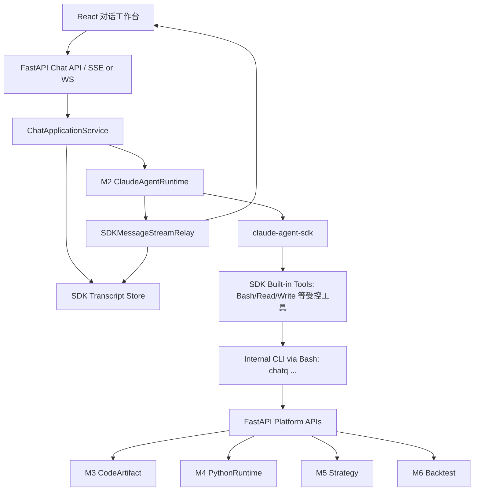
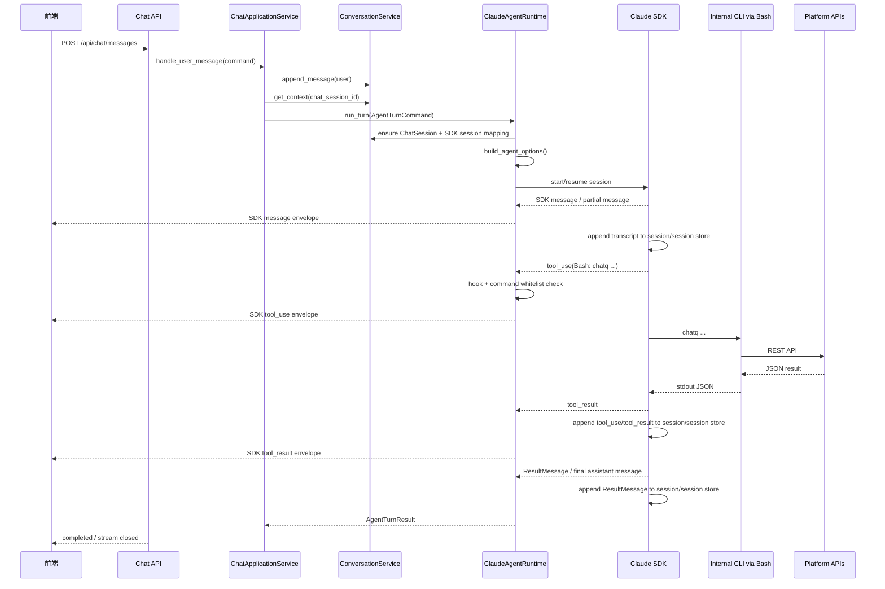
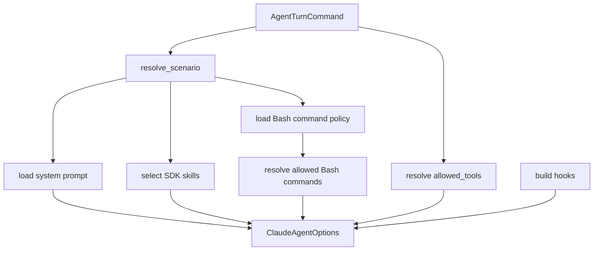

# 详细设计说明书 - M2 Claude Agent Runtime 模块

## 1. 文档信息

| 项目 | 内容 |
|---|---|
| 项目/系统 | Chat-Quant 股票分析与策略验证对话式智能体系统 |
| 模块编号 | M2 |
| 模块名称 | Claude Agent Runtime 模块 |
| 基线文档 | `docs/概要设计说明书.md`、`docs/prd.md`、`docs/stock-agent-prototype.html` |
| 版本/状态 | V0.2 / 草稿 |
| 日期 | 2026-07-24 |

## 2. 设计目标与边界

### 2.1 设计目标

M2 负责把 `claude-agent-sdk` 配置为 Chat-Quant 可控、可追踪、可恢复的智能体运行环境。它承接前端对话请求和 M1 会话上下文，启动或恢复 Claude SDK session，通过 SDK 原生 skills、Hook、allowed tools、Bash 权限和工作目录约束控制 Agent 行为，并透传 SDK 流式消息。历史消息由 SDK session / SessionStore 提供。

本版本基于 `docs/Claude-Agent-SDK框架介绍.md` 修订：Chat-Quant 不自建 Agent loop，也不新增额外 SDK 扩展工具。Agent 的多轮推理、工具选择、Bash 调用、工具结果回填和最终回复由 `claude-agent-sdk` 承担；系统只负责提供 `chatq ...` CLI、执行命令权限校验、透传 SDK 消息、持久化资产和审计。

核心目标：

| 目标 | 说明 |
|---|---|
| 薄封装 SDK | 统一封装 `ClaudeSDKClient`/`query()`、`ClaudeAgentOptions`、session resume、流式消息读取，不在业务层散落 SDK 类型 |
| 受控运行 | 通过 system prompt、SDK 原生 skills、hooks、allowed tools、Bash 命令白名单、cwd、环境变量白名单限制 Agent 行为 |
| 可追踪 | SDK session transcript 由 SDK/SessionStore 管理；生成代码和回测结果通过 AssetLink 回溯到 SDK session、message 和 Bash tool_use |
| 可续聊 | 维护 ChatSession 与 SDK session 的映射，支持历史会话继续追问 |
| 可流式展示 | 透传 SDK message stream，前端按 SDK message/content block 语义渲染 |
| 平台能力可发现 | 在 SDK 运行环境中提供受控 `chatq ...` Bash 命令说明和白名单，让 Agent 根据用户目标自行选择 CLI 命令；该能力不作为 Chat API 暴露 |

### 2.2 边界声明

M2 是 `claude-agent-sdk` 的 Runtime 薄封装，不是任务编排引擎，也不是股票策略业务服务。M2 不实现独立 Agent，不实现自己的 tool-use 循环，不在平台侧复刻 Claude Code 的智能体框架。

M2 范围内：

| 能力 | 说明 |
|---|---|
| 构造 Agent 运行参数 | system prompt、SDK skills 配置、hooks、allowed tools、cwd、环境变量、Bash 命令白名单 |
| 启动/恢复 Agent turn | 根据 `AgentTurnCommand` 调用 Claude SDK，并维护 SDK session |
| 透传 SDK 消息 | 将 SDK message stream 加上传输 envelope 后推给前端，不改写 SDK 语义 |
| 接入 SDK session 存储 | 配置 SDK SessionStore；当前 turn 透传 SDK stream；历史详情通过 `get_session_messages()` 读取 |
| 执行边界检查 | 校验工具权限、拒绝未知/越权工具、限制工作目录、屏蔽敏感配置 |
| 对接前端进度 | 透传 SDK message/content block，让前端渲染“工具调用”“分析中”“完成/失败” |

M2 范围外：

| 不负责事项 | 所属模块/机制 |
|---|---|
| 股票查询、选股、策略、回测的业务编排 | Agent 自主决定；平台能力通过 Bash 调用内部 `chatq ...` CLI 提供 |
| 策略创建、策略版本保存、策略校验 | M5 策略资产模块 |
| Python 代码执行、stdout/stderr 捕获、超时终止 | M4 Python 运行时模块 |
| 代码产物保存、图表/JSON 文件登记 | M3 代码产物模块 |
| BacktestRun、指标、交易明细、收益/回撤曲线 | M6 回测与风险结果模块 |
| 历史会话列表、标题、摘要、资产关联 | M1 会话与消息模块 |
| 用户权限模型、登录态鉴权 | API 接入层与应用服务 |

特别约束：

1. Runtime 不写死“先保存代码、再执行、再创建策略、再回测”的流程。
2. Runtime 不替 Agent 编排业务步骤；Agent 在 SDK loop 中自行决定是否调用平台工具、何时调用和如何组合调用。
3. Agent 如需使用平台能力，只能通过 SDK 自带 `Bash` 工具调用 `chatq ...` CLI，例如 `chatq artifact save-code`、`chatq runtime execute`、`chatq strategy create`、`chatq backtest run`。
4. 首期不新增额外 SDK 扩展工具；如后续启用必须重新评审权限模型和部署模型。
5. Runtime 只记录 Agent 调用了哪个 Bash/CLI 命令、命令输入输出摘要、产物引用和状态。

## 3. PRD/UI 映射

### 3.1 PRD 功能映射

| PRD 编号 | 需求 | M2 责任 | 非 M2 责任 |
|---|---|---|---|
| FR-000 | 意图理解、澄清与任务确认 | 注入澄清策略 system prompt；允许 Agent 基于上下文先追问或声明默认假设；输出 `waiting_user` 状态 | 不保存任务对象，不实现固定意图分类器 |
| FR-001 | 自然语言股票数据查询 | 通过 SDK 原生 skills 提供股票分析能力说明；Bash 环境允许受控数据查询/执行 CLI；流式返回分析过程 | 不内置行情查询逻辑，不定义统一 `QueryAnalysisResult` |
| FR-002 | 结果解释与依据展示 | 在 prompt 中要求说明任务理解、关键假设、数据口径、风险提示；记录工具调用作为依据 | 不计算指标，不判断投资价值 |
| FR-003 | 股票图表可视化 | Bash 环境允许受控图表/产物 CLI；CLI 输出进入 SDK tool_result，资产引用进入 AssetLink | 不渲染图表，不生成最终 ChartSpec 内容 |
| FR-004 | 自然语言策略创建 | 通过 SDK 原生 skills 提供策略代码生成能力说明；Bash 环境允许受控策略创建/校验 CLI | 不直接创建 Strategy/StrategyVersion |
| FR-005 | 策略回测验证 | Bash 环境允许受控回测创建、运行、查询 CLI；记录命令调用日志 | 不执行回测，不解析风险指标 |
| FR-006 | 自然语言选股辅助 | 通过 SDK 原生 skills 提供选股能力说明，并允许普通 Python 执行能力；支持候选列表通过文本/表格/文件产物返回 | 不固化选股业务 schema |
| FR-007 | 连续追问与上下文理解 | 加载 M1 会话上下文并恢复 SDK session；支持同会话多 turn | 不生成历史列表，不决定会话摘要 |
| FR-008 | 历史会话与复盘 | 记录 sdk_session_id，配置 SessionStore，支撑 M1 通过 SDK 读取历史 messages | 不负责历史检索和删除 |
| FR-009 | 策略型历史会话复用 | 在上下文中提供历史 StrategyVersion、BacktestRun 引用，允许 Agent 调用再次回测命令 | 不维护策略版本列表和回测结果对比 |

### 3.2 UI 原型映射

| UI 区域/交互 | 原型表现 | M2 输出/契约 |
|---|---|---|
| 对话输入框 | 用户输入股票问题、选股条件或策略想法 | `POST /api/chat/messages` 触发 `AgentTurnCommand` |
| 对话流文本 | Assistant 气泡逐步输出任务理解、解释、结论 | SDK assistant message/text block 或 partial text |
| 工具调用进度 | “读取上下文 / 调用平台命令 / 整理产物 / 生成回复”进度卡 | SDK Bash tool_use/tool_result，前端做轻量 UI 投影 |
| 图表对象 | 收益、回撤、对比、行情 tab 与详情面板 | Agent 调用图表/回测命令后返回 ArtifactFile 或业务资产引用，M2 透传 SDK message stream |
| 结果对象详情 | 策略逻辑、参数快照、年化收益、最大回撤 | M2 不生成详情数据；只转发 M5/M6 产物引用和 Agent 总结 |
| 再次回测 | 按钮转为“再次回测这个策略”追问 | M2 恢复同一 ChatSession 的 SDK session，并把历史资产引用放入上下文 |
| 改成更稳一点 | 按钮转为优化追问 | M2 不决定优化策略；Agent 根据上下文生成新版本并调用 CLI |
| 自动保存提示 | “结果已作为对话消息展示”“已保存到历史记录” | M2 推送运行完成事件；M1 负责 persisted 事件 |
| 历史会话加载 | 侧边栏打开策略型历史会话 | M2 通过 `resume_session` 续接 SDK session；上下文由 M1 提供 |

## 4. 运行架构

### 4.1 模块位置



### 4.2 推荐包结构

沿用概要设计目录：

```text
app/
  application/
    chat_service.py
    dto.py
  infrastructure/
    agent/
      claude_runtime.py
      prompts.py
      sdk_skills.py
      hooks.py
      bash_command_policy.py
      sdk_stream_relay.py
      sdk_transcript_store.py
      tool_call_logger.py
  domain/
    conversations/
      dto.py
      services.py
  schemas/
    contracts/
      agent_runtime.py
```

职责建议：

| 文件 | 责任 |
|---|---|
| `claude_runtime.py` | `ClaudeAgentRuntime` 主入口，组合 SDK options、session、message stream |
| `prompts.py` | system prompt 模板加载、变量渲染、版本号管理 |
| `sdk_skills.py` | 选择并配置 SDK 原生 skills；不解析技能内容、不拼装自研技能 prompt |
| `hooks.py` | 实现 SDK hooks：`PreToolUse`、`PostToolUse`、`Stop`、`SessionStart`、`SessionEnd`、`UserPromptSubmit` 等 |
| `bash_command_policy.py` | 维护 Bash 可执行命令白名单、命令说明来源和参数边界校验 |
| `sdk_stream_relay.py` | 对 SDK message stream 添加传输 envelope 后透传给前端 |
| `sdk_session_store.py` | 配置 SDK SessionStore，提供 session message 读取和外部存储适配 |
| `tool_call_logger.py` | 从 SDK Bash tool_use/tool_result 中提取 `chatq ...` 命令摘要、输出引用和错误 |
| `schemas/contracts/agent_runtime.py` | `AgentTurnCommand`、`AgentTurnResult`、`SDKMessageRef`、`SDKToolUseRef`、`SDKResultRef` |

### 4.3 运行时序



### 4.4 SDK 结果语义

M2 不维护独立 Runtime 状态机。一次用户输入是否完成，以 SDK stream 中的 `ResultMessage` 及 SDK 异常为准；HTTP/SSE 连接状态只是传输状态，不写成业务状态。

| SDK/传输事实 | 系统记录 | 说明 |
|---|---|---|
| SDK session id | `chat_sessions.sdk_session_id` | 续聊和历史回放依据 |
| Assistant/User/System/Result message | SDK session messages | 由 SDK `get_session_messages()` 读取 |
| text/tool_use/tool_result content block | SDK message content | 保留 SDK 原生结构，由前端直接渲染 |
| Bash tool_use 执行 `chatq ...` | SDK message content + AssetLink | 命令输出在 tool_result，业务资产在 AssetLink |
| ResultMessage | SDK result message | subtype、duration、usage、result 文本来自 SDK |
| SDK exception / transport cancel | 传输错误 + ChatSession 摘要 | 不发明新的 Agent 状态机 |

## 5. SDK Session 与产品历史映射

### 5.1 数据关系

Chat-Quant 的产品历史入口只保存 SDK session 的索引和展示元数据。SDK transcript 是事实源，并由 SDK session / SessionStore 管理；M1 不再拆出 SDK message/content/result 表。

建议字段：

| 字段 | 类型 | 说明 |
|---|---|---|
| `chat_session_id` | string | 产品历史入口 ID |
| `sdk_session_id` | string/null | Claude SDK session ID，用于续聊 |
| `sdk_project_key` | string/null | SDK project/session store 分区 |
| `sdk_message_uuid` | string/null | SDK message 引用，仅用于资产对齐 |
| `sdk_tool_use_id` | string/null | SDK tool_use ID，仅用于资产对齐 |
| `asset_link_id` | string/null | 关联到 M1 AssetLink |
| `raw_json` | object | SDK 原始 JSON，作为审计事实源 |

### 5.2 Session 映射策略

| 场景 | 输入 `sdk_session_id` | 处理 |
|---|---|---|
| 新建历史入口首次消息 | null | 创建新 SDK session，运行完成后把返回的 session ID 写入 ChatSession |
| 同会话连续追问 | M1 返回最近可用 session ID | 调用 SDK resume；上下文仍由 M1 注入，避免完全依赖 SDK 内部记忆 |
| 历史会话续聊 | ChatSession 有历史 session ID | 优先 resume；若 SDK session 失效则创建新 session，并把摘要和关键资产引用注入 prompt |
| 用户重新生成 | 可复用上一个 session ID，也可 fork 新 session | 首期建议 fork 新 SDK session，但继续归属同一 ChatSession |
| Runtime 异常中断 | 可能已有 session ID | 按 SDK exception/result 语义写入 transcript；下一次 turn 按 ChatSession 最近可用 session 恢复 |

### 5.3 上下文注入原则

即使 SDK session 可以恢复，Runtime 仍必须显式传入 M1 的 `ChatSessionContext` 或等价上下文包，原因：

1. 平台历史资产、策略版本、回测记录和图表引用存在系统数据库中，SDK session 不一定完整保存。
2. 用户可能从历史会话入口续聊，需要明确当前策略参数、版本和回测结果。
3. M1 可以控制上下文窗口和隐私范围，避免越权引用其他 user/project 数据。

上下文建议包含：

| 内容 | 来源 | 用途 |
|---|---|---|
| 最近 N 条消息 | M1 | 连续追问、澄清、语义承接 |
| 会话摘要 | M1 | 长上下文压缩 |
| 关联股票/市场/时间范围 | M1 metadata | 默认假设 |
| CodeArtifact 引用 | M3 via M1 asset link | 继续分析或复用代码 |
| StrategyVersion 引用 | M5 via M1 asset link | 再次回测、优化策略 |
| BacktestRun/BacktestResult 引用 | M6 via M1 asset link | 解释回撤、对比版本 |
| 图表/文件产物引用 | M3/M6 via M1 asset link | UI 详情面板和结论依据 |

## 6. System Prompt、Skills、Hooks、Allowed Tools 与命令白名单

### 6.1 加载总流程



### 6.2 System Prompt 策略

Prompt 分为基础产品边界、场景指导、命令说明和输出规范四层。

| 层级 | 内容 | 版本策略 |
|---|---|---|
| 基础产品边界 | 股票分析和策略验证产品；不构成投资建议；不做真实交易；缺参数时澄清或声明默认假设 | `base:vX` |
| 场景指导 | 查询分析、选股、策略创建、回测、连续追问的行为建议 | `scenario:<name>:vX` |
| 命令说明 | 可调用 `chatq` 命令、参数 schema、示例、输出格式 | Bash command policy 生成运行环境说明，不作为 API 暴露 |
| 输出规范 | 解释依据、数据口径、风险提示、产物引用写法 | `output:vX` |

基础约束必须包含：

1. 只在股票分析、选股辅助、基础策略验证范围内工作。
2. 对市场、股票池、时间范围、回测资金、手续费等关键参数不明确时，优先提出少量澄清问题；信息基本足够时可声明默认假设。
3. 结果需要说明数据口径、关键假设和局限；回测不代表未来收益。
4. 平台能力只能通过 SDK Bash 中的内部 `chatq ...` CLI 调用。
5. 不要尝试真实交易、下单、读取系统敏感文件或调用白名单外命令。
6. 生成会影响结果的代码时，应通过 `chatq artifact save-code` 保存，再通过平台运行命令执行。

### 6.3 SDK Skills 配置策略

`claude-agent-sdk` 原生支持 skills。M2 只负责选择允许本次 SDK turn 使用的 skill 名称/来源，并交给 SDK 原生机制加载。

| SDK skill | 示例 | 启用条件 |
|---|---|---|
| `stock_query` | akshare/pandas 查询、行情字段口径 | 查询、对比、选股场景 |
| `charting` | K 线、趋势、对比图、收益/回撤图协议 | 有时间序列或图表请求 |
| `strategy_authoring` | backtrader 策略类结构、参数 schema、StrategyPackage | 策略创建/优化场景 |
| `backtest` | BacktestRunSpec、结果 JSON、风险指标口径 | 回测或再次回测场景 |
| `risk_disclaimer` | 风险提示与合规边界表达 | 所有场景 |

配置规则：

1. `AgentTurnCommand.sdk_skill_names` 是应用服务给出的候选集，M2 只做 allowlist 校验和审计记录。
2. SDK `skills` option 只控制已发现 skills 的可见性；M2 不负责发现或解析 skill 内容。
3. SDK skills 的发现范围由 `cwd`、`setting_sources` 和 SDK 原生规则决定，生产环境必须显式配置，避免加载不可控本机配置。
4. 技能启用失败时，若该技能是必需技能则本 turn failed；若是增强技能则降级运行并记录 warning。
5. 用户自建 skills 不得扩大 allowed tools、Bash 命令白名单和权限模式。
6. M2 记录 `skill_name`、`source`、`version/hash` 等元数据用于审计，不复制技能内容。

### 6.4 Hooks 策略

Hook 用于运行前后检查和工具调用审计，不承载业务编排。

| Hook | 触发点 | 责任 |
|---|---|---|
| `pre_run` | SDK turn 启动前 | 校验 user/project、working_dir、prompt、SDK skills、Bash command policy、上下文资产权限 |
| `pre_tool_use` | SDK 工具调用前 | 检查 tool 是否在 `allowed_tools`，若是 Bash/命令执行则检查命令白名单和参数边界 |
| `post_tool_use` | SDK 工具调用结束后 | 记录 stdout/stderr 摘要、退出码、产物引用、错误 |
| `post_run` | SDK final message / ResultMessage 后 | 更新 ChatSession 摘要、token 统计和 session 引用 |
| `on_error` | SDK 或 Runtime 异常 | 标准化错误码，决定是否可重试，发出失败事件 |
| `on_cancel` | 用户停止 | 尝试取消 SDK stream，标记 `cancelled` |

### 6.5 Allowed Tools 策略

首期建议采取最小工具集。

| Tool | 默认 | 说明 |
|---|---|---|
| `Read` | 可选开启 | 仅允许读取工作目录和已授权产物目录 |
| `Write` | 可选开启 | 仅允许写入当前 SDK session 工作目录；正式产物必须通过 CLI 保存 |
| `Edit` | 默认关闭 | 避免 Agent 修改平台代码；如用于产物目录需单独评审 |
| `Bash` | 开启但强约束 | 只能执行命令白名单中的 `chatq ...` 与必要只读辅助命令 |
| `WebFetch/WebSearch` | 默认关闭 | 金融数据应通过平台数据/代码能力获取；如启用需合规评审 |
| 额外 SDK 扩展工具 | 首期不启用 | 平台能力统一通过 `Bash` 调用 `chatq ...` CLI；后续启用需重新评审 |

如果 SDK 的 allowed tools 粒度不能限制 Bash 参数，必须依赖 `pre_tool_use` Hook 对 Bash 输入做二次解析和拒绝。

### 6.6 Bash 命令白名单策略

Bash 命令白名单是 SDK 运行环境内部的安全策略，不是 Agent/Chat API。前端和外部调用方不会通过 M2 API 获取 CLI 清单；Agent 只是在 SDK session 中看到 system prompt/skill/运行环境允许的命令说明，并通过 Bash 调用。

建议 policy 结构：

```yaml
version: 1
commands:
  - name: chatq artifact save-code
    enabled: true
    modules: [M3]
    description: 保存 Agent 生成的 Python 代码产物
    input_schema_ref: SaveCodeArtifactCommand
    output_schema_ref: CodeArtifactDTO
    idempotency_key: required
  - name: chatq runtime execute
    enabled: true
    modules: [M4]
    description: 执行已保存代码产物
    input_schema_ref: ExecuteArtifactCommand
    output_schema_ref: ExecutionResult
  - name: chatq chart kline
    enabled: true
    modules: [M3, M4]
    description: 生成 K 线图表产物
  - name: chatq strategy create
    enabled: true
    modules: [M5]
    description: 根据 StrategyPackage 创建策略和版本
  - name: chatq strategy get
    enabled: true
    modules: [M5]
    description: 查询策略版本、入口和参数 schema
  - name: chatq strategy validate
    enabled: true
    modules: [M5, M4]
    description: 校验策略版本
  - name: chatq backtest create
    enabled: true
    modules: [M6]
    description: 创建 BacktestRun
  - name: chatq backtest run
    enabled: true
    modules: [M6, M4]
    description: 执行 BacktestRun
  - name: chatq backtest get
    enabled: true
    modules: [M6]
    description: 查询回测结果
  - name: chatq conversation link-asset
    enabled: true
    modules: [M1]
    description: 将产物、策略或回测关联到会话
```

加载规则：

1. 启动时读取全局 Bash command policy，校验格式和命令重复。
2. 每个 turn 根据 `bash_command_policy_id` 和 user/project 权限取交集，生成本 turn 的 Bash 命令说明。
3. Hook 校验 Bash 命令必须以白名单命令前缀开头，并拒绝 shell control operators、重定向到非工作目录、环境变量注入、子命令替换等高风险形式。
4. CLI 输出必须为 JSON 或 JSON Lines，包含 `ok`、`data`、`error`、`artifacts`、`request_id` 字段。
5. 该 policy 只供 M2 构建 SDK options、system prompt 片段和 Hook 校验使用，不通过 Chat API 返回。
6. 未在 Bash command policy 中登记的命令，即使出现在 prompt 或用户输入中也不得执行。

## 7. SDK 消息透传与 SessionStore

SDK message stream 是事实源，系统只做传输 envelope 和持久化。UI 进度直接由 assistant text block、Bash tool_use、tool_result 和 ResultMessage 驱动。

### 7.1 透传 envelope

```python
class SDKStreamEnvelope(BaseModel):
    sequence: int
    chat_session_id: str
    sdk_session_id: str | None = None
    received_at: datetime
    sdk_event: dict[str, Any]
```

规则：

1. `sdk_event` 原样保留 SDK 事件/消息结构，不重命名 role、content block、tool_use、tool_result 或 result 字段。
2. `sequence` 只表示本地传输顺序，用于断线续传，不参与 Agent 语义判断。
3. 当前 turn 开启 `include_partial_messages=True` 时，前端会收到 `StreamEvent` 增量；完整消息仍以 `AssistantMessage`、`ResultMessage` 到达。
4. 前端根据 SDK message/content block 直接渲染文本、工具调用和最终结果。
5. 业务资产展示通过 `AssetLink` 查询，不塞进自定义流式事件。

### 7.2 SDK session message 读取

| SDK 语义 | 数据来源 | 使用方式 |
|---|---|---|
| User/Assistant/System message | `get_session_messages(sdk_session_id)` | 历史会话详情和继续追问上下文 |
| text/tool_use/tool_result block | SDK message content | 前端直接按 SDK block 渲染 |
| Bash tool_use | SDK message content | 提取 `sdk_tool_use_id` 与 AssetLink 对齐 |
| tool_result | SDK message content | 展示 CLI stdout JSON、错误或产物引用 |
| ResultMessage | SDK result message | 展示完成状态、usage、duration 和最终文本 |

多实例部署时，M2 必须配置 SDK SessionStore。SessionStore 条目按 SDK opaque JSON 保存，不能再拆成 M1 业务消息表。

### 7.3 UI 进度投影

原型中的“读取上下文 / 调用平台命令 / 整理产物 / 生成回复”只是 UI 对 SDK transcript 的投影，不是后端协议：

| UI 步骤 | SDK transcript 来源 |
|---|---|
| 读取上下文 | M2 已构造 options 并开始接收 SDK stream；可用本地 transport envelope 表示 |
| 调用平台命令 | SDK `tool_use` content block，且 Bash 命令匹配 `chatq ...` |
| 整理产物 | `tool_result` 中包含 CLI JSON 输出，或 AssetLink 已写入 |
| 生成回复 | SDK assistant text block / ResultMessage |

## 8. Bash tool_use 与 CLI 留痕

M2 只从 SDK Bash tool_use/tool_result 中抽取用于审计和资产关联的最小字段，不定义新的工具调用状态机。

```python
class SDKToolUseRef(BaseModel):
    sdk_tool_use_id: str
    sdk_message_uuid: str | None = None
    chat_session_id: str
    sdk_session_id: str
    tool_name: str = "Bash"
    bash_command: str
    chatq_command: str | None = None
    input_preview: str
    tool_result_json: dict[str, Any] | None = None
    is_error: bool = False
    output_ref: str | None = None
```

记录原则：

1. 完整 SDK message 仍以 `raw_json` 保存；`SDKToolUseRef` 只是查询索引。
2. Hook 阻断 Bash 时，阻断结果以 SDK tool_result/error 语义回到 transcript。
3. CLI 输出必须是 JSON/JSONL，M2 只解析其中的 `artifacts`、`asset_links`、`error` 等索引用字段。
4. 命令参数中包含 user/project/chat_session/sdk_session 时必须与当前上下文一致。
5. 工具调用日志是审计和 UI 回放依据，不作为业务状态唯一来源；业务状态以 M3/M4/M5/M6 记录为准。

## 9. 应用服务与 Chat API 契约

### 9.1 应用服务契约

```python
class ClaudeAgentRuntime:
    async def run_turn(
        self,
        command: AgentTurnCommand,
        stream_sink: SDKStreamSink | None = None,
    ) -> AgentTurnResult:
        ...

    async def resume_session(
        self,
        chat_session_id: str,
        sdk_session_id: str | None,
    ) -> AgentSession:
        ...

    async def cancel_session_turn(
        self,
        chat_session_id: str,
        reason: str,
    ) -> None:
        ...
```

```python
class AgentTurnCommand(BaseModel):
    user_id: str
    project_id: str
    chat_session_id: str
    user_message_id: str
    scenario: str
    context: ChatSessionContext
    system_prompt_key: str
    sdk_skill_names: list[str] = []
    allowed_tools: list[str] = []
    bash_command_policy_id: str
    working_dir: str
    sdk_session_id: str | None = None
    request_id: str
    deadline_seconds: int | None = None
```

```python
class AgentTurnResult(BaseModel):
    chat_session_id: str
    user_message_id: str
    sdk_session_id: str | None = None
    sdk_result_message_id: str | None = None
    sdk_result_subtype: str | None = None
    assistant_message: str = ""
    generated_artifacts: list[GeneratedArtifact] = []
    sdk_message_refs: list[SDKMessageRef] = []
    sdk_tool_uses: list[SDKToolUseRef] = []
    error_code: str | None = None
    error_message: str | None = None
    retryable: bool = False
```

### 9.2 Chat API 契约

M2 不直接暴露公网 API，由 `ChatApplicationService` 调用。Chat/Agent API 只表达用户消息、SDK stream、取消和历史读取，不暴露 CLI 清单或 CLI 调用接口。

| 接口 | 方法 | M2 参与点 |
|---|---|---|
| `/api/chat/messages` | POST | 创建用户消息后调用 `run_turn`；返回 `chat_session_id`、`message_id`、`sdk_session_id`、`stream_url` |
| `/api/chat/{chat_session_id}/stream` | SSE/WS | 透传 SDKStreamEnvelope，内含 SDK 原生 message |
| `/api/chat/sessions/{chat_session_id}/cancel` | POST | 调用 SDK client cancel/close 能力，记录传输取消事实 |
| `/api/conversations/{id}` | GET | 返回 ChatSession、SDK session messages、资产引用，支持续聊 |

`POST /api/chat/messages` 推荐响应：

```json
{
  "chat_session_id": "conv_001",
  "user_message_id": "msg_user_001",
  "sdk_session_id": "sdk_session_xxx",
  "stream_url": "/api/chat/conv_001/stream?after=0"
}
```

### 9.3 内部 Bash/CLI 运行约束

CLI 不是 M2 的 API 契约，也不作为智能体 API 暴露。CLI 只是 SDK Bash 工具可执行的受控命令集合，由 `bash_command_policy_id` 指向的策略决定。M2 通过 system prompt、SDK skills 和 Hook 约束 Agent 能调用哪些 `chatq ...` 命令。

内部通用输入约束：

| 字段/参数 | 说明 |
|---|---|
| `--conversation-id` 或 `--chat-session-id` | 必须等于当前 ChatSession |
| `--sdk-session-id` | 必须等于当前 Claude SDK session，便于审计和资产回链 |
| `--sdk-tool-use-id` | 可选，来自当前 Bash tool_use 的 SDK ID |
| `--project-id` | 必须等于当前 project |
| `--request-id` | 用于幂等和日志关联 |
| `--json` | 输出 JSON，便于 SDK 读取 |

内部通用输出：

```json
{
  "ok": true,
  "request_id": "req_001",
  "data": {},
  "artifacts": [],
  "warnings": [],
  "error": null
}
```

失败输出：

```json
{
  "ok": false,
  "request_id": "req_001",
  "data": null,
  "artifacts": [],
  "warnings": [],
  "error": {
    "code": "VALIDATION_FAILED",
    "message": "参数不符合 BacktestRunSpec",
    "retryable": false
  }
}
```

命令列表、输入 schema 和平台入口由 CLI 模块/平台能力文档维护。M2 只消费命令白名单策略和 Hook 校验结果，不把命令表作为 Chat API 输出。

## 10. 配置项

### 10.1 Runtime 配置

| 配置项 | 示例 | 说明 |
|---|---|---|
| `AGENT_MODEL` | `claude-sonnet-4` | 默认模型 |
| `AGENT_MAX_TURNS` | `8` | 单次用户消息内最大 SDK turn/tool 循环数 |
| `AGENT_TURN_TIMEOUT_SECONDS` | `300` | 单次 SDK turn 总超时 |
| `AGENT_FIRST_TOKEN_TIMEOUT_SECONDS` | `15` | 首包超时，用于 UI 失败反馈 |
| `AGENT_WORKDIR_ROOT` | `/var/lib/chatq/sdk-sessions` | SDK session 工作目录根路径 |
| `AGENT_PROMPT_DIR` | `app/infrastructure/agent/prompts` | prompt 模板目录 |
| `AGENT_SDK_SKILL_SOURCES` | `system,user` | SDK 原生 skills 来源配置 |
| `AGENT_SETTING_SOURCES` | `project,user` | SDK 配置来源，生产环境建议显式限制 |
| `AGENT_INCLUDE_PARTIAL_MESSAGES` | `true` | 是否启用 SDK partial streaming，供前端实时显示 |
| `AGENT_BASH_COMMAND_POLICY` | `config/bash_command_policy.yaml` | Bash 命令白名单策略，内部使用，不通过 API 暴露 |
| `AGENT_ALLOWED_TOOLS_DEFAULT` | `Bash,Read,Write` | 默认工具集合 |
| `AGENT_BASH_COMMANDS_DEFAULT` | `chatq artifact save-code,...` | 默认 Bash 命令集合 |
| `AGENT_ENABLE_WEB_TOOLS` | `false` | 是否允许联网工具 |
| `AGENT_LOG_STDOUT_BYTES` | `4096` | 工具输出摘要最大长度 |
| `AGENT_RETRY_MAX_ATTEMPTS` | `1` | SDK 可重试错误重试次数 |
| `AGENT_ENV_ALLOWLIST` | `CHATQ_API_BASE,CHATQ_AGENT_TOKEN` | 传给 CLI 的环境变量白名单 |

### 10.2 场景默认配置

| 场景 | SDK Skills | Bash command policy |
|---|---|---|
| `chat_analysis` | `stock_query`、`charting`、`risk_disclaimer` | `artifact save-code`、`runtime execute`、`chart kline`、`conversation link-asset` |
| `screening` | `stock_query`、`charting`、`risk_disclaimer` | `artifact save-code`、`runtime execute`、`conversation link-asset` |
| `strategy_build` | `strategy_authoring`、`backtest`、`risk_disclaimer` | `artifact save-code`、`strategy create`、`strategy validate`、`conversation link-asset` |
| `backtest` | `backtest`、`charting`、`risk_disclaimer` | `strategy get`、`backtest create`、`backtest run`、`backtest get`、`conversation link-asset` |
| `follow_up` | 根据上下文资产动态选择 | 根据历史资产和用户意图取交集 |

## 11. 异常与重试

### 11.1 错误分类

| 错误码 | 场景 | 用户反馈 | 是否可重试 |
|---|---|---|---|
| `SDK_UNAVAILABLE` | Claude SDK 初始化或网络失败 | “智能体服务暂时不可用，请稍后重试” | 是 |
| `SDK_SESSION_EXPIRED` | resume 失败 | 自动创建新 session，并注入历史摘要继续 | 是 |
| `FIRST_TOKEN_TIMEOUT` | 首包超时 | “分析启动较慢，请重试或稍后查看” | 是 |
| `RUN_TIMEOUT` | SDK turn 总超时 | “本次分析超时，可缩短范围或简化条件” | 否/人工触发 |
| `COMMAND_NOT_ALLOWED` | Agent 调用白名单外命令 | “系统阻止了不安全工具调用” | 否 |
| `TOOL_PERMISSION_DENIED` | 工具越权读写目录或资产 | “系统阻止了越权访问” | 否 |
| `COMMAND_FAILED` | CLI 返回失败 | 使用 CLI error message | 视 error.retryable |
| `COMMAND_OUTPUT_INVALID` | CLI 输出非 JSON 或 schema 不合法 | “平台命令返回格式异常” | 否 |
| `SDK_SESSION_STORE_FAILED` | SDK SessionStore 写入或读取失败 | 若启动前失败则终止；若完成后失败则 pending persist | 是 |
| `STREAM_CLIENT_DISCONNECTED` | 前端断开 | 后端可继续或取消，取决于请求策略 | 否 |

### 11.2 重试策略

| 对象 | 策略 |
|---|---|
| SDK 初始化/请求 | 对明确可重试错误做指数退避，默认最多 1 次，避免重复调用平台命令造成副作用 |
| SDK session resume | resume 失败时创建新 session，注入 M1 摘要和资产引用 |
| CLI 命令 | Runtime 默认不自动重试有副作用命令；由 CLI 根据 idempotency key 或 Agent 自行决定 |
| SDK stream 推送 | SSE/WS 失败不影响 SDK turn；envelope 可按 sequence 补发 |
| SDK SessionStore | 启动前无法建立 ChatSession 或 SessionStore 则不启动 SDK；完成后写入失败可进入 pending persist |

副作用命令包括保存代码、创建策略、创建/运行回测、关联资产。对这些命令的重试必须依赖 request_id 和平台幂等逻辑。

### 11.3 降级策略

1. SDK skill 启用失败：记录 warning，继续运行基础 prompt。
2. SDK session 失效：创建新 session，通过历史摘要补偿。
3. 流式通道断开：SDK turn 可继续执行，用户重新连接后按 sequence 补发 SDKStreamEnvelope。
4. 历史保存失败：结果仍展示，M1 标记 pending persist。
5. 图表命令失败：Agent 可以用文本解释并提示图表生成失败，但 Runtime 不替 Agent 改走其他流程。

## 12. 安全与权限

### 12.1 权限原则

| 类别 | 要求 |
|---|---|
| 用户隔离 | `user_id/project_id/chat_session_id/sdk_session_id` 必须从服务端上下文注入，不能信任 Agent 自行传入 |
| 资产隔离 | CLI 访问策略、回测、代码产物时必须校验资产属于当前 user/project/ChatSession 或已授权引用 |
| 工作目录 | 每个 SDK session 或 turn 使用独立 working dir，禁止访问仓库源码、系统目录和其他用户产物 |
| 命令执行 | Bash 必须通过 command policy 和 Hook 双重校验，禁止任意 shell |
| 敏感配置 | API key、Agent token 仅作为环境变量传入 CLI，不写入 prompt、消息和代码产物 |
| 投资边界 | Prompt 强制声明数据口径、假设和风险提示；禁止真实交易建议和下单 |
| 审计 | SDK transcript、Bash tool_use/tool_result、命令输入输出摘要、阻断原因必须可查询 |

### 12.2 命令安全检查

`pre_tool_use` 对 Bash 输入至少检查：

1. 命令前缀是否在当前 Bash command policy 中。
2. 是否包含 `;`、`&&`、`||`、管道、命令替换、重定向、后台执行等高风险 shell 结构。
3. 是否尝试访问白名单外路径，例如 `/etc`、用户 home、仓库源码目录。
4. 是否包含未授权网络命令、包安装命令、真实交易相关命令。
5. `--chat-session-id` 或兼容的 `--conversation-id`、`--sdk-session-id`、`--project-id` 是否与当前上下文一致。
6. JSON 参数是否符合 command policy 指向的 schema。

### 12.3 文件与目录策略

| 路径 | 权限 |
|---|---|
| SDK session working dir | 读写 |
| 当前会话产物目录 | 读，必要时通过 CLI 写 |
| 系统 prompt/SDK skill/command policy 目录 | Runtime 只读，Agent 不可直接写 |
| 后端源码目录 | Agent 不可读写 |
| 用户 home、系统目录 | Agent 不可读写 |
| 临时目录 | 仅允许 Runtime 分配的子目录 |

### 12.4 合规提示

Runtime 不直接生成业务结论，但必须在 system prompt 中约束 Agent：

1. 股票分析仅供研究和学习，不构成投资建议。
2. 回测结果基于历史数据和假设，不代表未来收益。
3. 数据源可能延迟、缺失或口径不同，重要结论需说明数据口径。
4. 不支持真实交易、资金账户、自动下单和投顾合规闭环。

## 13. 测试建议

### 13.1 单元测试

| 测试对象 | 用例 |
|---|---|
| `build_agent_options` | 不同 scenario 配置正确 prompt、SDK skills、allowed tools、command policy |
| `sdk_skills` | SDK skill allowlist、启用/禁用、hash 记录、失败降级 |
| `bash_command_policy` | policy schema 校验、命令去重、权限交集、禁用命令过滤 |
| `hooks.pre_tool_use` | 白名单命令允许；未知命令、shell control operators、越权路径阻断 |
| `sdk_stream_relay` | SDK message 原样放入 envelope，sequence 单调递增 |
| `sdk_session_store` | SDK SessionStore 配置、session messages 读取、存储失败降级 |
| `tool_call_logger` | Bash tool_use/tool_result 解析、脱敏、stdout 截断 |
| `resume_session` | 有 session、session 失效、新建 session 的分支 |

### 13.2 集成测试

| 场景 | 验证点 |
|---|---|
| 股票查询 | Agent 调用保存代码/执行/图表命令，前端收到 SDK assistant text block 和 Bash tool_use/tool_result |
| 选股辅助 | Agent 生成候选列表，工具日志可追溯，普通文本结果不强制 schema |
| 策略创建 | Agent 保存策略代码并调用 `strategy create/validate`，Runtime 不直接写策略表 |
| 策略回测 | Agent 调用 `backtest create/run/get`，CLI JSON 输出可通过 AssetLink 找到指标和图表产物 |
| 连续追问 | 第二条消息恢复 SDK session，并注入历史 StrategyVersion/BacktestRun |
| 历史会话续聊 | SDK session 失效时通过摘要和资产引用继续 |
| 工具阻断 | Agent 尝试非白名单命令，Hook 阻断并以 SDK tool_result/error 语义进入 transcript |

### 13.3 契约测试

1. Bash command policy 中每个命令都有对应 CLI 实现、输入 schema、输出 schema。
2. CLI 成功与失败输出都符合通用 JSON 契约。
3. `SDKStreamEnvelope` 可被 SSE/WS 序列化，前端能按 `sequence` 排序并读取原始 SDK message。
4. `AgentTurnResult` 不泄漏 SDK 内部复杂类型。
5. `SDKToolUseRef` 中 artifact 引用能被 M1 历史详情解析。

### 13.4 安全测试

| 攻击/误用 | 预期 |
|---|---|
| 用户要求读取本机文件 | Agent 拒绝或 Hook 阻断 |
| Agent 生成 `rm`、`curl`、`pip install` 等命令 | Hook 阻断 |
| Agent 伪造其他 chat_session_id 或 sdk_session_id | CLI 鉴权失败 |
| SDK skill 中包含密钥样式文本 | 启用失败或脱敏并告警 |
| stdout 输出 token | 日志脱敏 |
| Web 工具访问外部站点 | 默认不可用 |

### 13.5 UI 流式测试

基于 HTML 原型的状态，至少验证：

1. 发送消息后收到 SDKStreamEnvelope，前端创建消息流容器。
2. SDK assistant text block 能追加到 assistant 气泡。
3. SDK Bash tool_use/tool_result 能推进“调用平台命令”状态。
4. CLI JSON 输出和 AssetLink 能驱动结果卡和详情面板。
5. 再次回测和“更稳一点”追问会复用当前 ChatSession/sdk_session_id。
6. SDK error/result subtype 能展示可理解错误，不丢失已有文本和工具日志。

## 14. 待决事项

| 编号 | 事项 | 影响 | 建议 |
|---|---|---|---|
| TBD-M2-001 | Claude SDK message/content block 具体字段命名 | 影响 AssetLink 引用字段和前端渲染 | 实现前以当前 SDK 文档/版本做一次适配清单 |
| TBD-M2-002 | allowed tools 最小集合 | 影响 Agent 能力和安全边界 | 首期只开放 Bash + 必要文件读写，且 Bash 强白名单 |
| TBD-M2-003 | Hook 能否完全拦截 Bash 参数 | 影响命令安全 | 首期必须验证 SDK Hook 对 Bash 输入可阻断；不足时收紧 allowed tools 或在隔离进程内二次拦截 |
| TBD-M2-004 | SDK skills 来源和用户自建 skill 格式 | 影响 SDK skill 配置 | 先支持系统 skills，用户 skills 只读加载并做权限评审 |
| TBD-M2-005 | SDK session 保存周期 | 影响历史续聊体验和成本 | ChatSession 保存最近 SDK session ID，同时依赖 M1 摘要兜底 |
| TBD-M2-006 | SDK SessionStore 选型 | 影响断线补发和历史回放 | 开发用本地 session；生产优先 Postgres/S3 SessionStore，M1 不另存 message 表 |
| TBD-M2-007 | SDK session 工作目录清理策略 | 影响存储成本和复盘 | 已资产化文件长期保存，临时文件按 TTL 清理 |
| TBD-M2-008 | CLI 命令是否走本机 HTTP | 影响部署和鉴权 | 首期按 HLD 走 FastAPI REST，后续可优化为内部应用服务调用 |
| TBD-M2-009 | 失败后自动重试边界 | 影响副作用命令幂等 | 默认不自动重试副作用命令，只重试 SDK/session 类错误 |

## 15. 小结

M2 Claude Agent Runtime 的关键设计取舍是保持薄封装：它负责把 Claude Agent SDK 放进 Chat-Quant 的权限、上下文和 Bash command policy 里，而不是替 Agent 写死股票查询、策略创建或回测流程，也不把 SDK transcript 改造成另一套消息表或事件协议。平台能力通过 SDK Bash 中的内部 `chatq ...` CLI 提供，Agent 决定是否调用、何时调用和如何组合调用；M2 负责限制、透传、配置 SessionStore 和恢复 session，使对话式股票分析体验既灵活又可追踪。
