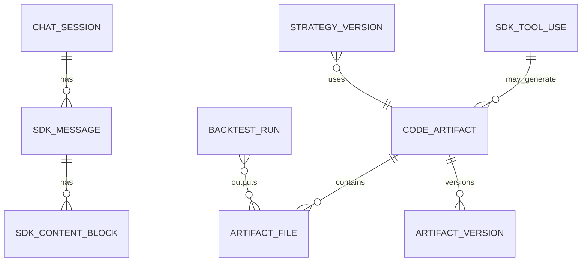
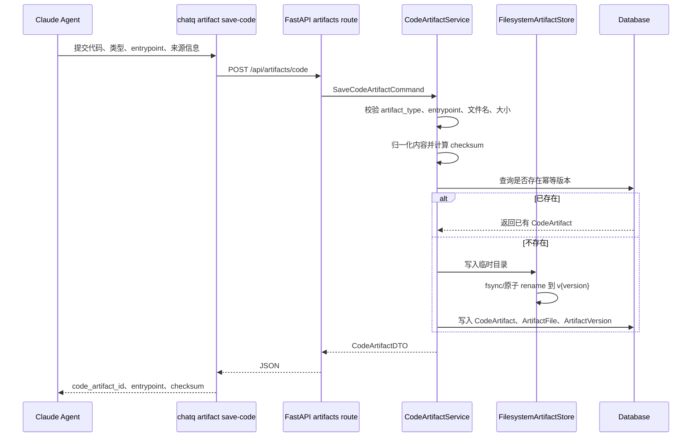

# 详细设计-M3-代码产物模块

## 1. 文档信息

| 项目 | 内容 |
|---|---|
| 系统 | Chat-Quant 股票分析与策略验证对话式智能体系统 |
| 模块 | M3 代码产物模块 |
| 版本 | V0.1 |
| 日期 | 2026-07-24 |
| 上游基线 | `docs/概要设计说明书.md`、`docs/prd.md`、`docs/stock-agent-prototype.html` |

## 2. 设计目标与边界

### 2.1 设计目标

M3 代码产物模块负责把 `claude-agent-sdk` 驱动的 Agent 生成代码、以及 M4 运行时产生的关键文件转化为可追溯、可复用、可回放的系统资产。Agent 通过 SDK 自带 `Bash` 调用 `chatq artifact ...` CLI 进入 M3；M3 本身不实现 Agent，也不引入额外 SDK 扩展工具。模块目标如下：

1. 保存 Agent 生成的 Python 代码，包括查询、分析、策略和回测脚本。
2. 保存运行过程产生的 JSON、图表、曲线、日志等文件引用。
3. 记录每个产物的来源 ChatSession、SDK message、SDK Bash tool_use、版本、入口、checksum 和文件清单。
4. 为 M4 Python 运行时提供稳定入口，为 M5 策略资产提供策略代码引用，为 M6 回测结果提供结果文件引用。
5. 支持前端对话流、图表对象、结果对象详情和历史会话复盘所需的产物读取。

### 2.2 职责边界

| 类型 | M3 负责 | M3 不负责 |
|---|---|---|
| 代码保存 | 校验类型、命名、路径、版本、checksum、entrypoint，并落库和落盘 | 理解代码收益、决定是否创建策略 |
| 文件产物 | 登记 JSON、图表、曲线、日志等文件并建立归属关系 | 渲染图表、解析回测指标、计算风险指标 |
| 关联关系 | 记录与 ChatSession、SDKMessage、SDKToolUse、StrategyVersion、BacktestRun 的弱关联 | 维护会话摘要、策略版本状态、回测状态 |
| 安全边界 | 做路径隔离、扩展名白名单、文件大小限制、checksum 校验 | 运行沙箱、进程超时、依赖安装 |

M3 不直接调用 Agent，也不直接执行 Python。M3 是资产管理模块，不是策略引擎或回测引擎。

Agent/CLI 边界：

1. Agent loop、工具选择和最终回复由 `claude-agent-sdk` 负责。
2. M3 只承接 `chatq artifact save-code`、`chatq artifact save-files` 等 CLI 请求，并执行代码/文件资产登记。
3. M3 不向 SDK 注册额外扩展工具；工具可见性和权限由 M2 的 SDK options 配置控制。

## 3. PRD/UI 映射

### 3.1 PRD 功能映射

| PRD 需求 | M3 支撑点 | 产物类型 |
|---|---|---|
| FR-001 自然语言股票数据查询 | 保存查询脚本、查询结果 JSON 和行情图表 | `query_script`、`json_result`、`chart_file` |
| FR-002 结果解释与依据展示 | 保存影响结论的代码和结果文件，供用户追问时回放依据 | `query_script`、`analysis_script`、`json_result` |
| FR-003 股票图表可视化 | 登记 K 线图、趋势图、对比图、收益曲线、回撤图 | `chart_file`、`json_result` |
| FR-004 自然语言策略创建 | 保存策略代码，提供 `StrategyPackage.code_artifact_id` | `strategy_script` |
| FR-005 策略回测验证 | 保存回测脚本、回测结果 JSON、曲线文件和图表文件 | `backtest_script`、`json_result`、`chart_file` |
| FR-006 自然语言选股辅助 | 保存选股脚本、候选池 JSON/CSV 和排序说明关联 | `query_script`、`analysis_script`、`json_result` |
| FR-007 连续追问与上下文理解 | 通过 ChatSession、SDK message、SDK tool_use 反查历史代码与结果 | 全部类型 |
| FR-008 历史会话与复盘 | 为历史详情提供可查看的关键图表和结果文件 | `json_result`、`chart_file` |
| FR-009 策略型历史会话复用 | 为再次回测提供策略代码版本和历史回测文件引用 | `strategy_script`、`backtest_script` |

### 3.2 HTML 原型交互映射

| 原型区域/交互 | M3 设计响应 |
|---|---|
| 对话流中的“工具调用”进度 | 每次 `save-code`、`runtime execute`、`chart kline` 都由 SDK Bash tool_use/tool_result 展示；M3 只返回 CLI JSON 和资产 ID |
| 结果卡片中的“图表对象”标签 | 图表以 `ArtifactFile.file_role=chart_file` 保存，`render_metadata_json` 记录图表类型、标题、series、时间范围 |
| 图表页签：收益、回撤、对比、行情 | 通过 `chart_kind` 区分 `equity_curve`、`drawdown_curve`、`compare`、`trend`、`kline` |
| 右侧“图表对象”详情 | 读取 ArtifactFile 的元数据和预览 URL，展示当前视图、周期、叠加指标、数据口径 |
| 右侧“结果对象详情” | 通过 StrategyVersion/BacktestRun 反查 CodeArtifact 和 ArtifactFile，展示策略版本、参数快照和指标来源 |
| “再次回测”按钮 | 使用历史 StrategyVersion 的 `code_artifact_id` 和 `entrypoint`，创建新的 BacktestRun；M3 不创建回测，只提供代码入口 |
| “复制策略摘要” | 摘要来自消息或策略元数据；M3 只提供可追溯代码和文件引用 |

## 4. CodeArtifact/ArtifactFile 模型

### 4.1 领域对象关系



### 4.2 CodeArtifact

`CodeArtifact` 表示一组逻辑产物，通常对应一次 Agent 生成的代码包或一次平台工具登记的结果包。它不一定只包含代码，也可以作为 JSON/图表文件集合的归属对象；但首要用途是记录可执行代码。

核心字段：

| 字段 | 类型 | 说明 |
|---|---|---|
| `id` | string | 产物 ID，建议前缀 `ca_` |
| `chat_session_id` | string | 来源 ChatSession |
| `source_sdk_session_id` | string/null | 来源 SDK session |
| `source_sdk_message_uuid` | string/null | 触发产物生成的 SDK message id 或本地 SDKMessage 行 ID |
| `source_sdk_tool_use_id` | string/null | 来源 SDK Bash tool_use id |
| `artifact_type` | enum | `query_script`、`analysis_script`、`strategy_script`、`backtest_script`、`json_result`、`chart_file` |
| `title` | string | 前端展示标题 |
| `description` | string/null | 产物说明 |
| `version` | int | 当前逻辑版本号，从 1 开始 |
| `entrypoint` | string/null | 代码入口，非代码产物可为空 |
| `root_path` | string | 该产物在受控存储中的相对根目录 |
| `main_file_id` | string/null | 主文件 ID |
| `checksum` | string | 产物包 checksum |
| `metadata_json` | json | 股票、市场、时间范围、参数、图表类型等扩展信息 |
| `status` | enum | `created`、`validated`、`invalid`、`archived` |
| `created_at`/`updated_at` | datetime | 创建和更新时间 |

### 4.3 ArtifactFile

`ArtifactFile` 表示 CodeArtifact 下的单个物理文件或外部存储对象引用。

核心字段：

| 字段 | 类型 | 说明 |
|---|---|---|
| `id` | string | 文件 ID，建议前缀 `af_` |
| `artifact_id` | string | 所属 CodeArtifact |
| `file_role` | enum | `query_script`、`analysis_script`、`strategy_script`、`backtest_script`、`json_result`、`chart_file`、`log_file`、`data_file` |
| `relative_path` | string | 相对 `root_path` 的路径 |
| `storage_uri` | string | 存储 URI 或本地相对 URI |
| `mime_type` | string | `text/x-python`、`application/json`、`image/png` 等 |
| `size_bytes` | int | 文件大小 |
| `checksum` | string | 单文件 SHA-256 |
| `is_entrypoint` | bool | 是否为入口文件 |
| `render_metadata_json` | json | 图表渲染、表格预览、下载名等 UI 元信息 |
| `created_at` | datetime | 创建时间 |

### 4.4 产物类型差异

| 类型 | 所属对象 | 文件形态 | 是否可执行 | 是否可作为策略版本 | entrypoint | 典型来源 | 典型消费者 |
|---|---|---|---|---|---|---|---|
| `query_script` | CodeArtifact/ArtifactFile | `.py` | 是 | 否 | 必填，指向查询函数或脚本 | 股票行情查询、选股数据获取 | M4、会话复盘 |
| `analysis_script` | CodeArtifact/ArtifactFile | `.py` | 是 | 否 | 必填，指向分析函数或脚本 | 指标计算、对比分析、候选排序 | M4、会话复盘 |
| `strategy_script` | CodeArtifact/ArtifactFile | `.py` | 是 | 是 | 必填，格式如 `strategy.py:GeneratedStrategy` | 策略创建、策略优化 | M5、M4、M6 |
| `backtest_script` | CodeArtifact/ArtifactFile | `.py` | 是 | 否 | 必填，指向标准回测入口 | 回测编排脚本或适配脚本 | M4、M6 |
| `json_result` | CodeArtifact/ArtifactFile | `.json` | 否 | 否 | 空 | 查询结果、回测结果、候选池、指标快照 | 前端、M6、会话复盘 |
| `chart_file` | CodeArtifact/ArtifactFile | `.png`/`.svg`/`.html`/图表 spec JSON | 否 | 否 | 空 | K 线图、收益曲线、回撤图、对比图 | 前端、历史详情 |

说明：

1. `query_script` 偏“取数”，可以访问允许的数据源，输出原始或轻加工数据。
2. `analysis_script` 偏“计算与解释依据”，输入通常来自查询结果或数据文件，输出指标、排序、统计摘要。
3. `strategy_script` 是策略资产核心，必须遵守 backtrader 策略入口规范，不能混入临时回测配置。
4. `backtest_script` 是回测执行适配代码，负责按 `BacktestRunSpec` 加载策略、数据、参数并输出标准 `BacktestResult`。
5. `json_result` 是机器可读结果，不保证都是回测结果；只有符合 M6 schema 的才可被 M6 解析为 BacktestResult。
6. `chart_file` 是前端可展示对象，可由图片、HTML 或 chart spec JSON 表示；真实数据应优先保存在 `json_result`，图表文件负责渲染。

## 5. 文件目录与命名规则

### 5.1 存储根目录

建议配置：

```text
CHATQ_ARTIFACT_ROOT=/var/lib/chat-quant/artifacts
```

开发环境可使用项目内或用户数据目录，但必须由配置显式指定。数据库只保存相对路径和存储 URI，不保存可被 Agent 拼接越权的绝对路径。

### 5.2 目录结构

```text
{artifact_root}/
  users/{user_id}/
    chat_sessions/{chat_session_id}/
      sdk_sessions/{sdk_session_id}/
        artifacts/{artifact_id}/
          v{version}/
            manifest.json
            src/
              query.py
              analysis.py
              strategy.py
              backtest.py
            outputs/
              result.json
              equity_curve.json
              drawdown_curve.json
              chart.png
            logs/
              stdout.log
              stderr.log
```

### 5.3 命名规则

| 对象 | 规则 |
|---|---|
| `artifact_id` | `ca_` + ULID/UUID，禁止用户输入 |
| `file_id` | `af_` + ULID/UUID，禁止用户输入 |
| 代码文件 | `query.py`、`analysis.py`、`strategy.py`、`backtest.py`；多文件时使用 `src/{slug}_{index}.py` |
| 结果文件 | `result.json`、`metrics.json`、`candidates.json`、`equity_curve.json`、`drawdown_curve.json` |
| 图表文件 | `chart_{chart_kind}.{ext}`，如 `chart_equity_curve.png` |
| manifest | 固定为 `manifest.json` |
| slug | 仅允许小写字母、数字、下划线和连字符，最大 64 字符 |

禁止在保存请求中直接使用 `..`、绝对路径、空路径、隐藏目录、符号链接目标路径和系统保留名称。

## 6. 版本号、checksum、entrypoint 规则

### 6.1 版本号

1. `CodeArtifact.version` 从 `1` 开始递增。
2. 同一 `artifact_id` 的内容变更必须创建新版本，不覆盖历史版本目录。
3. 策略逻辑变更时，M5 应创建新的 StrategyVersion，并引用新的 `CodeArtifact` 或新的 CodeArtifact 版本。
4. 仅回测参数变更时，不创建新的 `strategy_script`，只创建新的 BacktestRun；如生成新的回测适配脚本，可创建新的 `backtest_script`。
5. 对同一 `source_sdk_tool_use_id` 重复提交完全相同内容时，允许幂等返回已有版本；判定依据为 `artifact_type + normalized_files_checksum + entrypoint`。

### 6.2 checksum

单文件 checksum：

```text
sha256(file_bytes)
```

产物包 checksum：

```text
sha256(
  artifact_type + "\n" +
  entrypoint + "\n" +
  sorted(relative_path + ":" + file_checksum).join("\n")
)
```

规则：

1. Python 代码保存前做换行归一化为 LF，编码为 UTF-8。
2. JSON 文件保存前建议按 canonical JSON 计算 checksum：键排序、去除无意义空白。
3. checksum 只用于完整性、幂等和追溯，不作为安全扫描替代。

### 6.3 entrypoint

entrypoint 格式：

| 类型 | 格式 | 示例 |
|---|---|---|
| 脚本入口 | `{relative_path}` | `src/query.py` |
| 函数入口 | `{relative_path}:{function_name}` | `src/analysis.py:run` |
| 策略类入口 | `{relative_path}:{class_name}` | `src/strategy.py:GeneratedStrategy` |

校验规则：

1. `query_script`、`analysis_script`、`backtest_script` 必须提供可执行入口；未指定函数时，M4 按脚本方式执行。
2. `strategy_script` 必须提供类入口，且 M5/M4 后续校验该类可 import。
3. `json_result`、`chart_file` 不允许设置 entrypoint。
4. entrypoint 中的路径必须属于该 CodeArtifact 的 `src/` 或允许执行目录。
5. entrypoint 不允许包含 shell 片段、空白控制字符、绝对路径或父目录跳转。

## 7. 保存生成文件流程

### 7.1 保存 Agent 生成代码



### 7.2 保存运行生成文件

M4 执行完成后返回 `ExecutionResult.artifacts`，M3 通过 `save_generated_files` 或 `save_file_artifact` 登记文件。

流程：

1. 接收 `execution_result_id`、`code_artifact_id`、`backtest_run_id`、文件清单和运行输出目录。
2. 校验每个文件位于 M4 分配的 `output_dir` 内。
3. 根据扩展名、MIME 和 `RuntimeArtifact.type` 映射 `file_role`。
4. 将文件复制或移动到对应 CodeArtifact 的 `outputs/` 或 `logs/` 目录。
5. 计算 `ArtifactFile.checksum` 和大小。
6. 更新 `CodeArtifact.checksum` 或创建派生结果型 CodeArtifact。
7. 发送 `artifact.file.created` 事件，供前端刷新图表、结果详情和历史会话。

### 7.3 文件角色映射

| RuntimeArtifact.type | ArtifactFile.file_role | 说明 |
|---|---|---|
| `json_result` | `json_result` | 标准 JSON 结果，如 `result.json` |
| `chart` | `chart_file` | 前端图表对象或图片 |
| `curve` | `json_result` | 曲线数据，`render_metadata_json.chart_kind` 标记收益/回撤 |
| `log` | `log_file` | stdout/stderr 或调试日志 |
| `file` | `data_file` | CSV、Parquet、临时数据导出等 |

## 8. SDK transcript、策略、回测关联

### 8.1 关联原则

1. `CodeArtifact.chat_session_id` 必填，用于历史会话复盘。
2. `CodeArtifact.source_sdk_message_uuid` 尽量填写，用于追溯用户问题、助手回复或产物所在 SDK message。
3. `CodeArtifact.source_sdk_tool_use_id` 尽量填写，用于追溯 Agent 通过 Bash 调用 `chatq artifact ...` 的 SDK tool_use。
4. M3 不保存自定义 ToolCall 状态；对话流展示来自 M1/M2 保存的 SDK tool_use/tool_result。
5. M3 可保存 `strategy_version_id`、`backtest_run_id` 作为弱引用字段或通过资产关联表维护，但不拥有这些对象生命周期。

### 8.2 典型关联场景

| 场景 | 关联方式 |
|---|---|
| 股票查询 | SDKMessage -> SDKToolUse(Bash) -> CodeArtifact(`query_script`) -> ArtifactFile(`json_result`/`chart_file`) |
| 选股辅助 | SDKMessage -> SDKToolUse(Bash) -> CodeArtifact(`query_script`/`analysis_script`) -> ArtifactFile(`candidates.json`) |
| 策略创建 | SDKMessage -> SDKToolUse(Bash) -> CodeArtifact(`strategy_script`) -> StrategyVersion.code_artifact_id |
| 策略回测 | BacktestRun -> StrategyVersion -> CodeArtifact(`strategy_script`)；BacktestRun -> ArtifactFile(`result.json`/曲线/图表) |
| 策略优化 | 新 SDKMessage -> 新 SDKToolUse(Bash) -> 新 CodeArtifact(`strategy_script`) -> 新 StrategyVersion |
| 再次回测 | 新 BacktestRun 复用旧 StrategyVersion 和旧 CodeArtifact，仅新增回测结果文件 |

### 8.3 对话展示 DTO

前端会话详情中 M3 输出的最小 DTO：

```json
{
  "artifact_id": "ca_01H...",
  "artifact_type": "chart_file",
  "title": "策略收益曲线与沪深300基准",
  "version": 1,
  "source_sdk_message_uuid": "msg_uuid_...",
  "source_sdk_tool_use_id": "toolu_...",
  "files": [
    {
      "file_id": "af_...",
      "file_role": "chart_file",
      "download_url": "/api/artifacts/ca_.../files/af_...",
      "preview_url": "/api/artifacts/ca_.../files/af_.../preview",
      "render_metadata": {
        "chart_kind": "equity_curve",
        "timeframe": "1d",
        "data_scope": "近三年",
        "source": "backtest_run"
      }
    }
  ]
}
```

## 9. API/CLI 契约

### 9.1 REST API

#### POST `/api/artifacts/code`

用途：保存 Agent 生成代码。

请求：

```json
{
  "chat_session_id": "conv_...",
  "source_sdk_session_id": "claude_sess_...",
  "source_sdk_message_uuid": "msg_uuid_...",
  "source_sdk_tool_use_id": "toolu_...",
  "artifact_type": "strategy_script",
  "title": "均线突破策略代码",
  "description": "短期均线上穿长期均线买入",
  "entrypoint": "src/strategy.py:GeneratedStrategy",
  "files": [
    {
      "relative_path": "src/strategy.py",
      "content": "import backtrader as bt\n\nclass GeneratedStrategy(bt.Strategy):\n    pass\n",
      "file_role": "strategy_script"
    }
  ],
  "metadata": {
    "symbols": ["000300.SH"],
    "market": "CN",
    "strategy_type": "ma_cross"
  }
}
```

响应：

```json
{
  "artifact_id": "ca_...",
  "artifact_type": "strategy_script",
  "version": 1,
  "entrypoint": "src/strategy.py:GeneratedStrategy",
  "checksum": "sha256:...",
  "root_path": "users/u1/chat_sessions/conv_.../sdk_sessions/claude_sess_.../artifacts/ca_.../v1",
  "files": [
    {
      "file_id": "af_...",
      "relative_path": "src/strategy.py",
      "file_role": "strategy_script",
      "checksum": "sha256:...",
      "size_bytes": 1024
    }
  ]
}
```

#### POST `/api/artifacts/files`

用途：登记运行时或图表工具生成文件。

请求：

```json
{
  "chat_session_id": "conv_...",
  "source_sdk_session_id": "claude_sess_...",
  "source_sdk_message_uuid": "msg_uuid_...",
  "source_sdk_tool_use_id": "toolu_...",
  "parent_artifact_id": "ca_...",
  "execution_result_id": "er_...",
  "backtest_run_id": "bt_...",
  "files": [
    {
      "source_path": "result.json",
      "file_role": "json_result",
      "title": "回测结果 JSON",
      "render_metadata": {
        "schema": "BacktestResultPayload"
      }
    }
  ]
}
```

响应：返回 `ArtifactFileDTO[]`。

#### GET `/api/artifacts/{artifact_id}`

用途：查询 CodeArtifact 详情和文件清单。默认不返回完整代码内容，只返回元数据、checksum、entrypoint 和可访问 URL。

#### GET `/api/artifacts/{artifact_id}/files/{file_id}`

用途：下载或读取单个文件。代码文件需鉴权；大文件以流式下载返回。

#### GET `/api/artifacts/{artifact_id}/entrypoint`

用途：供 M4/M5/M6 获取可执行入口和本地存储路径。

响应：

```json
{
  "artifact_id": "ca_...",
  "artifact_type": "strategy_script",
  "entrypoint": "src/strategy.py:GeneratedStrategy",
  "absolute_root_path": "/var/lib/chat-quant/artifacts/users/...",
  "main_file": "src/strategy.py",
  "checksum": "sha256:..."
}
```

### 9.2 Agent-facing CLI

#### `chatq artifact save-code`

用途：Agent 保存代码。

示例：

```bash
chatq artifact save-code \
  --conversation-id conv_xxx \
  --source-message-id msg_xxx \
  --agent-run-id ar_xxx \
  --type strategy_script \
  --entrypoint src/strategy.py:GeneratedStrategy \
  --file src/strategy.py=@/tmp/generated_strategy.py \
  --metadata-json '{"strategy_type":"ma_cross"}'
```

输出：

```json
{
  "code_artifact_id": "ca_xxx",
  "entrypoint": "src/strategy.py:GeneratedStrategy",
  "version": 1,
  "checksum": "sha256:..."
}
```

#### `chatq artifact save-files`

用途：Agent 或平台命令登记生成文件。一般由 M4/M6 内部调用，Agent 直接调用时遵守 M2 的 SDK 工具权限配置。

```bash
chatq artifact save-files \
  --conversation-id conv_xxx \
  --agent-run-id ar_xxx \
  --parent-artifact-id ca_xxx \
  --file-role chart_file \
  --file chart_equity_curve.png=@/tmp/chart.png
```

#### `chatq artifact get`

用途：读取元数据，供 Agent 在续聊时引用历史代码和图表对象。

```bash
chatq artifact get --artifact-id ca_xxx
```

## 10. 数据库表设计

### 10.1 `code_artifacts`

| 字段 | 类型 | 约束 | 说明 |
|---|---|---|---|
| `id` | varchar(40) | PK | `ca_` 前缀 |
| `user_id` | varchar(40) | NOT NULL, index | 所属用户 |
| `project_id` | varchar(40) | NOT NULL, index | 项目/租户 |
| `chat_session_id` | varchar(40) | NOT NULL, index | ChatSession ID |
| `source_sdk_session_id` | varchar(128) | NULL, index | 来源 SDK session |
| `source_sdk_message_uuid` | varchar(128) | NULL, index | 来源 SDK message 或本地行 ID |
| `source_sdk_tool_use_id` | varchar(128) | NULL, index | 来源 SDK Bash tool_use |
| `artifact_type` | varchar(32) | NOT NULL, index | 产物类型 |
| `title` | varchar(200) | NOT NULL | 展示标题 |
| `description` | text | NULL | 描述 |
| `version` | integer | NOT NULL | 当前版本 |
| `entrypoint` | varchar(300) | NULL | 执行入口 |
| `root_path` | varchar(600) | NOT NULL | 相对存储根路径 |
| `main_file_id` | varchar(40) | NULL | 主文件 |
| `checksum` | varchar(80) | NOT NULL, index | `sha256:...` |
| `metadata_json` | json/text | NOT NULL default `{}` | 扩展元数据 |
| `status` | varchar(24) | NOT NULL default `created` | 状态 |
| `created_at` | datetime | NOT NULL | 创建时间 |
| `updated_at` | datetime | NOT NULL | 更新时间 |

索引：

1. `idx_code_artifacts_chat_created(chat_session_id, created_at)`
2. `idx_code_artifacts_sdk_tool_use(source_sdk_tool_use_id)`
3. `idx_code_artifacts_type(artifact_type)`
4. `uq_code_artifacts_idempotent(source_sdk_tool_use_id, artifact_type, checksum, entrypoint)`

### 10.2 `artifact_files`

| 字段 | 类型 | 约束 | 说明 |
|---|---|---|---|
| `id` | varchar(40) | PK | `af_` 前缀 |
| `artifact_id` | varchar(40) | FK, NOT NULL, index | 所属 CodeArtifact |
| `file_role` | varchar(32) | NOT NULL, index | 文件角色 |
| `relative_path` | varchar(600) | NOT NULL | 相对路径 |
| `storage_uri` | varchar(800) | NOT NULL | 存储地址 |
| `mime_type` | varchar(120) | NOT NULL | MIME |
| `size_bytes` | bigint | NOT NULL | 文件大小 |
| `checksum` | varchar(80) | NOT NULL | 文件 checksum |
| `is_entrypoint` | boolean | NOT NULL default false | 是否入口 |
| `render_metadata_json` | json/text | NOT NULL default `{}` | 渲染元数据 |
| `created_at` | datetime | NOT NULL | 创建时间 |

索引：

1. `idx_artifact_files_artifact(artifact_id)`
2. `idx_artifact_files_role(file_role)`
3. `uq_artifact_files_path(artifact_id, relative_path)`

### 10.3 `artifact_versions`

| 字段 | 类型 | 约束 | 说明 |
|---|---|---|---|
| `id` | varchar(40) | PK | 版本记录 ID |
| `artifact_id` | varchar(40) | FK, NOT NULL, index | 产物 ID |
| `version` | integer | NOT NULL | 版本号 |
| `root_path` | varchar(600) | NOT NULL | 该版本目录 |
| `checksum` | varchar(80) | NOT NULL | 包 checksum |
| `entrypoint` | varchar(300) | NULL | 该版本入口 |
| `manifest_json` | json/text | NOT NULL | 文件清单快照 |
| `created_by_sdk_tool_use_id` | varchar(128) | NULL | 创建来源 SDK Bash tool_use |
| `created_at` | datetime | NOT NULL | 创建时间 |

约束：

1. `uq_artifact_versions_version(artifact_id, version)`
2. `uq_artifact_versions_checksum(artifact_id, checksum, entrypoint)`

### 10.4 `artifact_links`

用于保存 M3 到策略、回测、消息等对象的弱关联，避免 M3 强依赖 M5/M6 表结构。

| 字段 | 类型 | 约束 | 说明 |
|---|---|---|---|
| `id` | varchar(40) | PK | 关联 ID |
| `artifact_id` | varchar(40) | NOT NULL, index | CodeArtifact |
| `file_id` | varchar(40) | NULL, index | ArtifactFile |
| `target_type` | varchar(32) | NOT NULL, index | `message`、`strategy_version`、`backtest_run`、`backtest_result` |
| `target_id` | varchar(40) | NOT NULL, index | 目标对象 ID |
| `relation` | varchar(32) | NOT NULL | `source`、`uses`、`output`、`preview` |
| `metadata_json` | json/text | NOT NULL default `{}` | 关联元数据 |
| `created_at` | datetime | NOT NULL | 创建时间 |

索引：

1. `idx_artifact_links_target(target_type, target_id)`
2. `idx_artifact_links_artifact(artifact_id)`

## 11. 异常处理

| 异常码 | 场景 | HTTP | 处理方式 |
|---|---|---|---|
| `ARTIFACT_INVALID_TYPE` | 不支持的产物类型 | 400 | 拒绝保存，返回允许值 |
| `ARTIFACT_INVALID_ENTRYPOINT` | 入口格式错误或与类型不匹配 | 400 | 返回 entrypoint 规则 |
| `ARTIFACT_PATH_ESCAPE` | 路径包含越权片段或指向存储根外 | 400 | 拒绝保存并记录安全日志 |
| `ARTIFACT_FILE_TOO_LARGE` | 文件超过大小限制 | 413 | 拒绝保存，提示限制 |
| `ARTIFACT_UNSUPPORTED_EXTENSION` | 扩展名不在白名单 | 400 | 拒绝保存 |
| `ARTIFACT_CHECKSUM_MISMATCH` | 客户端声明 checksum 与服务端计算不一致 | 409 | 以服务端结果为准并拒绝本次写入 |
| `ARTIFACT_PARENT_NOT_FOUND` | 父产物不存在 | 404 | 返回错误 |
| `ARTIFACT_ACCESS_DENIED` | 用户无权访问产物 | 403 | 隐藏对象存在性细节 |
| `ARTIFACT_STORAGE_FAILED` | 文件系统写入失败 | 500 | 回滚数据库事务，保留错误日志 |
| `ARTIFACT_DB_FAILED` | 数据库写入失败 | 500 | 清理临时目录或标记孤儿文件待清扫 |

事务策略：

1. 先写临时目录，再在数据库事务中写记录，最后原子 rename 到正式目录。
2. 如数据库提交失败，临时目录进入后台清扫队列。
3. 如正式目录写入失败，数据库事务必须回滚。
4. 幂等请求返回已有对象时不重复写文件。

## 12. 安全与路径隔离

### 12.1 路径隔离

1. 所有物理文件必须位于 `CHATQ_ARTIFACT_ROOT` 下。
2. 路径解析必须使用服务端生成的根目录，不信任客户端传入根路径。
3. 保存前执行 `resolve()`，校验解析后路径仍以 artifact root 开头。
4. 禁止符号链接作为输入文件或输出目标。
5. 禁止使用绝对路径、父目录跳转、隐藏目录和控制字符。
6. 下载接口通过 `artifact_id/file_id` 定位，不提供任意路径读取接口。

### 12.2 类型和大小限制

| 文件类型 | 扩展名 | 默认上限 |
|---|---|---|
| Python 代码 | `.py` | 1 MB/文件 |
| JSON 结果 | `.json` | 20 MB/文件 |
| CSV 数据 | `.csv` | 50 MB/文件 |
| 图表图片 | `.png`、`.jpg`、`.jpeg`、`.webp`、`.svg` | 10 MB/文件 |
| HTML 图表 | `.html` | 5 MB/文件 |
| 日志 | `.log`、`.txt` | 10 MB/文件 |

SVG 和 HTML 图表需要额外消毒：

1. 禁止内联脚本。
2. 禁止外部网络资源。
3. 禁止表单、iframe、object、embed。
4. 前端预览时使用独立 sandbox 或只展示为下载文件。

### 12.3 代码安全检查

M3 保存代码时做轻量静态检查，发现风险时标记 `status=invalid` 或拒绝保存：

| 检查项 | 处理 |
|---|---|
| 语法不可解析 | `strategy_script`、`backtest_script` 拒绝；普通查询脚本可保存为 `invalid` 供排查 |
| 明显真实交易 API 关键词 | 拒绝策略资产化，记录风险原因 |
| 越权文件访问模式 | 拒绝或标记待审 |
| shell 执行、动态下载依赖 | 标记高风险，默认拒绝执行 |

真正的运行隔离由 M4 沙箱完成，M3 的安全检查是入口防线。

## 13. 测试建议

### 13.1 单元测试

1. `artifact_type` 与 `entrypoint` 组合校验。
2. 路径规范化和越权路径拦截。
3. 单文件 checksum 和包 checksum 稳定性。
4. 幂等保存：相同 SDK tool_use、类型、内容、入口返回同一对象。
5. 版本递增：同一逻辑产物内容变化生成新版本。
6. 文件角色映射：`RuntimeArtifact.type` 到 `ArtifactFile.file_role`。
7. JSON canonical checksum 计算。

### 13.2 集成测试

1. `chatq artifact save-code` 保存 `strategy_script` 后，M5 可读取 `code_artifact_id` 和 `entrypoint`。
2. M4 执行查询脚本产生 `result.json` 后，M3 可保存并通过 API 下载。
3. M6 回测完成后，`result.json`、`equity_curve.json`、`drawdown_curve.json` 与 BacktestRun 建立关联。
4. 历史会话详情接口可返回图表对象和策略对象引用。
5. 删除会话或归档产物后，下载接口权限符合预期。

### 13.3 安全测试

1. `../secret.py`、`/etc/passwd`、符号链接输入必须被拒绝。
2. 超大 JSON、超大日志、异常扩展名必须被拒绝。
3. HTML/SVG 图表中的脚本和外链必须被清理或禁止预览。
4. 跨用户访问 `artifact_id` 必须返回 403 或统一的不可见错误。

### 13.4 回归验收

1. 策略创建后能在历史会话中看到策略摘要和版本号。
2. 再次回测复用原 `strategy_script`，不覆盖旧版本。
3. 图表页签切换所需的收益、回撤、对比、行情数据均能从 ArtifactFile 或 BacktestResult 找到来源。
4. 失败回测保留 stderr/log 文件，前端能展示失败原因但不泄露服务器绝对路径。

## 14. 待决事项

| 编号 | 待决事项 | 影响 | 建议 |
|---|---|---|---|
| M3-TBD-001 | 产物物理存储使用本地文件、对象存储还是混合方案 | 影响 `storage_uri` 和备份策略 | 首期本地文件，接口抽象为 ArtifactStore |
| M3-TBD-002 | HTML 图表是否首期支持预览 | 存在 XSS 风险 | 首期优先 PNG/chart spec JSON，HTML 仅下载 |
| M3-TBD-003 | 代码内容是否在 API 中直接返回 | 影响隐私和前端体验 | 默认只返回元数据，详情页按需读取且审计 |
| M3-TBD-004 | 历史会话删除时产物是软删除还是物理删除 | 影响合规、成本和可恢复性 | 首期软删除，后台按保留周期清理 |
| M3-TBD-005 | 代码静态安全检查范围 | 影响误杀率和执行安全 | 首期做轻量规则，执行前由 M4 做强隔离 |
| M3-TBD-006 | 是否将普通分析结果统一成表格 schema | 影响前端历史复盘一致性 | 遵循 HLD，不固定普通分析业务 schema，只固定资产协议 |

## 15. 实现清单建议

1. 在 `domain/artifacts` 定义 `CodeArtifact`、`ArtifactFile`、DTO、命令和校验服务。
2. 在 `infrastructure/storage` 实现 `FilesystemArtifactStore`，提供原子写入、路径隔离和 checksum。
3. 在 `infrastructure/db/models` 新增 M3 四张表。
4. 在 `api/routes/artifacts.py` 实现保存、查询、下载和 entrypoint API。
5. 在 `cli/commands/artifact_commands.py` 实现 `chatq artifact save-code/get/save-files`。
6. 与 M4 对接 `ExecutionResult.artifacts` 的保存回调。
7. 与 M5/M6 对接弱关联和读取入口。
