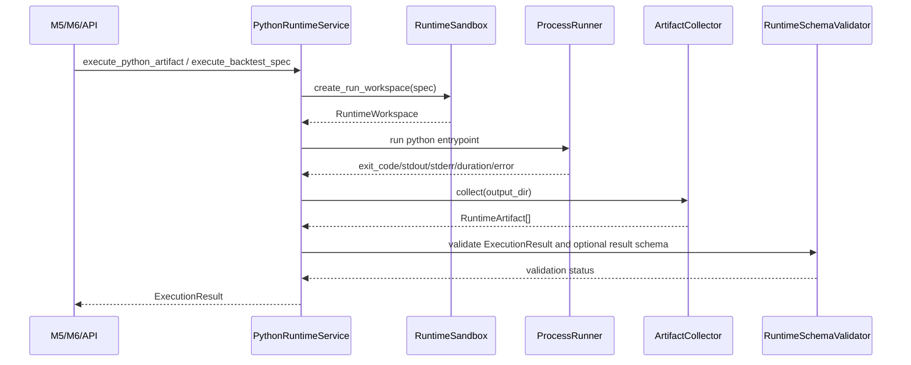

# 详细设计-M4-Python 运行时模块

## 1. 文档信息

| 项目 | 内容 |
|---|---|
| 系统 | Chat-Quant 股票分析与策略验证对话式智能体系统 |
| 模块 | M4 Python 运行时模块 |
| 版本 | V0.1 / 草稿 |
| HLD 基线 | 概要设计说明书 V0.2 |
| PRD 基线 | PRD-STOCK-001 V0.4 |
| 原型基线 | stock-agent-prototype.html |
| 日期 | 2026-07-24 |

## 2. 设计目标与边界

### 2.1 设计目标

M4 Python 运行时模块负责把 `claude-agent-sdk` 驱动的 Agent 生成、并由 M3 保存的 Python 代码，以及 M6 生成的 `BacktestRunSpec` 转换为一次可追溯、可终止、可校验的受控执行。Agent 不直接进入 M4 进程；首期由 SDK 自带 `Bash` 调用 `chatq runtime ...` 或 `chatq backtest ...` CLI，再由 CLI 进入 M4/M6 应用服务。模块核心目标如下：

| 编号 | 目标 | 说明 |
|---|---|---|
| M4-G01 | 受控执行 | 在限定工作目录、限定环境变量、限定超时内执行 Python 代码 |
| M4-G02 | 事实返回 | 统一返回 `ExecutionResult`，只描述执行事实，不生成业务解释 |
| M4-G03 | 产物收集 | 收集 stdout、stderr、异常、JSON 结果、曲线、图表、表格和日志文件 |
| M4-G04 | 回测承接 | 首期稳定支持 akshare/pandas/backtrader 组合下的基础查询、选股和回测 |
| M4-G05 | 可追溯 | 每次执行可关联到 user、project、conversation、agent_run、code_artifact、backtest_run |
| M4-G06 | 可复用 | 运行目录和结果 schema 固定，便于历史会话复盘和再次回测 |
| M4-G07 | 安全隔离 | 不允许真实交易、不允许越权文件访问、不允许泄露敏感配置 |

### 2.2 模块边界

| 类型 | 内容 |
|---|---|
| M4 负责 | 构造运行目录；准备输入文件；启动子进程；传入白名单环境变量；管理超时和终止；捕获 stdout/stderr；识别异常；收集输出目录产物；校验 `ExecutionResult` 和可选业务 schema；记录运行日志 |
| M4 不负责 | 理解用户意图；生成 Python 代码；保存 CodeArtifact；创建 StrategyVersion；创建 BacktestRun；计算和入库标准 BacktestResult；生成最终对话解释；真实交易下单 |
| 上游依赖 | M3 提供 CodeArtifact、入口文件、checksum 和代码目录；M6 提供 BacktestRunSpec；M5 可要求策略 smoke test |
| 下游输出 | `ExecutionResult`；runtime 事件；运行日志；待 M3 持久化的文件产物引用；待 M6 解析的 `result.json` |

Agent/CLI 边界：

1. M4 不实现 Agent loop，不消费用户自然语言，也不注册额外 SDK 扩展工具。
2. M4 是 `chatq runtime execute` 和 `chatq backtest run` 背后的执行服务之一。
3. M4 的安全重点是 Python 子进程隔离；Agent 的 Bash 权限、CLI 白名单和 Hook 阻断由 M2 负责。

### 2.3 首期取舍

1. 首期采用“受控子进程 + 工作目录隔离”，本地开发不强制容器化；生产环境建议升级为容器或系统级沙箱。
2. 普通股票查询、对比、选股不定义统一业务结果 schema；M4 只校验可选 JSON 是否为合法 JSON，并把文件产物返回给 Agent/M3。
3. 策略回测必须输出符合 `BacktestResultPayload` 的 `result.json`，否则执行即使 exit code 为 0，也视为业务结果校验失败。
4. akshare 数据仅作为股票分析与历史回测数据源，不提供、也不暗示任何真实交易能力。

## 3. PRD/UI 映射

### 3.1 PRD 功能映射

| PRD 需求 | M4 支撑点 | 输出给其他模块 |
|---|---|---|
| FR-001 自然语言股票数据查询 | 执行 Agent 生成的 akshare/pandas 查询脚本，收集文本、表格、JSON、图表数据 | `ExecutionResult`、表格/JSON/图表文件引用 |
| FR-003 股票图表可视化 | 收集 K 线、趋势、对比、收益、回撤等图表所需 JSON/CSV 文件 | `RuntimeArtifact(type=chart/curve/json_result/file)` |
| FR-004 自然语言策略创建 | 执行策略 import/smoke test，验证 backtrader 策略入口是否可运行 | 策略校验用 `ExecutionResult` |
| FR-005 策略回测验证 | 执行标准 backtrader 回测入口，输出 `result.json`、收益曲线、回撤曲线 | `ExecutionResult` + M6 可解析的结果文件 |
| FR-006 自然语言选股辅助 | 执行筛选脚本，支持 pandas DataFrame 落盘为 CSV/JSON | 候选池文件、摘要 JSON、stdout |
| FR-008 历史会话与复盘 | 保留运行记录和产物路径，支撑历史会话回放 | execution_result_id、artifacts |
| FR-009 策略型历史会话复用 | 同一 StrategyVersion 可多次基于不同 `BacktestRunSpec` 执行 | 多个不可变 ExecutionResult |

### 3.2 HTML 原型交互映射

| 原型交互/展示 | M4 设计响应 |
|---|---|
| “已连接数据与回测引擎” | M4 提供健康检查，验证 Python、核心包、输出目录可用 |
| 工具调用进度“读取上下文/调用平台命令/整理产物/生成回复” | M4 返回 ExecutionResult 和运行日志；前端对话进度由 SDK Bash tool_use/tool_result 驱动 |
| 收益、回撤、对比、行情图表 tab | M4 收集 `equity_curve.json`、`drawdown_curve.json`、`compare.json`、`kline.json` 等产物 |
| 策略结果区指标卡片 | M4 只保证回测结果 JSON 可被 M6 解析；指标口径和展示由 M6/前端负责 |
| “再次回测” | M6 生成新的 BacktestRunSpec，M4 重新执行，返回新的 ExecutionResult |
| “改成更稳一点” | Agent/M5 生成新 StrategyVersion 或参数变化；M4 不判断策略优劣，只执行新输入 |
| 历史会话打开结果 | M4 的 execution record 和 artifact path 支撑回放，不重新执行历史结果 |

## 4. 执行架构

### 4.1 组件结构

```text
apps/api/app/
  domain/runtime/
    dto.py
    contracts.py
    errors.py
    services.py
  infrastructure/runtime/
    python_runtime.py
    sandbox.py
    process_runner.py
    artifact_collector.py
    schema_validator.py
  schemas/contracts/
    execution_result.py
    backtest_run_spec.py
    backtest_result.py
```

### 4.2 类职责

| 类/组件 | 主要职责 |
|---|---|
| `PythonRuntimeService` | M4 应用入口，暴露 `execute_python_artifact`、`execute_backtest_spec`、`validate_result_schema` |
| `RuntimeSandbox` | 创建运行目录、物化输入、生成环境变量、校验路径边界 |
| `ProcessRunner` | 使用 `asyncio.create_subprocess_exec` 启动 Python 子进程，捕获输出和超时 |
| `ArtifactCollector` | 扫描输出目录，识别 JSON、CSV、PNG、HTML、日志、曲线等产物 |
| `RuntimeSchemaValidator` | 校验 `ExecutionResult`、`BacktestResultPayload` 和可选 JSON schema |
| `RuntimeExecutionRepository` | 保存 M4 自有运行记录和日志元数据 |

### 4.3 执行流程



### 4.4 进程模型

1. 每次执行创建独立 `run_id`，独立工作目录和输出目录。
2. 使用当前项目配置的 Python 解释器启动子进程，例如 `.venv/bin/python` 或 `sys.executable`。
3. 子进程的 `cwd` 固定为本次运行的 `work_dir`。
4. Agent 代码通过文件方式接收 `stdin_json`、`BacktestRunSpec` 和输出目录路径，不依赖交互式 stdin。
5. stdout/stderr 采用异步读取，防止缓冲区阻塞。
6. 超时后先发送 terminate，宽限期后 kill。

## 5. ExecutionResult schema

### 5.1 Pydantic 契约

```python
class RuntimeArtifact(BaseModel):
    type: Literal[
        "json_result",
        "chart",
        "curve",
        "table",
        "image",
        "html",
        "log",
        "file",
    ]
    path: str
    name: str | None = None
    mime_type: str | None = None
    size_bytes: int | None = None
    checksum: str | None = None
    metadata: dict[str, Any] = Field(default_factory=dict)


class RuntimeErrorInfo(BaseModel):
    code: str
    message: str
    detail: str | None = None
    traceback: str | None = None
    phase: Literal[
        "prepare",
        "execute",
        "timeout",
        "collect",
        "schema_validation",
        "persist",
    ]


class ExecutionResult(BaseModel):
    id: str | None = None
    run_id: str
    status: Literal["succeeded", "failed", "timeout", "canceled"]
    exit_code: int | None
    stdout: str
    stderr: str
    artifacts: list[RuntimeArtifact] = Field(default_factory=list)
    error: RuntimeErrorInfo | None = None
    duration_ms: int
    started_at: datetime
    completed_at: datetime
    python_version: str
    command: list[str]
    cwd: str
    output_dir: str
    schema_validation: dict[str, Any] = Field(default_factory=dict)
    metadata: dict[str, Any] = Field(default_factory=dict)
```

### 5.2 字段规则

| 字段 | 规则 |
|---|---|
| `run_id` | M4 生成的不可变运行 ID，建议格式 `rt_yyyyMMddHHmmss_xxxxxx` |
| `status` | 子进程 exit code 为 0 且必需 schema 校验通过时为 `succeeded`；超时为 `timeout`；用户取消为 `canceled`；其他为 `failed` |
| `exit_code` | 正常退出记录整数；prepare 阶段失败或启动失败为 `null` |
| `stdout`/`stderr` | 默认最多各保存末尾 200KB，完整日志可作为 `log` artifact 保存 |
| `artifacts.path` | 必须是相对 `output_dir` 的路径，不返回任意绝对路径给 Agent |
| `error.code` | 使用稳定错误码，便于前端和 Agent 判断重试方式 |
| `schema_validation` | 记录校验对象、schema 名称、是否通过、错误列表 |
| `metadata` | 存放 `chat_session_id`、`source_sdk_session_id`、`source_sdk_tool_use_id`、`code_artifact_id`、`backtest_run_id` 等追溯信息 |

### 5.3 状态判定

| 条件 | status | error |
|---|---|---|
| 启动前输入非法、路径越界、entrypoint 不存在 | `failed` | `PREPARE_FAILED` |
| 子进程 exit code = 0，产物收集成功，必需 schema 通过 | `succeeded` | `null` |
| 子进程 exit code != 0 | `failed` | `PROCESS_EXIT_NONZERO` |
| 子进程超时并被终止 | `timeout` | `PROCESS_TIMEOUT` |
| 用户主动取消 | `canceled` | `PROCESS_CANCELED` |
| result.json 缺失或 schema 不匹配 | `failed` | `RESULT_SCHEMA_INVALID` |
| 产物收集阶段失败但主进程成功 | `failed` | `ARTIFACT_COLLECTION_FAILED` |

## 6. 运行输入/输出目录

### 6.1 目录布局

建议 M4 运行根目录由配置项 `CHATQ_RUNTIME_ROOT` 指定，默认位于项目受控存储目录下。

```text
storage/runtime/
  runs/
    rt_20260724174200_ab12cd/
      input/
        stdin.json
        backtest_spec.json
      code/
        strategy.py
        analysis.py
      work/
      output/
        result.json
        equity_curve.json
        drawdown_curve.json
        tables/
        charts/
        logs/
      tmp/
      manifest.json
```

### 6.2 输入目录

| 路径 | 来源 | 说明 |
|---|---|---|
| `input/stdin.json` | `PythonExecutionSpec.stdin_json` | 普通查询、选股和分析脚本的结构化输入 |
| `input/backtest_spec.json` | `BacktestRunSpec` | 标准回测运行参数 |
| `code/` | M3 CodeArtifact | 运行所需代码文件的只读拷贝 |
| `manifest.json` | M4 生成 | 记录 run_id、输入摘要、entrypoint、checksum、超时和环境变量键名 |

### 6.3 输出目录

| 路径 | 产物类型 | 说明 |
|---|---|---|
| `output/result.json` | `json_result` | 普通执行可选；回测执行必需 |
| `output/equity_curve.json` | `curve` | 回测收益曲线，可由 M6 入库或转存 M3 |
| `output/drawdown_curve.json` | `curve` | 回测回撤曲线 |
| `output/tables/*.csv` | `table` | 选股候选、指标明细、对比结果 |
| `output/charts/*.json` | `chart` | K 线、对比图、趋势图等前端可渲染协议 |
| `output/charts/*.png` | `image` | matplotlib 等静态图，首期作为辅助产物 |
| `output/logs/*.log` | `log` | 完整日志或用户代码自写日志 |

### 6.4 路径安全规则

1. M4 只收集 `output_dir` 内文件。
2. 所有 artifact path 统一转为相对路径。
3. 禁止跟随指向运行目录外的 symlink。
4. 单次运行输出文件数默认不超过 200 个。
5. 单个文件默认不超过 20MB，超过则标记为 ignored，并写入 warning。
6. `../`、绝对路径、隐藏敏感文件路径不允许进入 `ExecutionResult.artifacts`。

## 7. 环境变量

### 7.1 注入变量

| 变量 | 示例 | 说明 |
|---|---|---|
| `CHATQ_RUNTIME_RUN_ID` | `rt_20260724174200_ab12cd` | 本次运行 ID |
| `CHATQ_INPUT_DIR` | `/.../input` | 输入目录 |
| `CHATQ_OUTPUT_DIR` | `/.../output` | 输出目录 |
| `CHATQ_RESULT_JSON` | `/.../output/result.json` | 建议结果 JSON 输出路径 |
| `CHATQ_STDIN_JSON` | `/.../input/stdin.json` | 普通执行输入 |
| `CHATQ_BACKTEST_SPEC` | `/.../input/backtest_spec.json` | 回测输入 |
| `CHATQ_MARKET_DATA_MODE` | `akshare` | 首期数据模式标识 |
| `CHATQ_NO_REAL_TRADING` | `1` | 明确禁止真实交易 |
| `PYTHONUNBUFFERED` | `1` | 实时捕获输出 |
| `MPLBACKEND` | `Agg` | 后端无界面绘图 |
| `TZ` | `Asia/Shanghai` | 时间口径 |

### 7.2 白名单继承

默认只继承以下变量：

| 变量 | 说明 |
|---|---|
| `PATH` | 运行 Python 和基础命令 |
| `HOME` | 某些 Python 包需要，但不得用于写业务文件 |
| `LANG`/`LC_ALL` | 编码 |
| `VIRTUAL_ENV` | 虚拟环境 |
| `PYTHONPATH` | 仅允许项目配置指定的受控路径 |

### 7.3 禁止注入

1. 不把券商、交易、资金账户相关变量传入运行时。
2. 不把平台服务 token、数据库连接串、云存储密钥直接传入 Agent 代码。
3. 不允许用户输入覆盖 `CHATQ_OUTPUT_DIR`、`CHATQ_RESULT_JSON`、`PYTHONPATH` 等关键变量。

## 8. 超时/终止

### 8.1 默认超时

| 场景 | 默认超时 | 最大值 | 说明 |
|---|---|---|---|
| 普通查询/分析 | 30 秒 | 120 秒 | 支持常见 akshare/pandas 查询和轻量计算 |
| 选股辅助 | 60 秒 | 180 秒 | 股票池较大时允许更长时间 |
| 策略 smoke test | 30 秒 | 60 秒 | 使用样例 OHLCV 数据 |
| 单次回测 | 120 秒 | 600 秒 | 首期面向基础策略与日线数据 |

### 8.2 终止机制

1. 超时后调用 `process.terminate()`。
2. 等待 `grace_period_seconds`，默认 5 秒。
3. 未退出则调用 `process.kill()`。
4. 终止后继续读取剩余 stdout/stderr。
5. 写入 `ExecutionResult(status="timeout")`，并保留已生成的安全产物。

### 8.3 取消机制

当用户在前端取消运行，或上游 BacktestRun 被取消：

1. M6/API 调用 `cancel_runtime_run(run_id)`。
2. M4 查找进程句柄并执行终止机制。
3. 返回 `ExecutionResult(status="canceled")`。
4. M4 不删除运行目录，保留日志供排查。

## 9. stdout/stderr/异常/JSON/文件产物收集

### 9.1 stdout/stderr

| 项目 | 规则 |
|---|---|
| 捕获方式 | 子进程 stdout/stderr 分别异步读取 |
| 编码 | UTF-8，非法字符使用 replacement |
| 展示截断 | `ExecutionResult.stdout/stderr` 默认保留末尾 200KB |
| 完整日志 | 超过截断阈值时写入 `output/logs/stdout.log` 和 `output/logs/stderr.log` |
| 流式事件 | 可按行发出 `runtime.output.delta`，供前端展示“工具调用中”状态 |

### 9.2 异常识别

1. 用户代码未捕获异常通常表现为 exit code 非 0，traceback 进入 stderr。
2. M4 从 stderr 中提取最后一个 Python traceback，填入 `error.traceback`。
3. M4 自身异常分阶段标记为 `prepare`、`execute`、`collect`、`schema_validation`。
4. akshare 数据为空、接口失败等若由用户代码捕获并写入 `result.json.warnings`，可保持 `succeeded`；若导致进程异常则为 `failed`。

### 9.3 JSON 结果

| 场景 | JSON 要求 |
|---|---|
| 普通查询 | `result.json` 可选；存在时必须是合法 JSON |
| 选股辅助 | 建议输出 `result.json` 和 `tables/candidates.csv`，不强制统一业务 schema |
| 策略 smoke test | 可选输出 `result.json`，主要依据 import 和最小 backtrader run |
| 回测执行 | 必须输出 `result.json`，且符合 `BacktestResultPayload` |

### 9.4 文件产物识别

| 后缀/文件名 | artifact type | mime_type |
|---|---|---|
| `result.json` | `json_result` | `application/json` |
| `*_curve.json` | `curve` | `application/json` |
| `*.chart.json`、`charts/*.json` | `chart` | `application/json` |
| `*.csv` | `table` | `text/csv` |
| `*.png` | `image` | `image/png` |
| `*.html` | `html` | `text/html` |
| `*.log` | `log` | `text/plain` |
| 其他白名单后缀 | `file` | 按扩展名推断 |

### 9.5 warnings 收集

M4 支持从以下来源合并 warning：

1. `result.json.warnings`。
2. 产物超限、忽略文件、非法 symlink。
3. stdout/stderr 截断。
4. schema 校验中的非致命提示。

warnings 写入 `ExecutionResult.metadata["warnings"]`，业务展示由 Agent/M6/前端决定。

## 10. execute_python_artifact

### 10.1 输入契约

```python
class PythonExecutionSpec(BaseModel):
    chat_session_id: str
    source_sdk_session_id: str | None = None
    source_sdk_message_uuid: str | None = None
    source_sdk_tool_use_id: str | None = None
    code_artifact_id: str
    entrypoint: str
    args: list[str] = Field(default_factory=list)
    stdin_json: dict[str, Any] | None = None
    env: dict[str, str] = Field(default_factory=dict)
    timeout_seconds: int = 30
    expected_outputs: list[str] = Field(default_factory=list)
    result_schema: dict[str, Any] | None = None
    purpose: Literal[
        "query_analysis",
        "stock_screening",
        "chart_generation",
        "strategy_smoke_test",
        "utility",
    ] = "query_analysis"
```

### 10.2 entrypoint 规则

| 格式 | 示例 | 执行方式 |
|---|---|---|
| 文件入口 | `analysis.py` | `python analysis.py ...args` |
| 模块入口 | `package.module` | `python -m package.module ...args` |
| 函数入口 | `analysis.py:main` | 通过 M4 wrapper import 后调用 `main(stdin_json)` |

首期建议 Agent 优先生成文件入口，策略类入口仍由 M5 管理。

### 10.3 执行步骤

1. 根据 `code_artifact_id` 从 M3 读取代码目录和 entrypoint。
2. 校验 entrypoint 是否存在且位于 CodeArtifact 目录内。
3. 创建运行目录并把代码物化到 `code/`。
4. 写入 `input/stdin.json`。
5. 合并默认环境变量和 spec.env 白名单。
6. 启动子进程执行。
7. 收集输出和产物。
8. 如 `result_schema` 存在，校验 `result.json`。
9. 返回并持久化 `ExecutionResult`。

### 10.4 成功标准

`execute_python_artifact` 满足以下条件时成功：

1. 子进程 exit code 为 0。
2. 输出目录收集无致命错误。
3. 若声明 `expected_outputs`，文件全部存在。
4. 若声明 `result_schema`，`result.json` 校验通过。

## 11. execute_backtest_spec

### 11.1 输入契约

沿用 HLD 中 `BacktestRunSpec`，详细设计补充约束：

```python
class BacktestRunSpec(BaseModel):
    backtest_run_id: str
    strategy_version_id: str
    code_artifact_id: str
    entrypoint: str
    symbols: list[str]
    market: str
    start_date: date
    end_date: date
    initial_cash: float
    commission: float
    slippage: float = 0
    data_adjust: str = "qfq"
    timeframe: str = "1d"
    params: dict[str, Any]
    output_path: str = "result.json"
```

补充校验：

| 字段 | 规则 |
|---|---|
| `symbols` | 非空；首期建议限制单次不超过 500 个标的 |
| `market` | 首期支持 `CN`、`US` 的基础数据口径，具体由产品待决 |
| `start_date/end_date` | `start_date < end_date`，结束日期不晚于当前日期 |
| `initial_cash` | 大于 0 |
| `commission/slippage` | 大于等于 0 |
| `timeframe` | 首期默认 `1d`，分钟级后置 |
| `output_path` | 必须为相对路径，默认 `result.json` |

### 11.2 标准回测 runner

M4 不直接把 Agent 策略文件当脚本运行，而是使用平台标准 runner：

```text
python -m chatq_runtime.backtest_runner \
  --spec /.../input/backtest_spec.json \
  --output-dir /.../output
```

runner 负责：

1. 从 `BacktestRunSpec` 读取策略入口。
2. import `strategy.py:GeneratedStrategy`。
3. 使用 akshare 拉取或读取缓存历史 OHLCV。
4. 使用 pandas 清洗为 backtrader data feed。
5. 设置 broker 初始资金、手续费、滑点。
6. 执行 backtrader `cerebro.run()`。
7. 计算基础指标和曲线。
8. 写入 `result.json`、`equity_curve.json`、`drawdown_curve.json`。

### 11.3 BacktestResultPayload

```python
class BacktestMetricPayload(BaseModel):
    initial_value: float
    final_value: float
    total_return_pct: float
    annual_return_pct: float | None = None
    max_drawdown_pct: float | None = None
    max_drawdown_start: date | None = None
    max_drawdown_end: date | None = None
    max_drawdown_duration_days: int | None = None
    sharpe_ratio: float | None = None
    win_rate_pct: float | None = None
    total_trades: int = 0


class BacktestResultPayload(BaseModel):
    status: Literal["succeeded", "failed"]
    metrics: BacktestMetricPayload
    trades: list[dict[str, Any]] = Field(default_factory=list)
    equity_curve: list[dict[str, Any]] = Field(default_factory=list)
    drawdown_curve: list[dict[str, Any]] = Field(default_factory=list)
    warnings: list[str] = Field(default_factory=list)
    data_source: dict[str, Any] = Field(default_factory=dict)
    assumptions: dict[str, Any] = Field(default_factory=dict)
```

### 11.4 输出要求

| 文件 | 是否必需 | 说明 |
|---|---|---|
| `result.json` | 是 | 符合 `BacktestResultPayload` |
| `equity_curve.json` | 建议 | 可与 `result.json.equity_curve` 内容一致或作为大曲线外置 |
| `drawdown_curve.json` | 建议 | 可与 `result.json.drawdown_curve` 内容一致或作为大曲线外置 |
| `trades.csv` | 可选 | 交易明细较多时使用 |
| `logs/backtest.log` | 可选 | 回测 runner 详细日志 |

### 11.5 成功标准

`execute_backtest_spec` 满足以下条件时成功：

1. runner exit code 为 0。
2. `result.json` 存在。
3. `result.json` 符合 `BacktestResultPayload`。
4. `metrics.initial_value`、`metrics.final_value` 为有效数值。
5. 曲线日期和数值可解析。

注意：回测收益为负、最大回撤较大、交易次数为 0 不代表 M4 执行失败，只是业务结果。

## 12. 结果 schema 校验

### 12.1 校验层级

| 层级 | 校验对象 | 失败影响 |
|---|---|---|
| L1 | `ExecutionResult` 自身字段 | M4 内部错误，必须修复 |
| L2 | artifact path、文件大小、checksum | 产物收集失败或 warning |
| L3 | 普通执行自带 `result_schema` | `execute_python_artifact` 失败 |
| L4 | `BacktestResultPayload` | `execute_backtest_spec` 失败 |
| L5 | M6 入库 schema | M6 决定 BacktestRun 状态 |

### 12.2 校验错误示例

```json
{
  "schema_validation": {
    "schema": "BacktestResultPayload",
    "passed": false,
    "errors": [
      {
        "path": "$.metrics.final_value",
        "message": "Field required"
      }
    ]
  }
}
```

### 12.3 JSON 数值规范

1. 禁止输出 `NaN`、`Infinity`、`-Infinity`。
2. 日期统一使用 ISO 8601 字符串，例如 `2024-01-31`。
3. 百分比字段使用数值，例如 `12.3` 表示 `12.3%`。
4. 金额字段使用浮点数，展示格式由前端负责。

## 13. API/CLI 契约

### 13.1 REST API

#### POST `/api/runtime/execute`

用途：执行普通 Python CodeArtifact。

请求：

```json
{
  "chat_session_id": "conv_xxx",
  "source_sdk_session_id": "claude_sess_xxx",
  "source_sdk_message_uuid": "msg_uuid_xxx",
  "source_sdk_tool_use_id": "toolu_xxx",
  "code_artifact_id": "code_xxx",
  "entrypoint": "analysis.py",
  "stdin_json": {
    "symbols": ["AAPL", "MSFT"],
    "start_date": "2026-04-24",
    "end_date": "2026-07-24"
  },
  "timeout_seconds": 30,
  "purpose": "query_analysis"
}
```

响应：

```json
{
  "execution_result": {
    "run_id": "rt_20260724174200_ab12cd",
    "status": "succeeded",
    "exit_code": 0,
    "stdout": "...",
    "stderr": "",
    "artifacts": [],
    "error": null,
    "duration_ms": 12800
  }
}
```

#### POST `/api/runtime/backtests/execute`

用途：执行 `BacktestRunSpec`。该接口主要供 M6 应用服务内部或 Agent-facing CLI 间接调用；前端通常调用 `/api/backtests/{id}/run`。

请求体即 `BacktestRunSpec`。

响应体为 `ExecutionResult`。

#### POST `/api/runtime/runs/{run_id}/cancel`

用途：取消正在运行的 Python 进程。

响应：

```json
{
  "run_id": "rt_20260724174200_ab12cd",
  "status": "canceled"
}
```

#### GET `/api/runtime/health`

用途：健康检查。

响应：

```json
{
  "status": "ok",
  "python_version": "3.12.x",
  "packages": {
    "akshare": "installed",
    "pandas": "installed",
    "backtrader": "installed"
  },
  "runtime_root_writable": true
}
```

### 13.2 Agent-facing CLI

#### `chatq runtime execute`

```text
chatq runtime execute \
  --conversation-id conv_xxx \
  --agent-run-id ar_xxx \
  --code-artifact-id code_xxx \
  --entrypoint analysis.py \
  --stdin-json @input.json \
  --timeout 30 \
  --purpose query_analysis
```

标准输出：`ExecutionResult` JSON。

#### `chatq runtime cancel`

```text
chatq runtime cancel --run-id rt_xxx
```

#### `chatq backtest run`

HLD 中该命令属于 M6 平台命令；内部由 M6 创建或读取 BacktestRun，然后调用 M4 `execute_backtest_spec`。M4 不直接暴露“创建回测”语义。

```text
chatq backtest run --backtest-run-id bt_xxx
```

### 13.3 运行进度记录

M4 可以向调用方返回普通运行进度记录或日志片段，但这些记录不是 Agent stream，也不与 SDK message 做协议转换。对话流中的进度展示仍以 SDK Bash tool_use/tool_result 为准。

| 记录 | payload 关键字段 | 说明 |
|---|---|---|
| `started` | `run_id`、`chat_session_id`、`code_artifact_id`、`backtest_run_id` | 运行开始 |
| `output_delta` | `run_id`、`stream`、`text` | stdout/stderr 增量 |
| `artifact_collected` | `run_id`、`artifact` | 收集到文件产物 |
| `completed` | `run_id`、`status`、`duration_ms`、`execution_result_id` | 运行完成 |

## 14. 数据库表设计

M4 拥有运行事实表，不拥有业务结果表。M6 的 `BacktestRun.execution_result_id` 引用 M4 执行记录；M3 可根据 `ExecutionResult.artifacts` 保存可展示文件。

### 14.1 `runtime_execution_results`

| 字段 | 类型 | 约束 | 说明 |
|---|---|---|---|
| `id` | string | PK | 执行结果 ID |
| `run_id` | string | unique, not null | M4 运行 ID |
| `project_id` | string | index | 项目隔离 |
| `user_id` | string | index | 用户隔离 |
| `chat_session_id` | string | index, nullable | 关联 ChatSession |
| `source_sdk_session_id` | string | index, nullable | 来源 SDK session |
| `source_sdk_message_uuid` | string | index, nullable | 来源 SDK message |
| `source_sdk_tool_use_id` | string | index, nullable | 来源 SDK Bash tool_use |
| `code_artifact_id` | string | index, nullable | 关联 CodeArtifact |
| `strategy_version_id` | string | index, nullable | 关联 StrategyVersion |
| `backtest_run_id` | string | index, nullable | 关联 BacktestRun |
| `purpose` | string | not null | query_analysis/stock_screening/backtest 等 |
| `status` | string | not null | succeeded/failed/timeout/canceled |
| `exit_code` | integer | nullable | 子进程退出码 |
| `duration_ms` | integer | not null | 执行耗时 |
| `stdout_text` | text | nullable | 截断后的 stdout |
| `stderr_text` | text | nullable | 截断后的 stderr |
| `error_json` | json | nullable | RuntimeErrorInfo |
| `schema_validation_json` | json | nullable | schema 校验结果 |
| `command_json` | json | not null | 实际命令数组 |
| `cwd` | string | not null | 运行工作目录 |
| `output_dir` | string | not null | 输出目录 |
| `python_version` | string | not null | Python 版本 |
| `metadata_json` | json | nullable | warnings、输入摘要等 |
| `started_at` | datetime | not null | 开始时间 |
| `completed_at` | datetime | nullable | 完成时间 |
| `created_at` | datetime | not null | 创建时间 |

索引：

1. `idx_runtime_results_chat_created(chat_session_id, created_at)`。
2. `idx_runtime_results_backtest(backtest_run_id)`。
3. `idx_runtime_results_artifact(code_artifact_id)`。
4. `idx_runtime_results_status(status)`。

### 14.2 `runtime_artifact_refs`

| 字段 | 类型 | 约束 | 说明 |
|---|---|---|---|
| `id` | string | PK | 产物引用 ID |
| `execution_result_id` | string | FK, not null | 关联运行结果 |
| `type` | string | not null | json_result/chart/curve/table/image/log/file |
| `name` | string | nullable | 展示名称 |
| `path` | string | not null | 相对 output_dir 路径 |
| `mime_type` | string | nullable | MIME 类型 |
| `size_bytes` | integer | nullable | 文件大小 |
| `checksum` | string | nullable | sha256 |
| `metadata_json` | json | nullable | 曲线类型、图表类型等 |
| `created_at` | datetime | not null | 创建时间 |

索引：

1. `idx_runtime_artifacts_execution(execution_result_id)`。
2. `idx_runtime_artifacts_type(type)`。

### 14.3 与其他表关系

| 关系 | 说明 |
|---|---|
| `BacktestRun.execution_result_id -> runtime_execution_results.id` | 回测运行引用执行事实 |
| `ArtifactFile.source_execution_result_id -> runtime_execution_results.id` | M3 文件产物可追溯到运行结果 |
| `SDKToolUse.output_ref -> runtime_execution_results.id` | SDK Bash tool_use 日志可定位 M4 输出 |

## 15. 异常处理

### 15.1 错误码

| 错误码 | 阶段 | 说明 | 建议用户反馈 |
|---|---|---|---|
| `INVALID_SPEC` | prepare | 输入 spec 不合法 | “运行参数不完整，请补充后重试” |
| `ENTRYPOINT_NOT_FOUND` | prepare | 入口文件或类不存在 | “代码入口不存在，策略需要重新生成或修正” |
| `PATH_OUT_OF_BOUNDS` | prepare/collect | 路径越界 | “运行产物路径不合法” |
| `DEPENDENCY_MISSING` | execute | 缺少 akshare/pandas/backtrader 等依赖 | “运行环境缺少必要依赖” |
| `PROCESS_START_FAILED` | execute | 子进程启动失败 | “Python 运行环境启动失败” |
| `PROCESS_EXIT_NONZERO` | execute | 用户代码异常退出 | “代码执行失败，请查看错误日志” |
| `PROCESS_TIMEOUT` | timeout | 超时终止 | “回测超时，可缩短区间或减少股票池” |
| `PROCESS_CANCELED` | timeout | 用户取消 | “运行已取消” |
| `ARTIFACT_COLLECTION_FAILED` | collect | 产物收集失败 | “结果文件收集失败” |
| `RESULT_JSON_MISSING` | schema_validation | 回测缺少 result.json | “回测执行完成但未生成标准结果” |
| `RESULT_SCHEMA_INVALID` | schema_validation | result.json 不符合 schema | “回测结果格式无法解析” |
| `DATA_SOURCE_EMPTY` | execute/schema_validation | 数据为空 | “当前数据源不可用或数据为空” |

### 15.2 典型场景

| 场景 | M4 行为 |
|---|---|
| akshare 接口失败 | 若用户代码抛异常，返回 failed；若写入 warnings 且结果完整，可返回 succeeded with warnings |
| pandas 解析空数据 | 由 runner 捕获为空数据 warning 或 failed，避免生成误导性指标 |
| backtrader 策略参数不匹配 | smoke test 或 runner import 阶段失败，返回 `PROCESS_EXIT_NONZERO` 或 `RESULT_SCHEMA_INVALID` |
| result.json 中存在 NaN | schema 校验失败，返回 `RESULT_SCHEMA_INVALID` |
| 输出文件过大 | 文件忽略，写入 warning；若必需文件被忽略则 failed |
| 用户代码尝试写运行目录外 | 路径校验或沙箱限制阻止；返回 failed |

## 16. 安全隔离

### 16.1 执行隔离

| 类别 | 首期方案 | 生产增强建议 |
|---|---|---|
| 进程隔离 | 每次运行独立子进程 | 容器、微虚拟机或系统沙箱 |
| 文件隔离 | 独立运行目录，仅收集 output | chroot/容器 volume 只读挂载 |
| 网络限制 | 首期允许 akshare 必要数据访问 | 出站域名白名单、代理审计 |
| 资源限制 | 超时、输出文件大小、文件数量 | CPU/内存限制、进程数限制 |
| 环境变量 | 白名单注入 | 密钥服务按能力授权，不直接暴露给代码 |

### 16.2 禁止行为

1. 禁止调用真实交易、券商下单、账户资产查询 API。
2. 禁止写入运行目录外的业务文件。
3. 禁止读取平台密钥、数据库文件、用户私有目录。
4. 禁止在输出产物中包含明文 token、cookie、数据库连接串。
5. 禁止持久运行后台进程。

### 16.3 代码静态预检

M4 可在执行前做轻量 AST 预检，发现高风险模式时拒绝或标记待人工确认：

| 模式 | 处理 |
|---|---|
| `subprocess`、`os.system` | 普通分析脚本默认拒绝；平台 runner 内部允许 |
| `socket`、`requests.post` | 默认拒绝外部写操作，akshare 数据访问除外 |
| `open('/absolute/path')` | 若不在运行目录白名单内则拒绝 |
| 交易相关包名或关键字 | 拒绝执行并提示真实交易不在范围内 |

预检不是安全边界，只是提前给出清晰错误；真正边界仍依赖进程、目录、环境和生产沙箱。

## 17. akshare/pandas/backtrader 首期运行需求

### 17.1 akshare

| 要求 | 说明 |
|---|---|
| 数据用途 | 股票行情、历史日线、基础指标、选股辅助数据 |
| 数据口径 | result 或 metadata 中记录数据源、复权方式、更新时间 |
| 失败处理 | 接口异常、数据为空、字段变化必须进入 warnings 或 failed |
| 缓存 | 首期可先不做强缓存，但需预留 `data_source` 元数据 |

### 17.2 pandas

| 要求 | 说明 |
|---|---|
| DataFrame 输出 | 选股和对比结果建议保存 CSV/JSON |
| 日期字段 | 统一转 ISO 日期字符串 |
| 数值字段 | 输出 JSON 前清理 NaN/Inf |
| 大表 | 大于展示阈值时落文件，stdout 只打印摘要 |

### 17.3 backtrader

| 要求 | 说明 |
|---|---|
| 策略类 | 继承 `backtrader.Strategy` 或项目约定 `BaseStrategy` |
| 数据 feed | 由标准 runner 把 pandas OHLCV 转换为 backtrader feed |
| 指标 | 首期至少计算最终权益、总收益、年化收益、最大回撤、夏普、胜率、交易次数 |
| 交易明细 | 可选输出，首期不要求复杂撮合或真实交易对接 |
| 免责声明 | 回测结果是历史模拟，不代表未来收益或真实交易表现 |

## 18. 测试建议

### 18.1 单元测试

| 测试对象 | 用例 |
|---|---|
| `RuntimeSandbox` | 目录创建、路径越界、symlink、output path 规范化 |
| `ProcessRunner` | 成功退出、非零退出、stderr traceback、超时 kill、取消 |
| `ArtifactCollector` | JSON/CSV/PNG/log 识别、大小限制、checksum、隐藏文件忽略 |
| `RuntimeSchemaValidator` | ExecutionResult、BacktestResultPayload、NaN/Inf、缺字段 |
| 环境变量构造 | 白名单继承、禁止覆盖关键变量、敏感变量过滤 |

### 18.2 集成测试

| 场景 | 验证点 |
|---|---|
| 普通查询脚本 | stdout、result.json、表格产物可收集 |
| 选股脚本 | `tables/candidates.csv` 和摘要 JSON 可回放 |
| 策略 smoke test | 合法 backtrader 策略通过，非法入口失败 |
| 回测 runner | 使用固定样例 OHLCV 数据生成标准 `BacktestResultPayload` |
| akshare 失败模拟 | 网络异常和空数据不会生成伪成功结果 |
| 再次回测 | 同一 StrategyVersion 多个 BacktestRun 生成独立 ExecutionResult |

### 18.3 契约测试

1. `POST /api/runtime/execute` 请求/响应与 OpenAPI schema 一致。
2. `chatq runtime execute` stdout 必须是合法 `ExecutionResult` JSON。
3. `chatq backtest run` 内部调用 M4 后，M6 能解析 `result.json`。
4. 前端可根据 SDK Bash tool_use/tool_result 和最终 ExecutionResult 展示运行中/完成/错误状态。

### 18.4 安全测试

| 场景 | 期望 |
|---|---|
| 用户代码读取 `../../.env` | 被拒绝或无法访问 |
| 用户代码输出 symlink 指向外部文件 | 不收集并记录 warning |
| 用户代码无限循环 | 超时终止 |
| 用户代码输出超大文件 | 文件被忽略或运行失败 |
| 用户代码尝试真实交易 API | 静态预检拒绝或沙箱阻断 |

## 19. 待决事项

| 编号 | 待决事项 | 影响 | 建议 |
|---|---|---|---|
| M4-TBD-001 | 生产环境是否强制容器隔离 | 影响安全边界和部署成本 | 本地子进程，生产容器/沙箱 |
| M4-TBD-002 | akshare 网络访问白名单和缓存策略 | 影响数据稳定性和响应速度 | 首期记录数据口径，缓存后置 |
| M4-TBD-003 | 单次回测最大股票数和最大时间跨度 | 影响超时和成本 | 按 P0 场景先限制，后续配置化 |
| M4-TBD-004 | stdout/stderr 完整日志保存周期 | 影响存储成本和排障能力 | 与历史会话保存周期统一决策 |
| M4-TBD-005 | result.json 大曲线是否内嵌或文件化 | 影响 M6 入库和前端回放性能 | 小曲线内嵌，大曲线文件化 |
| M4-TBD-006 | 是否允许 Agent 普通分析脚本访问网络 | 影响安全与数据能力 | 首期仅允许数据源访问，禁止外部写操作 |

## 20. 验收标准

1. `execute_python_artifact` 可以执行一个 akshare/pandas 查询脚本，返回 `ExecutionResult` 并收集 JSON/CSV 产物。
2. `execute_backtest_spec` 可以执行一个 backtrader 均线策略样例，生成符合 schema 的 `result.json`、收益曲线和回撤曲线。
3. 超时、非零退出、schema 错误、数据为空均能返回稳定错误码。
4. 运行结果可以通过 `execution_result_id` 追溯到 ChatSession、SDK Bash tool_use、CodeArtifact 和 BacktestRun。
5. 输出目录外文件不会被收集，敏感环境变量不会进入用户代码。
6. 回测执行结果不包含真实交易承诺或真实下单能力。
