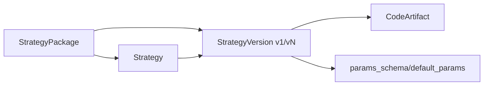
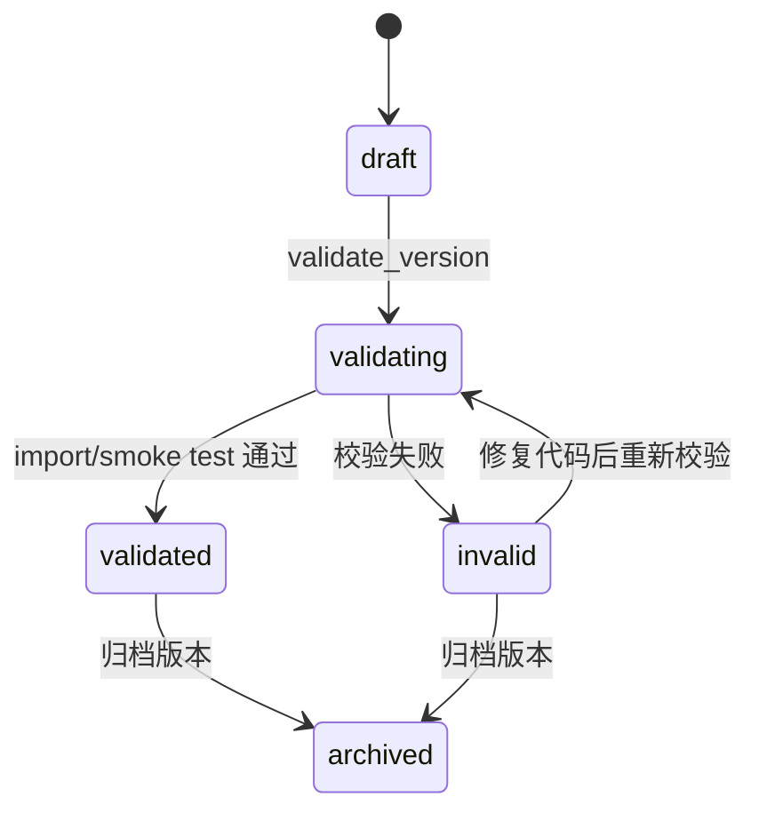
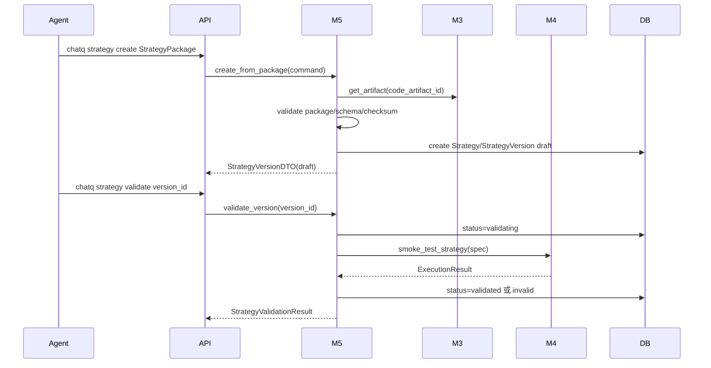

# 详细设计-M5-策略资产模块

## 1. 文档信息

| 项目 | 内容 |
|---|---|
| 系统 | Chat-Quant 股票分析与策略验证对话式智能体系统 |
| 模块 | M5 策略资产模块 |
| 版本 | V0.1 |
| 状态 | 草稿 |
| 输入基线 | `docs/概要设计说明书.md`、`docs/prd.md`、`docs/stock-agent-prototype.html` |
| 日期 | 2026-07-24 |

## 2. 设计目标与边界

### 2.1 设计目标

M5 负责把 `claude-agent-sdk` 驱动的 Agent 在对话中生成、并通过 `chatq strategy ...` CLI 提交的策略沉淀为可复用、可校验、可追溯的个人策略资产。它不是独立策略库页面的后端，而是服务于“策略型历史会话”的资产层。

核心目标：

- 承接 Agent 提交的 `StrategyPackage`，创建 `Strategy` 与首个 `StrategyVersion`。
- 以版本为单位管理策略代码、参数 schema、默认参数、校验状态和来源信息。
- 支持策略型历史会话中的命名、描述、标签、复制、复用、再次回测入口。
- 支持策略逻辑迭代，保证历史版本不可覆盖。
- 为 M6 回测模块提供稳定的 `StrategyVersion`、入口类和参数定义。
- 保留与 ChatSession、SDKMessage、SDKToolUse、CodeArtifact、BacktestRun 的追溯链路。

### 2.2 边界

| 类型 | 内容 |
|---|---|
| M5 负责 | 策略元数据、策略版本、参数 schema、默认参数、策略校验状态、复制/复用、标签、参数快照引用、版本查询 |
| M5 不负责 | Agent 意图理解、策略代码生成、普通 Python 执行、正式回测运行、收益/风险指标计算、图表渲染、独立策略列表页 |
| 上游依赖 | M1 提供 ChatSession 与 SDK transcript 来源，M2/Agent 通过 CLI 提交包，M3 提供策略代码产物，M4 提供策略 smoke test |
| 下游依赖 | M6 读取 `StrategyVersion` 创建和执行 `BacktestRun`，M1 在历史会话中展示策略资产引用 |

Agent/CLI 边界：

1. M5 不实现 Agent loop，不生成策略代码，不注册额外 SDK 扩展工具。
2. Agent 通过 SDK 自带 `Bash` 调用 `chatq strategy create/validate/get` 进入 M5。
3. M5 只校验并资产化 Agent 已提交的 `StrategyPackage`，是否创建新版、是否再次回测由 Agent 在 SDK loop 中依据上下文决定。

关键规则：

- 调整策略逻辑生成新的 `StrategyVersion`，不覆盖旧版本。
- 只调整回测参数生成新的 `BacktestRun`，不生成策略版本。
- 策略必须先通过校验才允许正式回测；失败原因要落库并可展示。
- 首期不提供全局独立策略库、策略市场、公开分享、协作权限和实盘交易。

## 3. PRD/UI 映射

### 3.1 PRD 映射

| PRD 需求 | M5 设计响应 |
|---|---|
| FR-004 自然语言策略创建 | 接收 Agent 生成的 `StrategyPackage`，保存策略名称、描述、类型、代码引用、参数 schema 和首个版本 |
| FR-005 策略回测验证 | 向 M6 暴露已校验的 `StrategyVersion`、入口类、默认参数和参数 schema |
| FR-007 连续追问与上下文理解 | 在同一会话内识别当前策略资产和最新版本，支持“改成更稳一点”等逻辑迭代 |
| FR-008 历史会话与复盘 | 策略资产与 ChatSession 绑定，供历史会话详情展示策略摘要、版本和最近回测 |
| FR-009 策略型历史会话复用 | 支持编辑标题/标签、复制策略版本、查看参数快照、基于原版本再次回测 |

### 3.2 HTML 原型映射

| 原型交互/区域 | 设计对象 | M5 行为 |
|---|---|---|
| 页面标题“沪深300 均线突破回测” | `Strategy.name`、`ChatSession.title` | 策略创建后可生成默认标题，用户编辑标题时更新策略/会话元数据 |
| “策略型历史会话”标签 | `ChatSession.kind=strategy`、`Strategy.tags` | 创建策略或回测成功后，由 M1/M5 标记会话具备策略资产 |
| 快捷问题“更稳一点” | 新 `StrategyVersion` | 若改变均线周期、过滤条件、交易规则等策略逻辑，创建新版本 |
| “再次回测”按钮 | `BacktestRun` | 基于当前 `StrategyVersion` 和新的回测参数创建回测，不创建策略版本 |
| “复制策略摘要”按钮 | `StrategyPackage` 摘要/复制记录 | 生成可带入新会话或剪贴板的策略摘要，不修改原策略 |
| 结果对象详情 `V2` | `StrategyVersion.version` | 展示当前版本号、策略逻辑、关键参数、校验状态和最近回测摘要 |
| 参数快照：MA 20/60、波动过滤 | `StrategyVersion.default_params`、`BacktestRun.config_json.params` | 默认参数归属策略版本；某次回测实际参数归属 BacktestRun |
| 收益/回撤/对比图切换 | `BacktestRun`/`BacktestResult` | M5 仅提供策略引用，图表数据由 M6/M3 提供 |

## 4. 核心模型

### 4.1 Strategy

`Strategy` 表示用户在某个会话中沉淀出的策略资产本体。它聚合多个版本，但不直接保存可执行代码。

| 字段 | 类型 | 说明 |
|---|---|---|
| `id` | string | 策略 ID |
| `user_id` | string | 所属用户，用于隔离 |
| `project_id` | string | 所属项目/空间 |
| `chat_session_id` | string | 来源 ChatSession |
| `source_sdk_message_uuid` | string/null | 首次创建策略的 SDK message |
| `name` | string | 策略名称，可由 Agent 生成，可由用户改名 |
| `description` | text | 策略描述 |
| `strategy_type` | string | 策略类型，如 `ma_cross`、`rsi_reversal` |
| `tags` | json array | 用户标签和系统标签 |
| `current_version_id` | string | 当前默认使用版本 |
| `status` | enum | `active`、`archived`、`deleted` |
| `created_at`/`updated_at` | datetime | 创建/更新时间 |

### 4.2 StrategyVersion

`StrategyVersion` 是可执行、可校验、可回测的策略版本单位。

| 字段 | 类型 | 说明 |
|---|---|---|
| `id` | string | 策略版本 ID |
| `strategy_id` | string | 所属策略 |
| `version` | int | 单策略内递增版本号，从 1 开始 |
| `version_name` | string | 可选版本名，如“加入波动过滤” |
| `code_artifact_id` | string | M3 代码产物引用 |
| `entrypoint` | string | `strategy.py:GeneratedStrategy` 形式 |
| `params_schema` | json | 参数 schema |
| `default_params` | json | 默认策略参数 |
| `logic_summary` | text | 策略逻辑摘要 |
| `change_summary` | text | 相对上一版本的变化 |
| `parent_version_id` | string | 来源版本，首版为空 |
| `source_sdk_session_id` | string/null | 来源 SDK session |
| `source_sdk_message_uuid` | string/null | 触发该版本的 SDK message |
| `source_sdk_tool_use_id` | string/null | 生成该版本的 SDK Bash tool_use |
| `code_checksum` | string | 创建时记录的代码 checksum |
| `status` | enum | `draft`、`validating`、`validated`、`invalid`、`archived` |
| `validation_error` | text | 最近一次校验失败原因 |
| `validated_at` | datetime | 最近一次校验通过时间 |
| `created_at` | datetime | 创建时间 |

### 4.3 StrategyPackage

`StrategyPackage` 是 Agent 调用 `chatq strategy create` 或创建新版本时必须提交的资产包。

```json
{
  "name": "均线突破策略",
  "description": "短期均线上穿长期均线买入，下穿卖出",
  "strategy_type": "ma_cross",
  "entrypoint": "strategy.py:GeneratedStrategy",
  "code_artifact_id": "code_xxx",
  "params_schema": {
    "fast_period": {
      "type": "integer",
      "title": "短期均线周期",
      "default": 20,
      "minimum": 2,
      "maximum": 250,
      "ui": {"control": "number", "unit": "日"}
    },
    "slow_period": {
      "type": "integer",
      "title": "长期均线周期",
      "default": 60,
      "minimum": 5,
      "maximum": 500,
      "ui": {"control": "number", "unit": "日"}
    },
    "volatility_filter": {
      "type": "string",
      "title": "波动过滤",
      "enum": ["off", "medium", "strong"],
      "default": "medium",
      "ui": {"control": "select"}
    }
  },
  "default_params": {
    "fast_period": 20,
    "slow_period": 60,
    "volatility_filter": "medium"
  },
  "logic_summary": "MA 20/60 突破并使用中等波动过滤",
  "risk_notes": ["策略仅用于历史回测，不构成投资建议"]
}
```

P0 必填字段：

- `name`
- `strategy_type`
- `entrypoint`
- `code_artifact_id`
- `params_schema`
- `default_params`

### 4.4 参数 schema 模型

首期采用 JSON Schema 子集，便于 Agent 生成、后端校验和前端渲染参数表单。

| 字段 | 说明 |
|---|---|
| `type` | 支持 `integer`、`number`、`string`、`boolean` |
| `title` | 前端显示名 |
| `description` | 参数说明 |
| `default` | 默认值，必须与 `default_params` 一致 |
| `minimum`/`maximum` | 数值范围 |
| `enum` | 枚举值 |
| `required` | 是否必填，默认 true |
| `ui.control` | `number`、`select`、`checkbox`、`text` |
| `ui.unit` | 单位，如“日”“%”“手” |

校验规则：

- `default_params` 的 key 必须是 `params_schema` 的子集，P0 建议完全一致。
- 每个默认值必须满足类型、枚举、范围约束。
- 参数名必须是 Python 标识符风格，禁止包含空格、路径符和控制字符。
- schema 仅描述策略逻辑参数，不包含回测环境参数。`symbols`、`start_date`、`end_date`、`initial_cash`、`commission` 等归属 `BacktestRun.config_json`。

### 4.5 StrategyPackage、Strategy、StrategyVersion 关系



首次创建时：

- 若没有目标 `strategy_id`，创建 `Strategy` 与 `StrategyVersion v1`。
- 若基于已有策略逻辑改造，创建同一 `Strategy` 下的新 `StrategyVersion`。

## 5. 版本与状态机

### 5.1 版本规则

| 场景 | 是否生成 StrategyVersion | 说明 |
|---|---|---|
| Agent 新生成一个策略 | 是 | 创建 `Strategy` + `StrategyVersion v1` |
| 用户说“把这个策略改成更稳一点”且改变交易规则 | 是 | 创建 `vN+1`，记录 `parent_version_id` 和 `change_summary` |
| 修改买卖条件、指标、过滤器、仓位规则、止盈止损规则 | 是 | 属于策略逻辑变化 |
| 修改 `params_schema` 的参数范围、默认值含义或新增逻辑参数 | 是 | 影响策略定义 |
| 只改股票池、市场、时间范围、初始资金、手续费、滑点、复权方式 | 否 | 只创建新的 `BacktestRun` |
| 只改已有策略参数的取值用于再次回测 | 否 | 只创建新的 `BacktestRun`，参数写入 `BacktestRun.config_json.params` |
| 编辑策略名称、描述、标签 | 否 | 只更新 `Strategy` 元数据 |
| 复制策略到新会话但不改逻辑 | 可选 | 默认不生成新版本；创建复制记录或新 `Strategy` 指向同源版本 |

必须明确：调整策略逻辑生成新 `StrategyVersion`；只调整回测参数生成 `BacktestRun`，不生成策略版本。

### 5.2 Strategy 状态

| 状态 | 含义 | 允许操作 |
|---|---|---|
| `active` | 正常可见 | 查看、编辑元数据、创建版本、复制、回测 |
| `archived` | 已归档 | 查看、复制；默认不允许新回测 |
| `deleted` | 软删除 | 默认不可见；保留审计和已有关联回测 |

### 5.3 StrategyVersion 状态机



状态规则：

- `draft` 可被校验，不建议正式回测。
- `validating` 是短暂状态，需记录开始时间，超时后转 `invalid`。
- `validated` 才可作为正式 `BacktestRun` 输入。
- `invalid` 保留错误详情和代码引用，支持 Agent 基于失败原因生成新版本。
- `archived` 不再作为默认版本，但历史回测仍可查询。

## 6. 策略校验流程

### 6.1 创建与校验主流程



### 6.2 校验项

| 阶段 | 校验项 | 失败处理 |
|---|---|---|
| 包结构校验 | 必填字段、字段类型、JSON 可序列化 | 拒绝创建或返回 422 |
| 权限校验 | `chat_session_id`、`source_sdk_session_id`、`source_sdk_tool_use_id`、`code_artifact_id` 属于同一 user/project | 拒绝创建，记录安全事件 |
| 代码引用校验 | CodeArtifact 存在，类型为 `strategy_script` 或允许的代码类型 | 拒绝创建 |
| entrypoint 校验 | 文件和类名格式合法，类可 import | `invalid` |
| 语法校验 | Python AST 可解析 | `invalid` |
| 基类校验 | 继承 `backtrader.Strategy` 或项目约定 `BaseStrategy` | `invalid` |
| 参数一致性 | `params_schema` 与策略类 `params` 可对应 | `invalid` |
| 副作用检查 | 禁止真实交易、危险文件访问、任意外部写操作 | `invalid` 或安全拒绝 |
| smoke test | 样例 OHLCV 数据最小运行成功 | `invalid` |

### 6.3 StrategyValidationResult

```json
{
  "strategy_version_id": "stv_xxx",
  "status": "validated",
  "checks": [
    {"name": "entrypoint", "status": "passed"},
    {"name": "params_schema", "status": "passed"},
    {"name": "smoke_test", "status": "passed"}
  ],
  "execution_result_id": "exec_xxx",
  "error": null,
  "validated_at": "2026-07-24T17:42:00+08:00"
}
```

## 7. 复制、复用、标签与参数快照

### 7.1 复制与复用

| 操作 | 行为 |
|---|---|
| 复制策略摘要 | 输出策略名称、逻辑摘要、版本号、默认参数、来源会话，不改变数据库 |
| 复制为新策略 | 创建新的 `Strategy`，首版可复用同一 `code_artifact_id` 或复制代码产物；记录 `copied_from_strategy_version_id` |
| 在同一会话复用 | 使用当前 `Strategy.current_version_id` 创建新的 `BacktestRun` |
| 在历史会话继续追问 | M1 加载会话上下文，Agent 可读取策略版本并决定创建新版本或新回测 |

复制为新策略适用于用户希望从历史策略派生一个独立资产；同一会话内再次回测默认不复制策略。

### 7.2 标签

标签分为系统标签和用户标签：

- 系统标签：`策略回测`、`策略创建`、`ma_cross`、`rsi_reversal`、`validated` 等，由系统或 Agent 建议。
- 用户标签：用户编辑的自由标签，如“沪深300”“稳健版”“待优化”。

标签存储在 `Strategy.tags`，必要时同步部分标签到 `ChatSession.tags` 以支持历史会话筛选。

### 7.3 参数快照

参数有两层：

- `StrategyVersion.default_params`：策略版本的默认逻辑参数。
- `BacktestRun.config_json.params`：某次回测实际使用的参数快照。

展示规则：

- 历史会话详情展示最近一次成功回测的参数快照。
- 版本详情展示 `default_params` 与 schema。
- 回测对比展示各 `BacktestRun` 的实际参数差异。
- 用户只改参数并点击“再次回测”时，新的参数只写入 `BacktestRun`，不改 `StrategyVersion.default_params`。

## 8. 与其他模块的关联

### 8.1 与会话 M1

- `Strategy.chat_session_id` 指向策略来源历史入口。
- `StrategyVersion.source_sdk_message_uuid` 指向触发策略生成或优化的 SDK message。
- `StrategyVersion.source_sdk_tool_use_id` 指向 Agent 通过 Bash 调用 `chatq strategy ...` 的 SDK tool_use。
- M1 的会话详情聚合策略、版本、回测记录，但不直接修改策略内部状态。
- 策略创建成功后，M1 可将会话标记为 `strategy` 类型，支持历史筛选。

### 8.2 与代码产物 M3

- 每个 `StrategyVersion` 必须引用一个 `CodeArtifact`。
- M5 在创建版本时读取代码元数据和 checksum。
- 代码产物不可被 M5 覆盖；新逻辑对应新代码产物和新版本。
- M5 只保存引用和入口，不直接管理文件内容。

### 8.3 与运行时 M4

- M5 调用 M4 的 `smoke_test_strategy` 做 import、最小数据运行和结果捕获。
- M4 返回 `ExecutionResult`，M5 根据结果更新版本状态。
- M5 不调用 M4 执行正式回测。

### 8.4 与回测 M6

- M6 创建回测前读取 M5 的 `StrategyVersion`。
- 只有 `validated` 版本允许创建正式回测。
- `BacktestRun.strategy_version_id` 固定指向某个版本。
- M6 管理回测状态、配置、结果、交易和曲线；M5 只提供策略资产引用。

## 9. API/CLI 契约

### 9.1 REST API

| 接口 | 方法 | 用途 |
|---|---|---|
| `/api/strategies` | POST | 根据 `StrategyPackage` 创建策略和首个版本 |
| `/api/strategies/{id}` | GET | 查询策略详情、版本列表、标签、当前版本 |
| `/api/strategies/{id}` | PATCH | 更新策略名称、描述、标签、归档状态 |
| `/api/strategies/{id}/versions` | POST | 基于已有策略创建新版本 |
| `/api/strategy-versions/{id}` | GET | 查询策略版本详情、入口和参数 schema |
| `/api/strategy-versions/{id}/validate` | POST | 校验策略版本 |
| `/api/strategy-versions/{id}/copy` | POST | 复制为新策略或生成复制摘要 |

### 9.2 创建策略请求

```json
{
  "chat_session_id": "conv_xxx",
  "source_sdk_session_id": "claude_sess_xxx",
  "source_sdk_message_uuid": "msg_uuid_xxx",
  "source_sdk_tool_use_id": "toolu_xxx",
  "package": {
    "name": "均线突破策略",
    "description": "短期均线上穿长期均线买入，下穿卖出",
    "strategy_type": "ma_cross",
    "entrypoint": "strategy.py:GeneratedStrategy",
    "code_artifact_id": "code_xxx",
    "params_schema": {},
    "default_params": {}
  }
}
```

响应：

```json
{
  "strategy_id": "str_xxx",
  "strategy_version_id": "stv_xxx",
  "version": 1,
  "status": "draft",
  "entrypoint": "strategy.py:GeneratedStrategy"
}
```

### 9.3 创建新版本请求

```json
{
  "chat_session_id": "conv_xxx",
  "source_sdk_session_id": "claude_sess_xxx",
  "source_sdk_message_uuid": "msg_uuid_xxx",
  "source_sdk_tool_use_id": "toolu_xxx",
  "parent_version_id": "stv_v1",
  "change_summary": "加入波动过滤并延长长期均线周期",
  "package": {
    "name": "均线突破策略",
    "strategy_type": "ma_cross",
    "entrypoint": "strategy.py:GeneratedStrategy",
    "code_artifact_id": "code_yyy",
    "params_schema": {},
    "default_params": {}
  }
}
```

### 9.4 CLI

| 命令 | 说明 |
|---|---|
| `chatq strategy create --conversation-id <id> --agent-run-id <id> --source-message-id <id> --package-file strategy_package.json` | 创建策略或首个版本 |
| `chatq strategy version-create --strategy-id <id> --parent-version-id <id> --package-file strategy_package.json` | 创建新策略版本 |
| `chatq strategy validate --strategy-version-id <id>` | 校验策略版本 |
| `chatq strategy get --strategy-version-id <id>` | 查询版本、入口、参数 schema |
| `chatq strategy copy --strategy-version-id <id> --mode summary` | 输出复制摘要 |
| `chatq strategy copy --strategy-version-id <id> --mode new-strategy --conversation-id <id>` | 复制为新策略资产 |

CLI 输出统一为 JSON，失败时返回非 0 exit code，并包含 `error_code`、`message`、`details`。

## 10. 数据库表设计

### 10.1 `strategies`

| 字段 | 类型 | 约束 | 说明 |
|---|---|---|---|
| `id` | varchar | PK | 策略 ID |
| `user_id` | varchar | not null, index | 用户隔离 |
| `project_id` | varchar | not null, index | 项目隔离 |
| `chat_session_id` | varchar | not null, index | 来源 ChatSession |
| `source_sdk_message_uuid` | varchar | nullable, index | 来源 SDK message |
| `name` | varchar(128) | not null | 策略名称 |
| `description` | text | nullable | 策略描述 |
| `strategy_type` | varchar(64) | not null, index | 策略类型 |
| `tags_json` | json/text | not null default `[]` | 标签 |
| `current_version_id` | varchar | nullable, index | 当前版本 |
| `status` | varchar(32) | not null | `active`、`archived`、`deleted` |
| `created_at` | datetime | not null | 创建时间 |
| `updated_at` | datetime | not null | 更新时间 |

索引：

- `idx_strategies_user_project_updated(user_id, project_id, updated_at)`
- `idx_strategies_chat_session(chat_session_id)`
- `idx_strategies_type(strategy_type)`

### 10.2 `strategy_versions`

| 字段 | 类型 | 约束 | 说明 |
|---|---|---|---|
| `id` | varchar | PK | 策略版本 ID |
| `strategy_id` | varchar | not null, FK, index | 所属策略 |
| `version` | integer | not null | 单策略内递增版本 |
| `version_name` | varchar(128) | nullable | 版本名 |
| `parent_version_id` | varchar | nullable, index | 父版本 |
| `code_artifact_id` | varchar | not null, index | 策略代码产物 |
| `entrypoint` | varchar(256) | not null | 入口类 |
| `params_schema_json` | json/text | not null | 参数 schema |
| `default_params_json` | json/text | not null | 默认参数 |
| `logic_summary` | text | nullable | 逻辑摘要 |
| `change_summary` | text | nullable | 变化摘要 |
| `source_sdk_session_id` | varchar | nullable, index | 来源 SDK session |
| `source_sdk_message_uuid` | varchar | nullable, index | 来源 SDK message |
| `source_sdk_tool_use_id` | varchar | nullable, index | 来源 SDK Bash tool_use |
| `code_checksum` | varchar(128) | not null | 代码 checksum |
| `status` | varchar(32) | not null, index | 版本状态 |
| `validation_error` | text | nullable | 校验失败原因 |
| `validation_details_json` | json/text | nullable | 分项校验详情 |
| `validated_at` | datetime | nullable | 校验通过时间 |
| `created_at` | datetime | not null | 创建时间 |

约束：

- 唯一约束：`uniq_strategy_versions_strategy_version(strategy_id, version)`
- `version > 0`
- `status in ('draft','validating','validated','invalid','archived')`

### 10.3 `strategy_copy_records`

| 字段 | 类型 | 约束 | 说明 |
|---|---|---|---|
| `id` | varchar | PK | 复制记录 ID |
| `source_strategy_version_id` | varchar | not null, index | 来源版本 |
| `target_strategy_id` | varchar | nullable, index | 复制为新策略时填写 |
| `target_chat_session_id` | varchar | nullable, index | 复制目标 ChatSession |
| `mode` | varchar(32) | not null | `summary`、`new_strategy` |
| `created_by` | varchar | not null | 用户 ID |
| `created_at` | datetime | not null | 创建时间 |

### 10.4 与 M6 的关联字段

M5 不拥有回测表，但约定 M6 的 `backtest_runs` 必须包含：

- `strategy_version_id`
- `chat_session_id`
- `config_json.params`
- `config_json.symbols`
- `config_json.start_date`
- `config_json.end_date`
- `config_json.initial_cash`
- `config_json.commission`

其中 `config_json.params` 是回测参数快照，不反写 `StrategyVersion.default_params`。

## 11. 异常处理

| 错误码 | 场景 | HTTP | 用户反馈 |
|---|---|---|---|
| `STRATEGY_PACKAGE_INVALID` | 包结构或字段缺失 | 422 | “策略信息不完整，请重新生成策略。” |
| `STRATEGY_ARTIFACT_NOT_FOUND` | 代码产物不存在或无权限 | 404/403 | “未找到可用策略代码。” |
| `STRATEGY_ENTRYPOINT_INVALID` | 入口格式错误或类不可 import | 200 + `invalid` | “策略已生成但入口校验未通过。” |
| `STRATEGY_PARAMS_INVALID` | 参数 schema 与默认值或代码不一致 | 200 + `invalid` | “策略参数定义不一致，请修正后重试。” |
| `STRATEGY_SECURITY_VIOLATION` | 检测到越权、交易、危险操作 | 403 或 `invalid` | “策略代码包含不允许的操作。” |
| `STRATEGY_SMOKE_TEST_FAILED` | 样例数据运行失败 | 200 + `invalid` | “策略校验未通过，无法正式回测。” |
| `STRATEGY_VERSION_NOT_VALIDATED` | 未校验版本用于回测 | 409 | “请先通过策略校验再回测。” |
| `STRATEGY_ARCHIVED` | 已归档策略被修改或回测 | 409 | “策略已归档，可复制后继续使用。” |

处理原则：

- 创建失败且未落库时返回 4xx。
- 已创建版本但校验失败时保留 `StrategyVersion`，状态置为 `invalid`。
- 校验异常必须保留机器可读 `validation_details_json` 和面向用户的摘要。
- 用户可见文案避免暴露本地路径、环境变量、Token 等敏感信息。

## 12. 安全合规

| 类别 | 要求 |
|---|---|
| 数据隔离 | 所有策略查询和写入按 `user_id`、`project_id`、`chat_session_id` 校验 |
| 代码安全 | 策略校验禁止真实下单、资金账户访问、越权文件写、危险系统调用 |
| 网络边界 | 策略代码不应发起任意外部写请求；行情读取由受控数据能力或回测入口提供 |
| 审计追踪 | 记录来源 SDK message、SDK Bash tool_use、CodeArtifact、checksum、校验结果 |
| 投资建议边界 | 策略描述和回测引用必须提示“历史回测不代表未来收益，不构成投资建议” |
| 删除与归档 | 用户删除历史会话时，策略默认软删除或归档；若有合规保留要求，保留审计元数据 |
| 敏感信息 | 不允许把 API Key、账户、Token 写入策略代码、参数或标签 |

## 13. 测试建议

### 13.1 单元测试

- `StrategyPackage` 必填字段、类型、默认值、枚举和范围校验。
- 参数 schema 与 `default_params` 一致性校验。
- entrypoint 字符串解析。
- 版本号递增和唯一约束。
- 只改元数据不创建版本。
- 只改回测参数不创建版本。
- 逻辑变更创建新版本并保留父版本。

### 13.2 集成测试

- Agent 保存 CodeArtifact 后创建策略首版。
- `validate_version` 调用 M4 smoke test，通过后状态转 `validated`。
- 语法错误、入口错误、参数不一致、smoke test 失败时状态转 `invalid`。
- M6 创建回测时拒绝未校验版本。
- 历史会话详情可聚合策略、版本和最近回测记录。

### 13.3 API/CLI 测试

- REST 与 CLI 对同一 `StrategyPackage` 返回一致结果。
- CLI 失败时 exit code、`error_code`、`message` 格式稳定。
- `strategy copy --mode summary` 不产生数据库写入或只产生复制审计记录。
- `strategy copy --mode new-strategy` 创建新策略并记录来源版本。

### 13.4 UI 验收联动

- 策略结果区展示版本号、策略逻辑、参数快照、收益/回撤摘要。
- “再次回测”仅创建新 `BacktestRun`，版本号不变。
- “改成更稳一点”在策略逻辑改变时创建新 `StrategyVersion`。
- 历史列表可通过策略标签筛选策略型会话。
- 错误状态展示“策略已生成但校验未通过”，并保留继续追问入口。

## 14. 待决事项

| 编号 | 待决事项 | 影响 | 建议 |
|---|---|---|---|
| TBD-M5-001 | `params_schema` 是否完全采用 JSON Schema Draft 2020-12 | 影响前后端校验库选择 | 首期采用本文子集，后续再升级 |
| TBD-M5-002 | 复制为新策略时是否复制代码文件 | 影响存储与追溯 | P0 可复用同一 CodeArtifact，若用户修改逻辑再生成新代码 |
| TBD-M5-003 | 策略标签是否独立建表 | 影响搜索性能 | 首期 JSON 存储，数据量增长后拆表 |
| TBD-M5-004 | archived 策略是否允许直接再次回测 | 影响历史复用体验 | 默认不允许，提示复制后使用 |
| TBD-M5-005 | BaseStrategy 是否需要项目自定义封装 | 影响策略代码规范 | 首期允许 `backtrader.Strategy`，后续引入 `BaseStrategy` |
| TBD-M5-006 | 策略和历史会话保存周期 | 影响合规和存储成本 | 跟随 PRD TBD-003 由产品确认 |
