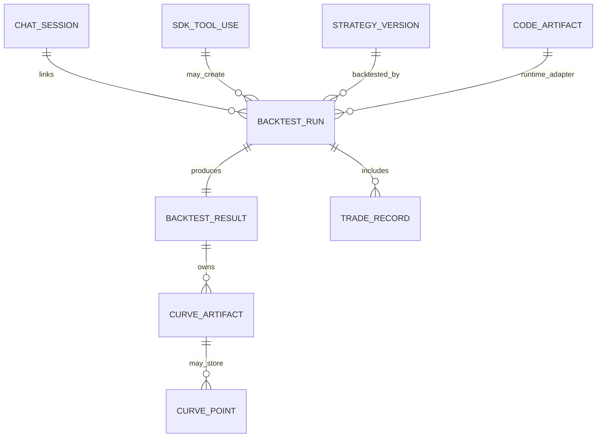
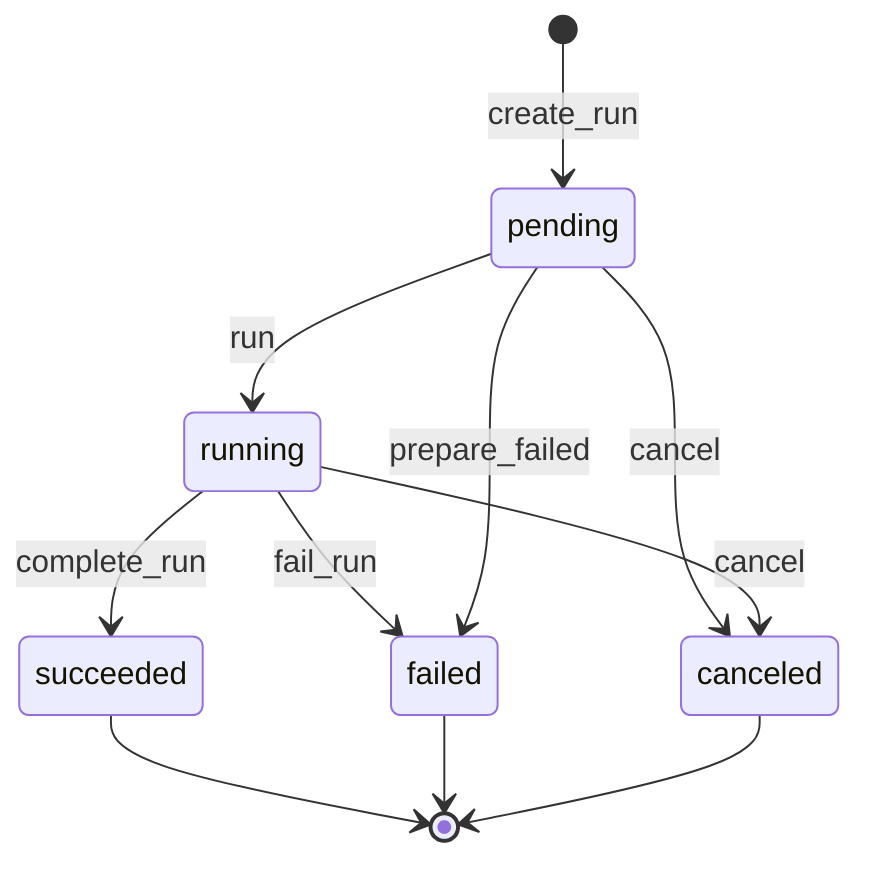
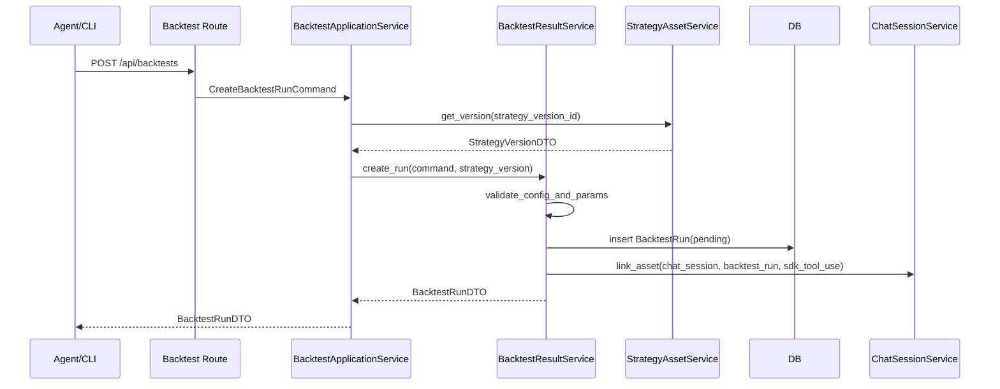
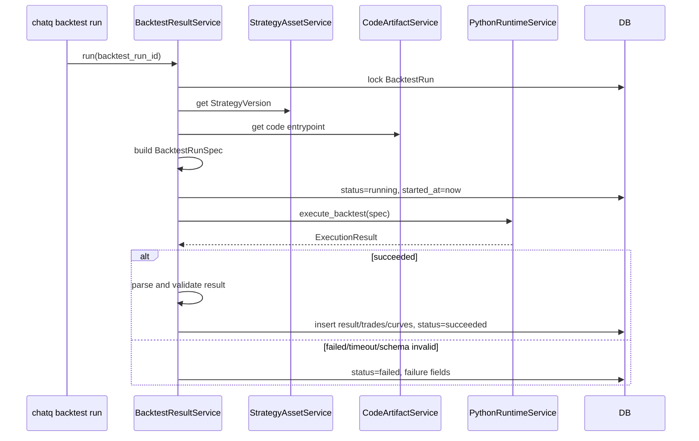

# 详细设计-M6-回测与风险结果模块

## 1. 文档信息

| 项目 | 内容 |
|---|---|
| 系统 | Chat-Quant 股票分析与策略验证对话式智能体系统 |
| 模块 | M6 回测与风险结果模块 |
| 版本 | V0.1 / 草稿 |
| HLD 基线 | 概要设计说明书 V0.2 |
| PRD 基线 | PRD-STOCK-001 V0.4 |
| 原型基线 | stock-agent-prototype.html |
| 日期 | 2026-07-24 |

## 2. 设计目标与边界

### 2.1 设计目标

M6 回测与风险结果模块负责把一次策略回测从“用户确认的回测条件”固化为不可变 `BacktestRun`，驱动 M4 Python 运行时执行标准 `BacktestRunSpec`，并将运行产出的收益、风险、交易明细、收益曲线、回撤曲线和失败原因持久化为可复盘、可比较、可再次回测的系统资产。Agent 由 `claude-agent-sdk` 承担，首期通过 SDK 自带 `Bash` 调用 `chatq backtest ...` CLI 进入 M6。

| 编号 | 目标 | 说明 |
|---|---|---|
| M6-G01 | 回测不可变 | 一次 `BacktestRun` 创建后配置不可原地修改；再次运行必须创建新记录 |
| M6-G02 | 结果标准化 | 所有正式回测必须输出符合 `BacktestResult` 契约的结果 |
| M6-G03 | 风险内聚 | 最大回撤、夏普、胜率等风险指标作为 `BacktestResult` 的一部分管理，不拆独立风险模块 |
| M6-G04 | 历史可复盘 | 支持历史会话展示参数快照、指标卡片、收益/回撤图、交易明细和失败原因 |
| M6-G05 | 策略可复用 | 同一 `StrategyVersion` 可基于不同参数、股票池、周期反复生成多个 `BacktestRun` |
| M6-G06 | 多回测可比较 | 支持按策略版本、会话和用户维度比较最近若干次回测 |
| M6-G07 | 可追溯 | 结果可追溯到 ChatSession、SDKMessage、SDKToolUse、StrategyVersion、CodeArtifact 和 ExecutionResult |

### 2.2 模块边界

| 类型 | 内容 |
|---|---|
| M6 负责 | 创建回测运行；校验并冻结回测配置；生成 `BacktestRunSpec`；驱动 M4 执行回测；解析 `ExecutionResult` 中的标准结果文件；计算或复核指标；持久化 `BacktestResult`、交易明细、收益曲线、回撤曲线；记录失败原因；提供查询、再次回测和比较能力 |
| M6 不负责 | 理解用户自然语言；生成策略代码；创建或校验 `StrategyVersion`；直接执行 Python 子进程；保存原始代码文件；生成最终对话解释；真实交易下单 |
| 上游依赖 | M1 提供会话和资产关联；M2/Agent 通过 CLI 决定是否调用回测命令；M5 提供策略版本、入口和参数 schema；M3 提供策略代码和运行产物文件引用 |
| 下游输出 | `BacktestRunDTO`、`BacktestResultDTO`、`BacktestComparisonDTO`、`BacktestChartSpec`、领域通知、会话资产引用 |

Agent/CLI 边界：

1. M6 不实现 Agent loop，不理解自然语言，也不注册额外 SDK 扩展工具。
2. Agent 是否创建回测、再次回测或比较多次回测，由 `claude-agent-sdk` loop 中的模型根据会话上下文决定。
3. M6 只承接 `chatq backtest create/run/get/rerun/compare` CLI 请求，执行配置冻结、运行协调、结果解析和指标持久化。

### 2.3 首期取舍

1. 回撤与风险指标不拆独立模块，也不建立独立 RiskResult 聚合；它们统一作为 `BacktestResult.metrics` 和曲线产物管理。
2. `BacktestConfig` 是 `BacktestRun` 内部不可变值对象，首期序列化存储在 `backtest_runs.config_json`，不单独建 `backtest_configs` 表。
3. `EquityCurve` 和 `DrawdownCurve` 是 `CurveArtifact` 的强类型视图。首期小曲线可入库为点，大曲线文件化并保存引用。
4. M6 可对运行时输出的指标做一致性复核；当运行时未输出可复核字段时，M6 以运行时输出为准并记录 warning。
5. 首期只支持单策略基础回测和基准对比，不支持组合回测、多策略归因和实盘绩效归因。

## 3. PRD/UI 映射

### 3.1 PRD 功能映射

| PRD 需求 | M6 支撑点 | 主要输出 |
|---|---|---|
| FR-003 股票图表可视化 | 提供收益曲线、回撤曲线和对比图所需数据 | `EquityCurve`、`DrawdownCurve`、`BacktestChartSpec` |
| FR-005 策略回测验证 | 创建、执行、完成或失败一次正式回测 | `BacktestRun`、`BacktestResult`、`TradeRecord` |
| FR-008 历史会话与复盘 | 将回测结果关联到会话，支持历史详情读取 | 参数快照、指标摘要、曲线和失败原因 |
| FR-009 策略型历史会话复用 | 支持从历史策略会话再次回测和比较最近若干次结果 | 新 `BacktestRun`、比较结果、版本关系 |

### 3.2 HTML 原型交互映射

| 原型区域/交互 | M6 设计响应 |
|---|---|
| 页面标题“沪深300 均线突破回测”与“策略型历史会话” | `BacktestRun.chat_session_id` 关联 M1；会话可按策略型历史筛选并展示最近回测摘要 |
| 顶部“数据口径：延迟行情 + 历史日线” | `BacktestConfig.data_source`、`data_adjust`、`timeframe`、`data_as_of` 记录数据口径 |
| 工具调用进度“读取上下文/调用平台命令/整理产物/生成回复” | 前端根据 SDK Bash tool_use/tool_result 展示；M6 只返回 CLI JSON 与领域通知 |
| 指标卡片：年化收益、最大回撤、夏普比率、交易胜率 | `BacktestResult.metrics_json` 固定这些 P0 指标，并提供展示格式字段 |
| 图表页签：收益、回撤、对比、行情 | M6 管理 `equity_curve`、`drawdown_curve`；对比图由 `compare_backtest_runs` 或基准曲线生成 |
| 图表对象详情：周期、叠加指标、数据口径 | `CurveArtifact.metadata_json` 保存周期、基准、叠加指标、数据来源和采样频率 |
| 结果对象详情：策略逻辑、波动过滤、年化收益、最大回撤 | M6 返回参数快照和指标；策略逻辑来自 M5 `StrategyVersion` |
| “再次回测” | 基于原 `StrategyVersion` 和原 `BacktestConfig` 复制生成新的 `BacktestRun`，可覆盖部分参数 |
| “改成更稳一点” | 若策略逻辑变化，先由 M5 生成新 `StrategyVersion`，再由 M6 创建新回测；若仅调参，则直接创建新 `BacktestRun` |
| 历史列表摘要“年化 18.6%，最大回撤 -12.8%” | M6 提供 `summary` 和关键指标快照给 M1 历史列表冗余展示 |

## 4. 领域模型

### 4.1 聚合关系



`BacktestRun` 是聚合根。`BacktestConfig`、`BacktestRunSpec`、`BacktestResult`、`TradeRecord`、`EquityCurve`、`DrawdownCurve` 和 `CurveArtifact` 都围绕一次不可变运行组织。查询入口可以按 `chat_session_id`、`strategy_version_id`、`source_sdk_tool_use_id` 或 `backtest_run_id` 访问，但写入必须从 `BacktestRun` 的状态流转进入。

### 4.2 BacktestRun

`BacktestRun` 表示一次正式回测运行记录。它承载状态、不可变配置、运行引用和结果引用。

| 字段 | 类型 | 必填 | 说明 |
|---|---|---|---|
| `id` | string | 是 | 回测 ID，建议前缀 `bt_` |
| `user_id` | string | 是 | 所属用户，用于权限隔离 |
| `project_id` | string | 是 | 所属项目 |
| `chat_session_id` | string | 是 | 来源 ChatSession |
| `source_sdk_session_id` | string/null | 否 | 来源 SDK session |
| `source_sdk_message_uuid` | string/null | 否 | 触发创建的 SDK message |
| `source_sdk_tool_use_id` | string/null | 否 | 触发命令的 SDK Bash tool_use |
| `strategy_id` | string | 是 | 策略本体 ID，冗余便于查询 |
| `strategy_version_id` | string | 是 | 回测使用的策略版本 |
| `code_artifact_id` | string | 是 | 策略代码产物 ID，来自 M5/M3 |
| `runtime_artifact_id` | string/null | 否 | 标准回测适配脚本或结果产物集合 |
| `parent_backtest_run_id` | string/null | 否 | 再次回测来源 |
| `status` | enum | 是 | `pending`、`running`、`succeeded`、`failed`、`canceled` |
| `config_json` | json | 是 | 冻结后的 `BacktestConfig` |
| `config_hash` | string | 是 | 配置规范化后的 SHA-256，用于比较和幂等提示 |
| `execution_result_id` | string/null | 否 | M4 执行结果 ID |
| `result_id` | string/null | 否 | 成功时的 `BacktestResult.id` |
| `failure_code` | string/null | 否 | 失败错误码 |
| `failure_message` | string/null | 否 | 面向用户可理解的失败摘要 |
| `failure_detail_json` | json/null | 否 | 详细错误、trace、schema 校验错误 |
| `started_at` | datetime/null | 否 | 进入 running 的时间 |
| `completed_at` | datetime/null | 否 | 进入终态的时间 |
| `created_at`/`updated_at` | datetime | 是 | 创建和更新时间 |

关键规则：

1. `pending` 状态允许补齐系统生成字段，但不允许修改用户已确认配置。
2. 一旦进入 `running`，`config_json`、`strategy_version_id`、`code_artifact_id` 不可修改。
3. `succeeded`、`failed`、`canceled` 为终态，不允许再次进入运行；再次执行必须创建新的 `BacktestRun`。
4. `parent_backtest_run_id` 只表达复制来源，不表达策略版本继承；策略版本继承由 M5 管理。

### 4.3 BacktestConfig

`BacktestConfig` 是 `BacktestRun` 的不可变值对象，表达用户确认或 Agent 声明默认假设后的回测配置。

| 字段 | 类型 | 必填 | 说明 |
|---|---|---|---|
| `symbols` | list[string] | 是 | 股票池或指数成分来源展开后的标的列表；大型股票池可记录 `universe_ref` |
| `universe_ref` | string/null | 否 | 如 `CSI300_constituents@2026-07-24` |
| `market` | string | 是 | `CN`、`US` 等市场 |
| `benchmark_symbol` | string/null | 否 | 基准，如 `000300.SH`、`SPY` |
| `start_date` | date | 是 | 回测开始日期，含当天 |
| `end_date` | date | 是 | 回测结束日期，含当天 |
| `timeframe` | string | 是 | 首期默认 `1d` |
| `data_source` | string | 是 | 如 `akshare` |
| `data_adjust` | string | 是 | `qfq`、`hfq`、`none` |
| `data_as_of` | datetime/null | 否 | 数据获取或缓存时间 |
| `initial_cash` | decimal | 是 | 初始资金 |
| `commission` | decimal | 是 | 单边手续费率，默认按成交额比例 |
| `slippage` | decimal | 是 | 滑点比例或价格偏移 |
| `tax` | decimal/null | 否 | 印花税等市场费用，首期可为空 |
| `order_size_mode` | string | 是 | `fixed_size`、`fixed_cash`、`percent_cash` |
| `params` | json | 是 | 策略参数快照，必须通过 M5 参数 schema 校验 |
| `risk_free_rate` | decimal | 是 | 年化无风险利率，首期默认 0 |
| `calendar` | string | 是 | 交易日历，如 `CN_A_SHARE` |
| `currency` | string | 是 | `CNY`、`USD` |
| `assumptions` | list[string] | 否 | Agent 声明的默认假设 |

配置规范化规则：

1. 日期统一为 ISO `YYYY-MM-DD`。
2. 小数以字符串或 Decimal 规范化后参与 `config_hash`，避免浮点序列化差异。
3. `symbols` 排序规则由回测语义决定：组合回测保留顺序，普通股票池比较可排序；规范化时必须记录 `symbol_order_mode`。
4. `params` 只保留策略 schema 允许字段；未知字段拒绝创建或记录为 warning 后忽略，首期建议拒绝。

### 4.4 BacktestRunSpec

`BacktestRunSpec` 是 M6 提交给 M4 的运行契约，由 `BacktestRun`、`BacktestConfig`、`StrategyVersion` 和代码产物入口合成。

```python
class BacktestRunSpec(BaseModel):
    backtest_run_id: str
    user_id: str
    project_id: str
    chat_session_id: str
    source_sdk_session_id: str | None = None
    source_sdk_message_uuid: str | None = None
    source_sdk_tool_use_id: str | None = None
    strategy_version_id: str
    code_artifact_id: str
    entrypoint: str
    symbols: list[str]
    universe_ref: str | None = None
    market: str
    benchmark_symbol: str | None = None
    start_date: date
    end_date: date
    initial_cash: Decimal
    commission: Decimal
    slippage: Decimal = Decimal("0")
    data_source: str = "akshare"
    data_adjust: str = "qfq"
    timeframe: str = "1d"
    params: dict[str, Any]
    risk_free_rate: Decimal = Decimal("0")
    calendar: str
    currency: str
    output_path: str
    timeout_seconds: int = 300
```

构造规则：

1. `entrypoint` 必须来自已验证或允许回测的 `StrategyVersion`。
2. `output_path` 必须位于 M4 分配的受控输出目录下，逻辑文件名固定包含 `result.json`、`equity_curve.json`、`drawdown_curve.json`。
3. `timeout_seconds` 可由系统配置、股票数量、时间跨度共同计算，但必须有上限。
4. `BacktestRunSpec` 不保存用户聊天文本，只保存执行需要的结构化参数。

### 4.5 BacktestResult

`BacktestResult` 表示一次成功回测的标准业务结果，也承载回撤和风险指标。风险指标不拆成独立模块、不拆成独立聚合。

| 字段 | 类型 | 必填 | 说明 |
|---|---|---|---|
| `id` | string | 是 | 结果 ID，建议前缀 `btr_` |
| `backtest_run_id` | string | 是 | 所属运行，唯一 |
| `status` | enum | 是 | 固定 `succeeded`；失败信息保存在 `BacktestRun` |
| `summary` | string | 是 | 面向历史列表和结果卡片的摘要 |
| `metrics_json` | json | 是 | 收益、风险、交易统计等指标 |
| `benchmark_metrics_json` | json/null | 否 | 基准指标 |
| `warnings_json` | json | 是 | 数据缺口、指标不可计算等 warning |
| `config_snapshot_json` | json | 是 | 展示用配置快照，来源于 `BacktestConfig` |
| `artifact_refs_json` | json | 是 | result.json、日志、曲线文件、图表产物引用 |
| `created_at` | datetime | 是 | 创建时间 |

`metrics_json` P0 字段：

| 指标字段 | 展示名 | 类型 | 说明 |
|---|---|---|---|
| `initial_value` | 初始资金 | decimal | 回测起始组合权益 |
| `final_value` | 期末权益 | decimal | 回测结束组合权益 |
| `total_return_pct` | 累计收益率 | decimal | `(final / initial - 1) * 100` |
| `annual_return_pct` | 年化收益率 | decimal | 按实际交易日或自然日折算，口径见第 6 章 |
| `max_drawdown_pct` | 最大回撤 | decimal | 展示为负值，如 `-12.8`；内部可同时保存绝对值 |
| `max_drawdown_start` | 最大回撤开始 | date/null | 回撤峰值日期 |
| `max_drawdown_end` | 最大回撤结束 | date/null | 回撤谷值日期 |
| `max_drawdown_recovery_date` | 回撤恢复日 | date/null | 重新回到前高的日期 |
| `max_drawdown_duration_days` | 回撤持续天数 | int/null | 峰值到恢复日或结束日 |
| `volatility_annual_pct` | 年化波动率 | decimal/null | 基于收益序列 |
| `sharpe_ratio` | 夏普比率 | decimal/null | 无风险利率来自配置 |
| `sortino_ratio` | 索提诺比率 | decimal/null | P1 展示，P0 可计算 |
| `calmar_ratio` | Calmar 比率 | decimal/null | 年化收益 / 最大回撤绝对值 |
| `win_rate_pct` | 交易胜率 | decimal/null | 盈利平仓交易数 / 已平仓交易数 |
| `total_trades` | 交易次数 | int | 平仓交易数或订单成交数需记录口径 |
| `profit_factor` | 盈亏比 | decimal/null | 总盈利 / 总亏损绝对值 |
| `turnover_rate` | 换手率 | decimal/null | 首期可选 |

### 4.6 TradeRecord

`TradeRecord` 保存标准化交易明细，用于历史复盘、解释收益来源和未来扩展详情页。

| 字段 | 类型 | 必填 | 说明 |
|---|---|---|---|
| `id` | string | 是 | 交易记录 ID，建议前缀 `tr_` |
| `backtest_run_id` | string | 是 | 所属运行 |
| `symbol` | string | 是 | 标的代码 |
| `order_id` | string/null | 否 | 运行时或 backtrader 订单 ID |
| `trade_id` | string/null | 否 | 配对交易 ID |
| `side` | enum | 是 | `buy`、`sell`、`short`、`cover` |
| `status` | enum | 是 | `opened`、`closed`、`partial` |
| `trade_datetime` | datetime | 是 | 成交时间 |
| `price` | decimal | 是 | 成交价 |
| `size` | decimal | 是 | 成交数量 |
| `value` | decimal | 是 | 成交金额 |
| `commission` | decimal | 是 | 手续费 |
| `pnl` | decimal/null | 否 | 单笔已实现盈亏 |
| `pnl_pct` | decimal/null | 否 | 单笔收益率 |
| `holding_days` | int/null | 否 | 持仓天数 |
| `metadata_json` | json | 否 | 原始订单、信号、原因等扩展信息 |

口径说明：

1. 指标中的 `total_trades` 首期以已平仓交易为准；如果运行时只能输出成交订单，则在 `metrics_json.trade_count_basis` 记录 `order_fill`。
2. `TradeRecord` 不负责保存逐日持仓；逐日权益由 `EquityCurve` 保存。

### 4.7 EquityCurve

`EquityCurve` 是权益曲线的领域视图，表示策略组合价值随时间变化。物理上由 `CurveArtifact(curve_type="equity")` 加可选点表或文件产物承载。

| 字段 | 类型 | 说明 |
|---|---|---|
| `backtest_run_id` | string | 所属回测 |
| `curve_type` | enum | 固定 `equity` |
| `points` | list[CurvePoint] | 小曲线直接返回 |
| `artifact_file_id` | string/null | 大曲线文件引用 |
| `normalized_base` | decimal | 归一化基准，默认 `100` |
| `metadata` | json | 基准、币种、采样频率、是否含现金和手续费 |

标准点字段：

| 字段 | 类型 | 说明 |
|---|---|---|
| `date` | date | 交易日 |
| `value` | decimal | 组合权益绝对值 |
| `normalized_value` | decimal | 归一化值，默认首日为 100 |
| `cash` | decimal/null | 现金 |
| `position_value` | decimal/null | 持仓市值 |
| `benchmark_value` | decimal/null | 基准归一化值 |

### 4.8 DrawdownCurve

`DrawdownCurve` 是回撤曲线的领域视图，物理上由 `CurveArtifact(curve_type="drawdown")` 承载。

| 字段 | 类型 | 说明 |
|---|---|---|
| `backtest_run_id` | string | 所属回测 |
| `curve_type` | enum | 固定 `drawdown` |
| `points` | list[CurvePoint] | 小曲线直接返回 |
| `artifact_file_id` | string/null | 大曲线文件引用 |
| `metadata` | json | 峰值、谷值、恢复区间、是否含基准回撤 |

标准点字段：

| 字段 | 类型 | 说明 |
|---|---|---|
| `date` | date | 交易日 |
| `value` | decimal | 回撤百分比，展示为 `<= 0` 的值，如 `-8.7` |
| `peak_value` | decimal/null | 截至当日历史高点 |
| `equity_value` | decimal/null | 当日权益 |
| `benchmark_value` | decimal/null | 基准回撤百分比 |

### 4.9 CurveArtifact

`CurveArtifact` 统一管理收益曲线、回撤曲线和后续可能的基准曲线。它属于 M6，但文件存储可委托 M3 登记。

| 字段 | 类型 | 必填 | 说明 |
|---|---|---|---|
| `id` | string | 是 | 曲线产物 ID，建议前缀 `cv_` |
| `backtest_run_id` | string | 是 | 所属运行 |
| `backtest_result_id` | string | 是 | 所属结果 |
| `curve_type` | enum | 是 | `equity`、`drawdown`、`benchmark_equity`、`benchmark_drawdown` |
| `storage_mode` | enum | 是 | `inline_points`、`artifact_file`、`hybrid` |
| `artifact_file_id` | string/null | 否 | M3 文件引用 |
| `point_count` | int | 是 | 点数量 |
| `start_date`/`end_date` | date | 是 | 曲线范围 |
| `sampling` | string | 是 | `daily`、`weekly`、`monthly` |
| `metadata_json` | json | 是 | 图表标题、数据口径、归一化基准、单位 |
| `created_at` | datetime | 是 | 创建时间 |

`CurveArtifact` 的存在是为了解决曲线存储方式可变的问题；它不是独立风险模块，也不拥有风险指标。最大回撤等指标仍保存在 `BacktestResult.metrics_json`。

## 5. 状态机

### 5.1 状态定义

| 状态 | 含义 | 可见性 |
|---|---|---|
| `pending` | 回测记录已创建，配置已冻结，尚未开始执行 | 前端可展示“待运行” |
| `running` | 已生成 `BacktestRunSpec` 并提交 M4 执行 | 前端展示工具调用进度 |
| `succeeded` | M4 执行成功，M6 解析并持久化 `BacktestResult` 成功 | 前端展示结果卡片和图表 |
| `failed` | 准备、执行、解析、校验或持久化失败 | 前端展示失败原因和可重试入口 |
| `canceled` | 用户或系统取消，未产生成功结果 | 前端展示已取消 |

### 5.2 状态流转



| 当前状态 | 事件 | 目标状态 | 规则 |
|---|---|---|---|
| `pending` | `backtest.run_requested` | `running` | 加行级锁，校验策略版本可回测，生成 spec |
| `pending` | `backtest.prepare_failed` | `failed` | 配置非法、策略不可用、代码产物缺失 |
| `running` | `runtime.completed.succeeded` + 结果解析通过 | `succeeded` | 创建 `BacktestResult`、交易和曲线后一次性提交 |
| `running` | `runtime.completed.failed/timeout` | `failed` | 保存 `execution_result_id` 和失败原因 |
| `running` | `result.schema_invalid` | `failed` | exit code 为 0 也视为失败 |
| `pending/running` | `backtest.cancel_requested` | `canceled` | running 时请求 M4 终止；若已终态则返回当前状态 |

幂等规则：

1. `POST /api/backtests/{id}/run` 对 `running/succeeded/failed/canceled` 不重复执行，返回当前记录和状态。
2. `complete_run` 必须检查 `BacktestRun.status == running`；重复 complete 返回已有结果。
3. `fail_run` 对已成功记录无效，必须记录冲突日志并返回 `409` 或内部冲突错误。

## 6. 指标计算与口径

### 6.1 输入序列

指标计算以 `EquityCurve` 的日频权益序列为主：

```text
equity[t] = cash[t] + position_market_value[t]
return[t] = equity[t] / equity[t-1] - 1
```

若运行时提供基准曲线，则 M6 同步计算 `benchmark_metrics_json`。若缺少必要日期、权益为 0 或序列长度不足，相关指标置为 `null` 并写入 `warnings_json`。

### 6.2 收益指标

| 指标 | 公式/口径 |
|---|---|
| 累计收益率 | `(final_value / initial_value - 1) * 100` |
| 年化收益率 | 当自然日跨度 `days > 0` 时：`((final / initial) ** (365 / days) - 1) * 100`；也可配置按交易日 `252 / trading_days` |
| 归一化收益曲线 | `equity[t] / equity[first] * 100` |
| 超额收益 | `strategy_total_return_pct - benchmark_total_return_pct` |

首期默认年化采用自然日口径，原因是不同市场交易日历可能不完整；当配置 `annualization_basis="trading_days"` 时使用 252 个交易日，并在 `metrics_json.annualization_basis` 中记录。

### 6.3 回撤指标

| 指标 | 公式/口径 |
|---|---|
| 当日回撤 | `(equity[t] / max(equity[:t]) - 1) * 100`，结果小于等于 0 |
| 最大回撤 | `min(drawdown_series)`，展示为负值 |
| 最大回撤开始 | 最大回撤谷值之前的最近权益峰值日期 |
| 最大回撤结束 | 最大回撤谷值日期 |
| 回撤恢复日 | 谷值之后首次 `equity >= previous_peak` 的日期；未恢复则为空 |
| 回撤持续天数 | 峰值日至恢复日；未恢复则到 `end_date` |

HLD 示例中 `max_drawdown_pct` 曾以正数表达绝对值。M6 详细设计采用面向 UI 的负值展示口径，同时在 `metrics_json.max_drawdown_abs_pct` 保存正数绝对值，避免计算 Calmar 等指标时产生歧义。

### 6.4 风险指标

| 指标 | 公式/口径 |
|---|---|
| 年化波动率 | `std(daily_returns) * sqrt(252) * 100` |
| 夏普比率 | `(annual_return - risk_free_rate) / annual_volatility`；收益和波动用小数计算 |
| 索提诺比率 | `(annual_return - risk_free_rate) / downside_volatility` |
| Calmar 比率 | `annual_return / abs(max_drawdown)` |
| 胜率 | `profitable_closed_trades / closed_trades * 100` |
| 盈亏比 | `gross_profit / abs(gross_loss)` |

异常口径：

1. 波动率为 0 时，夏普置为 `null` 并 warning。
2. 无平仓交易时，胜率置为 `null`，交易次数为 0。
3. 最大回撤为 0 时，Calmar 置为 `null` 或系统配置的上限值；首期置为 `null`。

### 6.5 指标复核

M4/backtrader 运行脚本可以直接输出指标，M6 必须做轻量复核：

| 复核项 | 规则 |
|---|---|
| `initial_value` | 应等于配置初始资金或首个权益点，允许小额费用差异 |
| `final_value` | 应等于最后一个权益点 |
| `total_return_pct` | 与权益曲线重算差异超过 0.01 pct 时 warning |
| `max_drawdown_pct` | 与回撤曲线重算差异超过 0.01 pct 时 warning |
| 曲线日期 | 必须在 `start_date` 到 `end_date` 内且单调递增 |
| 交易日期 | 必须在回测日期范围内 |

## 7. 创建、运行、完成、失败流程

### 7.1 创建回测



创建校验：

1. 当前用户必须拥有 `chat_session_id` 和 `strategy_version_id`。
2. 策略版本状态必须为 `validated`，或产品允许 `draft` 进入试运行但需写 warning；首期建议只允许 `validated`。
3. `symbols`、`market`、`start_date`、`end_date`、`initial_cash`、`commission` 必填。
4. `end_date >= start_date`；未来日期允许作为配置保存但运行时可能因数据不可用失败，首期建议创建时拦截未来日期。
5. `params` 必须通过 M5 `params_schema` 校验。

### 7.2 运行回测



运行规则：

1. `build_run_spec` 只从已冻结的 `config_json` 构造，不读取新的用户输入。
2. M6 不直接读取任意文件路径；只读取 M4 `ExecutionResult.artifacts` 和 M3 登记后的安全引用。
3. 长回测建议由后台任务执行；API 立即返回 `running`，前端通过 SSE/WS 订阅 `backtest.completed` 或 `backtest.failed`。
4. 首期 CLI 可以同步等待完成，但必须支持 `--async` 返回 run id。

### 7.3 完成回测

完成步骤：

1. 检查 `ExecutionResult.status == succeeded`。
2. 定位并读取 `result.json`；若缺失则失败。
3. 校验 `BacktestResultPayload` schema。
4. 解析 `metrics`、`trades`、`equity_curve`、`drawdown_curve`。
5. 执行指标复核与补齐。
6. 通过 M3 登记曲线文件、图表文件和原始 JSON 文件。
7. 在一个数据库事务中写入 `BacktestResult`、`TradeRecord`、`CurveArtifact`、可选 `CurvePoint`，并更新 `BacktestRun.status=succeeded`。
8. 发出 `backtest.completed` 事件，M1 更新会话资产摘要。

### 7.4 失败回测

失败来源：

| 阶段 | 错误码 | 示例 |
|---|---|---|
| 创建 | `BACKTEST_CONFIG_INVALID` | 缺少股票池、日期非法、参数不符合 schema |
| 准备 | `STRATEGY_VERSION_NOT_RUNNABLE` | 策略未验证、入口缺失 |
| 准备 | `CODE_ARTIFACT_NOT_FOUND` | 策略代码产物不存在 |
| 执行 | `RUNTIME_FAILED` | Python 进程非 0 退出 |
| 执行 | `RUNTIME_TIMEOUT` | 超过超时限制 |
| 数据 | `DATA_UNAVAILABLE` | akshare 数据为空或数据源失败 |
| 解析 | `RESULT_JSON_MISSING` | 未生成标准结果文件 |
| 解析 | `RESULT_SCHEMA_INVALID` | 字段类型或必填字段不符合契约 |
| 持久化 | `BACKTEST_PERSIST_FAILED` | DB 写入失败 |

失败记录规则：

1. 所有失败都更新 `BacktestRun.status=failed`，并保存 `failure_code`、`failure_message`、`failure_detail_json`。
2. 若 M4 已产生 `ExecutionResult`，必须保存 `execution_result_id` 以便排查。
3. 失败不创建 `BacktestResult`；失败摘要由 `BacktestRun` 提供。
4. 用户再次点击“再次回测”时创建新 `BacktestRun`，不重置失败记录。

## 8. 再次回测和多回测比较

### 8.1 再次回测

再次回测分两类：

| 类型 | 触发语义 | 处理方式 |
|---|---|---|
| 仅改回测参数 | “初始资金改成 20 万再跑”“手续费调高一点” | 复制原 `StrategyVersion`，覆盖 `BacktestConfig` 局部字段，创建新 `BacktestRun` |
| 修改策略逻辑 | “改成更稳一点”“减少震荡期交易” | 由 Agent/M5 先生成新 `StrategyVersion`，M6 再基于新版本创建 `BacktestRun` |

`CreateBacktestRerunCommand`：

```python
class CreateBacktestRerunCommand(BaseModel):
    chat_session_id: str
    source_backtest_run_id: str
    strategy_version_id: str | None = None
    override_config: dict[str, Any] = Field(default_factory=dict)
    source_sdk_message_uuid: str | None = None
    source_sdk_tool_use_id: str | None = None
```

规则：

1. 新记录 `parent_backtest_run_id` 指向来源回测。
2. 若未传 `strategy_version_id`，沿用来源策略版本。
3. `override_config` 必须重新走完整校验和 hash 计算。
4. 历史会话中展示为 V1/V2/V3 时，版本号优先来自 `StrategyVersion.version`；若同一策略版本多次回测，则展示为“回测 #n”或“参数组 n”，避免把回测次数误解为策略版本。

### 8.2 多回测比较

比较维度：

| 维度 | 说明 |
|---|---|
| 同策略版本不同参数 | 用于观察参数敏感性 |
| 不同策略版本同配置 | 用于比较策略逻辑优化前后 |
| 策略与基准 | 用于收益、回撤、波动对比 |
| 最近若干次回测 | 支持原型中的“策略、指数与等权股票池对比”图表 |

`BacktestComparisonDTO`：

```python
class BacktestComparisonDTO(BaseModel):
    comparison_id: str
    base_backtest_run_id: str | None
    backtest_run_ids: list[str]
    metrics_table: list[dict[str, Any]]
    equity_series: list[dict[str, Any]]
    drawdown_series: list[dict[str, Any]]
    differences: list[dict[str, Any]]
    warnings: list[str]
```

比较规则：

1. 只比较当前用户有权限访问的回测。
2. 默认最多比较 5 次，避免图表拥挤；API 可分页返回。
3. 曲线比较默认按日期 inner join；缺失日期可选择 forward fill，但必须写入 warning。
4. 指标比较字段固定包含年化收益、累计收益、最大回撤、夏普、胜率、交易次数。
5. 比较结果是派生视图，首期不必持久化；如需历史复盘，可保存为 M3 图表产物或 M1 消息内容。

## 9. 与策略、代码产物、运行时、会话的关联

| 关联对象 | 关联字段 | M6 使用方式 |
|---|---|---|
| ChatSession | `BacktestRun.chat_session_id` | 历史会话、续聊、结果卡片和会话资产管理 |
| SDKMessage | `source_sdk_message_uuid` | 追溯用户发起的“回测/再次回测”请求 |
| SDKToolUse | `source_sdk_tool_use_id` | 追溯 Agent 通过 Bash 调用 `chatq backtest create/run` 的工具链 |
| Strategy | `strategy_id` | 历史筛选和策略型会话摘要 |
| StrategyVersion | `strategy_version_id` | 确定策略代码入口、参数 schema 和版本关系 |
| CodeArtifact | `code_artifact_id` | 获取策略代码、entrypoint、checksum |
| ExecutionResult | `execution_result_id` | 保存 M4 执行事实、日志、错误和产物 |
| ArtifactFile | `artifact_file_id` | 保存 result.json、曲线和图表文件引用 |

边界约束：

1. M6 不调用 Agent，也不推断用户意图；Agent 只通过 API/CLI 调用 M6 的平台能力。
2. M6 不直接保存代码文件；策略代码和回测输出文件由 M3 负责物理资产登记。
3. M6 不覆盖策略版本；策略逻辑变化必须由 M5 生成新版本。
4. M1 可以冗余保存回测摘要用于历史列表，但权威结果仍来自 M6。

## 10. API 契约

### 10.1 REST API

#### POST /api/backtests

创建 `BacktestRun`，默认返回 `pending`。

请求：

```json
{
  "chat_session_id": "conv_xxx",
  "source_sdk_session_id": "claude_sess_xxx",
  "source_sdk_message_uuid": "msg_uuid_xxx",
  "source_sdk_tool_use_id": "toolu_xxx",
  "strategy_version_id": "stv_xxx",
  "symbols": ["000300.SH"],
  "market": "CN",
  "benchmark_symbol": "000300.SH",
  "start_date": "2023-01-01",
  "end_date": "2026-01-01",
  "initial_cash": "100000",
  "commission": "0.001",
  "slippage": "0",
  "data_source": "akshare",
  "data_adjust": "qfq",
  "timeframe": "1d",
  "params": {
    "fast_period": 20,
    "slow_period": 60
  }
}
```

响应：

```json
{
  "id": "bt_xxx",
  "status": "pending",
  "strategy_version_id": "stv_xxx",
  "chat_session_id": "conv_xxx",
  "config_hash": "sha256:...",
  "created_at": "2026-07-24T17:42:00+08:00"
}
```

#### POST /api/backtests/{id}/run

执行指定回测。同步模式可返回最终结果，异步模式返回当前状态。

请求：

```json
{
  "mode": "sync",
  "timeout_seconds": 300
}
```

响应成功：

```json
{
  "id": "bt_xxx",
  "status": "succeeded",
  "result": {
    "id": "btr_xxx",
    "summary": "回测完成：策略年化收益 18.6%，最大回撤 -12.8%。",
    "metrics": {
      "annual_return_pct": 18.6,
      "max_drawdown_pct": -12.8,
      "sharpe_ratio": 1.21,
      "win_rate_pct": 53.2,
      "total_trades": 47
    }
  }
}
```

响应失败：

```json
{
  "id": "bt_xxx",
  "status": "failed",
  "failure_code": "RESULT_SCHEMA_INVALID",
  "failure_message": "回测执行完成但结果格式无法解析"
}
```

#### GET /api/backtests/{id}

查询回测详情。

查询参数：

| 参数 | 默认 | 说明 |
|---|---|---|
| `include_trades` | `false` | 是否返回交易明细 |
| `include_curves` | `true` | 是否返回收益/回撤曲线 |
| `curve_sampling` | `daily` | 曲线采样 |

响应包含：

1. `run`：状态、配置快照、策略版本引用。
2. `result`：指标、摘要、warnings。
3. `trades`：可分页交易明细。
4. `curves`：收益曲线、回撤曲线、基准曲线引用。
5. `artifacts`：result.json、图表、日志下载引用。

#### GET /api/strategy-versions/{id}/backtests

查询策略版本下的回测列表。

| 参数 | 默认 | 说明 |
|---|---|---|
| `status` | all | 可按状态过滤 |
| `limit` | 20 | 默认最近 20 条 |
| `cursor` | null | 分页游标 |

#### POST /api/backtests/compare

比较多个回测。

请求：

```json
{
  "backtest_run_ids": ["bt_1", "bt_2", "bt_3"],
  "base_backtest_run_id": "bt_1",
  "curve_sampling": "daily"
}
```

响应：`BacktestComparisonDTO`。

#### POST /api/backtests/{id}/rerun

基于历史回测创建新回测，可选择立即运行。

请求：

```json
{
  "override_config": {
    "initial_cash": "200000",
    "params": {
      "fast_period": 25,
      "slow_period": 80
    }
  },
  "strategy_version_id": null,
  "run_immediately": true
}
```

### 10.2 领域通知

M6 可记录领域通知供审计、刷新缓存或内部订阅使用，但不把这些通知转换成 Agent SDK stream。前端对话中的工具进度仍由 SDK Bash tool_use/tool_result 驱动。

| 通知 | 生产时机 | payload 关键字段 |
|---|---|---|
| `created` | 创建 `BacktestRun` 后 | `backtest_run_id`、`chat_session_id`、`strategy_version_id` |
| `started` | 状态进入 running | `backtest_run_id`、`config_hash` |
| `completed` | 结果持久化成功 | `backtest_run_id`、`result_id`、`metrics_summary` |
| `failed` | 状态进入 failed | `backtest_run_id`、`failure_code`、`failure_message` |
| `canceled` | 状态进入 canceled | `backtest_run_id` |
| `comparison_created` | 生成比较视图 | `backtest_run_ids`、`metrics_table` |

## 11. CLI 契约

### 11.1 chatq backtest create

用途：Agent 创建回测运行记录。

```bash
chatq backtest create --input create_backtest.json
```

输出：

```json
{
  "backtest_run_id": "bt_xxx",
  "status": "pending"
}
```

### 11.2 chatq backtest run

用途：执行指定回测。

```bash
chatq backtest run bt_xxx --wait
```

参数：

| 参数 | 说明 |
|---|---|
| `--wait` | 同步等待完成并输出结果摘要 |
| `--async` | 提交后立即返回 |
| `--timeout-seconds` | 覆盖本次运行等待超时，不超过系统上限 |

输出成功：

```json
{
  "backtest_run_id": "bt_xxx",
  "status": "succeeded",
  "metrics": {
    "annual_return_pct": 18.6,
    "max_drawdown_pct": -12.8,
    "sharpe_ratio": 1.21,
    "win_rate_pct": 53.2
  },
  "result_id": "btr_xxx"
}
```

### 11.3 chatq backtest get

用途：查询回测结果，供 Agent 总结或继续追问。

```bash
chatq backtest get bt_xxx --include-curves --include-trades=false
```

### 11.4 chatq backtest rerun

用途：基于历史回测复制配置并再次回测。

```bash
chatq backtest rerun bt_xxx --override override.json --wait
```

### 11.5 chatq backtest compare

用途：比较多个回测结果。

```bash
chatq backtest compare bt_1 bt_2 bt_3
```

CLI 规则：

1. 所有 CLI 输入输出必须是 JSON 或稳定文本 + JSON 摘要，便于 Agent 读取。
2. CLI 不直接访问数据库，内部通过 REST API 调用 FastAPI。
3. CLI 错误输出必须包含稳定 `error_code` 和可给用户解释的 `message`。

## 12. 数据库表设计

### 12.1 backtest_runs

| 字段 | 类型 | 约束 | 说明 |
|---|---|---|---|
| `id` | varchar(64) | pk | `bt_` 前缀 |
| `user_id` | varchar(64) | not null, index | 权限隔离 |
| `project_id` | varchar(64) | not null, index | 项目隔离 |
| `chat_session_id` | varchar(64) | not null, index | ChatSession 关联 |
| `source_sdk_session_id` | varchar(128) | nullable, index | 来源 SDK session |
| `source_sdk_message_uuid` | varchar(128) | nullable, index | 来源 SDK message |
| `source_sdk_tool_use_id` | varchar(128) | nullable, index | 来源 SDK Bash tool_use |
| `strategy_id` | varchar(64) | not null, index | 策略本体 |
| `strategy_version_id` | varchar(64) | not null, index | 策略版本 |
| `code_artifact_id` | varchar(64) | not null | 策略代码引用 |
| `runtime_artifact_id` | varchar(64) | nullable | 回测适配或输出产物集合 |
| `parent_backtest_run_id` | varchar(64) | nullable, index | 再次回测来源 |
| `status` | varchar(32) | not null, index | 状态 |
| `config_json` | json/text | not null | `BacktestConfig` |
| `config_hash` | varchar(128) | not null, index | 配置 hash |
| `execution_result_id` | varchar(64) | nullable | M4 执行结果 |
| `result_id` | varchar(64) | nullable, unique | `BacktestResult` |
| `failure_code` | varchar(64) | nullable | 失败码 |
| `failure_message` | text | nullable | 失败摘要 |
| `failure_detail_json` | json/text | nullable | 失败详情 |
| `started_at` | datetime | nullable | 开始时间 |
| `completed_at` | datetime | nullable | 完成时间 |
| `created_at` | datetime | not null | 创建时间 |
| `updated_at` | datetime | not null | 更新时间 |

索引建议：

1. `(user_id, chat_session_id, created_at desc)`：历史会话详情。
2. `(user_id, strategy_version_id, created_at desc)`：策略版本回测列表。
3. `(user_id, strategy_id, created_at desc)`：策略型历史筛选。
4. `(status, created_at)`：后台恢复 pending/running。

### 12.2 backtest_results

| 字段 | 类型 | 约束 | 说明 |
|---|---|---|---|
| `id` | varchar(64) | pk | `btr_` 前缀 |
| `backtest_run_id` | varchar(64) | not null, unique, index | 所属运行 |
| `summary` | text | not null | 结果摘要 |
| `metrics_json` | json/text | not null | 指标和风险指标 |
| `benchmark_metrics_json` | json/text | nullable | 基准指标 |
| `warnings_json` | json/text | not null | warning 列表 |
| `config_snapshot_json` | json/text | not null | 展示用配置快照 |
| `artifact_refs_json` | json/text | not null | 文件产物引用 |
| `created_at` | datetime | not null | 创建时间 |

### 12.3 trade_records

| 字段 | 类型 | 约束 | 说明 |
|---|---|---|---|
| `id` | varchar(64) | pk | `tr_` 前缀 |
| `backtest_run_id` | varchar(64) | not null, index | 所属运行 |
| `symbol` | varchar(64) | not null, index | 标的 |
| `order_id` | varchar(128) | nullable | 原始订单 ID |
| `trade_id` | varchar(128) | nullable, index | 配对交易 ID |
| `side` | varchar(16) | not null | 买卖方向 |
| `status` | varchar(16) | not null | opened/closed/partial |
| `trade_datetime` | datetime | not null, index | 成交时间 |
| `price` | numeric(24, 8) | not null | 成交价 |
| `size` | numeric(24, 8) | not null | 成交量 |
| `value` | numeric(24, 8) | not null | 成交额 |
| `commission` | numeric(24, 8) | not null | 手续费 |
| `pnl` | numeric(24, 8) | nullable | 盈亏 |
| `pnl_pct` | numeric(12, 6) | nullable | 收益率 |
| `holding_days` | int | nullable | 持仓天数 |
| `metadata_json` | json/text | nullable | 扩展信息 |
| `created_at` | datetime | not null | 创建时间 |

### 12.4 curve_artifacts

| 字段 | 类型 | 约束 | 说明 |
|---|---|---|---|
| `id` | varchar(64) | pk | `cv_` 前缀 |
| `backtest_run_id` | varchar(64) | not null, index | 所属运行 |
| `backtest_result_id` | varchar(64) | not null, index | 所属结果 |
| `curve_type` | varchar(32) | not null, index | equity/drawdown/benchmark |
| `storage_mode` | varchar(32) | not null | inline_points/artifact_file/hybrid |
| `artifact_file_id` | varchar(64) | nullable | M3 文件引用 |
| `point_count` | int | not null | 点数 |
| `start_date` | date | not null | 起始日期 |
| `end_date` | date | not null | 结束日期 |
| `sampling` | varchar(16) | not null | daily/weekly/monthly |
| `metadata_json` | json/text | not null | 图表元数据 |
| `created_at` | datetime | not null | 创建时间 |

唯一约束：`(backtest_result_id, curve_type, sampling)`。

### 12.5 curve_points

| 字段 | 类型 | 约束 | 说明 |
|---|---|---|---|
| `id` | varchar(64) | pk | 点 ID |
| `curve_artifact_id` | varchar(64) | not null, index | 所属曲线 |
| `point_date` | date | not null, index | 日期 |
| `value` | numeric(24, 8) | not null | 主值：权益或回撤 |
| `normalized_value` | numeric(24, 8) | nullable | 归一化权益 |
| `benchmark_value` | numeric(24, 8) | nullable | 基准值 |
| `extra_json` | json/text | nullable | cash、position_value、peak 等 |

唯一约束：`(curve_artifact_id, point_date)`。

存储策略：

1. 曲线点数 `<= 2000` 时可写入 `curve_points`，用于快速历史回放。
2. 曲线点数 `> 2000` 时使用 `artifact_file`，`curve_points` 可只存抽样点。
3. 原始曲线文件必须通过 M3 保存 checksum 和安全路径。

## 13. 异常处理

### 13.1 用户可见异常

| 场景 | 系统行为 | 用户反馈建议 |
|---|---|---|
| 参数缺失 | 创建失败，返回 `BACKTEST_CONFIG_INVALID` | “请补充股票池、时间范围或初始资金后再回测” |
| 策略未验证 | 创建或运行失败 | “策略还未通过校验，暂不能正式回测” |
| 数据为空 | 运行失败或 warning | “当前数据源没有返回可用行情，可换时间范围或标的” |
| 回测超时 | M4 终止，M6 标记 failed | “回测超时，可缩短区间、减少股票池或简化策略” |
| 结果格式错误 | 标记 failed，保留日志 | “回测执行完成，但结果格式无法解析” |
| 历史保存失败 | 若结果已产生，返回结果并记录待修复状态 | “结果已生成，历史保存稍后重试” |

### 13.2 系统恢复

1. 服务启动时扫描 `running` 且 `updated_at` 超过运行超时上限的记录，标记为 `failed/RUNTIME_LOST`。
2. 对 `pending` 超过配置保留时间的记录可标记为 `canceled` 或保留，首期建议保留。
3. 若 `BacktestResult` 已写入但 `BacktestRun.status` 未更新，恢复任务按 `result_id` 修正为 `succeeded`。
4. 若曲线文件登记失败但结果已保存，记录 warning 并允许用户查看指标，图表展示降级。

### 13.3 日志与审计

每次状态变化记录审计日志：

| 字段 | 说明 |
|---|---|
| `backtest_run_id` | 回测 ID |
| `from_status`/`to_status` | 状态变化 |
| `actor_type` | `agent_cli`、`user_api`、`system_recovery` |
| `actor_id` | SDK tool_use id、用户 ID 或系统任务 ID |
| `reason` | 触发原因 |
| `created_at` | 时间 |

首期可先落应用日志，后续再建 `backtest_run_events` 表。

## 14. 安全、权限与合规

1. 所有 API 必须按 `user_id/project_id` 校验会话、策略版本和回测记录归属。
2. M6 生成的 `BacktestRunSpec` 不包含 API Key、Token 或绝对敏感路径。
3. 回测结果必须在 UI/Agent 回复中提示：回测基于历史数据和假设，不代表未来收益，不构成投资建议。
4. 失败日志向用户展示前需要截断并脱敏，完整 stderr 仅作为受控日志产物保存。
5. M6 不开放真实交易、资金账户和订单提交接口。

## 15. 测试建议

### 15.1 单元测试

| 测试对象 | 用例 |
|---|---|
| `BacktestConfig` 校验 | 缺字段、日期非法、资金为负、未知参数、Decimal 规范化 |
| `config_hash` | 字段顺序不同但语义相同 hash 一致；参数变化 hash 变化 |
| 状态机 | 合法流转成功；终态拒绝重复运行；重复 complete 幂等 |
| 指标计算 | 累计收益、年化收益、最大回撤、恢复日、夏普、胜率 |
| 曲线解析 | 日期单调、缺失值、超大曲线文件化、回撤值口径 |
| 结果 schema | result.json 缺字段、类型错误、空交易、空曲线 |

### 15.2 集成测试

| 场景 | 验证点 |
|---|---|
| 创建并运行均线策略 | M5 策略版本、M3 代码、M4 执行、M6 结果全链路关联 |
| 运行时超时 | M4 返回 timeout，M6 标记 failed 并保存失败原因 |
| 数据源空返回 | failed 或 warnings 口径符合预期 |
| 再次回测 | 新 `BacktestRun` 产生，原记录不可变，`parent_backtest_run_id` 正确 |
| 多回测比较 | 指标表和收益/回撤对比曲线正确 |
| 历史会话读取 | M1 通过会话资产拿到 M6 结果摘要和图表引用 |

### 15.3 API/CLI 测试

1. `POST /api/backtests` 权限、参数和响应 schema。
2. `POST /api/backtests/{id}/run` 同步、异步、重复调用。
3. `GET /api/backtests/{id}` 在成功、失败、运行中三种状态下的响应。
4. `POST /api/backtests/{id}/rerun` 覆盖参数和策略版本。
5. `chatq backtest create/run/get/rerun/compare` JSON 输入输出稳定性。

### 15.4 前端契约测试

围绕原型交互验证：

1. 指标卡片可稳定展示年化收益、最大回撤、夏普、胜率。
2. 收益/回撤/对比 tab 能从 `CurveArtifact` 或比较 DTO 获取数据。
3. 右侧结果对象详情能展示策略版本、参数快照和指标。
4. 失败回测显示失败原因和再次回测入口。
5. 历史策略型会话打开后不重新执行也能展示旧结果。

## 16. 待决事项

| 编号 | 待决事项 | 影响 | 建议 |
|---|---|---|---|
| M6-TBD-001 | 年化收益默认按自然日还是交易日 | 影响指标与用户理解 | 首期默认自然日，并在 `metrics_json.annualization_basis` 明示 |
| M6-TBD-002 | 大股票池回测的 `symbols` 是否完全展开入库 | 影响 config 大小和复现能力 | 同时保存 `universe_ref` 和展开快照文件 |
| M6-TBD-003 | 曲线点入库阈值 | 影响历史回放性能和 DB 体积 | 首期暂定 2000 点，压测后调整 |
| M6-TBD-004 | 基准数据缺失时是否允许成功 | 影响结果展示完整性 | 策略结果可成功，基准指标置空并 warning |
| M6-TBD-005 | 手续费、滑点、税费的市场默认值 | 影响回测可信度 | 由产品和量化口径共同确认，配置中必须展示 |
| M6-TBD-006 | 交易次数口径 | 订单成交数还是平仓交易数 | 首期指标采用平仓交易数，并记录 `trade_count_basis` |
| M6-TBD-007 | 是否持久化比较结果 | 影响历史复盘 | 首期比较为派生视图；用户需要保存时沉淀为消息或图表产物 |

## 17. 验收标准

1. 用户可在一次策略型会话中创建 `BacktestRun`，运行成功后看到策略年化收益、最大回撤、夏普比率和交易胜率。
2. 一次成功回测必须保存 `BacktestResult`、`TradeRecord`、`EquityCurve`、`DrawdownCurve` 和 `CurveArtifact` 引用。
3. 回撤和风险指标必须作为 `BacktestResult.metrics_json` 的一部分返回，不出现独立 Risk 模块或独立风险结果聚合。
4. 点击“再次回测”必须生成新的 `BacktestRun`，原回测配置和结果保持不可变。
5. 同一策略版本下最近若干次回测可按年化收益、最大回撤、夏普、胜率和交易次数比较。
6. 回测失败时必须记录稳定错误码、用户可读失败原因和可追溯执行结果。
7. 历史会话重新打开时可展示参数快照、指标卡片、收益/回撤图和再次回测入口。
